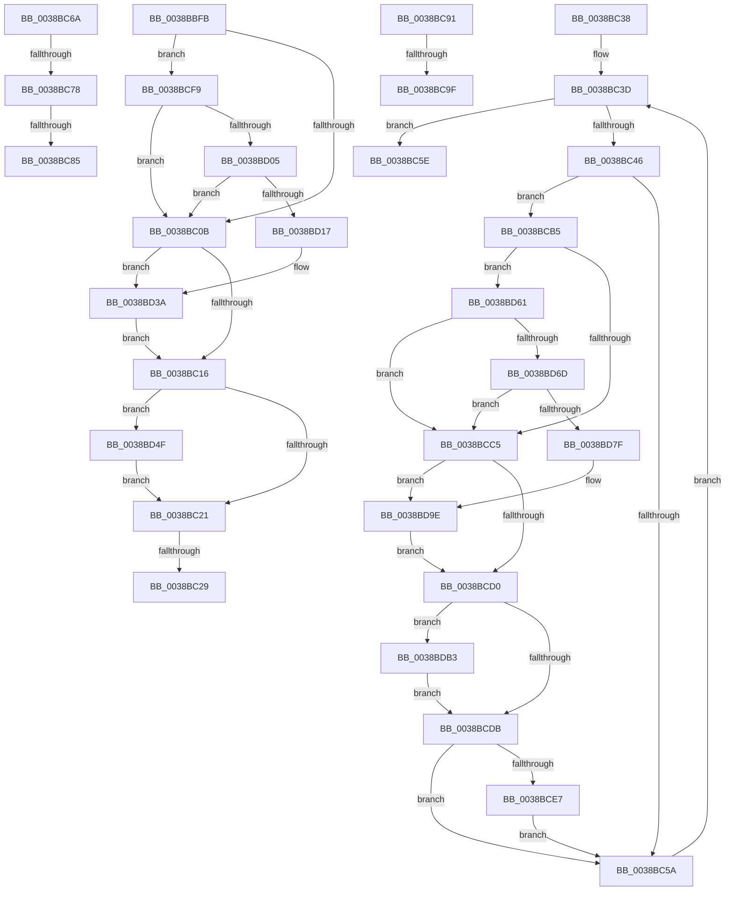

# sub_0038BBFB

- RVA: `0x0038BBFB`–`0x0038BDC5` (길이 `458` bytes)
- VA: `0x000000014038BBFB`
- 실행 섹션: `.text`
- PDB 이름 있음: `아니요`; PDB Function 태그: `아니요`
- unwind 정보 RVA: `0x000801A4`
- 디코드: `111`개 명령, `458/458` bytes 표시
- 미해석 바이트: `0` (있으면 어셈블리에 `.byte`로 보존)

> 이 문서는 커널 이미지의 기계어와 PDB 기호를 분석해 생성했습니다. 4번과 5번은 함수 원형과 자료형을 바이너리 사용 방식에서 추정한 C 해석이며 원본 소스 복구 결과는 아닙니다.

## 1. Dependencies

- 직접 호출 지점: **15**; 고유 호출 대상: **10**
- 직접 호출자로 확인된 함수: **0**
- RIP 상대 이미지 참조: **3**

### Outgoing calls
- `0x0038BBFE` → [ExpResourceEnforcesOwnershipTransfer](../41/ExpResourceEnforcesOwnershipTransfer_function_00411EB0.md) (function, `0x00411EB0`)
- `0x0038BC31` → [ObDereferenceObjectDeferDeleteWithTag](../26/ObDereferenceObjectDeferDeleteWithTag_function_00263EA0.md) (function, `0x00263EA0`)
- `0x0038BC4D` → [ExpOwnerEntryToThread](ExpOwnerEntryToThread_function_0038C030.md) (function, `0x0038C030`)
- `0x0038BC60` → [ExFreePoolWithTag](../../poolcode/B8/ExFreePoolWithTag_function_00B82870.md) (function, `0x00B82870`)
- `0x0038BC78` → [KiCheckVpBackingLongSpinWaitHypercall](../30/KiCheckVpBackingLongSpinWaitHypercall_function_0030F490.md) (function, `0x0030F490`)
- `0x0038BC87` → [HvlNotifyLongSpinWait](../30/HvlNotifyLongSpinWait_function_0030F460.md) (function, `0x0030F460`)
- `0x0038BCAB` → [ExpReleaseSpinLockExclusiveFromDpcLevelInstrumented](../2C/ExpReleaseSpinLockExclusiveFromDpcLevelInstrumented_function_002C0F44.md) (function, `0x002C0F44`)
- `0x0038BCB8` → [ExpResourceEnforcesOwnershipTransfer](../41/ExpResourceEnforcesOwnershipTransfer_function_00411EB0.md) (function, `0x00411EB0`)
- `0x0038BCEF` → [ObDereferenceObjectDeferDeleteWithTag](../26/ObDereferenceObjectDeferDeleteWithTag_function_00263EA0.md) (function, `0x00263EA0`)
- `0x0038BD34` → [KeBugCheckEx](../4F/KeBugCheckEx_function_004FD660.md) (function, `0x004FD660`)
- `0x0038BD45` → [PsBoostThreadIoEx](../39/PsBoostThreadIoEx_function_00392C00.md) (function, `0x00392C00`)
- `0x0038BD57` → [PsBoostThreadIoQoS](../21/PsBoostThreadIoQoS_function_0021EFC0.md) (function, `0x0021EFC0`)
- `0x0038BD98` → [KeBugCheckEx](../4F/KeBugCheckEx_function_004FD660.md) (function, `0x004FD660`)
- `0x0038BDA9` → [PsBoostThreadIoEx](../39/PsBoostThreadIoEx_function_00392C00.md) (function, `0x00392C00`)
- `0x0038BDBB` → [PsBoostThreadIoQoS](../21/PsBoostThreadIoQoS_function_0021EFC0.md) (function, `0x0021EFC0`)

### Direct callers
- 이 함수 시작 RVA로 연결되는 직접 call은 확인되지 않았습니다. 간접 호출은 완전히 역산할 수 없습니다.

### Static image references
- `0x0038BC6A` → RVA `0x00FC6AB8` (`ALMOSTRO`; read)
- `0x0038BC91` → RVA `0x00F0DE58` (`.data`; read)
- `0x0038BCA4` → RVA `0x00FCF0C0` (`CACHEALI`; read)

## 2. Other-region calls and transfers

- 다른 실행 섹션으로 향하는 call: **1**
  - `0x0038BC60` → [ExFreePoolWithTag](../../poolcode/B8/ExFreePoolWithTag_function_00B82870.md) (`.text` → `POOLCODE`)
- call이 아닌 외부 분기/꼬리 이동: **8**
  - `0x0038BC27` → [sub_0038BA93 + 0x12C](Unknown_function_0038BA93.md) (`tail-transfer`)
  - `0x0038BC36` → [sub_0038BA93 + 0x12C](Unknown_function_0038BA93.md) (`tail-transfer`)
  - `0x0038BC65` → [sub_0038BA93 + 0x135](Unknown_function_0038BA93.md) (`tail-transfer`)
  - `0x0038BC72` → [sub_0038BA93 + 0x8B](Unknown_function_0038BA93.md) (`tail-transfer`)
  - `0x0038BC7F` → [sub_0038BA93 + 0x8B](Unknown_function_0038BA93.md) (`tail-transfer`)
  - `0x0038BC8C` → [sub_0038BA93 + 0x8D](Unknown_function_0038BA93.md) (`tail-transfer`)
  - `0x0038BC99` → [sub_0038BA93 + 0xED](Unknown_function_0038BA93.md) (`tail-transfer`)
  - `0x0038BCB0` → [sub_0038BA93 + 0xF3](Unknown_function_0038BA93.md) (`tail-transfer`)

## 3. Assembly (complete function range)

```asm
0038BBFB  48 8B CB                        mov rcx, rbx
0038BBFE  E8 AD 62 08 00                  call 0x140411eb0
0038BC03  84 C0                           test al, al
0038BC05  0F 85 EE 00 00 00               jne 0x14038bcf9
0038BC0B  8B 43 38                        mov eax, dword ptr [rbx + 0x38]
0038BC0E  A8 01                           test al, 1
0038BC10  0F 85 24 01 00 00               jne 0x14038bd3a
0038BC16  8B 43 38                        mov eax, dword ptr [rbx + 0x38]
0038BC19  A8 04                           test al, 4
0038BC1B  0F 85 2E 01 00 00               jne 0x14038bd4f
0038BC21  8B 43 38                        mov eax, dword ptr [rbx + 0x38]
0038BC24  41 84 C6                        test r14b, al
0038BC27  74 96                           je 0x14038bbbf
0038BC29  BA 44 66 6C 74                  mov edx, 0x746c6644
0038BC2E  48 8B CF                        mov rcx, rdi
0038BC31  E8 6A 82 ED FF                  call 0x140263ea0
0038BC36  EB 87                           jmp 0x14038bbbf
0038BC38  BE 01 00 00 00                  mov esi, 1
0038BC3D  48 8B 4B 10                     mov rcx, qword ptr [rbx + 0x10]
0038BC41  3B 71 08                        cmp esi, dword ptr [rcx + 8]
0038BC44  73 18                           jae 0x14038bc5e
0038BC46  48 83 C7 10                     add rdi, 0x10
0038BC4A  48 8B CF                        mov rcx, rdi
0038BC4D  E8 DE 03 00 00                  call 0x14038c030
0038BC52  48 8B E8                        mov rbp, rax
0038BC55  48 85 C0                        test rax, rax
0038BC58  75 5B                           jne 0x14038bcb5
0038BC5A  FF C6                           inc esi
0038BC5C  EB DF                           jmp 0x14038bc3d
0038BC5E  33 D2                           xor edx, edx
0038BC60  E8 0B 6C 7F 00                  call 0x140b82870
0038BC65  E9 5E FF FF FF                  jmp 0x14038bbc8
0038BC6A  8B 05 48 AE C3 00               mov eax, dword ptr [rip + 0xc3ae48]
0038BC70  A8 40                           test al, 0x40
0038BC72  0F 84 A6 FE FF FF               je 0x14038bb1e
0038BC78  E8 13 38 F8 FF                  call 0x14030f490
0038BC7D  84 C0                           test al, al
0038BC7F  0F 84 99 FE FF FF               je 0x14038bb1e
0038BC85  8B CF                           mov ecx, edi
0038BC87  E8 D4 37 F8 FF                  call 0x14030f460
0038BC8C  E9 8F FE FF FF                  jmp 0x14038bb20
0038BC91  8B 05 C1 21 B8 00               mov eax, dword ptr [rip + 0xb821c1]
0038BC97  85 C0                           test eax, eax
0038BC99  0F 85 E1 FE FF FF               jne 0x14038bb80
0038BC9F  48 8B 54 24 48                  mov rdx, qword ptr [rsp + 0x48]
0038BCA4  48 8D 0D 15 34 C4 00            lea rcx, [rip + 0xc43415]
0038BCAB  E8 94 52 F3 FF                  call 0x1402c0f44
0038BCB0  E9 D1 FE FF FF                  jmp 0x14038bb86
0038BCB5  48 8B CB                        mov rcx, rbx
0038BCB8  E8 F3 61 08 00                  call 0x140411eb0
0038BCBD  84 C0                           test al, al
0038BCBF  0F 85 9C 00 00 00               jne 0x14038bd61
0038BCC5  8B 47 08                        mov eax, dword ptr [rdi + 8]
0038BCC8  A8 01                           test al, 1
0038BCCA  0F 85 CE 00 00 00               jne 0x14038bd9e
0038BCD0  8B 47 08                        mov eax, dword ptr [rdi + 8]
0038BCD3  A8 04                           test al, 4
0038BCD5  0F 85 D8 00 00 00               jne 0x14038bdb3
0038BCDB  8B 47 08                        mov eax, dword ptr [rdi + 8]
0038BCDE  41 84 C6                        test r14b, al
0038BCE1  0F 84 73 FF FF FF               je 0x14038bc5a
0038BCE7  BA 44 66 6C 74                  mov edx, 0x746c6644
0038BCEC  48 8B CD                        mov rcx, rbp
0038BCEF  E8 AC 81 ED FF                  call 0x140263ea0
0038BCF4  E9 61 FF FF FF                  jmp 0x14038bc5a
0038BCF9  8B 43 38                        mov eax, dword ptr [rbx + 0x38]
0038BCFC  41 84 C6                        test r14b, al
0038BCFF  0F 85 06 FF FF FF               jne 0x14038bc0b
0038BD05  65 48 8B 04 25 88 01 00 00      mov rax, qword ptr gs:[0x188]
0038BD0E  48 3B F8                        cmp rdi, rax
0038BD11  0F 84 F4 FE FF FF               je 0x14038bc0b
0038BD17  65 4C 8B 04 25 88 01 00 00      mov r8, qword ptr gs:[0x188]
0038BD20  4C 8B CF                        mov r9, rdi
0038BD23  48 8B D3                        mov rdx, rbx
0038BD26  48 C7 44 24 20 01 00 00 00      mov qword ptr [rsp + 0x20], 1
0038BD2F  B9 6E 01 00 00                  mov ecx, 0x16e
0038BD34  E8 27 19 17 00                  call 0x1404fd660
0038BD39  CC                              int3
0038BD3A  45 33 C9                        xor r9d, r9d
0038BD3D  45 33 C0                        xor r8d, r8d
0038BD40  B2 01                           mov dl, 1
0038BD42  48 8B CF                        mov rcx, rdi
0038BD45  E8 B6 6E 00 00                  call 0x140392c00
0038BD4A  E9 C7 FE FF FF                  jmp 0x14038bc16
0038BD4F  BA 01 00 00 00                  mov edx, 1
0038BD54  48 8B CF                        mov rcx, rdi
0038BD57  E8 64 32 E9 FF                  call 0x14021efc0
0038BD5C  E9 C0 FE FF FF                  jmp 0x14038bc21
0038BD61  8B 4F 08                        mov ecx, dword ptr [rdi + 8]
0038BD64  41 84 CE                        test r14b, cl
0038BD67  0F 85 58 FF FF FF               jne 0x14038bcc5
0038BD6D  65 48 8B 0C 25 88 01 00 00      mov rcx, qword ptr gs:[0x188]
0038BD76  48 3B E9                        cmp rbp, rcx
0038BD79  0F 84 46 FF FF FF               je 0x14038bcc5
0038BD7F  65 4C 8B 04 25 88 01 00 00      mov r8, qword ptr gs:[0x188]
0038BD88  4C 8B CD                        mov r9, rbp
0038BD8B  48 8B D3                        mov rdx, rbx
0038BD8E  4C 89 74 24 20                  mov qword ptr [rsp + 0x20], r14
0038BD93  B9 6E 01 00 00                  mov ecx, 0x16e
0038BD98  E8 C3 18 17 00                  call 0x1404fd660
0038BD9D  CC                              int3
0038BD9E  45 33 C9                        xor r9d, r9d
0038BDA1  45 33 C0                        xor r8d, r8d
0038BDA4  B2 01                           mov dl, 1
0038BDA6  48 8B CD                        mov rcx, rbp
0038BDA9  E8 52 6E 00 00                  call 0x140392c00
0038BDAE  E9 1D FF FF FF                  jmp 0x14038bcd0
0038BDB3  BA 01 00 00 00                  mov edx, 1
0038BDB8  48 8B CD                        mov rcx, rbp
0038BDBB  E8 00 32 E9 FF                  call 0x14021efc0
0038BDC0  E9 16 FF FF FF                  jmp 0x14038bcdb
```

## 4. C-style interpretation (structured pseudocode)

```c
__int64 __fastcall sub_0038BBFB(void)
{
    __int64 result;
    unsigned __int64 v_stack_p20;
    unsigned __int64 v_stack_p48;

    result = ExpResourceEnforcesOwnershipTransfer(v_rbx, a2, a3, a4);
    if ((unsigned __int8)(result) != 0) goto loc_0038BCF9;
loc_0038BC0B:
    if ((((unsigned __int8)((unsigned int)(*(unsigned int *)(v_rbx + 56)))) & (1)) != 0) goto loc_0038BD3A;
loc_0038BC16:
    if ((((unsigned __int8)((unsigned int)(*(unsigned int *)(v_rbx + 56)))) & (4)) != 0) goto loc_0038BD4F;
loc_0038BC21:
    result = ObDereferenceObjectDeferDeleteWithTag(v_rdi, (unsigned int)(0x746C6644ULL), a3, a4);
loc_0038BCF9:
    if ((((unsigned __int8)(v_r14)) & ((unsigned __int8)((unsigned int)(*(unsigned int *)(v_rbx + 56))))) != 0) goto loc_0038BC0B;
    if (v_rdi == (*(unsigned __int64 *)(gs_base + (0 + 392)))) goto loc_0038BC0B;
    v_stack_p20 = 1;
    result = KeBugCheckEx(366, v_rbx, *(unsigned __int64 *)(gs_base + (0 + 392)), v_rdi);
loc_0038BD3A:
    a4 = 0;
    a3 = 0;
    result = PsBoostThreadIoEx(v_rdi, 1, a3, a4);
    goto loc_0038BC16;
loc_0038BD4F:
    result = PsBoostThreadIoQoS(v_rdi, 1, a3, a4);
    goto loc_0038BC21;
}
```

## 5. (Beta) C Style

```c
void sub_0038BBFB(void)
{
    int64_t result;
    uint64_t v_stack_p20;
    uint64_t v_stack_p48;

    result = ExpResourceEnforcesOwnershipTransfer(local_rbx, a2, a3, a4);
    if ((uint8_t)(result) != 0) goto loc_0038BCF9;
loc_0038BC0B:
    if ((((uint8_t)((uint32_t)(*(uint32_t *)(local_rbx + 0x38)))) & (1)) != 0) goto loc_0038BD3A;
loc_0038BC16:
    if ((((uint8_t)((uint32_t)(*(uint32_t *)(local_rbx + 0x38)))) & (4)) != 0) goto loc_0038BD4F;
loc_0038BC21:
    result = ObDereferenceObjectDeferDeleteWithTag(local_rdi, (uint32_t)(0x746C6644ULL), a3, a4);
loc_0038BCF9:
    if ((((uint8_t)(local_r14)) & ((uint8_t)((uint32_t)(*(uint32_t *)(local_rbx + 0x38))))) != 0) goto loc_0038BC0B;
    if (local_rdi == (*(uint64_t *)(gs_base + (0 + 0x188)))) goto loc_0038BC0B;
    v_stack_p20 = 1;
    result = KeBugCheckEx(366, local_rbx, *(uint64_t *)(gs_base + (0 + 0x188)), local_rdi);
loc_0038BD3A:
    a4 = 0;
    a3 = 0;
    result = PsBoostThreadIoEx(local_rdi, 1, a3, a4);
    goto loc_0038BC16;
loc_0038BD4F:
    result = PsBoostThreadIoQoS(local_rdi, 1, a3, a4);
    goto loc_0038BC21;
}
```

## 6. Execution-region graph

[열기: 2D/3D 그래프와 함수 탐색 컨트롤 패널](../../../control-panel.html?section=text&rva=0x0038BBFB&view=graph)

- 2D 그래프는 위에서 아래로 흐르고, 3D 그래프는 빈 공간을 드래그해 회전합니다. Shift+드래그는 이동, 휠은 확대·축소, 함수 노드 선택은 대상 보고서 이동입니다.

### Static fallback


