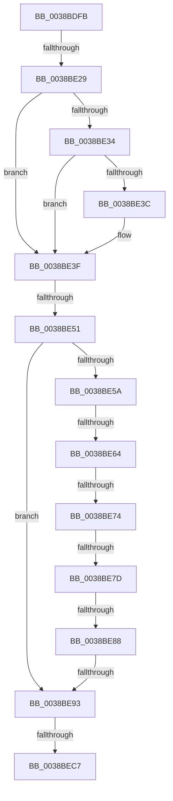

# sub_0038BDFB

- RVA: `0x0038BDFB`–`0x0038BEEE` (길이 `243` bytes)
- VA: `0x000000014038BDFB`
- 실행 섹션: `.text`
- PDB 이름 있음: `아니요`; PDB Function 태그: `아니요`
- unwind 정보 RVA: `0x000801CC`
- 디코드: `61`개 명령, `243/243` bytes 표시
- 미해석 바이트: `0` (있으면 어셈블리에 `.byte`로 보존)

> 이 문서는 커널 이미지의 기계어와 PDB 기호를 분석해 생성했습니다. 4번과 5번은 함수 원형과 자료형을 바이너리 사용 방식에서 추정한 C 해석이며 원본 소스 복구 결과는 아닙니다.

## 1. Dependencies

- 직접 호출 지점: **0**; 고유 호출 대상: **0**
- 직접 호출자로 확인된 함수: **0**
- RIP 상대 이미지 참조: **2**

### Outgoing calls
- 직접 디코드된 call 명령이 없습니다.

### Direct callers
- 이 함수 시작 RVA로 연결되는 직접 call은 확인되지 않았습니다. 간접 호출은 완전히 역산할 수 없습니다.

### Static image references
- `0x0038BE64` → RVA `0x00EFAC10` (`.data`; read)
- `0x0038BEB7` → RVA `0x00FC6B04` (`ALMOSTRO`; read)

## 2. Other-region calls and transfers

- 다른 실행 섹션으로 향하는 call: **0**
- call이 아닌 외부 분기/꼬리 이동: **8**
  - `0x0038BE23` → [sub_0038BEEF + 0xB](Unknown_function_0038BEEF.md) (`tail-transfer`)
  - `0x0038BE4B` → [sub_0038BEEF](Unknown_function_0038BEEF.md) (`tail-transfer`)
  - `0x0038BE5E` → [sub_0038BEEF + 0xAC](Unknown_function_0038BEEF.md) (`tail-transfer`)
  - `0x0038BE6E` → [sub_0038BEEF + 0xAC](Unknown_function_0038BEEF.md) (`tail-transfer`)
  - `0x0038BE77` → [sub_0038BEEF + 0xE9](Unknown_function_0038BEEF.md) (`tail-transfer`)
  - `0x0038BE82` → [sub_0038BEEF + 0xFE](Unknown_function_0038BEEF.md) (`tail-transfer`)
  - `0x0038BE8D` → [sub_0038BEEF + 0x110](Unknown_function_0038BEEF.md) (`tail-transfer`)
  - `0x0038BEC1` → [sub_0038BEEF + 0x122](Unknown_function_0038BEEF.md) (`tail-transfer`)

## 3. Assembly (complete function range)

```asm
0038BDFB  48 89 6C 24 60                  mov qword ptr [rsp + 0x60], rbp
0038BE00  48 89 74 24 70                  mov qword ptr [rsp + 0x70], rsi
0038BE05  48 8B 71 10                     mov rsi, qword ptr [rcx + 0x10]
0038BE09  4C 89 64 24 78                  mov qword ptr [rsp + 0x78], r12
0038BE0E  4C 89 6C 24 40                  mov qword ptr [rsp + 0x40], r13
0038BE13  4C 89 74 24 38                  mov qword ptr [rsp + 0x38], r14
0038BE18  4C 89 7C 24 30                  mov qword ptr [rsp + 0x30], r15
0038BE1D  44 8B FF                        mov r15d, edi
0038BE20  48 85 F6                        test rsi, rsi
0038BE23  0F 85 D1 00 00 00               jne 0x14038befa
0038BE29  8B EF                           mov ebp, edi
0038BE2B  48 8B 73 30                     mov rsi, qword ptr [rbx + 0x30]
0038BE2F  48 85 F6                        test rsi, rsi
0038BE32  74 0B                           je 0x14038be3f
0038BE34  FF C5                           inc ebp
0038BE36  40 F6 C6 03                     test sil, 3
0038BE3A  75 03                           jne 0x14038be3f
0038BE3C  41 FF C7                        inc r15d
0038BE3F  8B 53 38                        mov edx, dword ptr [rbx + 0x38]
0038BE42  4C 8D 73 38                     lea r14, [rbx + 0x38]
0038BE46  8B CA                           mov ecx, edx
0038BE48  83 E1 02                        and ecx, 2
0038BE4B  0F 84 9E 00 00 00               je 0x14038beef
0038BE51  48 83 E6 FC                     and rsi, 0xfffffffffffffffc
0038BE55  48 85 F6                        test rsi, rsi
0038BE58  74 39                           je 0x14038be93
0038BE5A  F6 43 1A 01                     test byte ptr [rbx + 0x1a], 1
0038BE5E  0F 85 37 01 00 00               jne 0x14038bf9b
0038BE64  39 3D A6 ED B6 00               cmp dword ptr [rip + 0xb6eda6], edi
0038BE6A  4C 8D 73 38                     lea r14, [rbx + 0x38]
0038BE6E  0F 85 27 01 00 00               jne 0x14038bf9b
0038BE74  F6 C2 01                        test dl, 1
0038BE77  0F 85 5B 01 00 00               jne 0x14038bfd8
0038BE7D  41 8B 06                        mov eax, dword ptr [r14]
0038BE80  A8 04                           test al, 4
0038BE82  0F 85 65 01 00 00               jne 0x14038bfed
0038BE88  41 8B 06                        mov eax, dword ptr [r14]
0038BE8B  A8 02                           test al, 2
0038BE8D  0F 85 6C 01 00 00               jne 0x14038bfff
0038BE93  89 7B 18                        mov dword ptr [rbx + 0x18], edi
0038BE96  33 C0                           xor eax, eax
0038BE98  48 89 7B 40                     mov qword ptr [rbx + 0x40], rdi
0038BE9C  0F 57 C0                        xorps xmm0, xmm0
0038BE9F  48 89 43 20                     mov qword ptr [rbx + 0x20], rax
0038BEA3  48 89 43 28                     mov qword ptr [rbx + 0x28], rax
0038BEA7  0F 11 43 30                     movups xmmword ptr [rbx + 0x30], xmm0
0038BEAB  48 89 7B 48                     mov qword ptr [rbx + 0x48], rdi
0038BEAF  65 FF 04 25 5C 90 00 00         inc dword ptr gs:[0x905c]
0038BEB7  F7 05 43 AC C3 00 00 00 02 00   test dword ptr [rip + 0xc3ac43], 0x20000
0038BEC1  0F 85 4A 01 00 00               jne 0x14038c011
0038BEC7  4C 8B 74 24 38                  mov r14, qword ptr [rsp + 0x38]
0038BECC  33 C0                           xor eax, eax
0038BECE  4C 8B 6C 24 40                  mov r13, qword ptr [rsp + 0x40]
0038BED3  4C 8B 64 24 78                  mov r12, qword ptr [rsp + 0x78]
0038BED8  48 8B 74 24 70                  mov rsi, qword ptr [rsp + 0x70]
0038BEDD  48 8B 6C 24 60                  mov rbp, qword ptr [rsp + 0x60]
0038BEE2  4C 8B 7C 24 30                  mov r15, qword ptr [rsp + 0x30]
0038BEE7  48 83 C4 48                     add rsp, 0x48
0038BEEB  5F                              pop rdi
0038BEEC  5B                              pop rbx
0038BEED  C3                              ret
```

## 4. C-style interpretation (structured pseudocode)

```c
__int64 __fastcall sub_0038BDFB(__int64 a1, __int64 a2, __int64 a3, __int64 a4, __int64 a5, __int64 a6, __int64 a7, __int64 a8, __int64 a9, __int64 a10, __int64 a11, __int64 a12, __int64 a13, __int64 a14, __int64 a15)
{
    __int64 result;
    __int64 v_r15;
    __int64 v_rbp;
    __int64 v_rsi;
    __int64 v_rsp;
    unsigned __int64 v_stack_p30;
    unsigned __int64 v_stack_p38;
    unsigned __int64 v_stack_p40;
    unsigned __int64 v_stack_p60;
    unsigned __int64 v_stack_p70;
    unsigned __int64 v_stack_p78;

    v_stack_p60 = v_rbp;
    v_stack_p70 = v_rsi;
    v_stack_p78 = v_r12;
    v_stack_p40 = v_r13;
    v_stack_p38 = v_r14;
    v_stack_p30 = v_r15;
    if (*(unsigned __int64 *)(v_rbx + 48) == 0) goto loc_0038BE3F;
    v_rbp = (unsigned int)(((unsigned int)((unsigned int)(v_rdi))) + 1);
    v_r15 = (unsigned int)((unsigned int)(v_rdi));
    if ((((unsigned __int8)(*(unsigned __int64 *)(v_rbx + 48))) & (3)) == 0) {
        v_r15 = (unsigned int)(((unsigned int)((unsigned int)(v_rdi))) + 1);
    }
    a1 = (unsigned int)(((unsigned int)((unsigned int)((unsigned int)(*(unsigned int *)(v_rbx + 56))))) & (2));
    v_rsi = (*(unsigned __int64 *)(v_rbx + 48)) & (-4);
    if (v_rsi == 0) goto loc_0038BE93;
loc_0038BE93:
    *(unsigned int *)(v_rbx + 24) = (unsigned int)(v_rdi);
    result = 0;
    *(unsigned __int64 *)(v_rbx + 64) = v_rdi;
    *(unsigned __int64 *)(v_rbx + 32) = 0;
    *(unsigned __int64 *)(v_rbx + 40) = 0;
    *(unsigned __int64 *)(v_rbx + 48) = v_xmm0;
    *(unsigned __int64 *)(v_rbx + 72) = v_rdi;
    result = 0;
    v_rsp = (v_rsp) + (72);
    return result;
}
```

## 5. (Beta) C Style

```c
int64_t sub_0038BDFB(void *Arg1, int64_t Arg2, int64_t Arg3, int64_t Arg4, uint64_t Arg5, int64_t Arg6, int64_t Arg7, int64_t Arg8, uint64_t Arg9, uint64_t Arg10, uint64_t Arg11, int64_t Arg12, uint64_t Arg13, int64_t Arg14, int64_t Arg15)
{
    uint8_t *arg1 = (uint8_t *)Arg1;

    int64_t result;
    int64_t local_r15;
    int64_t local_rbp;
    int64_t local_rsi;
    int64_t local_rsp;
    uint64_t v_stack_p30;
    uint64_t v_stack_p38;
    uint64_t v_stack_p40;
    uint64_t v_stack_p60;
    uint64_t v_stack_p70;
    uint64_t v_stack_p78;

    v_stack_p60 = local_rbp;
    v_stack_p70 = local_rsi;
    v_stack_p78 = local_r12;
    v_stack_p40 = local_r13;
    v_stack_p38 = local_r14;
    v_stack_p30 = local_r15;
    if (*(uint64_t *)(local_rbx + 0x30) == 0) goto loc_0038BE3F;
    local_rbp = (uint32_t)(((uint32_t)((uint32_t)(local_rdi))) + 1);
    local_r15 = (uint32_t)((uint32_t)(local_rdi));
    if ((((uint8_t)(*(uint64_t *)(local_rbx + 0x30))) & (3)) == 0) {
        local_r15 = (uint32_t)(((uint32_t)((uint32_t)(local_rdi))) + 1);
    }
    Arg1 = (uint32_t)(((uint32_t)((uint32_t)((uint32_t)(*(uint32_t *)(local_rbx + 0x38))))) & (2));
    local_rsi = (*(uint64_t *)(local_rbx + 0x30)) & (-4);
    if (local_rsi == 0) goto loc_0038BE93;
loc_0038BE93:
    *(uint32_t *)(local_rbx + 0x18) = (uint32_t)(local_rdi);
    result = 0;
    *(uint64_t *)(local_rbx + 0x40) = local_rdi;
    *(uint64_t *)(local_rbx + 0x20) = 0;
    *(uint64_t *)(local_rbx + 0x28) = 0;
    *(uint64_t *)(local_rbx + 0x30) = v_xmm0;
    *(uint64_t *)(local_rbx + 0x48) = local_rdi;
    result = 0;
    local_rsp = (local_rsp) + (72);
    return result;
}
```

### 관측된 메모리 오프셋

구조체 형식이 확인되지 않은 접근은 인자 기준의 오프셋으로만 기록했습니다.

| 기준 인자 | 오프셋 표현 | 폭 (bit) | 접근 |
|---|---:|---:|---|
| `Arg1` | `+ 0x10` | `64` | `R` |

## 6. Execution-region graph

[열기: 2D/3D 그래프와 함수 탐색 컨트롤 패널](../../../control-panel.html?section=text&rva=0x0038BDFB&view=graph)

- 2D 그래프는 위에서 아래로 흐르고, 3D 그래프는 빈 공간을 드래그해 회전합니다. Shift+드래그는 이동, 휠은 확대·축소, 함수 노드 선택은 대상 보고서 이동입니다.

### Static fallback


