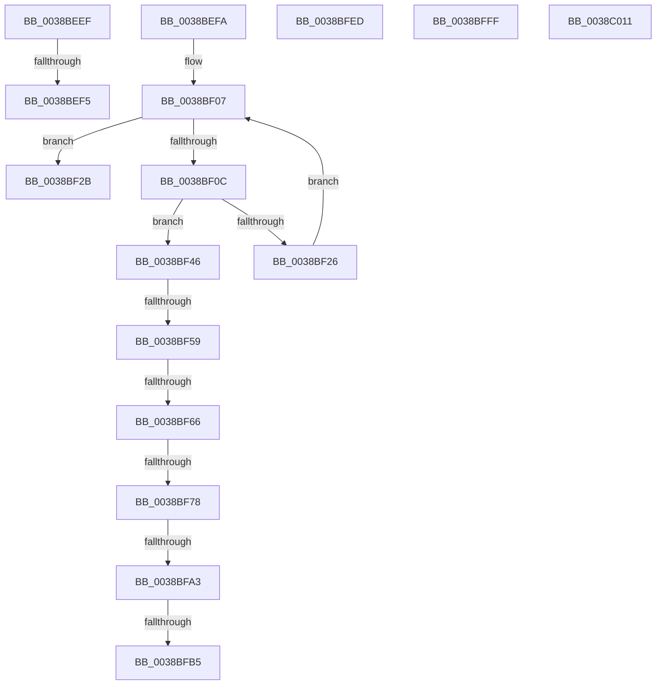

# sub_0038BEEF

- RVA: `0x0038BEEF`–`0x0038C029` (길이 `314` bytes)
- VA: `0x000000014038BEEF`
- 실행 섹션: `.text`
- PDB 이름 있음: `아니요`; PDB Function 태그: `아니요`
- unwind 정보 RVA: `0x00080208`
- 디코드: `74`개 명령, `314/314` bytes 표시
- 미해석 바이트: `0` (있으면 어셈블리에 `.byte`로 보존)

> 이 문서는 커널 이미지의 기계어와 PDB 기호를 분석해 생성했습니다. 4번과 5번은 함수 원형과 자료형을 바이너리 사용 방식에서 추정한 C 해석이며 원본 소스 복구 결과는 아닙니다.

## 1. Dependencies

- 직접 호출 지점: **9**; 고유 호출 대상: **8**
- 직접 호출자로 확인된 함수: **0**
- RIP 상대 이미지 참조: **0**

### Outgoing calls
- `0x0038BF14` → [ExpOwnerEntryToThread](ExpOwnerEntryToThread_function_0038C030.md) (function, `0x0038C030`)
- `0x0038BF3C` → [memset](../6C/memset_function_006C6C40.md) (function, `0x006C6C40`)
- `0x0038BF4C` → [ExpResourceEnforcesOwnershipTransfer](../41/ExpResourceEnforcesOwnershipTransfer_function_00411EB0.md) (function, `0x00411EB0`)
- `0x0038BF95` → [KeBugCheckEx](../4F/KeBugCheckEx_function_004FD660.md) (function, `0x004FD660`)
- `0x0038BFD2` → [KeBugCheckEx](../4F/KeBugCheckEx_function_004FD660.md) (function, `0x004FD660`)
- `0x0038BFE3` → [PsBoostThreadIoEx](../39/PsBoostThreadIoEx_function_00392C00.md) (function, `0x00392C00`)
- `0x0038BFF5` → [PsBoostThreadIoQoS](../21/PsBoostThreadIoQoS_function_0021EFC0.md) (function, `0x0021EFC0`)
- `0x0038C007` → [ObDereferenceObjectDeferDeleteWithTag](../26/ObDereferenceObjectDeferDeleteWithTag_function_00263EA0.md) (function, `0x00263EA0`)
- `0x0038C01F` → [PerfLogExecutiveResourceInitialize](../65/PerfLogExecutiveResourceInitialize_function_006525E8.md) (function, `0x006525E8`)

### Direct callers
- 이 함수 시작 RVA로 연결되는 직접 call은 확인되지 않았습니다. 간접 호출은 완전히 역산할 수 없습니다.

### Static image references
- 디코드된 RIP-relative 메모리 참조가 없습니다.

## 2. Other-region calls and transfers

- 다른 실행 섹션으로 향하는 call: **0**
- call이 아닌 외부 분기/꼬리 이동: **12**
  - `0x0038BEF3` → [sub_0038BDFB + 0x98](Unknown_function_0038BDFB.md) (`tail-transfer`)
  - `0x0038BEF5` → [sub_0038BDFB + 0x5A](Unknown_function_0038BDFB.md) (`tail-transfer`)
  - `0x0038BF41` → [sub_0038BDFB + 0x30](Unknown_function_0038BDFB.md) (`tail-transfer`)
  - `0x0038BF53` → [sub_006E5438](../6E/Unknown_function_006E5438.md) (`tail-transfer`)
  - `0x0038BF60` → [sub_006E5438](../6E/Unknown_function_006E5438.md) (`tail-transfer`)
  - `0x0038BF72` → [sub_006E5438](../6E/Unknown_function_006E5438.md) (`tail-transfer`)
  - `0x0038BF9D` → [sub_0038BDFB + 0x79](Unknown_function_0038BDFB.md) (`tail-transfer`)
  - `0x0038BFAF` → [sub_0038BDFB + 0x79](Unknown_function_0038BDFB.md) (`tail-transfer`)
  - `0x0038BFE8` → [sub_0038BDFB + 0x82](Unknown_function_0038BDFB.md) (`tail-transfer`)
  - `0x0038BFFA` → [sub_0038BDFB + 0x8D](Unknown_function_0038BDFB.md) (`tail-transfer`)
  - `0x0038C00C` → [sub_0038BDFB + 0x98](Unknown_function_0038BDFB.md) (`tail-transfer`)
  - `0x0038C024` → [sub_0038BDFB + 0xCC](Unknown_function_0038BDFB.md) (`tail-transfer`)

## 3. Assembly (complete function range)

```asm
0038BEEF  40 F6 C6 03                     test sil, 3
0038BEF3  75 9E                           jne 0x14038be93
0038BEF5  E9 5B FF FF FF                  jmp 0x14038be55
0038BEFA  8B 6E 08                        mov ebp, dword ptr [rsi + 8]
0038BEFD  4C 8D 6E 08                     lea r13, [rsi + 8]
0038BF01  41 BE 01 00 00 00               mov r14d, 1
0038BF07  44 3B F5                        cmp r14d, ebp
0038BF0A  73 1F                           jae 0x14038bf2b
0038BF0C  49 83 C5 10                     add r13, 0x10
0038BF10  49 8D 4D F8                     lea rcx, [r13 - 8]
0038BF14  E8 17 01 00 00                  call 0x14038c030
0038BF19  48 89 44 24 68                  mov qword ptr [rsp + 0x68], rax
0038BF1E  4C 8B D0                        mov r10, rax
0038BF21  48 85 C0                        test rax, rax
0038BF24  75 20                           jne 0x14038bf46
0038BF26  41 FF C6                        inc r14d
0038BF29  EB DC                           jmp 0x14038bf07
0038BF2B  44 8B 46 08                     mov r8d, dword ptr [rsi + 8]
0038BF2F  48 8D 4E 10                     lea rcx, [rsi + 0x10]
0038BF33  41 FF C8                        dec r8d
0038BF36  33 D2                           xor edx, edx
0038BF38  49 C1 E0 04                     shl r8, 4
0038BF3C  E8 FF AC 33 00                  call 0x1406c6c40
0038BF41  E9 E5 FE FF FF                  jmp 0x14038be2b
0038BF46  48 8B CB                        mov rcx, rbx
0038BF49  41 FF C7                        inc r15d
0038BF4C  E8 5F 5F 08 00                  call 0x140411eb0
0038BF51  84 C0                           test al, al
0038BF53  0F 84 DF 94 35 00               je 0x1406e5438
0038BF59  41 8B 4D 00                     mov ecx, dword ptr [r13]
0038BF5D  F6 C1 02                        test cl, 2
0038BF60  0F 85 D2 94 35 00               jne 0x1406e5438
0038BF66  65 48 8B 04 25 88 01 00 00      mov rax, qword ptr gs:[0x188]
0038BF6F  4C 3B D0                        cmp r10, rax
0038BF72  0F 84 C0 94 35 00               je 0x1406e5438
0038BF78  65 4C 8B 04 25 88 01 00 00      mov r8, qword ptr gs:[0x188]
0038BF81  4D 8B CA                        mov r9, r10
0038BF84  48 8B D3                        mov rdx, rbx
0038BF87  48 C7 44 24 20 03 00 00 00      mov qword ptr [rsp + 0x20], 3
0038BF90  B9 6E 01 00 00                  mov ecx, 0x16e
0038BF95  E8 C6 16 17 00                  call 0x1404fd660
0038BF9A  CC                              int3
0038BF9B  85 C9                           test ecx, ecx
0038BF9D  0F 85 D1 FE FF FF               jne 0x14038be74
0038BFA3  65 48 8B 04 25 88 01 00 00      mov rax, qword ptr gs:[0x188]
0038BFAC  48 3B F0                        cmp rsi, rax
0038BFAF  0F 84 BF FE FF FF               je 0x14038be74
0038BFB5  65 4C 8B 04 25 88 01 00 00      mov r8, qword ptr gs:[0x188]
0038BFBE  4C 8B CE                        mov r9, rsi
0038BFC1  48 8B D3                        mov rdx, rbx
0038BFC4  48 C7 44 24 20 04 00 00 00      mov qword ptr [rsp + 0x20], 4
0038BFCD  B9 6E 01 00 00                  mov ecx, 0x16e
0038BFD2  E8 89 16 17 00                  call 0x1404fd660
0038BFD7  CC                              int3
0038BFD8  45 33 C9                        xor r9d, r9d
0038BFDB  45 33 C0                        xor r8d, r8d
0038BFDE  B2 01                           mov dl, 1
0038BFE0  48 8B CE                        mov rcx, rsi
0038BFE3  E8 18 6C 00 00                  call 0x140392c00
0038BFE8  E9 90 FE FF FF                  jmp 0x14038be7d
0038BFED  BA 01 00 00 00                  mov edx, 1
0038BFF2  48 8B CE                        mov rcx, rsi
0038BFF5  E8 C6 2F E9 FF                  call 0x14021efc0
0038BFFA  E9 89 FE FF FF                  jmp 0x14038be88
0038BFFF  BA 44 66 6C 74                  mov edx, 0x746c6644
0038C004  48 8B CE                        mov rcx, rsi
0038C007  E8 94 7E ED FF                  call 0x140263ea0
0038C00C  E9 82 FE FF FF                  jmp 0x14038be93
0038C011  45 8B CF                        mov r9d, r15d
0038C014  44 8B C5                        mov r8d, ebp
0038C017  48 8B D3                        mov rdx, rbx
0038C01A  B9 18 00 01 00                  mov ecx, 0x10018
0038C01F  E8 C4 65 2C 00                  call 0x1406525e8
0038C024  E9 9E FE FF FF                  jmp 0x14038bec7
```

## 4. C-style interpretation (structured pseudocode)

```c
__int64 __fastcall sub_0038BEEF(__int64 a1, int a2)
{
    unsigned __int64 v_stack_p20;
    unsigned __int64 v_stack_p68;
}
```

## 5. (Beta) C Style

```c
int64_t sub_0038BEEF(int64_t Arg1, int32_t Arg2)
{
    uint64_t v_stack_p20;
    uint64_t v_stack_p68;
}
```

## 6. Execution-region graph

[열기: 2D/3D 그래프와 함수 탐색 컨트롤 패널](../../../control-panel.html?section=text&rva=0x0038BEEF&view=graph)

- 2D 그래프는 위에서 아래로 흐르고, 3D 그래프는 빈 공간을 드래그해 회전합니다. Shift+드래그는 이동, 휠은 확대·축소, 함수 노드 선택은 대상 보고서 이동입니다.

### Static fallback


