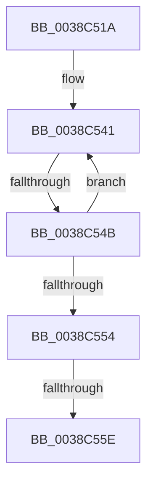

# sub_0038C51A

- RVA: `0x0038C51A`–`0x0038C58B` (길이 `113` bytes)
- VA: `0x000000014038C51A`
- 실행 섹션: `.text`
- PDB 이름 있음: `아니요`; PDB Function 태그: `아니요`
- unwind 정보 RVA: `0x000802A4`
- 디코드: `27`개 명령, `113/113` bytes 표시
- 미해석 바이트: `0` (있으면 어셈블리에 `.byte`로 보존)

> 이 문서는 커널 이미지의 기계어와 PDB 기호를 분석해 생성했습니다. 4번과 5번은 함수 원형과 자료형을 바이너리 사용 방식에서 추정한 C 해석이며 원본 소스 복구 결과는 아닙니다.

## 1. Dependencies

- 직접 호출 지점: **1**; 고유 호출 대상: **1**
- 직접 호출자로 확인된 함수: **0**
- RIP 상대 이미지 참조: **1**

### Outgoing calls
- `0x0038C563` → [ExFreePoolWithTag](../../poolcode/B8/ExFreePoolWithTag_function_00B82870.md) (function, `0x00B82870`)

### Direct callers
- 이 함수 시작 RVA로 연결되는 직접 call은 확인되지 않았습니다. 간접 호출은 완전히 역산할 수 없습니다.

### Static image references
- `0x0038C53A` → RVA `0x00000000` (`image boundary/outside`; read)

## 2. Other-region calls and transfers

- 다른 실행 섹션으로 향하는 call: **1**
  - `0x0038C563` → [ExFreePoolWithTag](../../poolcode/B8/ExFreePoolWithTag_function_00B82870.md) (`.text` → `POOLCODE`)
- call이 아닌 외부 분기/꼬리 이동: **3**
  - `0x0038C549` → [sub_0038C58B](Unknown_function_0038C58B.md) (`tail-transfer`)
  - `0x0038C558` → [sub_0038C58B + 0x336](Unknown_function_0038C58B.md) (`tail-transfer`)
  - `0x0038C586` → [IopDeleteFileObjectExtension + 0x16](IopDeleteFileObjectExtension_function_0038C4F0.md) (`tail-transfer`)

## 3. Assembly (complete function range)

```asm
0038C51A  48 89 5C 24 68                  mov qword ptr [rsp + 0x68], rbx
0038C51F  33 DB                           xor ebx, ebx
0038C521  48 89 7C 24 70                  mov qword ptr [rsp + 0x70], rdi
0038C526  4C 89 64 24 78                  mov qword ptr [rsp + 0x78], r12
0038C52B  4C 89 6C 24 40                  mov qword ptr [rsp + 0x40], r13
0038C530  4C 89 74 24 38                  mov qword ptr [rsp + 0x38], r14
0038C535  4C 89 7C 24 30                  mov qword ptr [rsp + 0x30], r15
0038C53A  4C 8D 3D BF 3A C7 FF            lea r15, [rip - 0x38c541]
0038C541  48 8B 7C DE 08                  mov rdi, qword ptr [rsi + rbx*8 + 8]
0038C546  48 85 FF                        test rdi, rdi
0038C549  75 40                           jne 0x14038c58b
0038C54B  48 FF C3                        inc rbx
0038C54E  48 83 FB 0A                     cmp rbx, 0xa
0038C552  7C ED                           jl 0x14038c541
0038C554  8B 06                           mov eax, dword ptr [rsi]
0038C556  A8 02                           test al, 2
0038C558  0F 85 63 03 00 00               jne 0x14038c8c1
0038C55E  33 D2                           xor edx, edx
0038C560  48 8B CE                        mov rcx, rsi
0038C563  E8 08 63 7F 00                  call 0x140b82870
0038C568  4C 8B 74 24 38                  mov r14, qword ptr [rsp + 0x38]
0038C56D  4C 8B 6C 24 40                  mov r13, qword ptr [rsp + 0x40]
0038C572  4C 8B 64 24 78                  mov r12, qword ptr [rsp + 0x78]
0038C577  48 8B 7C 24 70                  mov rdi, qword ptr [rsp + 0x70]
0038C57C  48 8B 5C 24 68                  mov rbx, qword ptr [rsp + 0x68]
0038C581  4C 8B 7C 24 30                  mov r15, qword ptr [rsp + 0x30]
0038C586  E9 7B FF FF FF                  jmp 0x14038c506
```

## 4. C-style interpretation (structured pseudocode)

```c
__int64 __fastcall sub_0038C51A(__int64 a1, int a2, __int64 a3, __int64 a4, __int64 a5, __int64 a6, __int64 a7, __int64 a8, __int64 a9, __int64 a10, __int64 a11, __int64 a12, __int64 a13, __int64 a14, __int64 a15)
{
    __int64 result;
    __int64 v_rbx;
    unsigned __int64 v_stack_p30;
    unsigned __int64 v_stack_p38;
    unsigned __int64 v_stack_p40;
    unsigned __int64 v_stack_p68;
    unsigned __int64 v_stack_p70;
    unsigned __int64 v_stack_p78;

    v_stack_p68 = v_rbx;
    v_rbx = 0;
    v_stack_p70 = v_rdi;
    v_stack_p78 = v_r12;
    v_stack_p40 = v_r13;
    v_stack_p38 = v_r14;
    v_stack_p30 = v_r15;
loc_0038C541:
    v_rbx = (v_rbx) + 1;
    if (v_rbx < 10) goto loc_0038C541;
    a2 = 0;
    result = ExFreePoolWithTag(v_rsi, a2, a3, a4);
}
```

## 5. (Beta) C Style

```c
int64_t sub_0038C51A(int64_t Arg1, int32_t Arg2, int64_t Arg3, int64_t Arg4, uint64_t Arg5, int64_t Arg6, int64_t Arg7, int64_t Arg8, uint64_t Arg9, uint64_t Arg10, uint64_t Arg11, uint64_t Arg12, int64_t Arg13, int64_t Arg14, int64_t Arg15)
{
    int64_t result;
    int64_t local_rbx;
    uint64_t v_stack_p30;
    uint64_t v_stack_p38;
    uint64_t v_stack_p40;
    uint64_t v_stack_p68;
    uint64_t v_stack_p70;
    uint64_t v_stack_p78;

    v_stack_p68 = local_rbx;
    local_rbx = 0;
    v_stack_p70 = local_rdi;
    v_stack_p78 = local_r12;
    v_stack_p40 = local_r13;
    v_stack_p38 = local_r14;
    v_stack_p30 = local_r15;
loc_0038C541:
    local_rbx = (local_rbx) + 1;
    if (local_rbx < 10) goto loc_0038C541;
    Arg2 = 0;
    result = ExFreePoolWithTag(local_rsi, Arg2, Arg3, Arg4);
}
```

## 6. Execution-region graph

[열기: 2D/3D 그래프와 함수 탐색 컨트롤 패널](../../../control-panel.html?section=text&rva=0x0038C51A&view=graph)

- 2D 그래프는 위에서 아래로 흐르고, 3D 그래프는 빈 공간을 드래그해 회전합니다. Shift+드래그는 이동, 휠은 확대·축소, 함수 노드 선택은 대상 보고서 이동입니다.

### Static fallback


