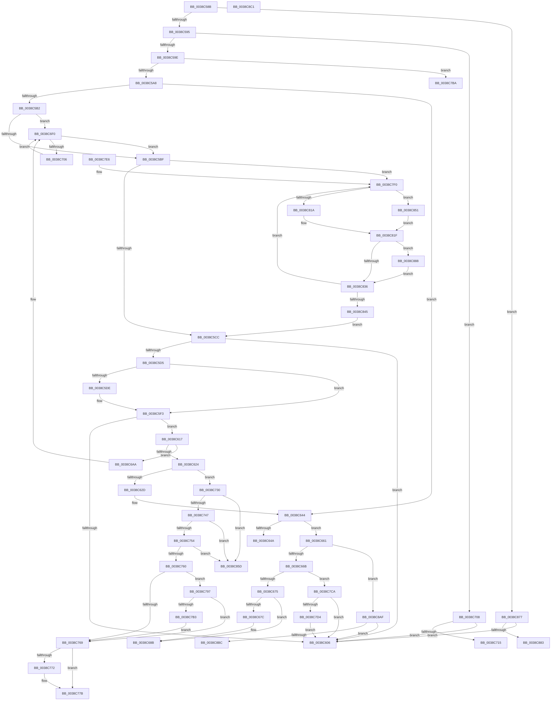

# sub_0038C58B

- RVA: `0x0038C58B`–`0x0038C8D6` (길이 `843` bytes)
- VA: `0x000000014038C58B`
- 실행 섹션: `.text`
- PDB 이름 있음: `아니요`; PDB Function 태그: `아니요`
- unwind 정보 RVA: `0x000802CC`
- 디코드: `198`개 명령, `843/843` bytes 표시
- 미해석 바이트: `0` (있으면 어셈블리에 `.byte`로 보존)

> 이 문서는 커널 이미지의 기계어와 PDB 기호를 분석해 생성했습니다. 4번과 5번은 함수 원형과 자료형을 바이너리 사용 방식에서 추정한 C 해석이며 원본 소스 복구 결과는 아닙니다.

## 1. Dependencies

- 직접 호출 지점: **27**; 고유 호출 대상: **17**
- 직접 호출자로 확인된 함수: **0**
- RIP 상대 이미지 참조: **5**

### Outgoing calls
- `0x0038C5EE` → [ObpPushStackInfo](../21/ObpPushStackInfo_function_002109E4.md) (function, `0x002109E4`)
- `0x0038C60D` → [ExFreePoolWithTag](../../poolcode/B8/ExFreePoolWithTag_function_00B82870.md) (function, `0x00B82870`)
- `0x0038C63E` → [KeBugCheckEx](../4F/KeBugCheckEx_function_004FD660.md) (function, `0x004FD660`)
- `0x0038C654` → [ExFreeToNPagedLookasideList](ExFreeToNPagedLookasideList_function_0038D9D0.md) (function, `0x0038D9D0`)
- `0x0038C686` → [PsReleaseSiloHardReference](PsReleaseSiloHardReference_function_0038DEA0.md) (function, `0x0038DEA0`)
- `0x0038C694` → [ObDereferenceObjectDeferDeleteWithTag](../26/ObDereferenceObjectDeferDeleteWithTag_function_00263EA0.md) (function, `0x00263EA0`)
- `0x0038C6A0` → [ExFreePoolWithTag](../../poolcode/B8/ExFreePoolWithTag_function_00B82870.md) (function, `0x00B82870`)
- `0x0038C6E1` → [KeBugCheckEx](../4F/KeBugCheckEx_function_004FD660.md) (function, `0x004FD660`)
- `0x0038C6F8` → [ExFreePoolWithTag](../../poolcode/B8/ExFreePoolWithTag_function_00B82870.md) (function, `0x00B82870`)
- `0x0038C71A` → [ObDereferenceObjectDeferDeleteWithTag](../26/ObDereferenceObjectDeferDeleteWithTag_function_00263EA0.md) (function, `0x00263EA0`)
- `0x0038C726` → [ExFreePoolWithTag](../../poolcode/B8/ExFreePoolWithTag_function_00B82870.md) (function, `0x00B82870`)
- `0x0038C747` → [KeAreInterruptsEnabled](../2F/KeAreInterruptsEnabled_function_002F8060.md) (function, `0x002F8060`)
- `0x0038C776` → [ObpDeregisterObject](../../page/9D/ObpDeregisterObject_function_009D7F78.md) (function, `0x009D7F78`)
- `0x0038C781` → [ObpRemoveObjectRoutine](../../page/86/ObpRemoveObjectRoutine_function_00864A60.md) (function, `0x00864A60`)
- `0x0038C78D` → [ExFreePoolWithTag](../../poolcode/B8/ExFreePoolWithTag_function_00B82870.md) (function, `0x00B82870`)
- `0x0038C7B3` → [ObpHandleRevocationBlockRemoveObject](../../page/9D/ObpHandleRevocationBlockRemoveObject_function_009D7E30.md) (function, `0x009D7E30`)
- `0x0038C7BD` → [FsRtlFreeExtraCreateParameter](../../page/8A/FsRtlFreeExtraCreateParameter_function_008A1760.md) (function, `0x008A1760`)
- `0x0038C7DC` → [ObfDereferenceObjectWithTag](../2F/ObfDereferenceObjectWithTag_function_002F78E0.md) (function, `0x002F78E0`)
- `0x0038C801` → [KeAcquireSpinLockRaiseToDpc](../20/KeAcquireSpinLockRaiseToDpc_function_00208470.md) (function, `0x00208470`)
- `0x0038C82A` → [KeReleaseSpinLock](../39/KeReleaseSpinLock_function_00392BA0.md) (function, `0x00392BA0`)
- `0x0038C83B` → [ExFreePoolWithTag](../../poolcode/B8/ExFreePoolWithTag_function_00B82870.md) (function, `0x00B82870`)
- `0x0038C856` → [ExFreePoolWithTag](../../poolcode/B8/ExFreePoolWithTag_function_00B82870.md) (function, `0x00B82870`)
- `0x0038C861` → [ObpDeferObjectDeletion](../3A/ObpDeferObjectDeletion_function_003A2394.md) (function, `0x003A2394`)
- `0x0038C86D` → [ExFreePoolWithTag](../../poolcode/B8/ExFreePoolWithTag_function_00B82870.md) (function, `0x00B82870`)
- `0x0038C89A` → [PspAdjustKeepAliveCountProcess](../../page/A7/PspAdjustKeepAliveCountProcess_function_00A7EE04.md) (function, `0x00A7EE04`)
- `0x0038C8A8` → [ObfDereferenceObjectWithTag](../2F/ObfDereferenceObjectWithTag_function_002F78E0.md) (function, `0x002F78E0`)
- `0x0038C8CC` → [IopCleanupNotifications](../4B/IopCleanupNotifications_function_004B044C.md) (function, `0x004B044C`)

### Direct callers
- 이 함수 시작 RVA로 연결되는 직접 call은 확인되지 않았습니다. 간접 호출은 완전히 역산할 수 없습니다.

### Static image references
- `0x0038C5D5` → RVA `0x00FC5010` (`ALMOSTRO`; read)
- `0x0038C64D` → RVA `0x00E12400` (`.data`; read)
- `0x0038C6CF` → RVA `0x00FC6E4C` (`ALMOSTRO`; read)
- `0x0038C7F4` → RVA `0x00F8D730` (`.data`; read)
- `0x0038C845` → RVA `0x00000000` (`image boundary/outside`; read)

## 2. Other-region calls and transfers

- 다른 실행 섹션으로 향하는 call: **13**
  - `0x0038C60D` → [ExFreePoolWithTag](../../poolcode/B8/ExFreePoolWithTag_function_00B82870.md) (`.text` → `POOLCODE`)
  - `0x0038C6A0` → [ExFreePoolWithTag](../../poolcode/B8/ExFreePoolWithTag_function_00B82870.md) (`.text` → `POOLCODE`)
  - `0x0038C6F8` → [ExFreePoolWithTag](../../poolcode/B8/ExFreePoolWithTag_function_00B82870.md) (`.text` → `POOLCODE`)
  - `0x0038C726` → [ExFreePoolWithTag](../../poolcode/B8/ExFreePoolWithTag_function_00B82870.md) (`.text` → `POOLCODE`)
  - `0x0038C776` → [ObpDeregisterObject](../../page/9D/ObpDeregisterObject_function_009D7F78.md) (`.text` → `PAGE`)
  - `0x0038C781` → [ObpRemoveObjectRoutine](../../page/86/ObpRemoveObjectRoutine_function_00864A60.md) (`.text` → `PAGE`)
  - `0x0038C78D` → [ExFreePoolWithTag](../../poolcode/B8/ExFreePoolWithTag_function_00B82870.md) (`.text` → `POOLCODE`)
  - `0x0038C7B3` → [ObpHandleRevocationBlockRemoveObject](../../page/9D/ObpHandleRevocationBlockRemoveObject_function_009D7E30.md) (`.text` → `PAGE`)
  - `0x0038C7BD` → [FsRtlFreeExtraCreateParameter](../../page/8A/FsRtlFreeExtraCreateParameter_function_008A1760.md) (`.text` → `PAGE`)
  - `0x0038C83B` → [ExFreePoolWithTag](../../poolcode/B8/ExFreePoolWithTag_function_00B82870.md) (`.text` → `POOLCODE`)
  - `0x0038C856` → [ExFreePoolWithTag](../../poolcode/B8/ExFreePoolWithTag_function_00B82870.md) (`.text` → `POOLCODE`)
  - `0x0038C86D` → [ExFreePoolWithTag](../../poolcode/B8/ExFreePoolWithTag_function_00B82870.md) (`.text` → `POOLCODE`)
  - `0x0038C89A` → [PspAdjustKeepAliveCountProcess](../../page/A7/PspAdjustKeepAliveCountProcess_function_00A7EE04.md) (`.text` → `PAGE`)
- call이 아닌 외부 분기/꼬리 이동: **10**
  - `0x0038C612` → [sub_0038C51A + 0x31](Unknown_function_0038C51A.md) (`tail-transfer`)
  - `0x0038C65C` → [sub_0038C51A + 0x27](Unknown_function_0038C51A.md) (`tail-transfer`)
  - `0x0038C6A5` → [sub_0038C51A + 0x31](Unknown_function_0038C51A.md) (`tail-transfer`)
  - `0x0038C72B` → [sub_0038C51A + 0x31](Unknown_function_0038C51A.md) (`tail-transfer`)
  - `0x0038C792` → [sub_0038C51A + 0x31](Unknown_function_0038C51A.md) (`tail-transfer`)
  - `0x0038C7C5` → [sub_0038C51A + 0x27](Unknown_function_0038C51A.md) (`tail-transfer`)
  - `0x0038C872` → [sub_0038C51A + 0x31](Unknown_function_0038C51A.md) (`tail-transfer`)
  - `0x0038C883` → [sub_006E548E](../6E/Unknown_function_006E548E.md) (`tail-transfer`)
  - `0x0038C8BC` → [sub_006E548E + 0x17](../6E/Unknown_function_006E548E.md) (`tail-transfer`)
  - `0x0038C8D1` → [sub_0038C51A + 0x44](Unknown_function_0038C51A.md) (`tail-transfer`)

## 3. Assembly (complete function range)

```asm
0038C58B  48 83 FB 04                     cmp rbx, 4
0038C58F  0F 84 E2 02 00 00               je 0x14038c877
0038C595  48 85 DB                        test rbx, rbx
0038C598  0F 84 6A 01 00 00               je 0x14038c708
0038C59E  48 83 FB 05                     cmp rbx, 5
0038C5A2  0F 84 12 02 00 00               je 0x14038c7ba
0038C5A8  48 83 FB 01                     cmp rbx, 1
0038C5AC  0F 85 92 00 00 00               jne 0x14038c644
0038C5B2  4C 8B 77 10                     mov r14, qword ptr [rdi + 0x10]
0038C5B6  4D 85 F6                        test r14, r14
0038C5B9  0F 85 31 01 00 00               jne 0x14038c6f0
0038C5BF  4C 8B 77 18                     mov r14, qword ptr [rdi + 0x18]
0038C5C3  4D 85 F6                        test r14, r14
0038C5C6  0F 85 24 02 00 00               jne 0x14038c7f0
0038C5CC  4C 8B 77 08                     mov r14, qword ptr [rdi + 8]
0038C5D0  4D 85 F6                        test r14, r14
0038C5D3  74 31                           je 0x14038c606
0038C5D5  83 3D 34 8A C3 00 00            cmp dword ptr [rip + 0xc38a34], 0
0038C5DC  74 15                           je 0x14038c5f3
0038C5DE  33 D2                           xor edx, edx
0038C5E0  49 8D 4E D0                     lea rcx, [r14 - 0x30]
0038C5E4  41 B9 44 66 6C 74               mov r9d, 0x746c6644
0038C5EA  44 8D 42 01                     lea r8d, [rdx + 1]
0038C5EE  E8 F1 43 E8 FF                  call 0x1402109e4
0038C5F3  48 C7 C0 FF FF FF FF            mov rax, 0xffffffffffffffff
0038C5FA  F0 49 0F C1 46 D0               lock xadd qword ptr [r14 - 0x30], rax
0038C600  48 83 E8 01                     sub rax, 1
0038C604  7E 11                           jle 0x14038c617
0038C606  48 8B 4C DE 08                  mov rcx, qword ptr [rsi + rbx*8 + 8]
0038C60B  33 D2                           xor edx, edx
0038C60D  E8 5E 62 7F 00                  call 0x140b82870
0038C612  E9 34 FF FF FF                  jmp 0x14038c54b
0038C617  49 8B 4E D8                     mov rcx, qword ptr [r14 - 0x28]
0038C61B  48 85 C9                        test rcx, rcx
0038C61E  0F 85 86 00 00 00               jne 0x14038c6aa
0038C624  48 85 C0                        test rax, rax
0038C627  0F 89 03 01 00 00               jns 0x14038c730
0038C62D  33 D2                           xor edx, edx
0038C62F  48 89 44 24 20                  mov qword ptr [rsp + 0x20], rax
0038C634  44 8D 49 02                     lea r9d, [rcx + 2]
0038C638  4D 8B C6                        mov r8, r14
0038C63B  8D 4A 18                        lea ecx, [rdx + 0x18]
0038C63E  E8 1D 10 17 00                  call 0x1404fd660
0038C643  CC                              int3
0038C644  48 83 FB 06                     cmp rbx, 6
0038C648  75 17                           jne 0x14038c661
0038C64A  48 8B D7                        mov rdx, rdi
0038C64D  48 8D 0D AC 5D A8 00            lea rcx, [rip + 0xa85dac]
0038C654  E8 77 13 00 00                  call 0x14038d9d0
0038C659  48 FF C3                        inc rbx
0038C65C  E9 E0 FE FF FF                  jmp 0x14038c541
0038C661  48 83 FB 02                     cmp rbx, 2
0038C665  0F 84 44 02 00 00               je 0x14038c8af
0038C66B  48 83 FB 07                     cmp rbx, 7
0038C66F  0F 85 55 01 00 00               jne 0x14038c7ca
0038C675  8B 47 04                        mov eax, dword ptr [rdi + 4]
0038C678  A8 01                           test al, 1
0038C67A  74 0F                           je 0x14038c68b
0038C67C  48 8B 4F 08                     mov rcx, qword ptr [rdi + 8]
0038C680  83 E0 FE                        and eax, 0xfffffffe
0038C683  89 47 04                        mov dword ptr [rdi + 4], eax
0038C686  E8 15 18 00 00                  call 0x14038dea0
0038C68B  48 8B 4F 08                     mov rcx, qword ptr [rdi + 8]
0038C68F  BA 49 6F 53 70                  mov edx, 0x70536f49
0038C694  E8 07 78 ED FF                  call 0x140263ea0
0038C699  48 8B 4C DE 08                  mov rcx, qword ptr [rsi + rbx*8 + 8]
0038C69E  33 D2                           xor edx, edx
0038C6A0  E8 CB 61 7F 00                  call 0x140b82870
0038C6A5  E9 A1 FE FF FF                  jmp 0x14038c54b
0038C6AA  41 B9 01 00 00 00               mov r9d, 1
0038C6B0  48 89 4C 24 20                  mov qword ptr [rsp + 0x20], rcx
0038C6B5  49 8D 46 D0                     lea rax, [r14 - 0x30]
0038C6B9  4D 8B C6                        mov r8, r14
0038C6BC  48 C1 E8 08                     shr rax, 8
0038C6C0  0F B6 D0                        movzx edx, al
0038C6C3  41 0F B6 46 E8                  movzx eax, byte ptr [r14 - 0x18]
0038C6C8  41 8D 49 17                     lea ecx, [r9 + 0x17]
0038C6CC  48 33 D0                        xor rdx, rax
0038C6CF  0F B6 05 76 A7 C3 00            movzx eax, byte ptr [rip + 0xc3a776]
0038C6D6  48 33 D0                        xor rdx, rax
0038C6D9  49 8B 94 D7 00 78 FC 00         mov rdx, qword ptr [r15 + rdx*8 + 0xfc7800]
0038C6E1  E8 7A 0F 17 00                  call 0x1404fd660
0038C6E6  CC                              int3
0038C6E7  66 0F 1F 84 00 00 00 00 00      nop word ptr [rax + rax]
0038C6F0  49 8B CE                        mov rcx, r14
0038C6F3  33 D2                           xor edx, edx
0038C6F5  4D 8B 36                        mov r14, qword ptr [r14]
0038C6F8  E8 73 61 7F 00                  call 0x140b82870
0038C6FD  4D 85 F6                        test r14, r14
0038C700  0F 84 B9 FE FF FF               je 0x14038c5bf
0038C706  EB E8                           jmp 0x14038c6f0
0038C708  48 8B 4F 08                     mov rcx, qword ptr [rdi + 8]
0038C70C  48 85 C9                        test rcx, rcx
0038C70F  0F 84 F1 FE FF FF               je 0x14038c606
0038C715  BA 44 66 6C 74                  mov edx, 0x746c6644
0038C71A  E8 81 77 ED FF                  call 0x140263ea0
0038C71F  48 8B 4C DE 08                  mov rcx, qword ptr [rsi + rbx*8 + 8]
0038C724  33 D2                           xor edx, edx
0038C726  E8 45 61 7F 00                  call 0x140b82870
0038C72B  E9 1B FE FF FF                  jmp 0x14038c54b
0038C730  65 48 8B 04 25 88 01 00 00      mov rax, qword ptr gs:[0x188]
0038C739  66 83 B8 E6 01 00 00 00         cmp word ptr [rax + 0x1e6], 0
0038C741  0F 85 16 01 00 00               jne 0x14038c85d
0038C747  E8 14 B9 F6 FF                  call 0x1402f8060
0038C74C  84 C0                           test al, al
0038C74E  0F 84 09 01 00 00               je 0x14038c85d
0038C754  44 0F 20 C0                     mov rax, cr8
0038C758  3C 01                           cmp al, 1
0038C75A  0F 83 FD 00 00 00               jae 0x14038c85d
0038C760  41 0F B6 46 EA                  movzx eax, byte ptr [r14 - 0x16]
0038C765  A8 40                           test al, 0x40
0038C767  75 2E                           jne 0x14038c797
0038C769  83 3D A0 88 C3 00 00            cmp dword ptr [rip + 0xc388a0], 0
0038C770  74 09                           je 0x14038c77b
0038C772  49 8D 4E D0                     lea rcx, [r14 - 0x30]
0038C776  E8 FD B7 64 00                  call 0x1409d7f78
0038C77B  33 D2                           xor edx, edx
0038C77D  49 8D 4E D0                     lea rcx, [r14 - 0x30]
0038C781  E8 DA 82 4D 00                  call 0x140864a60
0038C786  48 8B 4C DE 08                  mov rcx, qword ptr [rsi + rbx*8 + 8]
0038C78B  33 D2                           xor edx, edx
0038C78D  E8 DE 60 7F 00                  call 0x140b82870
0038C792  E9 B4 FD FF FF                  jmp 0x14038c54b
0038C797  83 E0 7F                        and eax, 0x7f
0038C79A  49 8D 4E D0                     lea rcx, [r14 - 0x30]
0038C79E  42 0F B6 84 38 80 FF F0 00      movzx eax, byte ptr [rax + r15 + 0xf0ff80]
0038C7A7  48 2B C8                        sub rcx, rax
0038C7AA  48 8B 09                        mov rcx, qword ptr [rcx]
0038C7AD  80 79 18 00                     cmp byte ptr [rcx + 0x18], 0
0038C7B1  74 B6                           je 0x14038c769
0038C7B3  E8 78 B6 64 00                  call 0x1409d7e30
0038C7B8  EB AF                           jmp 0x14038c769
0038C7BA  48 8B CF                        mov rcx, rdi
0038C7BD  E8 9E 4F 51 00                  call 0x1408a1760
0038C7C2  48 FF C3                        inc rbx
0038C7C5  E9 77 FD FF FF                  jmp 0x14038c541
0038C7CA  48 83 FB 08                     cmp rbx, 8
0038C7CE  0F 85 32 FE FF FF               jne 0x14038c606
0038C7D4  48 8B 0F                        mov rcx, qword ptr [rdi]
0038C7D7  BA 49 6F 46 6F                  mov edx, 0x6f466f49
0038C7DC  E8 FF B0 F6 FF                  call 0x1402f78e0
0038C7E1  E9 20 FE FF FF                  jmp 0x14038c606
0038C7E6  66 66 0F 1F 84 00 00 00 00 00   nop word ptr [rax + rax]
0038C7F0  4D 8B 7E 18                     mov r15, qword ptr [r14 + 0x18]
0038C7F4  48 8D 0D 35 0F C0 00            lea rcx, [rip + 0xc00f35]
0038C7FB  4D 8B EE                        mov r13, r14
0038C7FE  4D 8B 36                        mov r14, qword ptr [r14]
0038C801  E8 6A BC E7 FF                  call 0x140208470
0038C806  41 80 7F 10 01                  cmp byte ptr [r15 + 0x10], 1
0038C80B  44 0F B6 E0                     movzx r12d, al
0038C80F  41 0F B6 47 12                  movzx eax, byte ptr [r15 + 0x12]
0038C814  88 44 24 60                     mov byte ptr [rsp + 0x60], al
0038C818  75 37                           jne 0x14038c851
0038C81A  41 C6 47 11 01                  mov byte ptr [r15 + 0x11], 1
0038C81F  41 0F B6 D4                     movzx edx, r12b
0038C823  48 8D 0D 06 0F C0 00            lea rcx, [rip + 0xc00f06]
0038C82A  E8 71 63 00 00                  call 0x140392ba0
0038C82F  41 83 7D 10 00                  cmp dword ptr [r13 + 0x10], 0
0038C834  75 52                           jne 0x14038c888
0038C836  33 D2                           xor edx, edx
0038C838  49 8B CD                        mov rcx, r13
0038C83B  E8 30 60 7F 00                  call 0x140b82870
0038C840  4D 85 F6                        test r14, r14
0038C843  75 AB                           jne 0x14038c7f0
0038C845  4C 8D 3D B4 37 C7 FF            lea r15, [rip - 0x38c84c]
0038C84C  E9 7B FD FF FF                  jmp 0x14038c5cc
0038C851  33 D2                           xor edx, edx
0038C853  49 8B CF                        mov rcx, r15
0038C856  E8 15 60 7F 00                  call 0x140b82870
0038C85B  EB C2                           jmp 0x14038c81f
0038C85D  49 8D 4E D0                     lea rcx, [r14 - 0x30]
0038C861  E8 2E 5B 01 00                  call 0x1403a2394
0038C866  48 8B 4C DE 08                  mov rcx, qword ptr [rsi + rbx*8 + 8]
0038C86B  33 D2                           xor edx, edx
0038C86D  E8 FE 5F 7F 00                  call 0x140b82870
0038C872  E9 D4 FC FF FF                  jmp 0x14038c54b
0038C877  4C 8B 37                        mov r14, qword ptr [rdi]
0038C87A  4C 3B F7                        cmp r14, rdi
0038C87D  0F 84 83 FD FF FF               je 0x14038c606
0038C883  E9 06 8C 35 00                  jmp 0x1406e548e
0038C888  44 0F B6 4C 24 60               movzx r9d, byte ptr [rsp + 0x60]
0038C88E  4C 8B C5                        mov r8, rbp
0038C891  49 8B 4D 08                     mov rcx, qword ptr [r13 + 8]
0038C895  BA FF FF FF FF                  mov edx, 0xffffffff
0038C89A  E8 65 25 6F 00                  call 0x140a7ee04
0038C89F  49 8B 4D 08                     mov rcx, qword ptr [r13 + 8]
0038C8A3  BA 44 66 6C 74                  mov edx, 0x746c6644
0038C8A8  E8 33 B0 F6 FF                  call 0x1402f78e0
0038C8AD  EB 87                           jmp 0x14038c836
0038C8AF  48 8B 4F 28                     mov rcx, qword ptr [rdi + 0x28]
0038C8B3  48 85 C9                        test rcx, rcx
0038C8B6  0F 84 4A FD FF FF               je 0x14038c606
0038C8BC  E9 E4 8B 35 00                  jmp 0x1406e54a5
0038C8C1  48 8B 4D 08                     mov rcx, qword ptr [rbp + 8]
0038C8C5  48 8B D5                        mov rdx, rbp
0038C8C8  48 8B 49 08                     mov rcx, qword ptr [rcx + 8]
0038C8CC  E8 7B 3B 12 00                  call 0x1404b044c
0038C8D1  E9 88 FC FF FF                  jmp 0x14038c55e
```

## 4. C-style interpretation (structured pseudocode)

```c
__int64 __fastcall sub_0038C58B(__int64 a1, int a2, __int64 a3, __int64 a4, __int64 a5, __int64 a6, __int64 a7, __int64 a8, __int64 a9, __int64 a10, __int64 a11, unsigned __int8 a12)
{
    __int64 result;
    __int64 v_rbx;
    unsigned __int64 v_stack_p20;
    unsigned __int8 v_stack_p60;

    if (v_rbx == 4) goto loc_0038C877;
    if (v_rbx == 0) goto loc_0038C708;
    if (v_rbx == 5) goto loc_0038C7BA;
    if (v_rbx != 1) goto loc_0038C644;
    if (*(unsigned __int64 *)(v_rdi + 16) != 0) goto loc_0038C6F0;
loc_0038C5BF:
    if (*(unsigned __int64 *)(v_rdi + 24) != 0) goto loc_0038C7F0;
loc_0038C5CC:
    if (*(unsigned __int64 *)(v_rdi + 8) == 0) goto loc_0038C606;
    if ((*(unsigned int *)(v_rip + 12814900)) != 0) {
        a2 = 0;
        a1 = *(unsigned __int64 *)(v_rdi + 8) - 48;
        a4 = 0x746C6644ULL;
        a3 = a2 + 1;
        result = ObpPushStackInfo(a1, a2, a3, a4);
    }
    result = (-1) - (1);
    if (condition_is_less_or_equal) goto loc_0038C617;
loc_0038C606:
    a2 = 0;
    result = ExFreePoolWithTag(*(unsigned __int64 *)(v_rsi + v_rbx * 8 + 8), a2, a3, a4);
loc_0038C617:
    if (*(unsigned __int64 *)(*(unsigned __int64 *)(v_rdi + 8) - 40) != 0) goto loc_0038C6AA;
    if (!sign_flag) goto loc_0038C730;
    a2 = 0;
    v_stack_p20 = result;
    result = KeBugCheckEx(a2 + 24, a2, *(unsigned __int64 *)(v_rdi + 8), *(unsigned __int64 *)(*(unsigned __int64 *)(v_rdi + 8) - 40) + 2);
loc_0038C644:
    if (v_rbx != 6) goto loc_0038C661;
    result = ExFreeToNPagedLookasideList(v_rip + 11034028, v_rdi, *(unsigned __int64 *)(v_rdi + 8), *(unsigned __int64 *)(*(unsigned __int64 *)(v_rdi + 8) - 40) + 2);
    v_rbx = (v_rbx) + 1;
loc_0038C661:
    if (v_rbx == 2) goto loc_0038C8AF;
    if (v_rbx != 7) goto loc_0038C7CA;
    result = (unsigned int)(*(unsigned int *)(v_rdi + 4));
    if ((((unsigned __int8)((unsigned int)(*(unsigned int *)(v_rdi + 4)))) & (1)) != 0) {
        a1 = *(unsigned __int64 *)(v_rdi + 8);
        result = (unsigned int)(((unsigned int)(*(unsigned int *)(v_rdi + 4))) & (0xFFFFFFFEULL));
        *(unsigned int *)(v_rdi + 4) = (unsigned int)(result);
        result = PsReleaseSiloHardReference(a1, v_rdi, *(unsigned __int64 *)(v_rdi + 8), *(unsigned __int64 *)(*(unsigned __int64 *)(v_rdi + 8) - 40) + 2);
    }
    result = ObDereferenceObjectDeferDeleteWithTag(*(unsigned __int64 *)(v_rdi + 8), (unsigned int)(0x70536F49ULL), *(unsigned __int64 *)(v_rdi + 8), *(unsigned __int64 *)(*(unsigned __int64 *)(v_rdi + 8) - 40) + 2);
    a2 = 0;
    result = ExFreePoolWithTag(*(unsigned __int64 *)(v_rsi + v_rbx * 8 + 8), a2, *(unsigned __int64 *)(v_rdi + 8), *(unsigned __int64 *)(*(unsigned __int64 *)(v_rdi + 8) - 40) + 2);
loc_0038C6AA:
    v_stack_p20 = *(unsigned __int64 *)(v_rsi + v_rbx * 8 + 8);
    result = (*(unsigned __int64 *)(v_rdi + 8) - 48) >> (8);
    a2 = ((unsigned __int8)(result)) ^ (*(unsigned __int8 *)(*(unsigned __int64 *)(v_rdi + 8) - 24));
    a2 = (a2) ^ (*(unsigned __int8 *)(v_rip + 12822390));
    result = KeBugCheckEx(1 + 23, *(unsigned __int64 *)(v_r15 + a2 * 8 + 16545792), *(unsigned __int64 *)(v_rdi + 8), 1);
loc_0038C6F0:
    a2 = 0;
    result = ExFreePoolWithTag(*(unsigned __int64 *)(v_rdi + 8), a2, *(unsigned __int64 *)(v_rdi + 8), 1);
    if (*(unsigned __int64 *)(*(unsigned __int64 *)(v_rdi + 8)) == 0) goto loc_0038C5BF;
    goto loc_0038C6F0;
loc_0038C708:
    if (*(unsigned __int64 *)(v_rdi + 8) == 0) goto loc_0038C606;
    result = ObDereferenceObjectDeferDeleteWithTag(*(unsigned __int64 *)(v_rdi + 8), (unsigned int)(0x746C6644ULL), *(unsigned __int64 *)(v_rdi + 8), 1);
    a2 = 0;
    result = ExFreePoolWithTag(*(unsigned __int64 *)(v_rsi + v_rbx * 8 + 8), a2, *(unsigned __int64 *)(v_rdi + 8), 1);
loc_0038C730:
    if ((*(unsigned __int16 *)(*(unsigned __int64 *)(gs_base + (0 + 392)) + 486)) != 0) goto loc_0038C85D;
    result = KeAreInterruptsEnabled(*(unsigned __int64 *)(v_rsi + v_rbx * 8 + 8), a2, *(unsigned __int64 *)(v_rdi + 8), 1);
    if ((unsigned __int8)(result) == 0) goto loc_0038C85D;
    if (((unsigned __int8)(v_cr8)) >= 1) goto loc_0038C85D;
    if ((((unsigned __int8)(*(unsigned __int8 *)(*(unsigned __int64 *)(*(unsigned __int64 *)(v_rdi + 8)) - 22))) & (64)) != 0) goto loc_0038C797;
loc_0038C769:
    result = *(unsigned __int8 *)(*(unsigned __int64 *)(*(unsigned __int64 *)(v_rdi + 8)) - 22);
    if ((*(unsigned int *)(v_rip + 12814496)) != 0) {
        a1 = *(unsigned __int64 *)(*(unsigned __int64 *)(v_rdi + 8)) - 48;
        result = ObpDeregisterObject(a1, a2, *(unsigned __int64 *)(v_rdi + 8), 1);
    }
    a2 = 0;
    result = ObpRemoveObjectRoutine(*(unsigned __int64 *)(*(unsigned __int64 *)(v_rdi + 8)) - 48, a2, *(unsigned __int64 *)(v_rdi + 8), 1);
    a2 = 0;
    result = ExFreePoolWithTag(*(unsigned __int64 *)(v_rsi + v_rbx * 8 + 8), a2, *(unsigned __int64 *)(v_rdi + 8), 1);
loc_0038C797:
    result = (unsigned int)((result) & (127));
    a1 = (*(unsigned __int64 *)(*(unsigned __int64 *)(v_rdi + 8)) - 48) - (*(unsigned __int8 *)(result + v_r15 * 1 + 15794048));
    if ((*(unsigned __int8 *)(*(unsigned __int64 *)(a1) + 24)) == 0) goto loc_0038C769;
    result = ObpHandleRevocationBlockRemoveObject(*(unsigned __int64 *)(a1), a2, *(unsigned __int64 *)(v_rdi + 8), 1);
    goto loc_0038C769;
loc_0038C7BA:
    result = FsRtlFreeExtraCreateParameter(v_rdi, a2, *(unsigned __int64 *)(v_rdi + 8), 1);
    v_rbx = (v_rbx) + 1;
loc_0038C7CA:
    if (v_rbx != 8) goto loc_0038C606;
    result = ObfDereferenceObjectWithTag(*(unsigned __int64 *)(v_rdi), (unsigned int)(0x6F466F49ULL), *(unsigned __int64 *)(v_rdi + 8), 1);
    goto loc_0038C606;
loc_0038C7F0:
    result = KeAcquireSpinLockRaiseToDpc(v_rip + 12586805, (unsigned int)(0x6F466F49ULL), *(unsigned __int64 *)(v_rdi + 8), 1);
    v_stack_p60 = (unsigned __int8)(*(unsigned __int8 *)(*(unsigned __int64 *)(*(unsigned __int64 *)(*(unsigned __int64 *)(v_rdi + 8)) + 24) + 18));
    if ((*(unsigned __int8 *)(*(unsigned __int64 *)(*(unsigned __int64 *)(*(unsigned __int64 *)(v_rdi + 8)) + 24) + 16)) != 1) goto loc_0038C851;
    *(unsigned __int8 *)(*(unsigned __int64 *)(*(unsigned __int64 *)(*(unsigned __int64 *)(v_rdi + 8)) + 24) + 17) = 1;
loc_0038C81F:
    result = KeReleaseSpinLock(v_rip + 12586758, (unsigned __int8)((unsigned __int8)(result)), *(unsigned __int64 *)(v_rdi + 8), 1);
    if ((*(unsigned int *)(*(unsigned __int64 *)(*(unsigned __int64 *)(v_rdi + 8)) + 16)) != 0) goto loc_0038C888;
loc_0038C836:
    a2 = 0;
    result = ExFreePoolWithTag(*(unsigned __int64 *)(*(unsigned __int64 *)(v_rdi + 8)), a2, *(unsigned __int64 *)(v_rdi + 8), 1);
    if (*(unsigned __int64 *)(*(unsigned __int64 *)(*(unsigned __int64 *)(v_rdi + 8))) != 0) goto loc_0038C7F0;
    goto loc_0038C5CC;
loc_0038C851:
    a2 = 0;
    result = ExFreePoolWithTag(v_rip - 3721292, a2, *(unsigned __int64 *)(v_rdi + 8), 1);
    goto loc_0038C81F;
loc_0038C85D:
    result = ObpDeferObjectDeletion(*(unsigned __int64 *)(*(unsigned __int64 *)(*(unsigned __int64 *)(v_rdi + 8))) - 48, a2, *(unsigned __int64 *)(v_rdi + 8), 1);
    a2 = 0;
    result = ExFreePoolWithTag(*(unsigned __int64 *)(v_rsi + v_rbx * 8 + 8), a2, *(unsigned __int64 *)(v_rdi + 8), 1);
loc_0038C877:
    if ((*(unsigned __int64 *)(v_rdi)) == v_rdi) goto loc_0038C606;
loc_0038C888:
    result = PspAdjustKeepAliveCountProcess(*(unsigned __int64 *)(*(unsigned __int64 *)(*(unsigned __int64 *)(v_rdi + 8)) + 8), (unsigned int)(0xFFFFFFFFULL), v_rbp, a12);
    result = ObfDereferenceObjectWithTag(*(unsigned __int64 *)(*(unsigned __int64 *)(*(unsigned __int64 *)(v_rdi + 8)) + 8), (unsigned int)(0x746C6644ULL), v_rbp, a12);
    goto loc_0038C836;
loc_0038C8AF:
    if (*(unsigned __int64 *)(v_rdi + 40) == 0) goto loc_0038C606;
}
```

## 5. (Beta) C Style

```c
int64_t sub_0038C58B(int64_t Arg1, int32_t Arg2, int64_t Arg3, int64_t Arg4, uint64_t Arg5, uint64_t Arg6, uint64_t Arg7, uint64_t Arg8, uint64_t Arg9, uint64_t Arg10, uint64_t Arg11, uint8_t Arg12)
{
    int64_t result;
    int64_t local_rbx;
    uint64_t v_stack_p20;
    uint8_t v_stack_p60;

    if (local_rbx == 4) goto loc_0038C877;
    if (local_rbx == 0) goto loc_0038C708;
    if (local_rbx == 5) goto loc_0038C7BA;
    if (local_rbx != 1) goto loc_0038C644;
    if (*(uint64_t *)(local_rdi + 0x10) != 0) goto loc_0038C6F0;
loc_0038C5BF:
    if (*(uint64_t *)(local_rdi + 0x18) != 0) goto loc_0038C7F0;
loc_0038C5CC:
    if (*(uint64_t *)(local_rdi + 0x8) == 0) goto loc_0038C606;
    if ((*(uint32_t *)(v_rip + 0xC38A34)) != 0) {
        Arg2 = 0;
        Arg1 = *(uint64_t *)(local_rdi + 0x8) - 48;
        Arg4 = 0x746C6644ULL;
        Arg3 = Arg2 + 1;
        result = ObpPushStackInfo(Arg1, Arg2, Arg3, Arg4);
    }
    result = (-1) - (1);
    if (condition_is_less_or_equal) goto loc_0038C617;
loc_0038C606:
    Arg2 = 0;
    result = ExFreePoolWithTag(*(uint64_t *)(local_rsi + local_rbx * 8 + 0x8), Arg2, Arg3, Arg4);
loc_0038C617:
    if (*(uint64_t *)(*(uint64_t *)(local_rdi + 0x8) - 0x28) != 0) goto loc_0038C6AA;
    if (!sign_flag) goto loc_0038C730;
    Arg2 = 0;
    v_stack_p20 = result;
    result = KeBugCheckEx(Arg2 + 24, Arg2, *(uint64_t *)(local_rdi + 0x8), *(uint64_t *)(*(uint64_t *)(local_rdi + 0x8) - 0x28) + 2);
loc_0038C644:
    if (local_rbx != 6) goto loc_0038C661;
    result = ExFreeToNPagedLookasideList(v_rip + 11034028, local_rdi, *(uint64_t *)(local_rdi + 0x8), *(uint64_t *)(*(uint64_t *)(local_rdi + 0x8) - 0x28) + 2);
    local_rbx = (local_rbx) + 1;
loc_0038C661:
    if (local_rbx == 2) goto loc_0038C8AF;
    if (local_rbx != 7) goto loc_0038C7CA;
    result = (uint32_t)(*(uint32_t *)(local_rdi + 0x4));
    if ((((uint8_t)((uint32_t)(*(uint32_t *)(local_rdi + 0x4)))) & (1)) != 0) {
        Arg1 = *(uint64_t *)(local_rdi + 0x8);
        result = (uint32_t)(((uint32_t)(*(uint32_t *)(local_rdi + 0x4))) & (0xFFFFFFFEULL));
        *(uint32_t *)(local_rdi + 0x4) = (uint32_t)(result);
        result = PsReleaseSiloHardReference(Arg1, local_rdi, *(uint64_t *)(local_rdi + 0x8), *(uint64_t *)(*(uint64_t *)(local_rdi + 0x8) - 0x28) + 2);
    }
    result = ObDereferenceObjectDeferDeleteWithTag(*(uint64_t *)(local_rdi + 0x8), (uint32_t)(0x70536F49ULL), *(uint64_t *)(local_rdi + 0x8), *(uint64_t *)(*(uint64_t *)(local_rdi + 0x8) - 0x28) + 2);
    Arg2 = 0;
    result = ExFreePoolWithTag(*(uint64_t *)(local_rsi + local_rbx * 8 + 0x8), Arg2, *(uint64_t *)(local_rdi + 0x8), *(uint64_t *)(*(uint64_t *)(local_rdi + 0x8) - 0x28) + 2);
loc_0038C6AA:
    v_stack_p20 = *(uint64_t *)(local_rsi + local_rbx * 8 + 0x8);
    result = (*(uint64_t *)(local_rdi + 0x8) - 48) >> (8);
    Arg2 = ((uint8_t)(result)) ^ (*(uint8_t *)(*(uint64_t *)(local_rdi + 0x8) - 0x18));
    Arg2 = (Arg2) ^ (*(uint8_t *)(v_rip + 0xC3A776));
    result = KeBugCheckEx(1 + 23, *(uint64_t *)(local_r15 + Arg2 * 8 + 0xFC7800), *(uint64_t *)(local_rdi + 0x8), 1);
loc_0038C6F0:
    Arg2 = 0;
    result = ExFreePoolWithTag(*(uint64_t *)(local_rdi + 0x8), Arg2, *(uint64_t *)(local_rdi + 0x8), 1);
    if (*(uint64_t *)(*(uint64_t *)(local_rdi + 0x8)) == 0) goto loc_0038C5BF;
    goto loc_0038C6F0;
loc_0038C708:
    if (*(uint64_t *)(local_rdi + 0x8) == 0) goto loc_0038C606;
    result = ObDereferenceObjectDeferDeleteWithTag(*(uint64_t *)(local_rdi + 0x8), (uint32_t)(0x746C6644ULL), *(uint64_t *)(local_rdi + 0x8), 1);
    Arg2 = 0;
    result = ExFreePoolWithTag(*(uint64_t *)(local_rsi + local_rbx * 8 + 0x8), Arg2, *(uint64_t *)(local_rdi + 0x8), 1);
loc_0038C730:
    if ((*(uint16_t *)(*(uint64_t *)(gs_base + (0 + 0x188)) + 0x1E6)) != 0) goto loc_0038C85D;
    result = KeAreInterruptsEnabled(*(uint64_t *)(local_rsi + local_rbx * 8 + 0x8), Arg2, *(uint64_t *)(local_rdi + 0x8), 1);
    if ((uint8_t)(result) == 0) goto loc_0038C85D;
    if (((uint8_t)(v_cr8)) >= 1) goto loc_0038C85D;
    if ((((uint8_t)(*(uint8_t *)(*(uint64_t *)(*(uint64_t *)(local_rdi + 0x8)) - 0x16))) & (64)) != 0) goto loc_0038C797;
loc_0038C769:
    result = *(uint8_t *)(*(uint64_t *)(*(uint64_t *)(local_rdi + 0x8)) - 0x16);
    if ((*(uint32_t *)(v_rip + 0xC388A0)) != 0) {
        Arg1 = *(uint64_t *)(*(uint64_t *)(local_rdi + 0x8)) - 48;
        result = ObpDeregisterObject(Arg1, Arg2, *(uint64_t *)(local_rdi + 0x8), 1);
    }
    Arg2 = 0;
    result = ObpRemoveObjectRoutine(*(uint64_t *)(*(uint64_t *)(local_rdi + 0x8)) - 48, Arg2, *(uint64_t *)(local_rdi + 0x8), 1);
    Arg2 = 0;
    result = ExFreePoolWithTag(*(uint64_t *)(local_rsi + local_rbx * 8 + 0x8), Arg2, *(uint64_t *)(local_rdi + 0x8), 1);
loc_0038C797:
    result = (uint32_t)((result) & (127));
    Arg1 = (*(uint64_t *)(*(uint64_t *)(local_rdi + 0x8)) - 48) - (*(uint8_t *)(result + local_r15 * 1 + 0xF0FF80));
    if ((*(uint8_t *)(*(uint64_t *)(Arg1) + 0x18)) == 0) goto loc_0038C769;
    result = ObpHandleRevocationBlockRemoveObject(*(uint64_t *)(Arg1), Arg2, *(uint64_t *)(local_rdi + 0x8), 1);
    goto loc_0038C769;
loc_0038C7BA:
    result = FsRtlFreeExtraCreateParameter(local_rdi, Arg2, *(uint64_t *)(local_rdi + 0x8), 1);
    local_rbx = (local_rbx) + 1;
loc_0038C7CA:
    if (local_rbx != 8) goto loc_0038C606;
    result = ObfDereferenceObjectWithTag(*(uint64_t *)(local_rdi), (uint32_t)(0x6F466F49ULL), *(uint64_t *)(local_rdi + 0x8), 1);
    goto loc_0038C606;
loc_0038C7F0:
    result = KeAcquireSpinLockRaiseToDpc(v_rip + 12586805, (uint32_t)(0x6F466F49ULL), *(uint64_t *)(local_rdi + 0x8), 1);
    v_stack_p60 = (uint8_t)(*(uint8_t *)(*(uint64_t *)(*(uint64_t *)(*(uint64_t *)(local_rdi + 0x8)) + 0x18) + 0x12));
    if ((*(uint8_t *)(*(uint64_t *)(*(uint64_t *)(*(uint64_t *)(local_rdi + 0x8)) + 0x18) + 0x10)) != 1) goto loc_0038C851;
    *(uint8_t *)(*(uint64_t *)(*(uint64_t *)(*(uint64_t *)(local_rdi + 0x8)) + 0x18) + 0x11) = 1;
loc_0038C81F:
    result = KeReleaseSpinLock(v_rip + 12586758, (uint8_t)((uint8_t)(result)), *(uint64_t *)(local_rdi + 0x8), 1);
    if ((*(uint32_t *)(*(uint64_t *)(*(uint64_t *)(local_rdi + 0x8)) + 0x10)) != 0) goto loc_0038C888;
loc_0038C836:
    Arg2 = 0;
    result = ExFreePoolWithTag(*(uint64_t *)(*(uint64_t *)(local_rdi + 0x8)), Arg2, *(uint64_t *)(local_rdi + 0x8), 1);
    if (*(uint64_t *)(*(uint64_t *)(*(uint64_t *)(local_rdi + 0x8))) != 0) goto loc_0038C7F0;
    goto loc_0038C5CC;
loc_0038C851:
    Arg2 = 0;
    result = ExFreePoolWithTag(v_rip - 3721292, Arg2, *(uint64_t *)(local_rdi + 0x8), 1);
    goto loc_0038C81F;
loc_0038C85D:
    result = ObpDeferObjectDeletion(*(uint64_t *)(*(uint64_t *)(*(uint64_t *)(local_rdi + 0x8))) - 48, Arg2, *(uint64_t *)(local_rdi + 0x8), 1);
    Arg2 = 0;
    result = ExFreePoolWithTag(*(uint64_t *)(local_rsi + local_rbx * 8 + 0x8), Arg2, *(uint64_t *)(local_rdi + 0x8), 1);
loc_0038C877:
    if ((*(uint64_t *)(local_rdi)) == local_rdi) goto loc_0038C606;
loc_0038C888:
    result = PspAdjustKeepAliveCountProcess(*(uint64_t *)(*(uint64_t *)(*(uint64_t *)(local_rdi + 0x8)) + 0x8), (uint32_t)(0xFFFFFFFFULL), local_rbp, Arg12);
    result = ObfDereferenceObjectWithTag(*(uint64_t *)(*(uint64_t *)(*(uint64_t *)(local_rdi + 0x8)) + 0x8), (uint32_t)(0x746C6644ULL), local_rbp, Arg12);
    goto loc_0038C836;
loc_0038C8AF:
    if (*(uint64_t *)(local_rdi + 0x28) == 0) goto loc_0038C606;
}
```

## 6. Execution-region graph

[열기: 2D/3D 그래프와 함수 탐색 컨트롤 패널](../../../control-panel.html?section=text&rva=0x0038C58B&view=graph)

- 2D 그래프는 위에서 아래로 흐르고, 3D 그래프는 빈 공간을 드래그해 회전합니다. Shift+드래그는 이동, 휠은 확대·축소, 함수 노드 선택은 대상 보고서 이동입니다.

### Static fallback


