# sub_0038CBC6

- RVA: `0x0038CBC6`–`0x0038CE4A` (길이 `644` bytes)
- VA: `0x000000014038CBC6`
- 실행 섹션: `.text`
- PDB 이름 있음: `아니요`; PDB Function 태그: `아니요`
- unwind 정보 RVA: `0x00080360`
- 디코드: `155`개 명령, `644/644` bytes 표시
- 미해석 바이트: `0` (있으면 어셈블리에 `.byte`로 보존)

> 이 문서는 커널 이미지의 기계어와 PDB 기호를 분석해 생성했습니다. 4번과 5번은 함수 원형과 자료형을 바이너리 사용 방식에서 추정한 C 해석이며 원본 소스 복구 결과는 아닙니다.

## 1. Dependencies

- 직접 호출 지점: **10**; 고유 호출 대상: **6**
- 직접 호출자로 확인된 함수: **0**
- RIP 상대 이미지 참조: **3**

### Outgoing calls
- `0x0038CBD4` → [KeAcquireSpinLockRaiseToDpc](../20/KeAcquireSpinLockRaiseToDpc_function_00208470.md) (function, `0x00208470`)
- `0x0038CBF0` → [KxReleaseSpinLock](../20/KxReleaseSpinLock_function_00206670.md) (function, `0x00206670`)
- `0x0038CC06` → [KiLowerIrqlProcessIrqlFlags](../4F/KiLowerIrqlProcessIrqlFlags_function_004F5698.md) (function, `0x004F5698`)
- `0x0038CC2A` → [KeAcquireSpinLockRaiseToDpc](../20/KeAcquireSpinLockRaiseToDpc_function_00208470.md) (function, `0x00208470`)
- `0x0038CD32` → [RtlDelete](RtlDelete_function_0038D8B0.md) (function, `0x0038D8B0`)
- `0x0038CD45` → [ExFreeToNPagedLookasideList](ExFreeToNPagedLookasideList_function_0038D9D0.md) (function, `0x0038D9D0`)
- `0x0038CD5E` → [FsRtlPrivateResetLowestLockOffset](FsRtlPrivateResetLowestLockOffset_function_0038D954.md) (function, `0x0038D954`)
- `0x0038CE08` → [ExFreeToNPagedLookasideList](ExFreeToNPagedLookasideList_function_0038D9D0.md) (function, `0x0038D9D0`)
- `0x0038CE1A` → [KxReleaseSpinLock](../20/KxReleaseSpinLock_function_00206670.md) (function, `0x00206670`)
- `0x0038CE30` → [KiLowerIrqlProcessIrqlFlags](../4F/KiLowerIrqlProcessIrqlFlags_function_004F5698.md) (function, `0x004F5698`)

### Direct callers
- 이 함수 시작 RVA로 연결되는 직접 call은 확인되지 않았습니다. 간접 호출은 완전히 역산할 수 없습니다.

### Static image references
- `0x0038CBF5` → RVA `0x00FC6D20` (`ALMOSTRO`; read)
- `0x0038CD3E` → RVA `0x00E11F80` (`.data`; read)
- `0x0038CE01` → RVA `0x00E12200` (`.data`; read)

## 2. Other-region calls and transfers

- 다른 실행 섹션으로 향하는 call: **0**
- call이 아닌 외부 분기/꼬리 이동: **19**
  - `0x0038CBE6` → [sub_0038CE61](Unknown_function_0038CE61.md) (`tail-transfer`)
  - `0x0038CC41` → [sub_0038D07B + 0x55](Unknown_function_0038D07B.md) (`tail-transfer`)
  - `0x0038CC5F` → [sub_0038D07B + 0x46](Unknown_function_0038D07B.md) (`tail-transfer`)
  - `0x0038CC6C` → [sub_0038D07B + 0x3C](Unknown_function_0038D07B.md) (`tail-transfer`)
  - `0x0038CC75` → [sub_0038CE61 + 0x168](Unknown_function_0038CE61.md) (`tail-transfer`)
  - `0x0038CC9C` → [sub_0038D07B + 0x55](Unknown_function_0038D07B.md) (`tail-transfer`)
  - `0x0038CCC6` → [sub_0038CE61 + 0x183](Unknown_function_0038CE61.md) (`tail-transfer`)
  - `0x0038CCD8` → [sub_0038D07B + 0x1F](Unknown_function_0038D07B.md) (`tail-transfer`)
  - `0x0038CCE2` → [sub_0038D07B + 0x1F](Unknown_function_0038D07B.md) (`tail-transfer`)
  - `0x0038CCEC` → [sub_0038D07B + 0x1F](Unknown_function_0038D07B.md) (`tail-transfer`)
  - `0x0038CCFA` → [sub_0038D07B + 0x1F](Unknown_function_0038D07B.md) (`tail-transfer`)
  - `0x0038CD04` → [sub_0038D07B + 0x1F](Unknown_function_0038D07B.md) (`tail-transfer`)
  - `0x0038CD80` → [sub_0038D07B + 0xF](Unknown_function_0038D07B.md) (`tail-transfer`)
  - `0x0038CDAB` → [sub_0038CE61 + 0x14B](Unknown_function_0038CE61.md) (`tail-transfer`)
  - `0x0038CDB8` → [sub_0038D07B + 0xED](Unknown_function_0038D07B.md) (`tail-transfer`)
  - `0x0038CDC1` → [sub_0038D07B](Unknown_function_0038D07B.md) (`tail-transfer`)
  - `0x0038CDCE` → [sub_0038D07B + 0x105](Unknown_function_0038D07B.md) (`tail-transfer`)
  - `0x0038CDF3` → [sub_0038D07B + 0x11A](Unknown_function_0038D07B.md) (`tail-transfer`)
  - `0x0038CE11` → [sub_0038D07B + 0x150](Unknown_function_0038D07B.md) (`tail-transfer`)

## 3. Assembly (complete function range)

```asm
0038CBC6  48 89 6C 24 58                  mov qword ptr [rsp + 0x58], rbp
0038CBCB  48 8D 4E 18                     lea rcx, [rsi + 0x18]
0038CBCF  48 89 7C 24 50                  mov qword ptr [rsp + 0x50], rdi
0038CBD4  E8 97 B8 E7 FF                  call 0x140208470
0038CBD9  48 8B 56 28                     mov rdx, qword ptr [rsi + 0x28]
0038CBDD  45 33 E4                        xor r12d, r12d
0038CBE0  0F B6 E8                        movzx ebp, al
0038CBE3  48 85 D2                        test rdx, rdx
0038CBE6  0F 85 75 02 00 00               jne 0x14038ce61
0038CBEC  48 8D 4E 18                     lea rcx, [rsi + 0x18]
0038CBF0  E8 7B 9A E7 FF                  call 0x140206670
0038CBF5  44 39 25 24 A1 C3 00            cmp dword ptr [rip + 0xc3a124], r12d
0038CBFC  74 0D                           je 0x14038cc0b
0038CBFE  40 0F B6 D5                     movzx edx, bpl
0038CC02  44 0F 20 C1                     mov rcx, cr8
0038CC06  E8 8D 8A 16 00                  call 0x1404f5698
0038CC0B  48 8B C5                        mov rax, rbp
0038CC0E  44 0F 22 C0                     mov cr8, rax
0038CC12  49 8B 47 18                     mov rax, qword ptr [r15 + 0x18]
0038CC16  49 8B 1E                        mov rbx, qword ptr [r14]
0038CC19  48 89 44 24 28                  mov qword ptr [rsp + 0x28], rax
0038CC1E  48 8D 70 18                     lea rsi, [rax + 0x18]
0038CC22  48 8B CE                        mov rcx, rsi
0038CC25  48 89 74 24 30                  mov qword ptr [rsp + 0x30], rsi
0038CC2A  E8 41 B8 E7 FF                  call 0x140208470
0038CC2F  48 8B 56 08                     mov rdx, qword ptr [rsi + 8]
0038CC33  0F B6 E8                        movzx ebp, al
0038CC36  40 88 AC 24 90 00 00 00         mov byte ptr [rsp + 0x90], bpl
0038CC3E  48 85 D2                        test rdx, rdx
0038CC41  0F 84 89 04 00 00               je 0x14038d0d0
0038CC47  49 8B 45 00                     mov rax, qword ptr [r13]
0038CC4B  4D 8B C4                        mov r8, r12
0038CC4E  48 FF C8                        dec rax
0038CC51  48 03 C3                        add rax, rbx
0038CC54  48 8D 4A E8                     lea rcx, [rdx - 0x18]
0038CC58  4C 8B 19                        mov r11, qword ptr [rcx]
0038CC5B  48 39 59 10                     cmp qword ptr [rcx + 0x10], rbx
0038CC5F  0F 82 5C 04 00 00               jb 0x14038d0c1
0038CC65  4D 8B 4B 08                     mov r9, qword ptr [r11 + 8]
0038CC69  4D 85 C9                        test r9, r9
0038CC6C  0F 84 45 04 00 00               je 0x14038d0b7
0038CC72  4C 3B C8                        cmp r9, rax
0038CC75  0F 86 4E 03 00 00               jbe 0x14038cfc9
0038CC7B  48 8B 52 08                     mov rdx, qword ptr [rdx + 8]
0038CC7F  48 85 D2                        test rdx, rdx
0038CC82  75 D0                           jne 0x14038cc54
0038CC84  48 85 D2                        test rdx, rdx
0038CC87  4C 0F 45 C1                     cmovne r8, rcx
0038CC8B  49 8B CC                        mov rcx, r12
0038CC8E  4D 85 C0                        test r8, r8
0038CC91  49 8D 40 18                     lea rax, [r8 + 0x18]
0038CC95  48 0F 45 C8                     cmovne rcx, rax
0038CC99  48 85 C9                        test rcx, rcx
0038CC9C  0F 84 2E 04 00 00               je 0x14038d0d0
0038CCA2  49 8B 55 00                     mov rdx, qword ptr [r13]
0038CCA6  4C 8D 79 E8                     lea r15, [rcx - 0x18]
0038CCAA  44 8B 8C 24 B8 00 00 00         mov r9d, dword ptr [rsp + 0xb8]
0038CCB2  4D 8B F7                        mov r14, r15
0038CCB5  4C 8B 94 24 B0 00 00 00         mov r10, qword ptr [rsp + 0xb0]
0038CCBD  49 8B FC                        mov rdi, r12
0038CCC0  4D 8B 2E                        mov r13, qword ptr [r14]
0038CCC3  4D 85 ED                        test r13, r13
0038CCC6  0F 84 18 03 00 00               je 0x14038cfe4
0038CCCC  48 8B 84 24 98 00 00 00         mov rax, qword ptr [rsp + 0x98]
0038CCD4  49 39 45 20                     cmp qword ptr [r13 + 0x20], rax
0038CCD8  0F 85 BC 03 00 00               jne 0x14038d09a
0038CCDE  4D 39 55 28                     cmp qword ptr [r13 + 0x28], r10
0038CCE2  0F 85 B2 03 00 00               jne 0x14038d09a
0038CCE8  45 39 4D 1C                     cmp dword ptr [r13 + 0x1c], r9d
0038CCEC  0F 85 A8 03 00 00               jne 0x14038d09a
0038CCF2  49 39 5D 08                     cmp qword ptr [r13 + 8], rbx
0038CCF6  4D 8D 45 08                     lea r8, [r13 + 8]
0038CCFA  0F 85 9A 03 00 00               jne 0x14038d09a
0038CD00  49 39 55 10                     cmp qword ptr [r13 + 0x10], rdx
0038CD04  0F 85 90 03 00 00               jne 0x14038d09a
0038CD0A  4C 39 40 78                     cmp qword ptr [rax + 0x78], r8
0038CD0E  75 04                           jne 0x14038cd14
0038CD10  4C 89 60 78                     mov qword ptr [rax + 0x78], r12
0038CD14  48 8B 41 18                     mov rax, qword ptr [rcx + 0x18]
0038CD18  49 39 06                        cmp qword ptr [r14], rax
0038CD1B  75 04                           jne 0x14038cd21
0038CD1D  4C 89 71 18                     mov qword ptr [rcx + 0x18], r14
0038CD21  49 8B 45 00                     mov rax, qword ptr [r13]
0038CD25  49 89 06                        mov qword ptr [r14], rax
0038CD28  4D 3B F7                        cmp r14, r15
0038CD2B  75 36                           jne 0x14038cd63
0038CD2D  4D 39 27                        cmp qword ptr [r15], r12
0038CD30  75 1B                           jne 0x14038cd4d
0038CD32  E8 79 0B 00 00                  call 0x14038d8b0
0038CD37  49 8B D7                        mov rdx, r15
0038CD3A  48 89 46 08                     mov qword ptr [rsi + 8], rax
0038CD3E  48 8D 0D 3B 52 A8 00            lea rcx, [rip + 0xa8523b]
0038CD45  E8 86 0C 00 00                  call 0x14038d9d0
0038CD4A  4D 8B FC                        mov r15, r12
0038CD4D  48 8B 54 24 28                  mov rdx, qword ptr [rsp + 0x28]
0038CD52  49 8B 45 08                     mov rax, qword ptr [r13 + 8]
0038CD56  48 39 02                        cmp qword ptr [rdx], rax
0038CD59  75 0D                           jne 0x14038cd68
0038CD5B  48 8B CA                        mov rcx, rdx
0038CD5E  E8 F1 0B 00 00                  call 0x14038d954
0038CD63  48 8B 54 24 28                  mov rdx, qword ptr [rsp + 0x28]
0038CD68  4D 85 FF                        test r15, r15
0038CD6B  0F 84 7E 00 00 00               je 0x14038cdef
0038CD71  49 8B DC                        mov rbx, r12
0038CD74  44 89 64 24 20                  mov dword ptr [rsp + 0x20], r12d
0038CD79  49 8B EC                        mov rbp, r12
0038CD7C  41 38 5F 08                     cmp byte ptr [r15 + 8], bl
0038CD80  0F 85 04 03 00 00               jne 0x14038d08a
0038CD86  48 8B DF                        mov rbx, rdi
0038CD89  49 8B 75 30                     mov rsi, qword ptr [r13 + 0x30]
0038CD8D  4D 39 27                        cmp qword ptr [r15], r12
0038CD90  74 50                           je 0x14038cde2
0038CD92  48 3B F7                        cmp rsi, rdi
0038CD95  76 4B                           jbe 0x14038cde2
0038CD97  49 8B 4F 10                     mov rcx, qword ptr [r15 + 0x10]
0038CD9B  48 89 4C 24 38                  mov qword ptr [rsp + 0x38], rcx
0038CDA0  49 8B 3E                        mov rdi, qword ptr [r14]
0038CDA3  48 85 FF                        test rdi, rdi
0038CDA6  74 31                           je 0x14038cdd9
0038CDA8  49 39 3F                        cmp qword ptr [r15], rdi
0038CDAB  0F 84 FB 01 00 00               je 0x14038cfac
0038CDB1  48 8B 47 08                     mov rax, qword ptr [rdi + 8]
0038CDB5  48 3B C3                        cmp rax, rbx
0038CDB8  0F 87 AA 03 00 00               ja 0x14038d168
0038CDBE  48 3B CE                        cmp rcx, rsi
0038CDC1  0F 87 B4 02 00 00               ja 0x14038d07b
0038CDC7  48 8B 47 30                     mov rax, qword ptr [rdi + 0x30]
0038CDCB  48 3B D8                        cmp rbx, rax
0038CDCE  0F 82 AC 03 00 00               jb 0x14038d180
0038CDD4  4C 8B F7                        mov r14, rdi
0038CDD7  EB C7                           jmp 0x14038cda0
0038CDD9  49 89 5F 10                     mov qword ptr [r15 + 0x10], rbx
0038CDDD  48 8B 54 24 28                  mov rdx, qword ptr [rsp + 0x28]
0038CDE2  0F B6 AC 24 90 00 00 00         movzx ebp, byte ptr [rsp + 0x90]
0038CDEA  48 8B 74 24 30                  mov rsi, qword ptr [rsp + 0x30]
0038CDEF  4C 39 62 10                     cmp qword ptr [rdx + 0x10], r12
0038CDF3  0F 85 9C 03 00 00               jne 0x14038d195
0038CDF9  48 8B 5C 24 28                  mov rbx, qword ptr [rsp + 0x28]
0038CDFE  49 8B D5                        mov rdx, r13
0038CE01  48 8D 0D F8 53 A8 00            lea rcx, [rip + 0xa853f8]
0038CE08  E8 C3 0B 00 00                  call 0x14038d9d0
0038CE0D  4C 39 66 18                     cmp qword ptr [rsi + 0x18], r12
0038CE11  0F 85 B4 03 00 00               jne 0x14038d1cb
0038CE17  48 8B CE                        mov rcx, rsi
0038CE1A  E8 51 98 E7 FF                  call 0x140206670
0038CE1F  44 39 25 FA 9E C3 00            cmp dword ptr [rip + 0xc39efa], r12d
0038CE26  74 0D                           je 0x14038ce35
0038CE28  44 0F 20 C1                     mov rcx, cr8
0038CE2C  40 0F B6 D5                     movzx edx, bpl
0038CE30  E8 63 88 16 00                  call 0x1404f5698
0038CE35  40 0F B6 C5                     movzx eax, bpl
0038CE39  44 0F 22 C0                     mov cr8, rax
0038CE3D  41 8B C4                        mov eax, r12d
0038CE40  48 8B 6C 24 58                  mov rbp, qword ptr [rsp + 0x58]
0038CE45  48 8B 7C 24 50                  mov rdi, qword ptr [rsp + 0x50]
```

## 4. C-style interpretation (structured pseudocode)

```c
__int64 __fastcall sub_0038CBC6(__int64 a1, __int64 a2, __int64 a3, __int64 a4, __int64 a5, __int64 a6, __int64 a7, __int64 a8, __int64 a9, __int64 a10, __int64 a11, __int64 a12, __int64 a13, __int64 a14, __int64 a15, __int64 a16, __int64 a17, unsigned __int8 a18, __int64 a19, __int64 a20, __int64 a21, __int64 a22, unsigned int a23)
{
    __int64 result;
    __int64 v_r12;
    __int64 v_r15;
    unsigned int v_stack_p20;
    unsigned __int64 v_stack_p28;
    unsigned __int64 v_stack_p30;
    unsigned __int64 v_stack_p38;
    unsigned __int64 v_stack_p50;
    unsigned __int64 v_stack_p58;
    unsigned __int8 v_stack_p90;

    v_stack_p58 = v_rbp;
    v_stack_p50 = v_rdi;
    result = KeAcquireSpinLockRaiseToDpc(v_rsi + 24, a2, a3, a4);
    v_r12 = 0;
    result = KxReleaseSpinLock(v_rsi + 24, *(unsigned __int64 *)(v_rsi + 40), a3, a4);
    if ((*(unsigned int *)(v_rip + 12820772)) != 0) {
        a2 = (unsigned __int8)((unsigned __int8)(result));
        a1 = v_cr8;
        result = KiLowerIrqlProcessIrqlFlags(a1, a2, a3, a4);
    }
    v_stack_p28 = *(unsigned __int64 *)(v_r15 + 24);
    v_stack_p30 = *(unsigned __int64 *)(v_r15 + 24) + 24;
    result = KeAcquireSpinLockRaiseToDpc(*(unsigned __int64 *)(v_r15 + 24) + 24, a2, a3, a4);
    v_stack_p90 = (unsigned __int8)((unsigned __int8)(result));
    result = (*(unsigned __int64 *)(v_r13)) - 1;
    result = (result) + (*(unsigned __int64 *)(v_r14));
loc_0038CC54:
    if (*(unsigned __int64 *)(*(unsigned __int64 *)(*(unsigned __int64 *)(v_r15 + 24) + 24 + 8) + 8) != 0) goto loc_0038CC54;
    a3 = 0;
    if (*(unsigned __int64 *)(*(unsigned __int64 *)(*(unsigned __int64 *)(v_r15 + 24) + 24 + 8) + 8) != 0) { a3 = *(unsigned __int64 *)(*(unsigned __int64 *)(v_r15 + 24) + 24 + 8) - 24; }
    a1 = 0;
    if (a3 != 0) { a1 = a3 + 24; }
    if ((*(unsigned __int64 *)(a19 + 120)) == (*(unsigned __int64 *)(a1 - 24) + 8)) {
        *(unsigned __int64 *)(a19 + 120) = 0;
    }
    if ((*(unsigned __int64 *)(a1 - 24)) == (*(unsigned __int64 *)(a1 + 24))) {
        *(unsigned __int64 *)(a1 + 24) = a1 - 24;
    }
    *(unsigned __int64 *)(a1 - 24) = *(unsigned __int64 *)(*(unsigned __int64 *)(a1 - 24));
    if ((a1 - 24) != (a1 - 24)) goto loc_0038CD63;
    result = *(unsigned __int64 *)(*(unsigned __int64 *)(a1 - 24));
    v_r15 = a1 - 24;
    if ((*(unsigned __int64 *)(a1 - 24)) == 0) {
        result = RtlDelete(a1, *(unsigned __int64 *)(v_r13), *(unsigned __int64 *)(a1 - 24) + 8, (unsigned int)(a23));
        a2 = a1 - 24;
        *(unsigned __int64 *)(*(unsigned __int64 *)(v_r15 + 24) + 24 + 8) = result;
        a1 = v_rip + 11031099;
        result = ExFreeToNPagedLookasideList(a1, a2, *(unsigned __int64 *)(a1 - 24) + 8, (unsigned int)(a23));
        v_r15 = 0;
    }
    if ((*(unsigned __int64 *)(a5)) != (*(unsigned __int64 *)(*(unsigned __int64 *)(a1 - 24) + 8))) goto loc_0038CD68;
    result = FsRtlPrivateResetLowestLockOffset(a5, a5, *(unsigned __int64 *)(a1 - 24) + 8, (unsigned int)(a23));
loc_0038CD63:
loc_0038CD68:
    if (v_r15 == 0) goto loc_0038CDEF;
    v_stack_p20 = 0;
    if ((*(unsigned __int64 *)(v_r15)) == 0) goto loc_0038CDE2;
    if ((*(unsigned __int64 *)(*(unsigned __int64 *)(a1 - 24) + 48)) <= 0) goto loc_0038CDE2;
    v_stack_p38 = *(unsigned __int64 *)(v_r15 + 16);
loc_0038CDA0:
    if (*(unsigned __int64 *)(a1 - 24) == 0) goto loc_0038CDD9;
    goto loc_0038CDA0;
loc_0038CDD9:
    *(unsigned __int64 *)(v_r15 + 16) = 0;
loc_0038CDE2:
loc_0038CDEF:
    result = ExFreeToNPagedLookasideList(v_rip + 11031544, *(unsigned __int64 *)(a1 - 24), *(unsigned __int64 *)(a1 - 24) + 8, (unsigned int)(a23));
    result = KxReleaseSpinLock(a6, *(unsigned __int64 *)(a1 - 24), *(unsigned __int64 *)(a1 - 24) + 8, (unsigned int)(a23));
    if ((*(unsigned int *)(v_rip + 12820218)) != 0) {
        a1 = (unsigned __int8)(result);
        a2 = a18;
        result = KiLowerIrqlProcessIrqlFlags(a1, a2, *(unsigned __int64 *)(a1 - 24) + 8, (unsigned int)(a23));
    }
    return 0;
}
```

## 5. (Beta) C Style

```c
int64_t sub_0038CBC6(int64_t Arg1, int64_t Arg2, int64_t Arg3, int64_t Arg4, void *Arg5, int64_t Arg6, uint64_t Arg7, uint64_t Arg8, uint64_t Arg9, int64_t Arg10, int64_t Arg11, uint64_t Arg12, uint64_t Arg13, uint64_t Arg14, uint64_t Arg15, uint64_t Arg16, uint64_t Arg17, uint8_t Arg18, void *Arg19, uint64_t Arg20, uint64_t Arg21, int64_t Arg22, uint32_t Arg23)
{
    uint8_t *arg5 = (uint8_t *)Arg5;
    uint8_t *arg19 = (uint8_t *)Arg19;

    int64_t result;
    int64_t local_r12;
    int64_t local_r15;
    uint32_t v_stack_p20;
    uint64_t v_stack_p28;
    uint64_t v_stack_p30;
    uint64_t v_stack_p38;
    uint64_t v_stack_p50;
    uint64_t v_stack_p58;
    uint8_t v_stack_p90;

    v_stack_p58 = local_rbp;
    v_stack_p50 = local_rdi;
    result = KeAcquireSpinLockRaiseToDpc(local_rsi + 24, Arg2, Arg3, Arg4);
    local_r12 = 0;
    result = KxReleaseSpinLock(local_rsi + 24, *(uint64_t *)(local_rsi + 0x28), Arg3, Arg4);
    if ((*(uint32_t *)(v_rip + 0xC3A124)) != 0) {
        Arg2 = (uint8_t)((uint8_t)(result));
        Arg1 = v_cr8;
        result = KiLowerIrqlProcessIrqlFlags(Arg1, Arg2, Arg3, Arg4);
    }
    v_stack_p28 = *(uint64_t *)(local_r15 + 0x18);
    v_stack_p30 = *(uint64_t *)(local_r15 + 0x18) + 24;
    result = KeAcquireSpinLockRaiseToDpc(*(uint64_t *)(local_r15 + 0x18) + 24, Arg2, Arg3, Arg4);
    v_stack_p90 = (uint8_t)((uint8_t)(result));
    result = (*(uint64_t *)(local_r13)) - 1;
    result = (result) + (*(uint64_t *)(local_r14));
loc_0038CC54:
    if (*(uint64_t *)(*(uint64_t *)(*(uint64_t *)(local_r15 + 0x18) + 0x18 + 0x8) + 0x8) != 0) goto loc_0038CC54;
    Arg3 = 0;
    if (*(uint64_t *)(*(uint64_t *)(*(uint64_t *)(local_r15 + 0x18) + 0x18 + 0x8) + 0x8) != 0) { Arg3 = *(uint64_t *)(*(uint64_t *)(local_r15 + 0x18) + 0x18 + 0x8) - 24; }
    Arg1 = 0;
    if (Arg3 != 0) { Arg1 = Arg3 + 24; }
    if ((*(uint64_t *)(arg19 + 0x78)) == (*(uint64_t *)(Arg1 - 0x18) + 8)) {
        *(uint64_t *)(arg19 + 0x78) = 0;
    }
    if ((*(uint64_t *)(Arg1 - 0x18)) == (*(uint64_t *)(Arg1 + 0x18))) {
        *(uint64_t *)(Arg1 + 0x18) = Arg1 - 24;
    }
    *(uint64_t *)(Arg1 - 0x18) = *(uint64_t *)(*(uint64_t *)(Arg1 - 0x18));
    if ((Arg1 - 24) != (Arg1 - 24)) goto loc_0038CD63;
    result = *(uint64_t *)(*(uint64_t *)(Arg1 - 0x18));
    local_r15 = Arg1 - 24;
    if ((*(uint64_t *)(Arg1 - 0x18)) == 0) {
        result = RtlDelete(Arg1, *(uint64_t *)(local_r13), *(uint64_t *)(Arg1 - 0x18) + 8, (uint32_t)(Arg23));
        Arg2 = Arg1 - 24;
        *(uint64_t *)(*(uint64_t *)(local_r15 + 0x18) + 0x18 + 0x8) = result;
        Arg1 = v_rip + 11031099;
        result = ExFreeToNPagedLookasideList(Arg1, Arg2, *(uint64_t *)(Arg1 - 0x18) + 8, (uint32_t)(Arg23));
        local_r15 = 0;
    }
    if ((*(uint64_t *)(arg5)) != (*(uint64_t *)(*(uint64_t *)(Arg1 - 0x18) + 0x8))) goto loc_0038CD68;
    result = FsRtlPrivateResetLowestLockOffset(Arg5, Arg5, *(uint64_t *)(Arg1 - 0x18) + 8, (uint32_t)(Arg23));
loc_0038CD63:
loc_0038CD68:
    if (local_r15 == 0) goto loc_0038CDEF;
    v_stack_p20 = 0;
    if ((*(uint64_t *)(local_r15)) == 0) goto loc_0038CDE2;
    if ((*(uint64_t *)(*(uint64_t *)(Arg1 - 0x18) + 0x30)) <= 0) goto loc_0038CDE2;
    v_stack_p38 = *(uint64_t *)(local_r15 + 0x10);
loc_0038CDA0:
    if (*(uint64_t *)(Arg1 - 0x18) == 0) goto loc_0038CDD9;
    goto loc_0038CDA0;
loc_0038CDD9:
    *(uint64_t *)(local_r15 + 0x10) = 0;
loc_0038CDE2:
loc_0038CDEF:
    result = ExFreeToNPagedLookasideList(v_rip + 11031544, *(uint64_t *)(Arg1 - 0x18), *(uint64_t *)(Arg1 - 0x18) + 8, (uint32_t)(Arg23));
    result = KxReleaseSpinLock(Arg6, *(uint64_t *)(Arg1 - 0x18), *(uint64_t *)(Arg1 - 0x18) + 8, (uint32_t)(Arg23));
    if ((*(uint32_t *)(v_rip + 0xC39EFA)) != 0) {
        Arg1 = (uint8_t)(result);
        Arg2 = Arg18;
        result = KiLowerIrqlProcessIrqlFlags(Arg1, Arg2, *(uint64_t *)(Arg1 - 0x18) + 8, (uint32_t)(Arg23));
    }
    return 0;
}
```

### 관측된 메모리 오프셋

구조체 형식이 확인되지 않은 접근은 인자 기준의 오프셋으로만 기록했습니다.

| 기준 인자 | 오프셋 표현 | 폭 (bit) | 접근 |
|---|---:|---:|---|
| `Arg5` | `+ 0x0` | `64` | `R` |
| `Arg5` | `+ 0x10` | `64` | `R` |
| `Arg19` | `+ 0x78` | `64` | `R` |
| `Arg19` | `+ 0x78` | `64` | `W` |

## 6. Execution-region graph

[열기: 2D/3D 그래프와 함수 탐색 컨트롤 패널](../../../control-panel.html?section=text&rva=0x0038CBC6&view=graph)

- 2D 그래프는 위에서 아래로 흐르고, 3D 그래프는 빈 공간을 드래그해 회전합니다. Shift+드래그는 이동, 휠은 확대·축소, 함수 노드 선택은 대상 보고서 이동입니다.

### Static fallback

```mermaid
flowchart TD
  bb_0038CBC6[BB_0038CBC6]
  bb_0038CBEC[BB_0038CBEC]
  bb_0038CBFE[BB_0038CBFE]
  bb_0038CC0B[BB_0038CC0B]
  bb_0038CC47[BB_0038CC47]
  bb_0038CC54[BB_0038CC54]
  bb_0038CC65[BB_0038CC65]
  bb_0038CC72[BB_0038CC72]
  bb_0038CC7B[BB_0038CC7B]
  bb_0038CC84[BB_0038CC84]
  bb_0038CCA2[BB_0038CCA2]
  bb_0038CCCC[BB_0038CCCC]
  bb_0038CCDE[BB_0038CCDE]
  bb_0038CCE8[BB_0038CCE8]
  bb_0038CCF2[BB_0038CCF2]
  bb_0038CD00[BB_0038CD00]
  bb_0038CD0A[BB_0038CD0A]
  bb_0038CD10[BB_0038CD10]
  bb_0038CD14[BB_0038CD14]
  bb_0038CD1D[BB_0038CD1D]
  bb_0038CD21[BB_0038CD21]
  bb_0038CD2D[BB_0038CD2D]
  bb_0038CD32[BB_0038CD32]
  bb_0038CD4D[BB_0038CD4D]
  bb_0038CD5B[BB_0038CD5B]
  bb_0038CD63[BB_0038CD63]
  bb_0038CD68[BB_0038CD68]
  bb_0038CD71[BB_0038CD71]
  bb_0038CD86[BB_0038CD86]
  bb_0038CD92[BB_0038CD92]
  bb_0038CD97[BB_0038CD97]
  bb_0038CDA0[BB_0038CDA0]
  bb_0038CDA8[BB_0038CDA8]
  bb_0038CDB1[BB_0038CDB1]
  bb_0038CDBE[BB_0038CDBE]
  bb_0038CDC7[BB_0038CDC7]
  bb_0038CDD4[BB_0038CDD4]
  bb_0038CDD9[BB_0038CDD9]
  bb_0038CDE2[BB_0038CDE2]
  bb_0038CDEF[BB_0038CDEF]
  bb_0038CDF9[BB_0038CDF9]
  bb_0038CE17[BB_0038CE17]
  bb_0038CE28[BB_0038CE28]
  bb_0038CE35[BB_0038CE35]
  bb_0038CBC6 -->|fallthrough| bb_0038CBEC
  bb_0038CBEC -->|branch| bb_0038CC0B
  bb_0038CBEC -->|fallthrough| bb_0038CBFE
  bb_0038CBFE -->|flow| bb_0038CC0B
  bb_0038CC0B -->|fallthrough| bb_0038CC47
  bb_0038CC47 -->|flow| bb_0038CC54
  bb_0038CC54 -->|fallthrough| bb_0038CC65
  bb_0038CC65 -->|fallthrough| bb_0038CC72
  bb_0038CC72 -->|fallthrough| bb_0038CC7B
  bb_0038CC7B -->|branch| bb_0038CC54
  bb_0038CC7B -->|fallthrough| bb_0038CC84
  bb_0038CC84 -->|fallthrough| bb_0038CCA2
  bb_0038CCA2 -->|fallthrough| bb_0038CCCC
  bb_0038CCCC -->|fallthrough| bb_0038CCDE
  bb_0038CCDE -->|fallthrough| bb_0038CCE8
  bb_0038CCE8 -->|fallthrough| bb_0038CCF2
  bb_0038CCF2 -->|fallthrough| bb_0038CD00
  bb_0038CD00 -->|fallthrough| bb_0038CD0A
  bb_0038CD0A -->|branch| bb_0038CD14
  bb_0038CD0A -->|fallthrough| bb_0038CD10
  bb_0038CD10 -->|flow| bb_0038CD14
  bb_0038CD14 -->|branch| bb_0038CD21
  bb_0038CD14 -->|fallthrough| bb_0038CD1D
  bb_0038CD1D -->|flow| bb_0038CD21
  bb_0038CD21 -->|branch| bb_0038CD63
  bb_0038CD21 -->|fallthrough| bb_0038CD2D
  bb_0038CD2D -->|branch| bb_0038CD4D
  bb_0038CD2D -->|fallthrough| bb_0038CD32
  bb_0038CD32 -->|flow| bb_0038CD4D
  bb_0038CD4D -->|branch| bb_0038CD68
  bb_0038CD4D -->|fallthrough| bb_0038CD5B
  bb_0038CD5B -->|flow| bb_0038CD63
  bb_0038CD63 -->|flow| bb_0038CD68
  bb_0038CD68 -->|branch| bb_0038CDEF
  bb_0038CD68 -->|fallthrough| bb_0038CD71
  bb_0038CD71 -->|fallthrough| bb_0038CD86
  bb_0038CD86 -->|branch| bb_0038CDE2
  bb_0038CD86 -->|fallthrough| bb_0038CD92
  bb_0038CD92 -->|branch| bb_0038CDE2
  bb_0038CD92 -->|fallthrough| bb_0038CD97
  bb_0038CD97 -->|flow| bb_0038CDA0
  bb_0038CDA0 -->|branch| bb_0038CDD9
  bb_0038CDA0 -->|fallthrough| bb_0038CDA8
  bb_0038CDA8 -->|fallthrough| bb_0038CDB1
  bb_0038CDB1 -->|fallthrough| bb_0038CDBE
  bb_0038CDBE -->|fallthrough| bb_0038CDC7
  bb_0038CDC7 -->|fallthrough| bb_0038CDD4
  bb_0038CDD4 -->|branch| bb_0038CDA0
  bb_0038CDD9 -->|flow| bb_0038CDE2
  bb_0038CDE2 -->|flow| bb_0038CDEF
  bb_0038CDEF -->|fallthrough| bb_0038CDF9
  bb_0038CDF9 -->|fallthrough| bb_0038CE17
  bb_0038CE17 -->|branch| bb_0038CE35
  bb_0038CE17 -->|fallthrough| bb_0038CE28
  bb_0038CE28 -->|flow| bb_0038CE35
```


