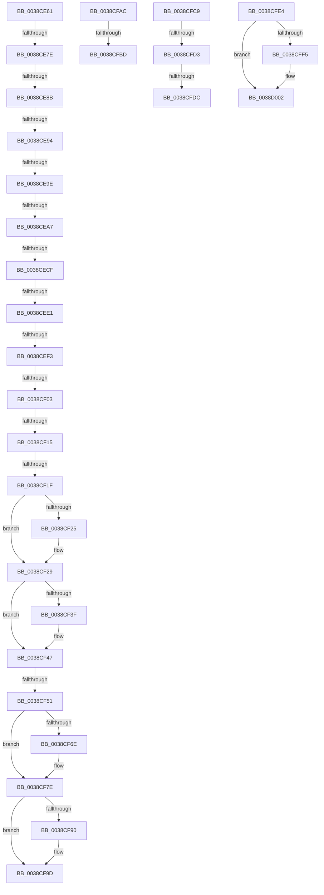

# sub_0038CE61

- RVA: `0x0038CE61`–`0x0038D011` (길이 `432` bytes)
- VA: `0x000000014038CE61`
- 실행 섹션: `.text`
- PDB 이름 있음: `아니요`; PDB Function 태그: `아니요`
- unwind 정보 RVA: `0x0008039C`
- 디코드: `98`개 명령, `432/432` bytes 표시
- 미해석 바이트: `0` (있으면 어셈블리에 `.byte`로 보존)

> 이 문서는 커널 이미지의 기계어와 PDB 기호를 분석해 생성했습니다. 4번과 5번은 함수 원형과 자료형을 바이너리 사용 방식에서 추정한 C 해석이며 원본 소스 복구 결과는 아닙니다.

## 1. Dependencies

- 직접 호출 지점: **8**; 고유 호출 대상: **6**
- 직접 호출자로 확인된 함수: **0**
- RIP 상대 이미지 참조: **2**

### Outgoing calls
- `0x0038CF29` → [RtlDelete](RtlDelete_function_0038D8B0.md) (function, `0x0038D8B0`)
- `0x0038CF42` → [FsRtlPrivateResetLowestLockOffset](FsRtlPrivateResetLowestLockOffset_function_0038D954.md) (function, `0x0038D954`)
- `0x0038CF63` → [ExFreeToNPagedLookasideList](ExFreeToNPagedLookasideList_function_0038D9D0.md) (function, `0x0038D9D0`)
- `0x0038CF79` → [FsRtlPrivateCheckWaitingLocks](FsRtlPrivateCheckWaitingLocks_function_0038DCBC.md) (function, `0x0038DCBC`)
- `0x0038CF82` → [KxReleaseSpinLock](../20/KxReleaseSpinLock_function_00206670.md) (function, `0x00206670`)
- `0x0038CF98` → [KiLowerIrqlProcessIrqlFlags](../4F/KiLowerIrqlProcessIrqlFlags_function_004F5698.md) (function, `0x004F5698`)
- `0x0038CFE7` → [KxReleaseSpinLock](../20/KxReleaseSpinLock_function_00206670.md) (function, `0x00206670`)
- `0x0038CFFD` → [KiLowerIrqlProcessIrqlFlags](../4F/KiLowerIrqlProcessIrqlFlags_function_004F5698.md) (function, `0x004F5698`)

### Direct callers
- 이 함수 시작 RVA로 연결되는 직접 call은 확인되지 않았습니다. 간접 호출은 완전히 역산할 수 없습니다.

### Static image references
- `0x0038CF5C` → RVA `0x00E12180` (`.data`; read)
- `0x0038CF87` → RVA `0x00FC6D20` (`ALMOSTRO`; read)

## 2. Other-region calls and transfers

- 다른 실행 섹션으로 향하는 call: **0**
- call이 아닌 외부 분기/꼬리 이동: **19**
  - `0x0038CE78` → [sub_0038D025](Unknown_function_0038D025.md) (`tail-transfer`)
  - `0x0038CE85` → [sub_0038D025 + 0x37](Unknown_function_0038D025.md) (`tail-transfer`)
  - `0x0038CE8E` → [sub_0038D07B + 0xA9](Unknown_function_0038D07B.md) (`tail-transfer`)
  - `0x0038CE98` → [sub_0038D07B + 0x9C](Unknown_function_0038D07B.md) (`tail-transfer`)
  - `0x0038CEA1` → [sub_0038D07B + 0xA6](Unknown_function_0038D07B.md) (`tail-transfer`)
  - `0x0038CEC9` → [sub_0038CBC6 + 0x26](Unknown_function_0038CBC6.md) (`tail-transfer`)
  - `0x0038CEDB` → [sub_0038D025 + 0x1B](Unknown_function_0038D025.md) (`tail-transfer`)
  - `0x0038CEED` → [sub_0038D025 + 0x1B](Unknown_function_0038D025.md) (`tail-transfer`)
  - `0x0038CEFD` → [sub_0038D025 + 0x1B](Unknown_function_0038D025.md) (`tail-transfer`)
  - `0x0038CF0F` → [sub_0038D025 + 0x1B](Unknown_function_0038D025.md) (`tail-transfer`)
  - `0x0038CF19` → [sub_0038D025 + 0x1B](Unknown_function_0038D025.md) (`tail-transfer`)
  - `0x0038CF4B` → [sub_0038D07B + 0xB2](Unknown_function_0038D07B.md) (`tail-transfer`)
  - `0x0038CFA7` → [sub_0038CBC6 + 0x27A](Unknown_function_0038CBC6.md) (`tail-transfer`)
  - `0x0038CFB7` → [sub_0038CBC6 + 0x20E](Unknown_function_0038CBC6.md) (`tail-transfer`)
  - `0x0038CFC4` → [sub_0038CBC6 + 0x1DA](Unknown_function_0038CBC6.md) (`tail-transfer`)
  - `0x0038CFCD` → [sub_0038D07B + 0x6C](Unknown_function_0038D07B.md) (`tail-transfer`)
  - `0x0038CFD6` → [sub_0038CBC6 + 0xBE](Unknown_function_0038CBC6.md) (`tail-transfer`)
  - `0x0038CFDF` → [sub_0038CBC6 + 0xB5](Unknown_function_0038CBC6.md) (`tail-transfer`)
  - `0x0038D00C` → [sub_0038CBC6 + 0x277](Unknown_function_0038CBC6.md) (`tail-transfer`)

## 3. Assembly (complete function range)

```asm
0038CE61  49 8B 45 00                     mov rax, qword ptr [r13]
0038CE65  49 8B CC                        mov rcx, r12
0038CE68  48 FF C8                        dec rax
0038CE6B  48 03 C3                        add rax, rbx
0038CE6E  4C 8B 42 40                     mov r8, qword ptr [rdx + 0x40]
0038CE72  4C 8B DA                        mov r11, rdx
0038CE75  4C 3B C3                        cmp r8, rbx
0038CE78  0F 82 A7 01 00 00               jb 0x14038d025
0038CE7E  4C 8B 52 18                     mov r10, qword ptr [rdx + 0x18]
0038CE82  4D 85 D2                        test r10, r10
0038CE85  0F 84 D1 01 00 00               je 0x14038d05c
0038CE8B  4C 3B D0                        cmp r10, rax
0038CE8E  0F 87 90 02 00 00               ja 0x14038d124
0038CE94  48 83 F8 FF                     cmp rax, -1
0038CE98  0F 84 79 02 00 00               je 0x14038d117
0038CE9E  4C 3B D3                        cmp r10, rbx
0038CEA1  0F 87 7A 02 00 00               ja 0x14038d121
0038CEA7  4D 8B 45 00                     mov r8, qword ptr [r13]
0038CEAB  48 85 D2                        test rdx, rdx
0038CEAE  4C 89 44 24 38                  mov qword ptr [rsp + 0x38], r8
0038CEB3  49 0F 45 CB                     cmovne rcx, r11
0038CEB7  48 85 C9                        test rcx, rcx
0038CEBA  49 0F 44 CC                     cmove rcx, r12
0038CEBE  48 89 8C 24 90 00 00 00         mov qword ptr [rsp + 0x90], rcx
0038CEC6  48 85 C9                        test rcx, rcx
0038CEC9  0F 84 1D FD FF FF               je 0x14038cbec
0038CECF  48 8B 94 24 98 00 00 00         mov rdx, qword ptr [rsp + 0x98]
0038CED7  48 39 51 30                     cmp qword ptr [rcx + 0x30], rdx
0038CEDB  0F 85 5F 01 00 00               jne 0x14038d040
0038CEE1  48 8B 84 24 B0 00 00 00         mov rax, qword ptr [rsp + 0xb0]
0038CEE9  48 39 41 38                     cmp qword ptr [rcx + 0x38], rax
0038CEED  0F 85 4D 01 00 00               jne 0x14038d040
0038CEF3  8B 84 24 B8 00 00 00            mov eax, dword ptr [rsp + 0xb8]
0038CEFA  39 41 2C                        cmp dword ptr [rcx + 0x2c], eax
0038CEFD  0F 85 3D 01 00 00               jne 0x14038d040
0038CF03  48 8D 41 18                     lea rax, [rcx + 0x18]
0038CF07  48 89 44 24 30                  mov qword ptr [rsp + 0x30], rax
0038CF0C  48 39 18                        cmp qword ptr [rax], rbx
0038CF0F  0F 85 2B 01 00 00               jne 0x14038d040
0038CF15  4C 39 41 20                     cmp qword ptr [rcx + 0x20], r8
0038CF19  0F 85 21 01 00 00               jne 0x14038d040
0038CF1F  48 39 42 78                     cmp qword ptr [rdx + 0x78], rax
0038CF23  75 04                           jne 0x14038cf29
0038CF25  4C 89 62 78                     mov qword ptr [rdx + 0x78], r12
0038CF29  E8 82 09 00 00                  call 0x14038d8b0
0038CF2E  48 89 46 28                     mov qword ptr [rsi + 0x28], rax
0038CF32  48 8B 44 24 30                  mov rax, qword ptr [rsp + 0x30]
0038CF37  48 8B 00                        mov rax, qword ptr [rax]
0038CF3A  48 39 06                        cmp qword ptr [rsi], rax
0038CF3D  75 08                           jne 0x14038cf47
0038CF3F  48 8B CE                        mov rcx, rsi
0038CF42  E8 0D 0A 00 00                  call 0x14038d954
0038CF47  4C 39 66 10                     cmp qword ptr [rsi + 0x10], r12
0038CF4B  0F 85 DC 01 00 00               jne 0x14038d12d
0038CF51  48 8B 9C 24 90 00 00 00         mov rbx, qword ptr [rsp + 0x90]
0038CF59  48 8B D3                        mov rdx, rbx
0038CF5C  48 8D 0D 1D 52 A8 00            lea rcx, [rip + 0xa8521d]
0038CF63  E8 68 0A 00 00                  call 0x14038d9d0
0038CF68  4C 39 66 30                     cmp qword ptr [rsi + 0x30], r12
0038CF6C  74 10                           je 0x14038cf7e
0038CF6E  44 0F B6 C5                     movzx r8d, bpl
0038CF72  48 8D 56 18                     lea rdx, [rsi + 0x18]
0038CF76  48 8B CE                        mov rcx, rsi
0038CF79  E8 3E 0D 00 00                  call 0x14038dcbc
0038CF7E  48 8D 4E 18                     lea rcx, [rsi + 0x18]
0038CF82  E8 E9 96 E7 FF                  call 0x140206670
0038CF87  44 39 25 92 9D C3 00            cmp dword ptr [rip + 0xc39d92], r12d
0038CF8E  74 0D                           je 0x14038cf9d
0038CF90  44 0F 20 C1                     mov rcx, cr8
0038CF94  40 0F B6 D5                     movzx edx, bpl
0038CF98  E8 FB 86 16 00                  call 0x1404f5698
0038CF9D  40 0F B6 C5                     movzx eax, bpl
0038CFA1  44 0F 22 C0                     mov cr8, rax
0038CFA5  33 C0                           xor eax, eax
0038CFA7  E9 94 FE FF FF                  jmp 0x14038ce40
0038CFAC  48 8B 5F 30                     mov rbx, qword ptr [rdi + 0x30]
0038CFB0  48 8B 6F 08                     mov rbp, qword ptr [rdi + 8]
0038CFB4  48 3B CE                        cmp rcx, rsi
0038CFB7  0F 87 17 FE FF FF               ja 0x14038cdd4
0038CFBD  49 89 5F 10                     mov qword ptr [r15 + 0x10], rbx
0038CFC1  4C 8B F7                        mov r14, rdi
0038CFC4  E9 D7 FD FF FF                  jmp 0x14038cda0
0038CFC9  48 83 F8 FF                     cmp rax, -1
0038CFCD  0F 84 14 01 00 00               je 0x14038d0e7
0038CFD3  4C 3B CB                        cmp r9, rbx
0038CFD6  0F 86 A8 FC FF FF               jbe 0x14038cc84
0038CFDC  4C 8B C1                        mov r8, rcx
0038CFDF  E9 97 FC FF FF                  jmp 0x14038cc7b
0038CFE4  48 8B CE                        mov rcx, rsi
0038CFE7  E8 84 96 E7 FF                  call 0x140206670
0038CFEC  44 39 25 2D 9D C3 00            cmp dword ptr [rip + 0xc39d2d], r12d
0038CFF3  74 0D                           je 0x14038d002
0038CFF5  44 0F 20 C1                     mov rcx, cr8
0038CFF9  40 0F B6 D5                     movzx edx, bpl
0038CFFD  E8 96 86 16 00                  call 0x1404f5698
0038D002  44 0F 22 C5                     mov cr8, rbp
0038D006  41 BC 7E 00 00 C0               mov r12d, 0xc000007e
0038D00C  E9 2C FE FF FF                  jmp 0x14038ce3d
```

## 4. C-style interpretation (structured pseudocode)

```c
__int64 __fastcall sub_0038CE61(__int64 a1, __int64 a2, __int64 a3, __int64 a4, __int64 a5, __int64 a6, __int64 a7, __int64 a8, __int64 a9, __int64 a10, __int64 a11, __int64 a12, __int64 a13, __int64 a14, __int64 a15, __int64 a16, __int64 a17, __int64 a18, __int64 a19, __int64 a20, __int64 a21, __int64 a22, unsigned int a23)
{
    __int64 result;
    unsigned __int64 v_stack_p30;
    unsigned __int64 v_stack_p38;
    unsigned __int64 v_stack_p90;

    result = (*(unsigned __int64 *)(v_r13)) - 1;
    result = (result) + (v_rbx);
    v_stack_p38 = *(unsigned __int64 *)(v_r13);
    a1 = v_r12;
    if (a2 != 0) { a1 = a2; }
    if (a1 == 0) { a1 = v_r12; }
    v_stack_p90 = a1;
    v_stack_p30 = a1 + 24;
    if ((*(unsigned __int64 *)(a19 + 120)) == (a1 + 24)) {
        *(unsigned __int64 *)(a19 + 120) = v_r12;
    }
    result = RtlDelete(a1, a19, *(unsigned __int64 *)(v_r13), a4);
    *(unsigned __int64 *)(v_rsi + 40) = result;
    result = *(unsigned __int64 *)(a6);
    if ((*(unsigned __int64 *)(v_rsi)) == (*(unsigned __int64 *)(a6))) {
        a1 = v_rsi;
        result = FsRtlPrivateResetLowestLockOffset(a1, a19, *(unsigned __int64 *)(v_r13), a4);
    }
    result = ExFreeToNPagedLookasideList(v_rip + 11031069, a18, *(unsigned __int64 *)(v_r13), a4);
    if ((*(unsigned __int64 *)(v_rsi + 48)) != v_r12) {
        a3 = (unsigned __int8)(v_rbp);
        a2 = v_rsi + 24;
        a1 = v_rsi;
        result = FsRtlPrivateCheckWaitingLocks(a1, a2, a3, a4);
    }
    result = KxReleaseSpinLock(v_rsi + 24, a2, a3, a4);
    if ((*(unsigned int *)(v_rip + 12819858)) != ((unsigned int)(v_r12))) {
        a1 = v_cr8;
        a2 = (unsigned __int8)(v_rbp);
        result = KiLowerIrqlProcessIrqlFlags(a1, a2, a3, a4);
    }
    result = 0;
}
```

## 5. (Beta) C Style

```c
int64_t sub_0038CE61(int64_t Arg1, void *Arg2, int64_t Arg3, int64_t Arg4, uint64_t Arg5, void *Arg6, uint64_t Arg7, uint64_t Arg8, uint64_t Arg9, uint64_t Arg10, uint64_t Arg11, uint64_t Arg12, uint64_t Arg13, uint64_t Arg14, uint64_t Arg15, uint64_t Arg16, uint64_t Arg17, int64_t Arg18, void *Arg19, uint64_t Arg20, uint64_t Arg21, int64_t Arg22, uint32_t Arg23)
{
    uint8_t *arg2 = (uint8_t *)Arg2;
    uint8_t *arg6 = (uint8_t *)Arg6;
    uint8_t *arg19 = (uint8_t *)Arg19;

    int64_t result;
    uint64_t v_stack_p30;
    uint64_t v_stack_p38;
    uint64_t v_stack_p90;

    result = (*(uint64_t *)(local_r13)) - 1;
    result = (result) + (local_rbx);
    v_stack_p38 = *(uint64_t *)(local_r13);
    Arg1 = local_r12;
    if (Arg2 != NULL) { Arg1 = Arg2; }
    if (Arg1 == 0) { Arg1 = local_r12; }
    v_stack_p90 = Arg1;
    v_stack_p30 = Arg1 + 24;
    if ((*(uint64_t *)(arg19 + 0x78)) == (Arg1 + 24)) {
        *(uint64_t *)(arg19 + 0x78) = local_r12;
    }
    result = RtlDelete(Arg1, Arg19, *(uint64_t *)(local_r13), Arg4);
    *(uint64_t *)(local_rsi + 0x28) = result;
    result = *(uint64_t *)(arg6);
    if ((*(uint64_t *)(local_rsi)) == (*(uint64_t *)(arg6))) {
        Arg1 = local_rsi;
        result = FsRtlPrivateResetLowestLockOffset(Arg1, Arg19, *(uint64_t *)(local_r13), Arg4);
    }
    result = ExFreeToNPagedLookasideList(v_rip + 11031069, Arg18, *(uint64_t *)(local_r13), Arg4);
    if ((*(uint64_t *)(local_rsi + 0x30)) != local_r12) {
        Arg3 = (uint8_t)(local_rbp);
        Arg2 = local_rsi + 24;
        Arg1 = local_rsi;
        result = FsRtlPrivateCheckWaitingLocks(Arg1, Arg2, Arg3, Arg4);
    }
    result = KxReleaseSpinLock(local_rsi + 24, Arg2, Arg3, Arg4);
    if ((*(uint32_t *)(v_rip + 0xC39D92)) != ((uint32_t)(local_r12))) {
        Arg1 = v_cr8;
        Arg2 = (uint8_t)(local_rbp);
        result = KiLowerIrqlProcessIrqlFlags(Arg1, Arg2, Arg3, Arg4);
    }
    result = 0;
}
```

### 관측된 메모리 오프셋

구조체 형식이 확인되지 않은 접근은 인자 기준의 오프셋으로만 기록했습니다.

| 기준 인자 | 오프셋 표현 | 폭 (bit) | 접근 |
|---|---:|---:|---|
| `Arg2` | `+ 0x18` | `64` | `R` |
| `Arg2` | `+ 0x40` | `64` | `R` |
| `Arg6` | `+ 0x0` | `64` | `R` |
| `Arg19` | `+ 0x78` | `64` | `R` |
| `Arg19` | `+ 0x78` | `64` | `W` |

## 6. Execution-region graph

[열기: 2D/3D 그래프와 함수 탐색 컨트롤 패널](../../../control-panel.html?section=text&rva=0x0038CE61&view=graph)

- 2D 그래프는 위에서 아래로 흐르고, 3D 그래프는 빈 공간을 드래그해 회전합니다. Shift+드래그는 이동, 휠은 확대·축소, 함수 노드 선택은 대상 보고서 이동입니다.

### Static fallback


