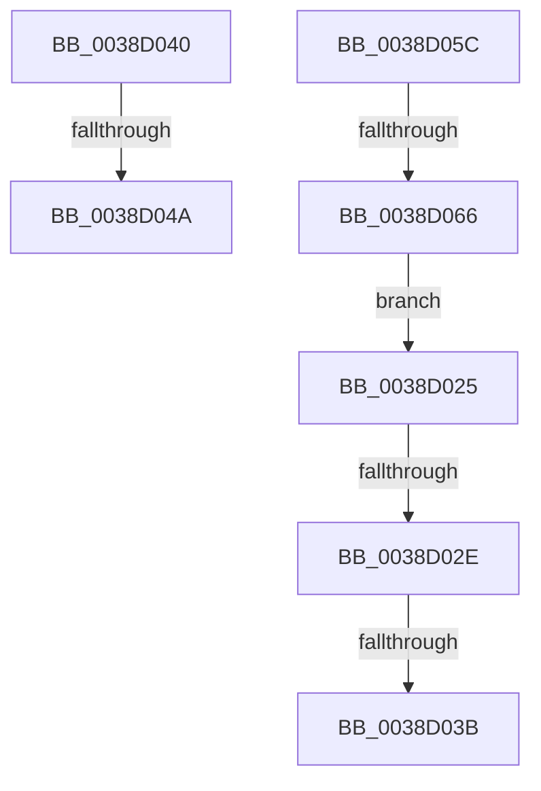

# sub_0038D025

- RVA: `0x0038D025`–`0x0038D068` (길이 `67` bytes)
- VA: `0x000000014038D025`
- 실행 섹션: `.text`
- PDB 이름 있음: `아니요`; PDB Function 태그: `아니요`
- unwind 정보 RVA: `0x000803CC`
- 디코드: `15`개 명령, `67/67` bytes 표시
- 미해석 바이트: `0` (있으면 어셈블리에 `.byte`로 보존)

> 이 문서는 커널 이미지의 기계어와 PDB 기호를 분석해 생성했습니다. 4번과 5번은 함수 원형과 자료형을 바이너리 사용 방식에서 추정한 C 해석이며 원본 소스 복구 결과는 아닙니다.

## 1. Dependencies

- 직접 호출 지점: **1**; 고유 호출 대상: **1**
- 직접 호출자로 확인된 함수: **0**
- RIP 상대 이미지 참조: **0**

### Outgoing calls
- `0x0038D04A` → [RtlRealSuccessor](RtlRealSuccessor_function_0038DF40.md) (function, `0x0038DF40`)

### Direct callers
- 이 함수 시작 RVA로 연결되는 직접 call은 확인되지 않았습니다. 간접 호출은 완전히 역산할 수 없습니다.

### Static image references
- 디코드된 RIP-relative 메모리 참조가 없습니다.

## 2. Other-region calls and transfers

- 다른 실행 섹션으로 향하는 call: **0**
- call이 아닌 외부 분기/꼬리 이동: **6**
  - `0x0038D028` → [sub_0038D07B + 0x86](Unknown_function_0038D07B.md) (`tail-transfer`)
  - `0x0038D035` → [sub_0038CE61 + 0xD](Unknown_function_0038CE61.md) (`tail-transfer`)
  - `0x0038D03B` → [sub_0038CE61 + 0x46](Unknown_function_0038CE61.md) (`tail-transfer`)
  - `0x0038D044` → [sub_0038CBC6 + 0x26](Unknown_function_0038CBC6.md) (`tail-transfer`)
  - `0x0038D057` → [sub_0038CE61 + 0x5D](Unknown_function_0038CE61.md) (`tail-transfer`)
  - `0x0038D060` → [sub_0038CE61 + 0x2A](Unknown_function_0038CE61.md) (`tail-transfer`)

## 3. Assembly (complete function range)

```asm
0038D025  4C 3B C0                        cmp r8, rax
0038D028  0F 84 D3 00 00 00               je 0x14038d101
0038D02E  48 8B 52 10                     mov rdx, qword ptr [rdx + 0x10]
0038D032  48 85 D2                        test rdx, rdx
0038D035  0F 85 33 FE FF FF               jne 0x14038ce6e
0038D03B  E9 67 FE FF FF                  jmp 0x14038cea7
0038D040  48 39 59 18                     cmp qword ptr [rcx + 0x18], rbx
0038D044  0F 87 A2 FB FF FF               ja 0x14038cbec
0038D04A  E8 F1 0E 00 00                  call 0x14038df40
0038D04F  4C 8B 44 24 38                  mov r8, qword ptr [rsp + 0x38]
0038D054  48 8B C8                        mov rcx, rax
0038D057  E9 62 FE FF FF                  jmp 0x14038cebe
0038D05C  4C 39 62 20                     cmp qword ptr [rdx + 0x20], r12
0038D060  0F 85 25 FE FF FF               jne 0x14038ce8b
0038D066  EB BD                           jmp 0x14038d025
```

## 4. C-style interpretation (structured pseudocode)

```c
__int64 __fastcall sub_0038D025(__int64 a1, __int64 a2, __int64 a3)
{
    unsigned __int64 v_stack_p38;
}
```

## 5. (Beta) C Style

```c
int64_t sub_0038D025(int64_t Arg1, void *Arg2, int64_t Arg3)
{
    uint8_t *arg2 = (uint8_t *)Arg2;

    uint64_t v_stack_p38;
}
```

### 관측된 메모리 오프셋

구조체 형식이 확인되지 않은 접근은 인자 기준의 오프셋으로만 기록했습니다.

| 기준 인자 | 오프셋 표현 | 폭 (bit) | 접근 |
|---|---:|---:|---|
| `Arg2` | `+ 0x10` | `64` | `R` |

## 6. Execution-region graph

[열기: 2D/3D 그래프와 함수 탐색 컨트롤 패널](../../../control-panel.html?section=text&rva=0x0038D025&view=graph)

- 2D 그래프는 위에서 아래로 흐르고, 3D 그래프는 빈 공간을 드래그해 회전합니다. Shift+드래그는 이동, 휠은 확대·축소, 함수 노드 선택은 대상 보고서 이동입니다.

### Static fallback


