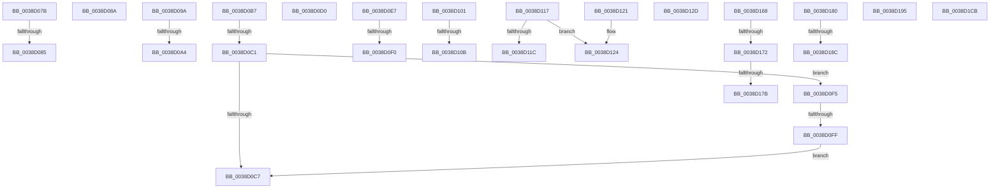

# sub_0038D07B

- RVA: `0x0038D07B`–`0x0038D1DF` (길이 `356` bytes)
- VA: `0x000000014038D07B`
- 실행 섹션: `.text`
- PDB 이름 있음: `아니요`; PDB Function 태그: `아니요`
- unwind 정보 RVA: `0x000803FC`
- 디코드: `81`개 명령, `356/356` bytes 표시
- 미해석 바이트: `0` (있으면 어셈블리에 `.byte`로 보존)

> 이 문서는 커널 이미지의 기계어와 PDB 기호를 분석해 생성했습니다. 4번과 5번은 함수 원형과 자료형을 바이너리 사용 방식에서 추정한 C 해석이며 원본 소스 복구 결과는 아닙니다.

## 1. Dependencies

- 직접 호출 지점: **8**; 고유 호출 대상: **4**
- 직접 호출자로 확인된 함수: **0**
- RIP 상대 이미지 참조: **0**

### Outgoing calls
- `0x0038D0D7` → [KeReleaseSpinLock](../39/KeReleaseSpinLock_function_00392BA0.md) (function, `0x00392BA0`)
- `0x0038D135` → [KeReleaseSpinLock](../39/KeReleaseSpinLock_function_00392BA0.md) (function, `0x00392BA0`)
- `0x0038D152` → [guard_dispatch_icall](../6B/guard_dispatch_icall_function_006BAAD0.md) (function, `0x006BAAD0`)
- `0x0038D15B` → [KeAcquireSpinLockRaiseToDpc](../20/KeAcquireSpinLockRaiseToDpc_function_00208470.md) (function, `0x00208470`)
- `0x0038D19C` → [KeReleaseSpinLock](../39/KeReleaseSpinLock_function_00392BA0.md) (function, `0x00392BA0`)
- `0x0038D1B6` → [guard_dispatch_icall](../6B/guard_dispatch_icall_function_006BAAD0.md) (function, `0x006BAAD0`)
- `0x0038D1BE` → [KeAcquireSpinLockRaiseToDpc](../20/KeAcquireSpinLockRaiseToDpc_function_00208470.md) (function, `0x00208470`)
- `0x0038D1D5` → [FsRtlPrivateCheckWaitingLocks](FsRtlPrivateCheckWaitingLocks_function_0038DCBC.md) (function, `0x0038DCBC`)

### Direct callers
- 이 함수 시작 RVA로 연결되는 직접 call은 확인되지 않았습니다. 간접 호출은 완전히 역산할 수 없습니다.

### Static image references
- 디코드된 RIP-relative 메모리 참조가 없습니다.

## 2. Other-region calls and transfers

- 다른 실행 섹션으로 향하는 call: **0**
- call이 아닌 외부 분기/꼬리 이동: **23**
  - `0x0038D07F` → [sub_0038CBC6 + 0x217](Unknown_function_0038CBC6.md) (`tail-transfer`)
  - `0x0038D085` → [sub_0038CBC6 + 0x201](Unknown_function_0038CBC6.md) (`tail-transfer`)
  - `0x0038D095` → [sub_0038CBC6 + 0x1D1](Unknown_function_0038CBC6.md) (`tail-transfer`)
  - `0x0038D09E` → [sub_0038CE61 + 0x183](Unknown_function_0038CE61.md) (`tail-transfer`)
  - `0x0038D0B2` → [sub_0038CBC6 + 0xFA](Unknown_function_0038CBC6.md) (`tail-transfer`)
  - `0x0038D0BB` → [sub_0038CE61 + 0x168](Unknown_function_0038CE61.md) (`tail-transfer`)
  - `0x0038D0CB` → [sub_0038CBC6 + 0xB9](Unknown_function_0038CBC6.md) (`tail-transfer`)
  - `0x0038D0E2` → [sub_0038CBC6 + 0x277](Unknown_function_0038CBC6.md) (`tail-transfer`)
  - `0x0038D0EA` → [sub_0038CBC6 + 0xB5](Unknown_function_0038CBC6.md) (`tail-transfer`)
  - `0x0038D0F0` → [sub_0038CE61 + 0x172](Unknown_function_0038CE61.md) (`tail-transfer`)
  - `0x0038D0F9` → [sub_0038CBC6 + 0xBE](Unknown_function_0038CBC6.md) (`tail-transfer`)
  - `0x0038D105` → [sub_0038D025 + 0x9](Unknown_function_0038D025.md) (`tail-transfer`)
  - `0x0038D112` → [sub_0038D025 + 0xD](Unknown_function_0038D025.md) (`tail-transfer`)
  - `0x0038D11C` → [sub_0038CE61 + 0x3D](Unknown_function_0038CE61.md) (`tail-transfer`)
  - `0x0038D128` → [sub_0038D025 + 0xD](Unknown_function_0038D025.md) (`tail-transfer`)
  - `0x0038D163` → [sub_0038CE61 + 0xF8](Unknown_function_0038CE61.md) (`tail-transfer`)
  - `0x0038D16C` → [sub_006E54BE](../6E/Unknown_function_006E54BE.md) (`tail-transfer`)
  - `0x0038D175` → [sub_0038CBC6 + 0x1F8](Unknown_function_0038CBC6.md) (`tail-transfer`)
  - `0x0038D17B` → [sub_006E54BE](../6E/Unknown_function_006E54BE.md) (`tail-transfer`)
  - `0x0038D186` → [sub_0038CBC6 + 0x20E](Unknown_function_0038CBC6.md) (`tail-transfer`)
  - `0x0038D190` → [sub_0038CBC6 + 0x20E](Unknown_function_0038CBC6.md) (`tail-transfer`)
  - `0x0038D1C6` → [sub_0038CBC6 + 0x238](Unknown_function_0038CBC6.md) (`tail-transfer`)
  - `0x0038D1DA` → [sub_0038CBC6 + 0x251](Unknown_function_0038CBC6.md) (`tail-transfer`)

## 3. Assembly (complete function range)

```asm
0038D07B  48 39 77 08                     cmp qword ptr [rdi + 8], rsi
0038D07F  0F 87 58 FD FF FF               ja 0x14038cddd
0038D085  E9 3D FD FF FF                  jmp 0x14038cdc7
0038D08A  49 8B 77 10                     mov rsi, qword ptr [r15 + 0x10]
0038D08E  4D 8B F7                        mov r14, r15
0038D091  41 88 5F 08                     mov byte ptr [r15 + 8], bl
0038D095  E9 FD FC FF FF                  jmp 0x14038cd97
0038D09A  49 39 5D 08                     cmp qword ptr [r13 + 8], rbx
0038D09E  0F 87 40 FF FF FF               ja 0x14038cfe4
0038D0A4  49 8B 45 30                     mov rax, qword ptr [r13 + 0x30]
0038D0A8  4D 8B F5                        mov r14, r13
0038D0AB  48 3B F8                        cmp rdi, rax
0038D0AE  48 0F 42 F8                     cmovb rdi, rax
0038D0B2  E9 09 FC FF FF                  jmp 0x14038ccc0
0038D0B7  4D 39 63 10                     cmp qword ptr [r11 + 0x10], r12
0038D0BB  0F 85 08 FF FF FF               jne 0x14038cfc9
0038D0C1  49 39 43 30                     cmp qword ptr [r11 + 0x30], rax
0038D0C5  74 2E                           je 0x14038d0f5
0038D0C7  48 8B 52 10                     mov rdx, qword ptr [rdx + 0x10]
0038D0CB  E9 AF FB FF FF                  jmp 0x14038cc7f
0038D0D0  40 0F B6 D5                     movzx edx, bpl
0038D0D4  48 8B CE                        mov rcx, rsi
0038D0D7  E8 C4 5A 00 00                  call 0x140392ba0
0038D0DC  41 BC 7E 00 00 C0               mov r12d, 0xc000007e
0038D0E2  E9 56 FD FF FF                  jmp 0x14038ce3d
0038D0E7  48 85 DB                        test rbx, rbx
0038D0EA  0F 84 8B FB FF FF               je 0x14038cc7b
0038D0F0  E9 DE FE FF FF                  jmp 0x14038cfd3
0038D0F5  49 39 5B 08                     cmp qword ptr [r11 + 8], rbx
0038D0F9  0F 84 85 FB FF FF               je 0x14038cc84
0038D0FF  EB C6                           jmp 0x14038d0c7
0038D101  48 39 5A 18                     cmp qword ptr [rdx + 0x18], rbx
0038D105  0F 85 23 FF FF FF               jne 0x14038d02e
0038D10B  48 8B CA                        mov rcx, rdx
0038D10E  48 8B 52 08                     mov rdx, qword ptr [rdx + 8]
0038D112  E9 1B FF FF FF                  jmp 0x14038d032
0038D117  48 85 DB                        test rbx, rbx
0038D11A  74 08                           je 0x14038d124
0038D11C  E9 7D FD FF FF                  jmp 0x14038ce9e
0038D121  48 8B CA                        mov rcx, rdx
0038D124  48 8B 52 08                     mov rdx, qword ptr [rdx + 8]
0038D128  E9 05 FF FF FF                  jmp 0x14038d032
0038D12D  40 0F B6 D5                     movzx edx, bpl
0038D131  48 8D 4E 18                     lea rcx, [rsi + 0x18]
0038D135  E8 66 5A 00 00                  call 0x140392ba0
0038D13A  48 8B 9C 24 90 00 00 00         mov rbx, qword ptr [rsp + 0x90]
0038D142  48 8B 46 10                     mov rax, qword ptr [rsi + 0x10]
0038D146  48 8B 8C 24 C0 00 00 00         mov rcx, qword ptr [rsp + 0xc0]
0038D14E  48 8D 53 18                     lea rdx, [rbx + 0x18]
0038D152  E8 79 D9 32 00                  call 0x1406baad0
0038D157  48 8D 4E 18                     lea rcx, [rsi + 0x18]
0038D15B  E8 10 B3 E7 FF                  call 0x140208470
0038D160  0F B6 E8                        movzx ebp, al
0038D163  E9 F1 FD FF FF                  jmp 0x14038cf59
0038D168  4C 39 67 10                     cmp qword ptr [rdi + 0x10], r12
0038D16C  0F 85 4C 83 35 00               jne 0x1406e54be
0038D172  48 3B C5                        cmp rax, rbp
0038D175  0F 84 43 FC FF FF               je 0x14038cdbe
0038D17B  E9 3E 83 35 00                  jmp 0x1406e54be
0038D180  48 8B D8                        mov rbx, rax
0038D183  48 3B CE                        cmp rcx, rsi
0038D186  0F 87 48 FC FF FF               ja 0x14038cdd4
0038D18C  49 89 47 10                     mov qword ptr [r15 + 0x10], rax
0038D190  E9 3F FC FF FF                  jmp 0x14038cdd4
0038D195  40 0F B6 D5                     movzx edx, bpl
0038D199  48 8B CE                        mov rcx, rsi
0038D19C  E8 FF 59 00 00                  call 0x140392ba0
0038D1A1  48 8B 5C 24 28                  mov rbx, qword ptr [rsp + 0x28]
0038D1A6  49 8D 55 08                     lea rdx, [r13 + 8]
0038D1AA  48 8B 8C 24 C0 00 00 00         mov rcx, qword ptr [rsp + 0xc0]
0038D1B2  48 8B 43 10                     mov rax, qword ptr [rbx + 0x10]
0038D1B6  E8 15 D9 32 00                  call 0x1406baad0
0038D1BB  48 8B CE                        mov rcx, rsi
0038D1BE  E8 AD B2 E7 FF                  call 0x140208470
0038D1C3  0F B6 E8                        movzx ebp, al
0038D1C6  E9 33 FC FF FF                  jmp 0x14038cdfe
0038D1CB  44 0F B6 C5                     movzx r8d, bpl
0038D1CF  48 8B D6                        mov rdx, rsi
0038D1D2  48 8B CB                        mov rcx, rbx
0038D1D5  E8 E2 0A 00 00                  call 0x14038dcbc
0038D1DA  E9 38 FC FF FF                  jmp 0x14038ce17
```

## 4. C-style interpretation (structured pseudocode)

```c
__int64 __fastcall sub_0038D07B(__int64 a1, __int64 a2)
{
    unsigned __int64 v_stack_p28;
    unsigned __int64 v_stack_p90;
    unsigned __int64 v_stack_pC0;
}
```

## 5. (Beta) C Style

```c
int64_t sub_0038D07B(int64_t Arg1, int64_t Arg2)
{
    uint64_t v_stack_p28;
    uint64_t v_stack_p90;
    uint64_t v_stack_pC0;
}
```

## 6. Execution-region graph

[열기: 2D/3D 그래프와 함수 탐색 컨트롤 패널](../../../control-panel.html?section=text&rva=0x0038D07B&view=graph)

- 2D 그래프는 위에서 아래로 흐르고, 3D 그래프는 빈 공간을 드래그해 회전합니다. Shift+드래그는 이동, 휠은 확대·축소, 함수 노드 선택은 대상 보고서 이동입니다.

### Static fallback


