# sub_0038D2A1

- RVA: `0x0038D2A1`–`0x0038D56A` (길이 `713` bytes)
- VA: `0x000000014038D2A1`
- 실행 섹션: `.text`
- PDB 이름 있음: `아니요`; PDB Function 태그: `아니요`
- unwind 정보 RVA: `0x00080448`
- 디코드: `146`개 명령, `713/713` bytes 표시
- 미해석 바이트: `0` (있으면 어셈블리에 `.byte`로 보존)

> 이 문서는 커널 이미지의 기계어와 PDB 기호를 분석해 생성했습니다. 4번과 5번은 함수 원형과 자료형을 바이너리 사용 방식에서 추정한 C 해석이며 원본 소스 복구 결과는 아닙니다.

## 1. Dependencies

- 직접 호출 지점: **5**; 고유 호출 대상: **4**
- 직접 호출자로 확인된 함수: **0**
- RIP 상대 이미지 참조: **15**

### Outgoing calls
- `0x0038D357` → [RtlDelete](RtlDelete_function_0038D8B0.md) (function, `0x0038D8B0`)
- `0x0038D3B5` → [ExpInterlockedPushEntrySList](../6B/ExpInterlockedPushEntrySList_function_006BA5B0.md) (function, `0x006BA5B0`)
- `0x0038D3EA` → [FsRtlPrivateResetLowestLockOffset](FsRtlPrivateResetLowestLockOffset_function_0038D954.md) (function, `0x0038D954`)
- `0x0038D503` → [ExpInterlockedPushEntrySList](../6B/ExpInterlockedPushEntrySList_function_006BA5B0.md) (function, `0x006BA5B0`)
- `0x0038D541` → [KiLowerIrqlProcessIrqlFlags](../4F/KiLowerIrqlProcessIrqlFlags_function_004F5698.md) (function, `0x004F5698`)

### Direct callers
- 이 함수 시작 RVA로 연결되는 직접 call은 확인되지 않았습니다. 간접 호출은 완전히 역산할 수 없습니다.

### Static image references
- `0x0038D31C` → RVA `0x00B82850` (`ExFreePool`; read)
- `0x0038D326` → RVA `0x00475D80` (`CmSiFreeMemory`; read)
- `0x0038D365` → RVA `0x00E11F9C` (`.data`; read/write)
- `0x0038D36B` → RVA `0x00E11F90` (`.data`; read)
- `0x0038D372` → RVA `0x00E11F80` (`.data`; read)
- `0x0038D386` → RVA `0x00E11FB8` (`.data`; read)
- `0x0038D38F` → RVA `0x00E11FAC` (`.data`; read)
- `0x0038D39E` → RVA `0x00FCEC68` (`ALMOSTRO`; read)
- `0x0038D4B9` → RVA `0x00E1221C` (`.data`; read/write)
- `0x0038D4BF` → RVA `0x00E12210` (`.data`; read)
- `0x0038D4C6` → RVA `0x00E12200` (`.data`; read)
- `0x0038D4D3` → RVA `0x00E12238` (`.data`; read)
- `0x0038D4DC` → RVA `0x00E1222C` (`.data`; read)
- `0x0038D51D` → RVA `0x00FC6B06` (`ALMOSTRO`; read)
- `0x0038D530` → RVA `0x00FC6D20` (`ALMOSTRO`; read)

## 2. Other-region calls and transfers

- 다른 실행 섹션으로 향하는 call: **0**
- call이 아닌 외부 분기/꼬리 이동: **20**
  - `0x0038D2BB` → [sub_0038D5A3](Unknown_function_0038D5A3.md) (`tail-transfer`)
  - `0x0038D2C6` → [sub_0038D5A3 + 0xAD](Unknown_function_0038D5A3.md) (`tail-transfer`)
  - `0x0038D2D1` → [sub_0038D5A3 + 0xAD](Unknown_function_0038D5A3.md) (`tail-transfer`)
  - `0x0038D2DC` → [sub_0038D5A3 + 0xAD](Unknown_function_0038D5A3.md) (`tail-transfer`)
  - `0x0038D2EC` → [sub_0038D5A3 + 0xAD](Unknown_function_0038D5A3.md) (`tail-transfer`)
  - `0x0038D2F7` → [sub_0038D5A3 + 0xAD](Unknown_function_0038D5A3.md) (`tail-transfer`)
  - `0x0038D344` → [sub_0038D5A3 + 0xA3](Unknown_function_0038D5A3.md) (`tail-transfer`)
  - `0x0038D34E` → [sub_0038D785 + 0xC3](Unknown_function_0038D785.md) (`tail-transfer`)
  - `0x0038D379` → [sub_0038D5A3 + 0x5F](Unknown_function_0038D5A3.md) (`tail-transfer`)
  - `0x0038D3A5` → [sub_0038D6CF + 0x2B](Unknown_function_0038D6CF.md) (`tail-transfer`)
  - `0x0038D409` → [sub_0038D5A3 + 0x93](Unknown_function_0038D5A3.md) (`tail-transfer`)
  - `0x0038D43B` → [sub_0038D56B](Unknown_function_0038D56B.md) (`tail-transfer`)
  - `0x0038D448` → [sub_0038D785 + 0xCD](Unknown_function_0038D785.md) (`tail-transfer`)
  - `0x0038D451` → [sub_0038D5A3 + 0x84](Unknown_function_0038D5A3.md) (`tail-transfer`)
  - `0x0038D45E` → [sub_0038D785 + 0xE6](Unknown_function_0038D785.md) (`tail-transfer`)
  - `0x0038D4AB` → [sub_006E5574 + 0xC6](../6E/Unknown_function_006E5574.md) (`tail-transfer`)
  - `0x0038D4CD` → [sub_0038D5A3 + 0x3A](Unknown_function_0038D5A3.md) (`tail-transfer`)
  - `0x0038D4F3` → [sub_0038D6CF](Unknown_function_0038D6CF.md) (`tail-transfer`)
  - `0x0038D517` → [sub_0038D785 + 0x105](Unknown_function_0038D785.md) (`tail-transfer`)
  - `0x0038D524` → [sub_0038D68D](Unknown_function_0038D68D.md) (`tail-transfer`)

## 3. Assembly (complete function range)

```asm
0038D2A1  4C 89 A4 24 98 00 00 00         mov qword ptr [rsp + 0x98], r12
0038D2A9  4C 89 7C 24 50                  mov qword ptr [rsp + 0x50], r15
0038D2AE  4C 8D 7E E8                     lea r15, [rsi - 0x18]
0038D2B2  4D 8B F7                        mov r14, r15
0038D2B5  4D 8B 26                        mov r12, qword ptr [r14]
0038D2B8  4D 85 E4                        test r12, r12
0038D2BB  0F 84 E2 02 00 00               je 0x14038d5a3
0038D2C1  4D 39 6C 24 20                  cmp qword ptr [r12 + 0x20], r13
0038D2C6  0F 85 84 03 00 00               jne 0x14038d650
0038D2CC  49 39 54 24 28                  cmp qword ptr [r12 + 0x28], rdx
0038D2D1  0F 85 79 03 00 00               jne 0x14038d650
0038D2D7  41 39 4C 24 1C                  cmp dword ptr [r12 + 0x1c], ecx
0038D2DC  0F 85 6E 03 00 00               jne 0x14038d650
0038D2E2  49 39 5C 24 08                  cmp qword ptr [r12 + 8], rbx
0038D2E7  49 8D 44 24 08                  lea rax, [r12 + 8]
0038D2EC  0F 85 5E 03 00 00               jne 0x14038d650
0038D2F2  4D 39 44 24 10                  cmp qword ptr [r12 + 0x10], r8
0038D2F7  0F 85 53 03 00 00               jne 0x14038d650
0038D2FD  49 39 45 78                     cmp qword ptr [r13 + 0x78], rax
0038D301  75 08                           jne 0x14038d30b
0038D303  49 C7 45 78 00 00 00 00         mov qword ptr [r13 + 0x78], 0
0038D30B  48 8B 46 18                     mov rax, qword ptr [rsi + 0x18]
0038D30F  49 39 06                        cmp qword ptr [r14], rax
0038D312  75 04                           jne 0x14038d318
0038D314  4C 89 76 18                     mov qword ptr [rsi + 0x18], r14
0038D318  49 8B 04 24                     mov rax, qword ptr [r12]
0038D31C  48 8D 2D 2D 55 7F 00            lea rbp, [rip + 0x7f552d]
0038D323  49 89 06                        mov qword ptr [r14], rax
0038D326  4C 8D 0D 53 8A 0E 00            lea r9, [rip + 0xe8a53]
0038D32D  49 BA 00 00 00 00 00 80 FF FF   movabs r10, 0xffff800000000000
0038D337  49 BB 00 00 00 00 00 80 00 00   movabs r11, 0x800000000000
0038D341  4D 3B F7                        cmp r14, r15
0038D344  0F 85 FC 02 00 00               jne 0x14038d646
0038D34A  49 83 3F 00                     cmp qword ptr [r15], 0
0038D34E  0F 85 F4 04 00 00               jne 0x14038d848
0038D354  48 8B CE                        mov rcx, rsi
0038D357  E8 54 05 00 00                  call 0x14038d8b0
0038D35C  4C 8B 6C 24 30                  mov r13, qword ptr [rsp + 0x30]
0038D361  49 89 45 08                     mov qword ptr [r13 + 8], rax
0038D365  FF 05 31 4C A8 00               inc dword ptr [rip + 0xa84c31]
0038D36B  0F B7 05 1E 4C A8 00            movzx eax, word ptr [rip + 0xa84c1e]
0038D372  66 39 05 07 4C A8 00            cmp word ptr [rip + 0xa84c07], ax
0038D379  0F 83 83 02 00 00               jae 0x14038d602
0038D37F  48 8D 05 FA 89 0E 00            lea rax, [rip + 0xe89fa]
0038D386  48 39 05 2B 4C A8 00            cmp qword ptr [rip + 0xa84c2b], rax
0038D38D  75 1C                           jne 0x14038d3ab
0038D38F  44 8B 05 16 4C A8 00            mov r8d, dword ptr [rip + 0xa84c16]
0038D396  4C 8D 4E F0                     lea r9, [rsi - 0x10]
0038D39A  49 83 E8 08                     sub r8, 8
0038D39E  80 3D C3 18 C4 00 00            cmp byte ptr [rip + 0xc418c3], 0
0038D3A5  0F 85 4F 03 00 00               jne 0x14038d6fa
0038D3AB  49 8B D7                        mov rdx, r15
0038D3AE  48 8D 0D CB 4B A8 00            lea rcx, [rip + 0xa84bcb]
0038D3B5  E8 F6 D1 32 00                  call 0x1406ba5b0
0038D3BA  45 33 FF                        xor r15d, r15d
0038D3BD  4C 8D 0D BC 89 0E 00            lea r9, [rip + 0xe89bc]
0038D3C4  49 BA 00 00 00 00 00 80 FF FF   movabs r10, 0xffff800000000000
0038D3CE  49 BB 00 00 00 00 00 80 00 00   movabs r11, 0x800000000000
0038D3D8  48 8B 8C 24 90 00 00 00         mov rcx, qword ptr [rsp + 0x90]
0038D3E0  49 8B 44 24 08                  mov rax, qword ptr [r12 + 8]
0038D3E5  48 39 01                        cmp qword ptr [rcx], rax
0038D3E8  75 05                           jne 0x14038d3ef
0038D3EA  E8 65 05 00 00                  call 0x14038d954
0038D3EF  B9 01 00 00 00                  mov ecx, 1
0038D3F4  4D 85 FF                        test r15, r15
0038D3F7  0F 84 97 00 00 00               je 0x14038d494
0038D3FD  33 DB                           xor ebx, ebx
0038D3FF  33 ED                           xor ebp, ebp
0038D401  89 5C 24 30                     mov dword ptr [rsp + 0x30], ebx
0038D405  41 38 5F 08                     cmp byte ptr [r15 + 8], bl
0038D409  0F 85 27 02 00 00               jne 0x14038d636
0038D40F  48 8B DF                        mov rbx, rdi
0038D412  49 8B 74 24 30                  mov rsi, qword ptr [r12 + 0x30]
0038D417  49 39 2F                        cmp qword ptr [r15], rbp
0038D41A  74 71                           je 0x14038d48d
0038D41C  48 3B F7                        cmp rsi, rdi
0038D41F  76 6C                           jbe 0x14038d48d
0038D421  49 8B 4F 10                     mov rcx, qword ptr [r15 + 0x10]
0038D425  48 89 4C 24 38                  mov qword ptr [rsp + 0x38], rcx
0038D42A  66 0F 1F 44 00 00               nop word ptr [rax + rax]
0038D430  49 8B 3E                        mov rdi, qword ptr [r14]
0038D433  48 85 FF                        test rdi, rdi
0038D436  74 31                           je 0x14038d469
0038D438  49 39 3F                        cmp qword ptr [r15], rdi
0038D43B  0F 84 2A 01 00 00               je 0x14038d56b
0038D441  48 8B 47 08                     mov rax, qword ptr [rdi + 8]
0038D445  48 3B C3                        cmp rax, rbx
0038D448  0F 87 04 04 00 00               ja 0x14038d852
0038D44E  48 3B CE                        cmp rcx, rsi
0038D451  0F 87 D0 01 00 00               ja 0x14038d627
0038D457  48 8B 47 30                     mov rax, qword ptr [rdi + 0x30]
0038D45B  48 3B D8                        cmp rbx, rax
0038D45E  0F 82 07 04 00 00               jb 0x14038d86b
0038D464  4C 8B F7                        mov r14, rdi
0038D467  EB C7                           jmp 0x14038d430
0038D469  49 89 5F 10                     mov qword ptr [r15 + 0x10], rbx
0038D46D  49 BB 00 00 00 00 00 80 00 00   movabs r11, 0x800000000000
0038D477  4C 8D 0D 02 89 0E 00            lea r9, [rip + 0xe8902]
0038D47E  49 BA 00 00 00 00 00 80 FF FF   movabs r10, 0xffff800000000000
0038D488  B9 01 00 00 00                  mov ecx, 1
0038D48D  48 8D 2D BC 53 7F 00            lea rbp, [rip + 0x7f53bc]
0038D494  80 BC 24 C8 00 00 00 00         cmp byte ptr [rsp + 0xc8], 0
0038D49C  48 8B 9C 24 90 00 00 00         mov rbx, qword ptr [rsp + 0x90]
0038D4A4  75 0B                           jne 0x14038d4b1
0038D4A6  48 83 7B 10 00                  cmp qword ptr [rbx + 0x10], 0
0038D4AB  0F 85 89 81 35 00               jne 0x1406e563a
0038D4B1  0F B6 BC 24 A0 00 00 00         movzx edi, byte ptr [rsp + 0xa0]
0038D4B9  FF 05 5D 4D A8 00               inc dword ptr [rip + 0xa84d5d]
0038D4BF  0F B7 05 4A 4D A8 00            movzx eax, word ptr [rip + 0xa84d4a]
0038D4C6  66 39 05 33 4D A8 00            cmp word ptr [rip + 0xa84d33], ax
0038D4CD  0F 83 0A 01 00 00               jae 0x14038d5dd
0038D4D3  4C 39 0D 5E 4D A8 00            cmp qword ptr [rip + 0xa84d5e], r9
0038D4DA  75 1D                           jne 0x14038d4f9
0038D4DC  44 8B 05 49 4D A8 00            mov r8d, dword ptr [rip + 0xa84d49]
0038D4E3  4D 8D 4C 24 08                  lea r9, [r12 + 8]
0038D4E8  49 83 E8 08                     sub r8, 8
0038D4EC  80 3D 75 17 C4 00 00            cmp byte ptr [rip + 0xc41775], 0
0038D4F3  0F 85 D6 01 00 00               jne 0x14038d6cf
0038D4F9  49 8B D4                        mov rdx, r12
0038D4FC  48 8D 0D FD 4C A8 00            lea rcx, [rip + 0xa84cfd]
0038D503  E8 A8 D0 32 00                  call 0x1406ba5b0
0038D508  80 BC 24 D0 00 00 00 00         cmp byte ptr [rsp + 0xd0], 0
0038D510  74 0B                           je 0x14038d51d
0038D512  49 83 7D 18 00                  cmp qword ptr [r13 + 0x18], 0
0038D517  0F 85 6D 03 00 00               jne 0x14038d88a
0038D51D  F6 05 E2 95 C3 00 01            test byte ptr [rip + 0xc395e2], 1
0038D524  0F 85 63 01 00 00               jne 0x14038d68d
0038D52A  F0 49 83 65 00 00               lock and qword ptr [r13], 0
0038D530  83 3D E9 97 C3 00 00            cmp dword ptr [rip + 0xc397e9], 0
0038D537  74 0D                           je 0x14038d546
0038D539  44 0F 20 C1                     mov rcx, cr8
0038D53D  40 0F B6 D7                     movzx edx, dil
0038D541  E8 52 81 16 00                  call 0x1404f5698
0038D546  40 0F B6 C7                     movzx eax, dil
0038D54A  44 0F 22 C0                     mov cr8, rax
0038D54E  33 C0                           xor eax, eax
0038D550  4C 8B A4 24 98 00 00 00         mov r12, qword ptr [rsp + 0x98]
0038D558  4C 8B 7C 24 50                  mov r15, qword ptr [rsp + 0x50]
0038D55D  48 83 C4 58                     add rsp, 0x58
0038D561  41 5E                           pop r14
0038D563  41 5D                           pop r13
0038D565  5F                              pop rdi
0038D566  5E                              pop rsi
0038D567  5D                              pop rbp
0038D568  5B                              pop rbx
0038D569  C3                              ret
```

## 4. C-style interpretation (structured pseudocode)

```c
__int64 __fastcall sub_0038D2A1(int a1, __int64 a2, __int64 a3, __int64 a4, __int64 a5, __int64 a6, __int64 a7, __int64 a8, __int64 a9, __int64 a10, __int64 a11, __int64 a12, __int64 a13, __int64 a14, __int64 a15, __int64 a16, __int64 a17, __int64 a18, __int64 a19, unsigned __int8 a20, __int64 a21, __int64 a22, __int64 a23, __int64 a24, unsigned __int8 a25, unsigned __int8 a26)
{
    __int64 result;
    __int64 v_r15;
    __int64 v_rbp;
    __int64 v_rbx;
    __int64 v_rsp;
    unsigned int v_stack_p30;
    unsigned __int64 v_stack_p38;
    unsigned __int64 v_stack_p50;
    unsigned __int64 v_stack_p98;

    v_stack_p98 = v_r12;
    v_stack_p50 = v_r15;
    if ((*(unsigned __int64 *)(v_r13 + 120)) == (*(unsigned __int64 *)(v_rsi - 24) + 8)) {
        *(unsigned __int64 *)(v_r13 + 120) = 0;
    }
    if ((*(unsigned __int64 *)(v_rsi - 24)) == (*(unsigned __int64 *)(v_rsi + 24))) {
        *(unsigned __int64 *)(v_rsi + 24) = v_rsi - 24;
    }
    *(unsigned __int64 *)(v_rsi - 24) = *(unsigned __int64 *)(*(unsigned __int64 *)(v_rsi - 24));
    result = RtlDelete(v_rsi, a2, a3, v_rip + 952915);
    *(unsigned __int64 *)(a6 + 8) = result;
    if ((*(unsigned __int64 *)(v_rip + 11029547)) != (v_rip + 952826)) goto loc_0038D3AB;
    a3 = ((unsigned int)(*(unsigned int *)(v_rip + 11029526))) - (8);
loc_0038D3AB:
    result = ExpInterlockedPushEntrySList(v_rip + 11029451, v_rsi - 24, a3, v_rsi - 16);
    v_r15 = 0;
    result = *(unsigned __int64 *)(*(unsigned __int64 *)(v_rsi - 24) + 8);
    if ((*(unsigned __int64 *)(a18)) == (*(unsigned __int64 *)(*(unsigned __int64 *)(v_rsi - 24) + 8))) {
        result = FsRtlPrivateResetLowestLockOffset(a18, v_rsi - 24, a3, v_rip + 952764);
    }
    if (0 == 0) goto loc_0038D494;
    v_rbx = 0;
    v_rbp = 0;
    v_stack_p30 = 0;
    if ((*(unsigned __int64 *)(v_r15)) == 0) goto loc_0038D48D;
    if ((*(unsigned __int64 *)(*(unsigned __int64 *)(v_rsi - 24) + 48)) <= v_rdi) goto loc_0038D48D;
    v_stack_p38 = *(unsigned __int64 *)(v_r15 + 16);
loc_0038D430:
    if (*(unsigned __int64 *)(v_rsi - 24) == 0) goto loc_0038D469;
    goto loc_0038D430;
loc_0038D469:
    *(unsigned __int64 *)(v_r15 + 16) = v_rdi;
loc_0038D48D:
loc_0038D494:
    if (a25 != 0) goto loc_0038D4B1;
loc_0038D4B1:
    if ((*(unsigned __int64 *)(v_rip + 11029854)) != (v_rip + 952578)) goto loc_0038D4F9;
    a3 = ((unsigned int)(*(unsigned int *)(v_rip + 11029833))) - (8);
loc_0038D4F9:
    result = ExpInterlockedPushEntrySList(v_rip + 11029757, *(unsigned __int64 *)(v_rsi - 24), a3, *(unsigned __int64 *)(v_rsi - 24) + 8);
    if (a26 == 0) goto loc_0038D51D;
loc_0038D51D:
    if ((*(unsigned int *)(v_rip + 12818409)) != 0) {
        a1 = v_cr8;
        a2 = a20;
        result = KiLowerIrqlProcessIrqlFlags(a1, a2, a3, *(unsigned __int64 *)(v_rsi - 24) + 8);
    }
    result = 0;
    v_rsp = (v_rsp) + (88);
    return result;
}
```

## 5. (Beta) C Style

```c
int64_t sub_0038D2A1(int32_t Arg1, int64_t Arg2, int64_t Arg3, int64_t Arg4, uint64_t Arg5, void *Arg6, uint64_t Arg7, uint64_t Arg8, uint64_t Arg9, int64_t Arg10, uint64_t Arg11, uint64_t Arg12, uint64_t Arg13, uint64_t Arg14, uint64_t Arg15, uint64_t Arg16, uint64_t Arg17, void *Arg18, int64_t Arg19, uint8_t Arg20, uint64_t Arg21, uint64_t Arg22, uint64_t Arg23, uint64_t Arg24, uint8_t Arg25, uint8_t Arg26)
{
    uint8_t *arg6 = (uint8_t *)Arg6;
    uint8_t *arg18 = (uint8_t *)Arg18;

    int64_t result;
    int64_t local_r15;
    int64_t local_rbp;
    int64_t local_rbx;
    int64_t local_rsp;
    uint32_t v_stack_p30;
    uint64_t v_stack_p38;
    uint64_t v_stack_p50;
    uint64_t v_stack_p98;

    v_stack_p98 = local_r12;
    v_stack_p50 = local_r15;
    if ((*(uint64_t *)(local_r13 + 0x78)) == (*(uint64_t *)(local_rsi - 0x18) + 8)) {
        *(uint64_t *)(local_r13 + 0x78) = 0;
    }
    if ((*(uint64_t *)(local_rsi - 0x18)) == (*(uint64_t *)(local_rsi + 0x18))) {
        *(uint64_t *)(local_rsi + 0x18) = local_rsi - 24;
    }
    *(uint64_t *)(local_rsi - 0x18) = *(uint64_t *)(*(uint64_t *)(local_rsi - 0x18));
    result = RtlDelete(local_rsi, Arg2, Arg3, v_rip + 952915);
    *(uint64_t *)(arg6 + 0x8) = result;
    if ((*(uint64_t *)(v_rip + 0xA84C2B)) != (v_rip + 952826)) goto loc_0038D3AB;
    Arg3 = ((uint32_t)(*(uint32_t *)(v_rip + 0xA84C16))) - (8);
loc_0038D3AB:
    result = ExpInterlockedPushEntrySList(v_rip + 11029451, local_rsi - 24, Arg3, local_rsi - 16);
    local_r15 = 0;
    result = *(uint64_t *)(*(uint64_t *)(local_rsi - 0x18) + 0x8);
    if ((*(uint64_t *)(arg18)) == (*(uint64_t *)(*(uint64_t *)(local_rsi - 0x18) + 0x8))) {
        result = FsRtlPrivateResetLowestLockOffset(Arg18, local_rsi - 24, Arg3, v_rip + 952764);
    }
    if (0 == 0) goto loc_0038D494;
    local_rbx = 0;
    local_rbp = 0;
    v_stack_p30 = 0;
    if ((*(uint64_t *)(local_r15)) == 0) goto loc_0038D48D;
    if ((*(uint64_t *)(*(uint64_t *)(local_rsi - 0x18) + 0x30)) <= local_rdi) goto loc_0038D48D;
    v_stack_p38 = *(uint64_t *)(local_r15 + 0x10);
loc_0038D430:
    if (*(uint64_t *)(local_rsi - 0x18) == 0) goto loc_0038D469;
    goto loc_0038D430;
loc_0038D469:
    *(uint64_t *)(local_r15 + 0x10) = local_rdi;
loc_0038D48D:
loc_0038D494:
    if (Arg25 != 0) goto loc_0038D4B1;
loc_0038D4B1:
    if ((*(uint64_t *)(v_rip + 0xA84D5E)) != (v_rip + 952578)) goto loc_0038D4F9;
    Arg3 = ((uint32_t)(*(uint32_t *)(v_rip + 0xA84D49))) - (8);
loc_0038D4F9:
    result = ExpInterlockedPushEntrySList(v_rip + 11029757, *(uint64_t *)(local_rsi - 0x18), Arg3, *(uint64_t *)(local_rsi - 0x18) + 8);
    if (Arg26 == 0) goto loc_0038D51D;
loc_0038D51D:
    if ((*(uint32_t *)(v_rip + 0xC397E9)) != 0) {
        Arg1 = v_cr8;
        Arg2 = Arg20;
        result = KiLowerIrqlProcessIrqlFlags(Arg1, Arg2, Arg3, *(uint64_t *)(local_rsi - 0x18) + 8);
    }
    result = 0;
    local_rsp = (local_rsp) + (88);
    return result;
}
```

### 관측된 메모리 오프셋

구조체 형식이 확인되지 않은 접근은 인자 기준의 오프셋으로만 기록했습니다.

| 기준 인자 | 오프셋 표현 | 폭 (bit) | 접근 |
|---|---:|---:|---|
| `Arg6` | `+ 0x0` | `64` | `R/W` |
| `Arg6` | `+ 0x8` | `64` | `W` |
| `Arg6` | `+ 0x18` | `64` | `R` |
| `Arg18` | `+ 0x0` | `64` | `R` |
| `Arg18` | `+ 0x10` | `64` | `R` |

## 6. Execution-region graph

[열기: 2D/3D 그래프와 함수 탐색 컨트롤 패널](../../../control-panel.html?section=text&rva=0x0038D2A1&view=graph)

- 2D 그래프는 위에서 아래로 흐르고, 3D 그래프는 빈 공간을 드래그해 회전합니다. Shift+드래그는 이동, 휠은 확대·축소, 함수 노드 선택은 대상 보고서 이동입니다.

### Static fallback

```mermaid
flowchart TD
  bb_0038D2A1[BB_0038D2A1]
  bb_0038D2C1[BB_0038D2C1]
  bb_0038D2CC[BB_0038D2CC]
  bb_0038D2D7[BB_0038D2D7]
  bb_0038D2E2[BB_0038D2E2]
  bb_0038D2F2[BB_0038D2F2]
  bb_0038D2FD[BB_0038D2FD]
  bb_0038D303[BB_0038D303]
  bb_0038D30B[BB_0038D30B]
  bb_0038D314[BB_0038D314]
  bb_0038D318[BB_0038D318]
  bb_0038D34A[BB_0038D34A]
  bb_0038D354[BB_0038D354]
  bb_0038D37F[BB_0038D37F]
  bb_0038D38F[BB_0038D38F]
  bb_0038D3AB[BB_0038D3AB]
  bb_0038D3EA[BB_0038D3EA]
  bb_0038D3EF[BB_0038D3EF]
  bb_0038D3FD[BB_0038D3FD]
  bb_0038D40F[BB_0038D40F]
  bb_0038D41C[BB_0038D41C]
  bb_0038D421[BB_0038D421]
  bb_0038D430[BB_0038D430]
  bb_0038D438[BB_0038D438]
  bb_0038D441[BB_0038D441]
  bb_0038D44E[BB_0038D44E]
  bb_0038D457[BB_0038D457]
  bb_0038D464[BB_0038D464]
  bb_0038D469[BB_0038D469]
  bb_0038D48D[BB_0038D48D]
  bb_0038D494[BB_0038D494]
  bb_0038D4A6[BB_0038D4A6]
  bb_0038D4B1[BB_0038D4B1]
  bb_0038D4D3[BB_0038D4D3]
  bb_0038D4DC[BB_0038D4DC]
  bb_0038D4F9[BB_0038D4F9]
  bb_0038D512[BB_0038D512]
  bb_0038D51D[BB_0038D51D]
  bb_0038D52A[BB_0038D52A]
  bb_0038D539[BB_0038D539]
  bb_0038D546[BB_0038D546]
  bb_0038D2A1 -->|fallthrough| bb_0038D2C1
  bb_0038D2C1 -->|fallthrough| bb_0038D2CC
  bb_0038D2CC -->|fallthrough| bb_0038D2D7
  bb_0038D2D7 -->|fallthrough| bb_0038D2E2
  bb_0038D2E2 -->|fallthrough| bb_0038D2F2
  bb_0038D2F2 -->|fallthrough| bb_0038D2FD
  bb_0038D2FD -->|branch| bb_0038D30B
  bb_0038D2FD -->|fallthrough| bb_0038D303
  bb_0038D303 -->|flow| bb_0038D30B
  bb_0038D30B -->|branch| bb_0038D318
  bb_0038D30B -->|fallthrough| bb_0038D314
  bb_0038D314 -->|flow| bb_0038D318
  bb_0038D318 -->|fallthrough| bb_0038D34A
  bb_0038D34A -->|fallthrough| bb_0038D354
  bb_0038D354 -->|fallthrough| bb_0038D37F
  bb_0038D37F -->|branch| bb_0038D3AB
  bb_0038D37F -->|fallthrough| bb_0038D38F
  bb_0038D38F -->|fallthrough| bb_0038D3AB
  bb_0038D3AB -->|branch| bb_0038D3EF
  bb_0038D3AB -->|fallthrough| bb_0038D3EA
  bb_0038D3EA -->|flow| bb_0038D3EF
  bb_0038D3EF -->|branch| bb_0038D494
  bb_0038D3EF -->|fallthrough| bb_0038D3FD
  bb_0038D3FD -->|fallthrough| bb_0038D40F
  bb_0038D40F -->|branch| bb_0038D48D
  bb_0038D40F -->|fallthrough| bb_0038D41C
  bb_0038D41C -->|branch| bb_0038D48D
  bb_0038D41C -->|fallthrough| bb_0038D421
  bb_0038D421 -->|flow| bb_0038D430
  bb_0038D430 -->|branch| bb_0038D469
  bb_0038D430 -->|fallthrough| bb_0038D438
  bb_0038D438 -->|fallthrough| bb_0038D441
  bb_0038D441 -->|fallthrough| bb_0038D44E
  bb_0038D44E -->|fallthrough| bb_0038D457
  bb_0038D457 -->|fallthrough| bb_0038D464
  bb_0038D464 -->|branch| bb_0038D430
  bb_0038D469 -->|flow| bb_0038D48D
  bb_0038D48D -->|flow| bb_0038D494
  bb_0038D494 -->|branch| bb_0038D4B1
  bb_0038D494 -->|fallthrough| bb_0038D4A6
  bb_0038D4A6 -->|fallthrough| bb_0038D4B1
  bb_0038D4B1 -->|fallthrough| bb_0038D4D3
  bb_0038D4D3 -->|branch| bb_0038D4F9
  bb_0038D4D3 -->|fallthrough| bb_0038D4DC
  bb_0038D4DC -->|fallthrough| bb_0038D4F9
  bb_0038D4F9 -->|branch| bb_0038D51D
  bb_0038D4F9 -->|fallthrough| bb_0038D512
  bb_0038D512 -->|fallthrough| bb_0038D51D
  bb_0038D51D -->|fallthrough| bb_0038D52A
  bb_0038D52A -->|branch| bb_0038D546
  bb_0038D52A -->|fallthrough| bb_0038D539
  bb_0038D539 -->|flow| bb_0038D546
```


