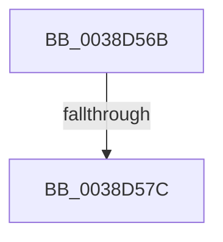

# sub_0038D56B

- RVA: `0x0038D56B`–`0x0038D588` (길이 `29` bytes)
- VA: `0x000000014038D56B`
- 실행 섹션: `.text`
- PDB 이름 있음: `아니요`; PDB Function 태그: `아니요`
- unwind 정보 RVA: `0x00080474`
- 디코드: `7`개 명령, `29/29` bytes 표시
- 미해석 바이트: `0` (있으면 어셈블리에 `.byte`로 보존)

> 이 문서는 커널 이미지의 기계어와 PDB 기호를 분석해 생성했습니다. 4번과 5번은 함수 원형과 자료형을 바이너리 사용 방식에서 추정한 C 해석이며 원본 소스 복구 결과는 아닙니다.

## 1. Dependencies

- 직접 호출 지점: **0**; 고유 호출 대상: **0**
- 직접 호출자로 확인된 함수: **0**
- RIP 상대 이미지 참조: **0**

### Outgoing calls
- 직접 디코드된 call 명령이 없습니다.

### Direct callers
- 이 함수 시작 RVA로 연결되는 직접 call은 확인되지 않았습니다. 간접 호출은 완전히 역산할 수 없습니다.

### Static image references
- 디코드된 RIP-relative 메모리 참조가 없습니다.

## 2. Other-region calls and transfers

- 다른 실행 섹션으로 향하는 call: **0**
- call이 아닌 외부 분기/꼬리 이동: **2**
  - `0x0038D576` → [sub_0038D2A1 + 0x1C3](Unknown_function_0038D2A1.md) (`tail-transfer`)
  - `0x0038D583` → [sub_0038D2A1 + 0x18F](Unknown_function_0038D2A1.md) (`tail-transfer`)

## 3. Assembly (complete function range)

```asm
0038D56B  48 8B 5F 30                     mov rbx, qword ptr [rdi + 0x30]
0038D56F  48 8B 6F 08                     mov rbp, qword ptr [rdi + 8]
0038D573  48 3B CE                        cmp rcx, rsi
0038D576  0F 87 E8 FE FF FF               ja 0x14038d464
0038D57C  49 89 5F 10                     mov qword ptr [r15 + 0x10], rbx
0038D580  4C 8B F7                        mov r14, rdi
0038D583  E9 A8 FE FF FF                  jmp 0x14038d430
```

## 4. C-style interpretation (structured pseudocode)

```c
void __fastcall sub_0038D56B(__int64 a1)
{
    *(unsigned __int64 *)(v_r15 + 16) = *(unsigned __int64 *)(v_rdi + 48);
}
```

## 5. (Beta) C Style

```c
void sub_0038D56B(int64_t Arg1)
{
    *(uint64_t *)(local_r15 + 0x10) = *(uint64_t *)(local_rdi + 0x30);
}
```

## 6. Execution-region graph

[열기: 2D/3D 그래프와 함수 탐색 컨트롤 패널](../../../control-panel.html?section=text&rva=0x0038D56B&view=graph)

- 2D 그래프는 위에서 아래로 흐르고, 3D 그래프는 빈 공간을 드래그해 회전합니다. Shift+드래그는 이동, 휠은 확대·축소, 함수 노드 선택은 대상 보고서 이동입니다.

### Static fallback


