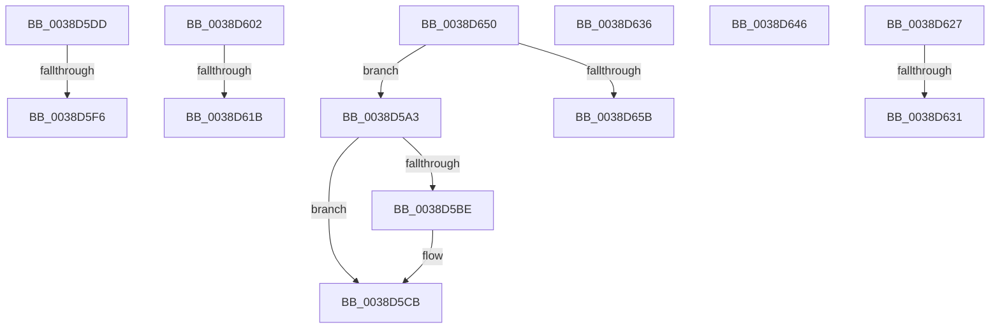

# sub_0038D5A3

- RVA: `0x0038D5A3`–`0x0038D66F` (길이 `204` bytes)
- VA: `0x000000014038D5A3`
- 실행 섹션: `.text`
- PDB 이름 있음: `아니요`; PDB Function 태그: `아니요`
- unwind 정보 RVA: `0x0008049C`
- 디코드: `44`개 명령, `204/204` bytes 표시
- 미해석 바이트: `0` (있으면 어셈블리에 `.byte`로 보존)

> 이 문서는 커널 이미지의 기계어와 PDB 기호를 분석해 생성했습니다. 4번과 5번은 함수 원형과 자료형을 바이너리 사용 방식에서 추정한 C 해석이며 원본 소스 복구 결과는 아닙니다.

## 1. Dependencies

- 직접 호출 지점: **4**; 고유 호출 대상: **3**
- 직접 호출자로 확인된 함수: **0**
- RIP 상대 이미지 참조: **5**

### Outgoing calls
- `0x0038D5A8` → [KxReleaseSpinLock](../20/KxReleaseSpinLock_function_00206670.md) (function, `0x00206670`)
- `0x0038D5C6` → [KiLowerIrqlProcessIrqlFlags](../4F/KiLowerIrqlProcessIrqlFlags_function_004F5698.md) (function, `0x004F5698`)
- `0x0038D5F8` → [ExFreePoolWithTag](../../poolcode/B8/ExFreePoolWithTag_function_00B82870.md) (function, `0x00B82870`)
- `0x0038D61D` → [ExFreePoolWithTag](../../poolcode/B8/ExFreePoolWithTag_function_00B82870.md) (function, `0x00B82870`)

### Direct callers
- 이 함수 시작 RVA로 연결되는 직접 call은 확인되지 않았습니다. 간접 호출은 완전히 역산할 수 없습니다.

### Static image references
- `0x0038D5AD` → RVA `0x00FC6D20` (`ALMOSTRO`; read)
- `0x0038D5DD` → RVA `0x00E12220` (`.data`; read/write)
- `0x0038D5E6` → RVA `0x00E12238` (`.data`; read)
- `0x0038D602` → RVA `0x00E11FA0` (`.data`; read/write)
- `0x0038D60B` → RVA `0x00E11FB8` (`.data`; read)

## 2. Other-region calls and transfers

- 다른 실행 섹션으로 향하는 call: **2**
  - `0x0038D5F8` → [ExFreePoolWithTag](../../poolcode/B8/ExFreePoolWithTag_function_00B82870.md) (`.text` → `POOLCODE`)
  - `0x0038D61D` → [ExFreePoolWithTag](../../poolcode/B8/ExFreePoolWithTag_function_00B82870.md) (`.text` → `POOLCODE`)
- call이 아닌 외부 분기/꼬리 이동: **10**
  - `0x0038D5D8` → [sub_0038D2A1 + 0x2AF](Unknown_function_0038D2A1.md) (`tail-transfer`)
  - `0x0038D5F0` → [sub_0038D785 + 0xFB](Unknown_function_0038D785.md) (`tail-transfer`)
  - `0x0038D5FD` → [sub_0038D2A1 + 0x267](Unknown_function_0038D2A1.md) (`tail-transfer`)
  - `0x0038D615` → [sub_0038D785 + 0xB9](Unknown_function_0038D785.md) (`tail-transfer`)
  - `0x0038D622` → [sub_0038D2A1 + 0x119](Unknown_function_0038D2A1.md) (`tail-transfer`)
  - `0x0038D62B` → [sub_0038D2A1 + 0x1CC](Unknown_function_0038D2A1.md) (`tail-transfer`)
  - `0x0038D631` → [sub_0038D2A1 + 0x1B6](Unknown_function_0038D2A1.md) (`tail-transfer`)
  - `0x0038D641` → [sub_0038D2A1 + 0x180](Unknown_function_0038D2A1.md) (`tail-transfer`)
  - `0x0038D64B` → [sub_0038D2A1 + 0x14E](Unknown_function_0038D2A1.md) (`tail-transfer`)
  - `0x0038D66A` → [sub_0038D2A1 + 0x14](Unknown_function_0038D2A1.md) (`tail-transfer`)

## 3. Assembly (complete function range)

```asm
0038D5A3  48 8B 4C 24 30                  mov rcx, qword ptr [rsp + 0x30]
0038D5A8  E8 C3 90 E7 FF                  call 0x140206670
0038D5AD  83 3D 6C 97 C3 00 00            cmp dword ptr [rip + 0xc3976c], 0
0038D5B4  0F B6 BC 24 A0 00 00 00         movzx edi, byte ptr [rsp + 0xa0]
0038D5BC  74 0D                           je 0x14038d5cb
0038D5BE  44 0F 20 C1                     mov rcx, cr8
0038D5C2  40 0F B6 D7                     movzx edx, dil
0038D5C6  E8 CD 80 16 00                  call 0x1404f5698
0038D5CB  40 0F B6 C7                     movzx eax, dil
0038D5CF  44 0F 22 C0                     mov cr8, rax
0038D5D3  B8 7E 00 00 C0                  mov eax, 0xc000007e
0038D5D8  E9 73 FF FF FF                  jmp 0x14038d550
0038D5DD  FF 05 3D 4C A8 00               inc dword ptr [rip + 0xa84c3d]
0038D5E3  49 8B CC                        mov rcx, r12
0038D5E6  48 8B 05 4B 4C A8 00            mov rax, qword ptr [rip + 0xa84c4b]
0038D5ED  48 3B C5                        cmp rax, rbp
0038D5F0  0F 85 8A 02 00 00               jne 0x14038d880
0038D5F6  33 D2                           xor edx, edx
0038D5F8  E8 73 52 7F 00                  call 0x140b82870
0038D5FD  E9 06 FF FF FF                  jmp 0x14038d508
0038D602  FF 05 98 49 A8 00               inc dword ptr [rip + 0xa84998]
0038D608  49 8B CF                        mov rcx, r15
0038D60B  48 8B 05 A6 49 A8 00            mov rax, qword ptr [rip + 0xa849a6]
0038D612  48 3B C5                        cmp rax, rbp
0038D615  0F 85 23 02 00 00               jne 0x14038d83e
0038D61B  33 D2                           xor edx, edx
0038D61D  E8 4E 52 7F 00                  call 0x140b82870
0038D622  E9 93 FD FF FF                  jmp 0x14038d3ba
0038D627  48 39 77 08                     cmp qword ptr [rdi + 8], rsi
0038D62B  0F 87 3C FE FF FF               ja 0x14038d46d
0038D631  E9 21 FE FF FF                  jmp 0x14038d457
0038D636  49 8B 77 10                     mov rsi, qword ptr [r15 + 0x10]
0038D63A  4D 8B F7                        mov r14, r15
0038D63D  41 88 5F 08                     mov byte ptr [r15 + 8], bl
0038D641  E9 DB FD FF FF                  jmp 0x14038d421
0038D646  4C 8B 6C 24 30                  mov r13, qword ptr [rsp + 0x30]
0038D64B  E9 9F FD FF FF                  jmp 0x14038d3ef
0038D650  49 39 5C 24 08                  cmp qword ptr [r12 + 8], rbx
0038D655  0F 87 48 FF FF FF               ja 0x14038d5a3
0038D65B  49 8B 44 24 30                  mov rax, qword ptr [r12 + 0x30]
0038D660  4D 8B F4                        mov r14, r12
0038D663  48 3B F8                        cmp rdi, rax
0038D666  48 0F 42 F8                     cmovb rdi, rax
0038D66A  E9 46 FC FF FF                  jmp 0x14038d2b5
```

## 4. C-style interpretation (structured pseudocode)

```c
__int64 __fastcall sub_0038D5A3(__int64 a1, __int64 a2, __int64 a3, __int64 a4, __int64 a5, __int64 a6, __int64 a7, __int64 a8, __int64 a9, __int64 a10, __int64 a11, __int64 a12, __int64 a13, __int64 a14, __int64 a15, __int64 a16, __int64 a17, __int64 a18, __int64 a19, unsigned __int8 a20)
{
    __int64 result;
    unsigned __int64 v_stack_p30;

    result = KxReleaseSpinLock(a6, a2, a3, a4);
    if ((*(unsigned int *)(v_rip + 12818284)) != 0) {
        a1 = v_cr8;
        a2 = a20;
        result = KiLowerIrqlProcessIrqlFlags(a1, a2, a3, a4);
    }
}
```

## 5. (Beta) C Style

```c
int64_t sub_0038D5A3(int64_t Arg1, int64_t Arg2, int64_t Arg3, int64_t Arg4, uint64_t Arg5, int64_t Arg6, uint64_t Arg7, uint64_t Arg8, uint64_t Arg9, uint64_t Arg10, uint64_t Arg11, uint64_t Arg12, uint64_t Arg13, uint64_t Arg14, uint64_t Arg15, uint64_t Arg16, uint64_t Arg17, uint64_t Arg18, uint64_t Arg19, uint8_t Arg20)
{
    int64_t result;
    uint64_t v_stack_p30;

    result = KxReleaseSpinLock(Arg6, Arg2, Arg3, Arg4);
    if ((*(uint32_t *)(v_rip + 0xC3976C)) != 0) {
        Arg1 = v_cr8;
        Arg2 = Arg20;
        result = KiLowerIrqlProcessIrqlFlags(Arg1, Arg2, Arg3, Arg4);
    }
}
```

## 6. Execution-region graph

[열기: 2D/3D 그래프와 함수 탐색 컨트롤 패널](../../../control-panel.html?section=text&rva=0x0038D5A3&view=graph)

- 2D 그래프는 위에서 아래로 흐르고, 3D 그래프는 빈 공간을 드래그해 회전합니다. Shift+드래그는 이동, 휠은 확대·축소, 함수 노드 선택은 대상 보고서 이동입니다.

### Static fallback


