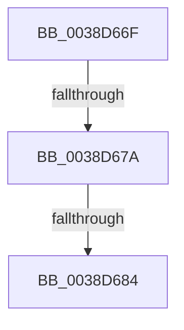

# sub_0038D66F

- RVA: `0x0038D66F`–`0x0038D68D` (길이 `30` bytes)
- VA: `0x000000014038D66F`
- 실행 섹션: `.text`
- PDB 이름 있음: `아니요`; PDB Function 태그: `아니요`
- unwind 정보 RVA: `0x000804B4`
- 디코드: `6`개 명령, `30/30` bytes 표시
- 미해석 바이트: `0` (있으면 어셈블리에 `.byte`로 보존)

> 이 문서는 커널 이미지의 기계어와 PDB 기호를 분석해 생성했습니다. 4번과 5번은 함수 원형과 자료형을 바이너리 사용 방식에서 추정한 C 해석이며 원본 소스 복구 결과는 아닙니다.

## 1. Dependencies

- 직접 호출 지점: **0**; 고유 호출 대상: **0**
- 직접 호출자로 확인된 함수: **0**
- RIP 상대 이미지 참조: **0**

### Outgoing calls
- 직접 디코드된 call 명령이 없습니다.

### Direct callers
- 이 함수 시작 RVA로 연결되는 직접 call은 확인되지 않았습니다. 간접 호출은 완전히 역산할 수 없습니다.

### Static image references
- 디코드된 RIP-relative 메모리 참조가 없습니다.

## 2. Other-region calls and transfers

- 다른 실행 섹션으로 향하는 call: **0**
- call이 아닌 외부 분기/꼬리 이동: **3**
  - `0x0038D674` → [sub_0038D588](Unknown_function_0038D588.md) (`tail-transfer`)
  - `0x0038D67E` → [sub_0038D776](Unknown_function_0038D776.md) (`tail-transfer`)
  - `0x0038D688` → [FsRtlFastUnlockSingleShared + 0x7A](FsRtlFastUnlockSingleShared_function_0038D1F0.md) (`tail-transfer`)

## 3. Assembly (complete function range)

```asm
0038D66F  49 83 79 10 00                  cmp qword ptr [r9 + 0x10], 0
0038D674  0F 85 0E FF FF FF               jne 0x14038d588
0038D67A  4D 39 41 30                     cmp qword ptr [r9 + 0x30], r8
0038D67E  0F 84 F2 00 00 00               je 0x14038d776
0038D684  4D 8B 52 10                     mov r10, qword ptr [r10 + 0x10]
0038D688  E9 DD FB FF FF                  jmp 0x14038d26a
```

## 4. C-style interpretation (structured pseudocode)

```c
void __fastcall sub_0038D66F(__int64 a1, __int64 a2, __int64 a3, __int64 a4)
{
}
```

## 5. (Beta) C Style

```c
void sub_0038D66F(int64_t Arg1, int64_t Arg2, int64_t Arg3, void *Arg4)
{
    uint8_t *arg4 = (uint8_t *)Arg4;

}
```

### 관측된 메모리 오프셋

구조체 형식이 확인되지 않은 접근은 인자 기준의 오프셋으로만 기록했습니다.

| 기준 인자 | 오프셋 표현 | 폭 (bit) | 접근 |
|---|---:|---:|---|
| `Arg4` | `+ 0x10` | `64` | `R` |
| `Arg4` | `+ 0x30` | `64` | `R` |

## 6. Execution-region graph

[열기: 2D/3D 그래프와 함수 탐색 컨트롤 패널](../../../control-panel.html?section=text&rva=0x0038D66F&view=graph)

- 2D 그래프는 위에서 아래로 흐르고, 3D 그래프는 빈 공간을 드래그해 회전합니다. Shift+드래그는 이동, 휠은 확대·축소, 함수 노드 선택은 대상 보고서 이동입니다.

### Static fallback


