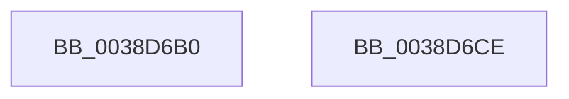

# sub_0038D6B0

- RVA: `0x0038D6B0`–`0x0038D6CF` (길이 `31` bytes)
- VA: `0x000000014038D6B0`
- 실행 섹션: `.text`
- PDB 이름 있음: `아니요`; PDB Function 태그: `아니요`
- unwind 정보 RVA: `0x000804DC`
- 디코드: `13`개 명령, `31/31` bytes 표시
- 미해석 바이트: `0` (있으면 어셈블리에 `.byte`로 보존)

> 이 문서는 커널 이미지의 기계어와 PDB 기호를 분석해 생성했습니다. 4번과 5번은 함수 원형과 자료형을 바이너리 사용 방식에서 추정한 C 해석이며 원본 소스 복구 결과는 아닙니다.

## 1. Dependencies

- 직접 호출 지점: **1**; 고유 호출 대상: **1**
- 직접 호출자로 확인된 함수: **0**
- RIP 상대 이미지 참조: **0**

### Outgoing calls
- `0x0038D6B7` → [KeReleaseSpinLock](../39/KeReleaseSpinLock_function_00392BA0.md) (function, `0x00392BA0`)

### Direct callers
- 이 함수 시작 RVA로 연결되는 직접 call은 확인되지 않았습니다. 간접 호출은 완전히 역산할 수 없습니다.

### Static image references
- 디코드된 RIP-relative 메모리 참조가 없습니다.

## 2. Other-region calls and transfers

- 다른 실행 섹션으로 향하는 call: **0**
- 별도 외부 분기/꼬리 이동을 확인하지 못했습니다.

## 3. Assembly (complete function range)

```asm
0038D6B0  41 0F B6 D6                     movzx edx, r14b
0038D6B4  48 8B CF                        mov rcx, rdi
0038D6B7  E8 E4 54 00 00                  call 0x140392ba0
0038D6BC  B8 7E 00 00 C0                  mov eax, 0xc000007e
0038D6C1  48 83 C4 58                     add rsp, 0x58
0038D6C5  41 5E                           pop r14
0038D6C7  41 5D                           pop r13
0038D6C9  5F                              pop rdi
0038D6CA  5E                              pop rsi
0038D6CB  5D                              pop rbp
0038D6CC  5B                              pop rbx
0038D6CD  C3                              ret
0038D6CE  CC                              int3
```

## 4. C-style interpretation (structured pseudocode)

```c
__int64 __fastcall sub_0038D6B0(void)
{
    __int64 result;
    __int64 v_rsp;

    result = KeReleaseSpinLock(v_rdi, (unsigned __int8)(v_r14), a3, a4);
    v_rsp = (v_rsp) + (88);
    return (unsigned int)(0xC000007EULL);
}
```

## 5. (Beta) C Style

```c
void sub_0038D6B0(void)
{
    int64_t result;
    int64_t local_rsp;

    result = KeReleaseSpinLock(local_rdi, (uint8_t)(local_r14), a3, a4);
    local_rsp = (local_rsp) + (88);
    return (uint32_t)(0xC000007EULL);
}
```

## 6. Execution-region graph

[열기: 2D/3D 그래프와 함수 탐색 컨트롤 패널](../../../control-panel.html?section=text&rva=0x0038D6B0&view=graph)

- 2D 그래프는 위에서 아래로 흐르고, 3D 그래프는 빈 공간을 드래그해 회전합니다. Shift+드래그는 이동, 휠은 확대·축소, 함수 노드 선택은 대상 보고서 이동입니다.

### Static fallback


