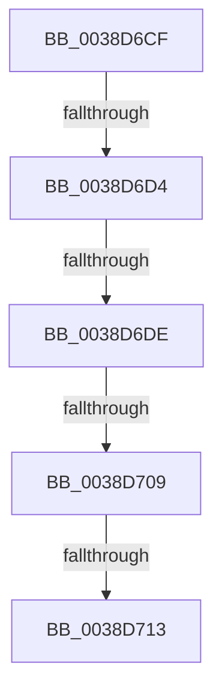

# sub_0038D6CF

- RVA: `0x0038D6CF`–`0x0038D72F` (길이 `96` bytes)
- VA: `0x000000014038D6CF`
- 실행 섹션: `.text`
- PDB 이름 있음: `아니요`; PDB Function 태그: `아니요`
- unwind 정보 RVA: `0x000804F0`
- 디코드: `21`개 명령, `96/96` bytes 표시
- 미해석 바이트: `0` (있으면 어셈블리에 `.byte`로 보존)

> 이 문서는 커널 이미지의 기계어와 PDB 기호를 분석해 생성했습니다. 4번과 5번은 함수 원형과 자료형을 바이너리 사용 방식에서 추정한 C 해석이며 원본 소스 복구 결과는 아닙니다.

## 1. Dependencies

- 직접 호출 지점: **2**; 고유 호출 대상: **1**
- 직접 호출자로 확인된 함수: **0**
- RIP 상대 이미지 참조: **0**

### Outgoing calls
- `0x0038D6F4` → [KeBugCheckEx](../4F/KeBugCheckEx_function_004FD660.md) (function, `0x004FD660`)
- `0x0038D729` → [KeBugCheckEx](../4F/KeBugCheckEx_function_004FD660.md) (function, `0x004FD660`)

### Direct callers
- 이 함수 시작 RVA로 연결되는 직접 call은 확인되지 않았습니다. 간접 호출은 완전히 역산할 수 없습니다.

### Static image references
- 디코드된 RIP-relative 메모리 참조가 없습니다.

## 2. Other-region calls and transfers

- 다른 실행 섹션으로 향하는 call: **0**
- call이 아닌 외부 분기/꼬리 이동: **4**
  - `0x0038D6D2` → [sub_0038D73D](Unknown_function_0038D73D.md) (`tail-transfer`)
  - `0x0038D6D8` → [sub_0038D785](Unknown_function_0038D785.md) (`tail-transfer`)
  - `0x0038D707` → [sub_0038D73D + 0x1C](Unknown_function_0038D73D.md) (`tail-transfer`)
  - `0x0038D70D` → [sub_0038D785 + 0x22](Unknown_function_0038D785.md) (`tail-transfer`)

## 3. Assembly (complete function range)

```asm
0038D6CF  4D 3B CA                        cmp r9, r10
0038D6D2  72 69                           jb 0x14038d73d
0038D6D4  41 F6 C1 07                     test r9b, 7
0038D6D8  0F 84 A7 00 00 00               je 0x14038d785
0038D6DE  BA 02 00 00 00                  mov edx, 2
0038D6E3  48 C7 44 24 20 08 00 00 00      mov qword ptr [rsp + 0x20], 8
0038D6EC  44 8B C2                        mov r8d, edx
0038D6EF  B9 F1 01 00 00                  mov ecx, 0x1f1
0038D6F4  E8 67 FF 16 00                  call 0x1404fd660
0038D6F9  CC                              int3
0038D6FA  48 B8 00 00 00 00 00 80 FF FF   movabs rax, 0xffff800000000000
0038D704  4C 3B C8                        cmp r9, rax
0038D707  72 50                           jb 0x14038d759
0038D709  41 F6 C1 07                     test r9b, 7
0038D70D  0F 84 94 00 00 00               je 0x14038d7a7
0038D713  BA 02 00 00 00                  mov edx, 2
0038D718  48 C7 44 24 20 08 00 00 00      mov qword ptr [rsp + 0x20], 8
0038D721  44 8B C2                        mov r8d, edx
0038D724  B9 F1 01 00 00                  mov ecx, 0x1f1
0038D729  E8 32 FF 16 00                  call 0x1404fd660
0038D72E  CC                              int3
```

## 4. C-style interpretation (structured pseudocode)

```c
__int64 __fastcall sub_0038D6CF(__int64 a1, __int64 a2, __int64 a3, __int64 a4)
{
    __int64 result;
    unsigned __int64 v_stack_p20;

    v_stack_p20 = 8;
    result = KeBugCheckEx(497, 2, 2, a4);
    v_stack_p20 = 8;
    result = KeBugCheckEx(497, 2, 2, a4);
    return result;
}
```

## 5. (Beta) C Style

```c
int64_t sub_0038D6CF(int64_t Arg1, int64_t Arg2, int64_t Arg3, int64_t Arg4)
{
    int64_t result;
    uint64_t v_stack_p20;

    v_stack_p20 = 8;
    result = KeBugCheckEx(497, 2, 2, Arg4);
    v_stack_p20 = 8;
    result = KeBugCheckEx(497, 2, 2, Arg4);
    return result;
}
```

## 6. Execution-region graph

[열기: 2D/3D 그래프와 함수 탐색 컨트롤 패널](../../../control-panel.html?section=text&rva=0x0038D6CF&view=graph)

- 2D 그래프는 위에서 아래로 흐르고, 3D 그래프는 빈 공간을 드래그해 회전합니다. Shift+드래그는 이동, 휠은 확대·축소, 함수 노드 선택은 대상 보고서 이동입니다.

### Static fallback


