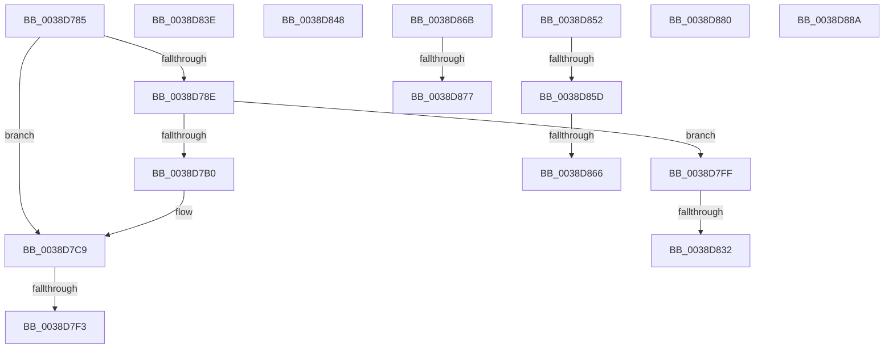

# sub_0038D785

- RVA: `0x0038D785`–`0x0038D89E` (길이 `281` bytes)
- VA: `0x000000014038D785`
- 실행 섹션: `.text`
- PDB 이름 있음: `아니요`; PDB Function 태그: `아니요`
- unwind 정보 RVA: `0x00080540`
- 디코드: `66`개 명령, `281/281` bytes 표시
- 미해석 바이트: `0` (있으면 어셈블리에 `.byte`로 보존)

> 이 문서는 커널 이미지의 기계어와 PDB 기호를 분석해 생성했습니다. 4번과 5번은 함수 원형과 자료형을 바이너리 사용 방식에서 추정한 C 해석이며 원본 소스 복구 결과는 아닙니다.

## 1. Dependencies

- 직접 호출 지점: **7**; 고유 호출 대상: **4**
- 직접 호출자로 확인된 함수: **0**
- RIP 상대 이미지 참조: **1**

### Outgoing calls
- `0x0038D7A1` → [KeBugCheckEx](../4F/KeBugCheckEx_function_004FD660.md) (function, `0x004FD660`)
- `0x0038D7C3` → [KeBugCheckEx](../4F/KeBugCheckEx_function_004FD660.md) (function, `0x004FD660`)
- `0x0038D7F5` → [memset](../6C/memset_function_006C6C40.md) (function, `0x006C6C40`)
- `0x0038D834` → [memset](../6C/memset_function_006C6C40.md) (function, `0x006C6C40`)
- `0x0038D83E` → [guard_dispatch_icall](../6B/guard_dispatch_icall_function_006BAAD0.md) (function, `0x006BAAD0`)
- `0x0038D880` → [guard_dispatch_icall](../6B/guard_dispatch_icall_function_006BAAD0.md) (function, `0x006BAAD0`)
- `0x0038D894` → [FsRtlPrivateCheckWaitingLocks](FsRtlPrivateCheckWaitingLocks_function_0038DCBC.md) (function, `0x0038DCBC`)

### Direct callers
- 이 함수 시작 RVA로 연결되는 직접 call은 확인되지 않았습니다. 간접 호출은 완전히 역산할 수 없습니다.

### Static image references
- `0x0038D7DB` → RVA `0x00FC6ED8` (`ALMOSTRO`; read)

## 2. Other-region calls and transfers

- 다른 실행 섹션으로 향하는 call: **0**
- call이 아닌 외부 분기/꼬리 이동: **13**
  - `0x0038D7ED` → [sub_0038D2A1 + 0x258](Unknown_function_0038D2A1.md) (`tail-transfer`)
  - `0x0038D7FA` → [sub_0038D2A1 + 0x258](Unknown_function_0038D2A1.md) (`tail-transfer`)
  - `0x0038D82C` → [sub_0038D2A1 + 0x10A](Unknown_function_0038D2A1.md) (`tail-transfer`)
  - `0x0038D839` → [sub_0038D2A1 + 0x10A](Unknown_function_0038D2A1.md) (`tail-transfer`)
  - `0x0038D843` → [sub_0038D2A1 + 0x119](Unknown_function_0038D2A1.md) (`tail-transfer`)
  - `0x0038D84D` → [sub_0038D2A1 + 0x137](Unknown_function_0038D2A1.md) (`tail-transfer`)
  - `0x0038D857` → [sub_006E5574](../6E/Unknown_function_006E5574.md) (`tail-transfer`)
  - `0x0038D860` → [sub_0038D2A1 + 0x1AD](Unknown_function_0038D2A1.md) (`tail-transfer`)
  - `0x0038D866` → [sub_006E5574](../6E/Unknown_function_006E5574.md) (`tail-transfer`)
  - `0x0038D871` → [sub_0038D2A1 + 0x1C3](Unknown_function_0038D2A1.md) (`tail-transfer`)
  - `0x0038D87B` → [sub_0038D2A1 + 0x1C3](Unknown_function_0038D2A1.md) (`tail-transfer`)
  - `0x0038D885` → [sub_0038D2A1 + 0x267](Unknown_function_0038D2A1.md) (`tail-transfer`)
  - `0x0038D899` → [sub_0038D2A1 + 0x27C](Unknown_function_0038D2A1.md) (`tail-transfer`)

## 3. Assembly (complete function range)

```asm
0038D785  4B 8D 04 01                     lea rax, [r9 + r8]
0038D789  49 3B C1                        cmp rax, r9
0038D78C  73 3B                           jae 0x14038d7c9
0038D78E  BA 02 00 00 00                  mov edx, 2
0038D793  4C 89 44 24 20                  mov qword ptr [rsp + 0x20], r8
0038D798  B9 F1 01 00 00                  mov ecx, 0x1f1
0038D79D  44 8D 42 01                     lea r8d, [rdx + 1]
0038D7A1  E8 BA FE 16 00                  call 0x1404fd660
0038D7A6  CC                              int3
0038D7A7  4B 8D 04 01                     lea rax, [r9 + r8]
0038D7AB  49 3B C1                        cmp rax, r9
0038D7AE  73 4F                           jae 0x14038d7ff
0038D7B0  BA 02 00 00 00                  mov edx, 2
0038D7B5  4C 89 44 24 20                  mov qword ptr [rsp + 0x20], r8
0038D7BA  B9 F1 01 00 00                  mov ecx, 0x1f1
0038D7BF  44 8D 42 01                     lea r8d, [rdx + 1]
0038D7C3  E8 98 FE 16 00                  call 0x1404fd660
0038D7C8  CC                              int3
0038D7C9  49 8D 40 FF                     lea rax, [r8 - 1]
0038D7CD  83 E0 07                        and eax, 7
0038D7D0  4B 8D 0C 19                     lea rcx, [r9 + r11]
0038D7D4  4C 2B C0                        sub r8, rax
0038D7D7  48 C1 E9 03                     shr rcx, 3
0038D7DB  48 03 0D F6 96 C3 00            add rcx, qword ptr [rip + 0xc396f6]
0038D7E2  49 83 C0 07                     add r8, 7
0038D7E6  49 C1 E8 03                     shr r8, 3
0038D7EA  4D 85 C0                        test r8, r8
0038D7ED  0F 84 06 FD FF FF               je 0x14038d4f9
0038D7F3  B2 8C                           mov dl, 0x8c
0038D7F5  E8 46 94 33 00                  call 0x1406c6c40
0038D7FA  E9 FA FC FF FF                  jmp 0x14038d4f9
0038D7FF  49 8D 40 FF                     lea rax, [r8 - 1]
0038D803  48 B9 00 00 00 00 00 80 00 00   movabs rcx, 0x800000000000
0038D80D  49 03 C9                        add rcx, r9
0038D810  83 E0 07                        and eax, 7
0038D813  4C 2B C0                        sub r8, rax
0038D816  48 C1 E9 03                     shr rcx, 3
0038D81A  48 03 0D B7 96 C3 00            add rcx, qword ptr [rip + 0xc396b7]
0038D821  49 83 C0 07                     add r8, 7
0038D825  49 C1 E8 03                     shr r8, 3
0038D829  4D 85 C0                        test r8, r8
0038D82C  0F 84 79 FB FF FF               je 0x14038d3ab
0038D832  B2 8C                           mov dl, 0x8c
0038D834  E8 07 94 33 00                  call 0x1406c6c40
0038D839  E9 6D FB FF FF                  jmp 0x14038d3ab
0038D83E  E8 8D D2 32 00                  call 0x1406baad0
0038D843  E9 72 FB FF FF                  jmp 0x14038d3ba
0038D848  4C 8B 6C 24 30                  mov r13, qword ptr [rsp + 0x30]
0038D84D  E9 86 FB FF FF                  jmp 0x14038d3d8
0038D852  48 83 7F 10 00                  cmp qword ptr [rdi + 0x10], 0
0038D857  0F 85 17 7D 35 00               jne 0x1406e5574
0038D85D  48 3B C5                        cmp rax, rbp
0038D860  0F 84 E8 FB FF FF               je 0x14038d44e
0038D866  E9 09 7D 35 00                  jmp 0x1406e5574
0038D86B  48 8B D8                        mov rbx, rax
0038D86E  48 3B CE                        cmp rcx, rsi
0038D871  0F 87 ED FB FF FF               ja 0x14038d464
0038D877  49 89 47 10                     mov qword ptr [r15 + 0x10], rax
0038D87B  E9 E4 FB FF FF                  jmp 0x14038d464
0038D880  E8 4B D2 32 00                  call 0x1406baad0
0038D885  E9 7E FC FF FF                  jmp 0x14038d508
0038D88A  44 0F B6 C7                     movzx r8d, dil
0038D88E  49 8B D5                        mov rdx, r13
0038D891  48 8B CB                        mov rcx, rbx
0038D894  E8 23 04 00 00                  call 0x14038dcbc
0038D899  E9 7F FC FF FF                  jmp 0x14038d51d
```

## 4. C-style interpretation (structured pseudocode)

```c
__int64 __fastcall sub_0038D785(__int64 a1, __int64 a2, __int64 a3, __int64 a4)
{
    __int64 result;
    unsigned __int64 v_stack_p20;
    unsigned __int64 v_stack_p30;

    if ((a4 + a3 * 1) >= a4) goto loc_0038D7C9;
    v_stack_p20 = a3;
    result = KeBugCheckEx(497, 2, 2 + 1, a4);
    if ((a4 + 2 + 1 * 1) >= a4) goto loc_0038D7FF;
    v_stack_p20 = 2 + 1;
    result = KeBugCheckEx(497, 2, 2 + 1, a4);
loc_0038D7C9:
    result = (unsigned int)((2 + 1 - 1) & (7));
    a3 = (2 + 1) - (result);
    a1 = (a4 + v_r11 * 1) >> (3);
    a1 = (a1) + (*(unsigned __int64 *)(v_rip + 12818166));
    a3 = (a3) + (7);
    a3 = (a3) >> (3);
    result = memset(a1, 140, a3, a4);
loc_0038D7FF:
    a1 = (a1) + (a4);
    result = (unsigned int)((a3 - 1) & (7));
    a3 = (a3) - (result);
    a1 = (a1) >> (3);
    a1 = (a1) + (*(unsigned __int64 *)(v_rip + 12818103));
    a3 = (a3) + (7);
    a3 = (a3) >> (3);
    result = memset(a1, 140, a3, a4);
}
```

## 5. (Beta) C Style

```c
int64_t sub_0038D785(int64_t Arg1, int64_t Arg2, int64_t Arg3, void *Arg4)
{
    uint8_t *arg4 = (uint8_t *)Arg4;

    int64_t result;
    uint64_t v_stack_p20;
    uint64_t v_stack_p30;

    if ((Arg4 + Arg3 * 1) >= Arg4) goto loc_0038D7C9;
    v_stack_p20 = Arg3;
    result = KeBugCheckEx(497, 2, 2 + 1, Arg4);
    if ((Arg4 + 2 + 1 * 1) >= Arg4) goto loc_0038D7FF;
    v_stack_p20 = 2 + 1;
    result = KeBugCheckEx(497, 2, 2 + 1, Arg4);
loc_0038D7C9:
    result = (uint32_t)((2 + 1 - 1) & (7));
    Arg3 = (2 + 1) - (result);
    Arg1 = (Arg4 + local_r11 * 1) >> (3);
    Arg1 = (Arg1) + (*(uint64_t *)(v_rip + 0xC396F6));
    Arg3 = (Arg3) + (7);
    Arg3 = (Arg3) >> (3);
    result = memset(Arg1, 140, Arg3, Arg4);
loc_0038D7FF:
    Arg1 = (Arg1) + (Arg4);
    result = (uint32_t)((Arg3 - 1) & (7));
    Arg3 = (Arg3) - (result);
    Arg1 = (Arg1) >> (3);
    Arg1 = (Arg1) + (*(uint64_t *)(v_rip + 0xC396B7));
    Arg3 = (Arg3) + (7);
    Arg3 = (Arg3) >> (3);
    result = memset(Arg1, 140, Arg3, Arg4);
}
```

### 관측된 메모리 오프셋

구조체 형식이 확인되지 않은 접근은 인자 기준의 오프셋으로만 기록했습니다.

| 기준 인자 | 오프셋 표현 | 폭 (bit) | 접근 |
|---|---:|---:|---|
| `Arg4` | `+ 0x0 + r8*1` | `64` | `R` |

## 6. Execution-region graph

[열기: 2D/3D 그래프와 함수 탐색 컨트롤 패널](../../../control-panel.html?section=text&rva=0x0038D785&view=graph)

- 2D 그래프는 위에서 아래로 흐르고, 3D 그래프는 빈 공간을 드래그해 회전합니다. Shift+드래그는 이동, 휠은 확대·축소, 함수 노드 선택은 대상 보고서 이동입니다.

### Static fallback


