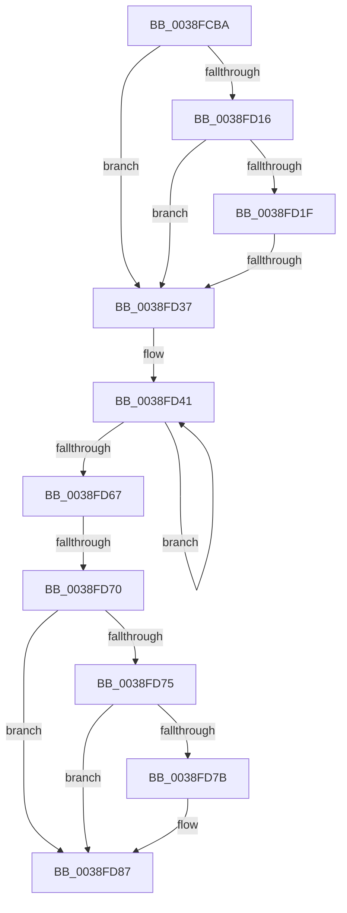

# sub_0038FCBA

- RVA: `0x0038FCBA`–`0x0038FDA5` (길이 `235` bytes)
- VA: `0x000000014038FCBA`
- 실행 섹션: `.text`
- PDB 이름 있음: `아니요`; PDB Function 태그: `아니요`
- unwind 정보 RVA: `0x0008088C`
- 디코드: `59`개 명령, `235/235` bytes 표시
- 미해석 바이트: `0` (있으면 어셈블리에 `.byte`로 보존)

> 이 문서는 커널 이미지의 기계어와 PDB 기호를 분석해 생성했습니다. 4번과 5번은 함수 원형과 자료형을 바이너리 사용 방식에서 추정한 C 해석이며 원본 소스 복구 결과는 아닙니다.

## 1. Dependencies

- 직접 호출 지점: **0**; 고유 호출 대상: **0**
- 직접 호출자로 확인된 함수: **0**
- RIP 상대 이미지 참조: **2**

### Outgoing calls
- 직접 디코드된 call 명령이 없습니다.

### Direct callers
- 이 함수 시작 RVA로 연결되는 직접 call은 확인되지 않았습니다. 간접 호출은 완전히 역산할 수 없습니다.

### Static image references
- `0x0038FCDD` → RVA `0x00000000` (`image boundary/outside`; read)
- `0x0038FD3A` → RVA `0x00E27F80` (`.data`; read)

## 2. Other-region calls and transfers

- 다른 실행 섹션으로 향하는 call: **0**
- call이 아닌 외부 분기/꼬리 이동: **2**
  - `0x0038FD35` → [sub_0038FDAD](Unknown_function_0038FDAD.md) (`tail-transfer`)
  - `0x0038FD6A` → [sub_0038FDAD + 0x53](Unknown_function_0038FDAD.md) (`tail-transfer`)

## 3. Assembly (complete function range)

```asm
0038FCBA  48 89 6C 24 68                  mov qword ptr [rsp + 0x68], rbp
0038FCBF  33 C0                           xor eax, eax
0038FCC1  48 89 74 24 70                  mov qword ptr [rsp + 0x70], rsi
0038FCC6  83 FA 01                        cmp edx, 1
0038FCC9  4C 89 64 24 78                  mov qword ptr [rsp + 0x78], r12
0038FCCE  0F 94 C0                        sete al
0038FCD1  4C 89 6C 24 40                  mov qword ptr [rsp + 0x40], r13
0038FCD6  4C 8B A9 F8 02 00 00            mov r13, qword ptr [rcx + 0x2f8]
0038FCDD  48 8D 0D 1C 03 C7 FF            lea rcx, [rip - 0x38fce4]
0038FCE4  4C 89 74 24 38                  mov qword ptr [rsp + 0x38], r14
0038FCE9  44 8B E0                        mov r12d, eax
0038FCEC  49 C1 E4 07                     shl r12, 7
0038FCF0  8B E8                           mov ebp, eax
0038FCF2  4C 89 7C 24 30                  mov qword ptr [rsp + 0x30], r15
0038FCF7  4F 8D 34 2C                     lea r14, [r12 + r13]
0038FCFB  44 0F B6 BC E9 50 73 FC 00      movzx r15d, byte ptr [rcx + rbp*8 + 0xfc7350]
0038FD04  41 0F 0D 0E                     prefetchw byte ptr [r14]
0038FD08  49 8B 36                        mov rsi, qword ptr [r14]
0038FD0B  49 8B 56 40                     mov rdx, qword ptr [r14 + 0x40]
0038FD0F  49 83 7E 50 00                  cmp qword ptr [r14 + 0x50], 0
0038FD14  74 21                           je 0x14038fd37
0038FD16  48 6B C5 38                     imul rax, rbp, 0x38
0038FD1A  48 3B D6                        cmp rdx, rsi
0038FD1D  76 18                           jbe 0x14038fd37
0038FD1F  4C 8D 89 48 66 F0 00            lea r9, [rcx + 0xf06648]
0038FD26  4C 03 C8                        add r9, rax
0038FD29  48 8B C2                        mov rax, rdx
0038FD2C  48 2B C6                        sub rax, rsi
0038FD2F  4D 8B 01                        mov r8, qword ptr [r9]
0038FD32  49 3B C0                        cmp rax, r8
0038FD35  77 76                           ja 0x14038fdad
0038FD37  4C 8B C7                        mov r8, rdi
0038FD3A  4C 8D 15 3F 82 A9 00            lea r10, [rip + 0xa9823f]
0038FD41  4C 3B C6                        cmp r8, rsi
0038FD44  4C 8B CE                        mov r9, rsi
0038FD47  48 8B CE                        mov rcx, rsi
0038FD4A  48 8B C6                        mov rax, rsi
0038FD4D  4D 0F 42 C8                     cmovb r9, r8
0038FD51  49 2B C8                        sub rcx, r8
0038FD54  33 D2                           xor edx, edx
0038FD56  4C 3B C6                        cmp r8, rsi
0038FD59  48 0F 42 D1                     cmovb rdx, rcx
0038FD5D  F0 49 0F B1 16                  lock cmpxchg qword ptr [r14], rdx
0038FD62  48 8B F0                        mov rsi, rax
0038FD65  75 DA                           jne 0x14038fd41
0038FD67  4D 2B C1                        sub r8, r9
0038FD6A  0F 85 90 00 00 00               jne 0x14038fe00
0038FD70  48 85 DB                        test rbx, rbx
0038FD73  74 12                           je 0x14038fd87
0038FD75  41 F6 C7 04                     test r15b, 4
0038FD79  74 0C                           je 0x14038fd87
0038FD7B  48 F7 DF                        neg rdi
0038FD7E  F0 48 01 BC EB 00 02 00 00      lock add qword ptr [rbx + rbp*8 + 0x200], rdi
0038FD87  4C 8B 74 24 38                  mov r14, qword ptr [rsp + 0x38]
0038FD8C  4C 8B 6C 24 40                  mov r13, qword ptr [rsp + 0x40]
0038FD91  4C 8B 64 24 78                  mov r12, qword ptr [rsp + 0x78]
0038FD96  48 8B 74 24 70                  mov rsi, qword ptr [rsp + 0x70]
0038FD9B  48 8B 6C 24 68                  mov rbp, qword ptr [rsp + 0x68]
0038FDA0  4C 8B 7C 24 30                  mov r15, qword ptr [rsp + 0x30]
```

## 4. C-style interpretation (structured pseudocode)

```c
__int64 __fastcall sub_0038FCBA(__int64 a1, int a2, __int64 a3, __int64 a4, __int64 a5, __int64 a6, __int64 a7, __int64 a8, __int64 a9, __int64 a10, __int64 a11, __int64 a12, __int64 a13, __int64 a14, __int64 a15)
{
    __int64 result;
    __int64 v_r12;
    __int64 v_rdi;
    unsigned __int64 v_stack_p30;
    unsigned __int64 v_stack_p38;
    unsigned __int64 v_stack_p40;
    unsigned __int64 v_stack_p68;
    unsigned __int64 v_stack_p70;
    unsigned __int64 v_stack_p78;

    v_stack_p68 = v_rbp;
    result = 0;
    v_stack_p70 = v_rsi;
    v_stack_p78 = v_r12;
    result = (a2 == 1) ? 1 : 0;
    v_stack_p40 = v_r13;
    v_stack_p38 = v_r14;
    v_r12 = ((unsigned int)((unsigned int)(result))) << (7);
    v_stack_p30 = v_r15;
    if ((*(unsigned __int64 *)(v_r12 + *(unsigned __int64 *)(a1 + 760) * 1 + 80)) == 0) goto loc_0038FD37;
    result = (result) * ((unsigned int)((unsigned int)(result)));
    if ((*(unsigned __int64 *)(v_r12 + *(unsigned __int64 *)(a1 + 760) * 1 + 64)) <= (*(unsigned __int64 *)(v_r12 + *(unsigned __int64 *)(a1 + 760) * 1))) goto loc_0038FD37;
    a4 = (v_rip - 3734756 + 15754824) + (result);
    result = (*(unsigned __int64 *)(v_r12 + *(unsigned __int64 *)(a1 + 760) * 1 + 64)) - (*(unsigned __int64 *)(v_r12 + *(unsigned __int64 *)(a1 + 760) * 1));
loc_0038FD37:
loc_0038FD41:
    a4 = *(unsigned __int64 *)(v_r12 + *(unsigned __int64 *)(a1 + 760) * 1);
    if (v_rdi < (*(unsigned __int64 *)(v_r12 + *(unsigned __int64 *)(a1 + 760) * 1))) { a4 = v_rdi; }
    a1 = (*(unsigned __int64 *)(v_r12 + *(unsigned __int64 *)(a1 + 760) * 1)) - (v_rdi);
    a2 = 0;
    if (v_rdi < (*(unsigned __int64 *)(v_r12 + *(unsigned __int64 *)(a1 + 760) * 1))) { a2 = a1; }
    if (v_rdi != (*(unsigned __int64 *)(v_r12 + *(unsigned __int64 *)(a1 + 760) * 1))) goto loc_0038FD41;
    a3 = (v_rdi) - (a4);
    if (v_rbx == 0) goto loc_0038FD87;
    if ((((unsigned __int8)(*(unsigned __int8 *)(v_rip - 3734756 + (unsigned int)((unsigned int)(result)) * 8 + 16544592))) & (4)) != 0) {
        v_rdi = -(v_rdi);
    }
    return *(unsigned __int64 *)(v_r12 + *(unsigned __int64 *)(a1 + 760) * 1);
}
```

## 5. (Beta) C Style

```c
int64_t sub_0038FCBA(void *Arg1, int32_t Arg2, int64_t Arg3, int64_t Arg4, uint64_t Arg5, int64_t Arg6, int64_t Arg7, int64_t Arg8, uint64_t Arg9, uint64_t Arg10, uint64_t Arg11, uint64_t Arg12, int64_t Arg13, int64_t Arg14, int64_t Arg15)
{
    uint8_t *arg1 = (uint8_t *)Arg1;

    int64_t result;
    int64_t local_r12;
    int64_t local_rdi;
    uint64_t v_stack_p30;
    uint64_t v_stack_p38;
    uint64_t v_stack_p40;
    uint64_t v_stack_p68;
    uint64_t v_stack_p70;
    uint64_t v_stack_p78;

    v_stack_p68 = local_rbp;
    result = 0;
    v_stack_p70 = local_rsi;
    v_stack_p78 = local_r12;
    result = (Arg2 == 1) ? 1 : 0;
    v_stack_p40 = local_r13;
    v_stack_p38 = local_r14;
    local_r12 = ((uint32_t)((uint32_t)(result))) << (7);
    v_stack_p30 = local_r15;
    if ((*(uint64_t *)(local_r12 + *(uint64_t *)(arg1 + 0x2F8) * 1 + 0x50)) == 0) goto loc_0038FD37;
    result = (result) * ((uint32_t)((uint32_t)(result)));
    if ((*(uint64_t *)(local_r12 + *(uint64_t *)(arg1 + 0x2F8) * 1 + 0x40)) <= (*(uint64_t *)(local_r12 + *(uint64_t *)(arg1 + 0x2F8) * 1))) goto loc_0038FD37;
    Arg4 = (v_rip - 3734756 + 15754824) + (result);
    result = (*(uint64_t *)(local_r12 + *(uint64_t *)(arg1 + 0x2F8) * 1 + 0x40)) - (*(uint64_t *)(local_r12 + *(uint64_t *)(arg1 + 0x2F8) * 1));
loc_0038FD37:
loc_0038FD41:
    Arg4 = *(uint64_t *)(local_r12 + *(uint64_t *)(arg1 + 0x2F8) * 1);
    if (local_rdi < (*(uint64_t *)(local_r12 + *(uint64_t *)(arg1 + 0x2F8) * 1))) { Arg4 = local_rdi; }
    Arg1 = (*(uint64_t *)(local_r12 + *(uint64_t *)(arg1 + 0x2F8) * 1)) - (local_rdi);
    Arg2 = 0;
    if (local_rdi < (*(uint64_t *)(local_r12 + *(uint64_t *)(arg1 + 0x2F8) * 1))) { Arg2 = Arg1; }
    if (local_rdi != (*(uint64_t *)(local_r12 + *(uint64_t *)(arg1 + 0x2F8) * 1))) goto loc_0038FD41;
    Arg3 = (local_rdi) - (Arg4);
    if (local_rbx == 0) goto loc_0038FD87;
    if ((((uint8_t)(*(uint8_t *)(v_rip - 0x38FCE4 + (uint32_t)((uint32_t)(result)) * 8 + 0xFC7350))) & (4)) != 0) {
        local_rdi = -(local_rdi);
    }
    return *(uint64_t *)(local_r12 + *(uint64_t *)(arg1 + 0x2F8) * 1);
}
```

### 관측된 메모리 오프셋

구조체 형식이 확인되지 않은 접근은 인자 기준의 오프셋으로만 기록했습니다.

| 기준 인자 | 오프셋 표현 | 폭 (bit) | 접근 |
|---|---:|---:|---|
| `Arg1` | `+ 0x2F8` | `64` | `R` |

## 6. Execution-region graph

[열기: 2D/3D 그래프와 함수 탐색 컨트롤 패널](../../../control-panel.html?section=text&rva=0x0038FCBA&view=graph)

- 2D 그래프는 위에서 아래로 흐르고, 3D 그래프는 빈 공간을 드래그해 회전합니다. Shift+드래그는 이동, 휠은 확대·축소, 함수 노드 선택은 대상 보고서 이동입니다.

### Static fallback


