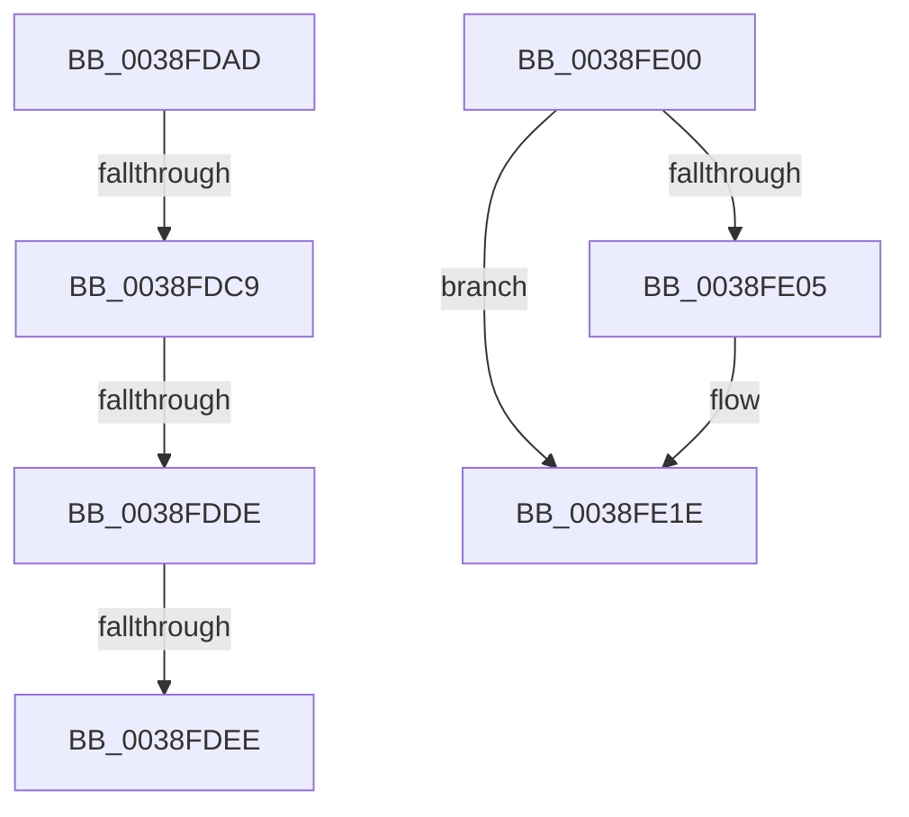

# sub_0038FDAD

- RVA: `0x0038FDAD`–`0x0038FE31` (길이 `132` bytes)
- VA: `0x000000014038FDAD`
- 실행 섹션: `.text`
- PDB 이름 있음: `아니요`; PDB Function 태그: `아니요`
- unwind 정보 RVA: `0x000808C8`
- 디코드: `35`개 명령, `132/132` bytes 표시
- 미해석 바이트: `0` (있으면 어셈블리에 `.byte`로 보존)

> 이 문서는 커널 이미지의 기계어와 PDB 기호를 분석해 생성했습니다. 4번과 5번은 함수 원형과 자료형을 바이너리 사용 방식에서 추정한 C 해석이며 원본 소스 복구 결과는 아닙니다.

## 1. Dependencies

- 직접 호출 지점: **2**; 고유 호출 대상: **2**
- 직접 호출자로 확인된 함수: **0**
- RIP 상대 이미지 참조: **0**

### Outgoing calls
- `0x0038FDF6` → [PspReturnResourceQuota](PspReturnResourceQuota_function_0038FFC4.md) (function, `0x0038FFC4`)
- `0x0038FE18` → [KeBugCheckEx](../4F/KeBugCheckEx_function_004FD660.md) (function, `0x004FD660`)

### Direct callers
- 이 함수 시작 RVA로 연결되는 직접 call은 확인되지 않았습니다. 간접 호출은 완전히 역산할 수 없습니다.

### Static image references
- 디코드된 RIP-relative 메모리 참조가 없습니다.

## 2. Other-region calls and transfers

- 다른 실행 섹션으로 향하는 call: **0**
- call이 아닌 외부 분기/꼬리 이동: **5**
  - `0x0038FDC3` → [sub_0038FCBA + 0x7D](Unknown_function_0038FCBA.md) (`tail-transfer`)
  - `0x0038FDD8` → [sub_0038FCBA + 0x7D](Unknown_function_0038FCBA.md) (`tail-transfer`)
  - `0x0038FDE8` → [sub_0038FCBA + 0x7D](Unknown_function_0038FCBA.md) (`tail-transfer`)
  - `0x0038FDFB` → [sub_0038FCBA + 0x7D](Unknown_function_0038FCBA.md) (`tail-transfer`)
  - `0x0038FE2C` → [sub_0038FCBA + 0x87](Unknown_function_0038FCBA.md) (`tail-transfer`)

## 3. Assembly (complete function range)

```asm
0038FDAD  4C 3B C7                        cmp r8, rdi
0038FDB0  48 8B CA                        mov rcx, rdx
0038FDB3  48 8B C2                        mov rax, rdx
0038FDB6  4C 0F 47 C7                     cmova r8, rdi
0038FDBA  49 2B C8                        sub rcx, r8
0038FDBD  F0 49 0F B1 4E 40               lock cmpxchg qword ptr [r14 + 0x40], rcx
0038FDC3  0F 85 6E FF FF FF               jne 0x14038fd37
0038FDC9  49 8B C0                        mov rax, r8
0038FDCC  F0 49 0F C1 46 48               lock xadd qword ptr [r14 + 0x48], rax
0038FDD2  4C 03 C0                        add r8, rax
0038FDD5  4D 3B 01                        cmp r8, qword ptr [r9]
0038FDD8  0F 86 59 FF FF FF               jbe 0x14038fd37
0038FDDE  45 33 C0                        xor r8d, r8d
0038FDE1  4D 87 46 48                     xchg qword ptr [r14 + 0x48], r8
0038FDE5  4D 85 C0                        test r8, r8
0038FDE8  0F 84 49 FF FF FF               je 0x14038fd37
0038FDEE  45 33 C9                        xor r9d, r9d
0038FDF1  49 8B D6                        mov rdx, r14
0038FDF4  8B CD                           mov ecx, ebp
0038FDF6  E8 C9 01 00 00                  call 0x14038ffc4
0038FDFB  E9 37 FF FF FF                  jmp 0x14038fd37
0038FE00  4D 3B EA                        cmp r13, r10
0038FE03  75 19                           jne 0x14038fe1e
0038FE05  4C 89 44 24 20                  mov qword ptr [rsp + 0x20], r8
0038FE0A  4C 8B CF                        mov r9, rdi
0038FE0D  4C 8B C5                        mov r8, rbp
0038FE10  48 8B D3                        mov rdx, rbx
0038FE13  B9 21 00 00 00                  mov ecx, 0x21
0038FE18  E8 43 D8 16 00                  call 0x1404fd660
0038FE1D  CC                              int3
0038FE1E  4D 8B EA                        mov r13, r10
0038FE21  4F 8D 34 14                     lea r14, [r12 + r10]
0038FE25  41 0F 0D 0E                     prefetchw byte ptr [r14]
0038FE29  49 8B 36                        mov rsi, qword ptr [r14]
0038FE2C  E9 10 FF FF FF                  jmp 0x14038fd41
```

## 4. C-style interpretation (structured pseudocode)

```c
__int64 __fastcall sub_0038FDAD(__int64 a1, __int64 a2, __int64 a3, __int64 a4)
{
    __int64 result;
    unsigned __int64 v_stack_p20;

    if (a3 > v_rdi) { a3 = v_rdi; }
    a1 = (a2) - (a3);
    a3 = (a3) + (a3);
    a3 = 0;
    a4 = 0;
    result = PspReturnResourceQuota((unsigned int)((unsigned int)(v_rbp)), v_r14, a3, a4);
}
```

## 5. (Beta) C Style

```c
int64_t sub_0038FDAD(int64_t Arg1, int64_t Arg2, int64_t Arg3, void *Arg4)
{
    uint8_t *arg4 = (uint8_t *)Arg4;

    int64_t result;
    uint64_t v_stack_p20;

    if (Arg3 > local_rdi) { Arg3 = local_rdi; }
    Arg1 = (Arg2) - (Arg3);
    Arg3 = (Arg3) + (Arg3);
    Arg3 = 0;
    Arg4 = 0;
    result = PspReturnResourceQuota((uint32_t)((uint32_t)(local_rbp)), local_r14, Arg3, Arg4);
}
```

### 관측된 메모리 오프셋

구조체 형식이 확인되지 않은 접근은 인자 기준의 오프셋으로만 기록했습니다.

| 기준 인자 | 오프셋 표현 | 폭 (bit) | 접근 |
|---|---:|---:|---|
| `Arg4` | `+ 0x0` | `64` | `R` |

## 6. Execution-region graph

[열기: 2D/3D 그래프와 함수 탐색 컨트롤 패널](../../../control-panel.html?section=text&rva=0x0038FDAD&view=graph)

- 2D 그래프는 위에서 아래로 흐르고, 3D 그래프는 빈 공간을 드래그해 회전합니다. Shift+드래그는 이동, 휠은 확대·축소, 함수 노드 선택은 대상 보고서 이동입니다.

### Static fallback


