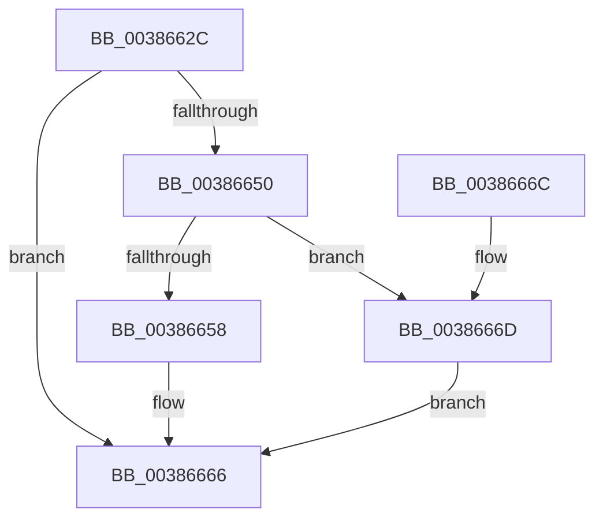

# WheapWorkQueueAddItem

- RVA: `0x0038662C`–`0x00386678` (길이 `76` bytes)
- VA: `0x000000014038662C`
- 실행 섹션: `.text`
- PDB 이름 있음: `예`; PDB Function 태그: `아니요`
- unwind 정보 RVA: `0x0007FBDC`
- 디코드: `25`개 명령, `76/76` bytes 표시
- 미해석 바이트: `0` (있으면 어셈블리에 `.byte`로 보존)

> 이 문서는 커널 이미지의 기계어와 PDB 기호를 분석해 생성했습니다. 4번과 5번은 함수 원형과 자료형을 바이너리 사용 방식에서 추정한 C 해석이며 원본 소스 복구 결과는 아닙니다.

## 1. Dependencies

- 직접 호출 지점: **3**; 고유 호출 대상: **3**
- 직접 호출자로 확인된 함수: **3**
- RIP 상대 이미지 참조: **0**

### Outgoing calls
- `0x00386639` → [ExInterlockedInsertTailList](ExInterlockedInsertTailList_function_00386700.md) (function, `0x00386700`)
- `0x00386661` → [KeInsertQueueDpc](../20/KeInsertQueueDpc_function_00207C50.md) (function, `0x00207C50`)
- `0x00386671` → [ExQueueWorkItem](../2F/ExQueueWorkItem_function_002F9520.md) (function, `0x002F9520`)

### Direct callers
- [WheaReportHwError](../4E/WheaReportHwError_function_004ED200.md) at `0x004ED5B2`
- [WheapReportBootError](../65/WheapReportBootError_function_0065DF58.md) at `0x0065DFEA`
- [WheapReportPersistedErrorRecord](../65/WheapReportPersistedErrorRecord_function_0065E010.md) at `0x0065E07D`

### Static image references
- 디코드된 RIP-relative 메모리 참조가 없습니다.

## 2. Other-region calls and transfers

- 다른 실행 섹션으로 향하는 call: **0**
- 별도 외부 분기/꼬리 이동을 확인하지 못했습니다.

## 3. Assembly (complete function range)

```asm
0038662C  40 53                           push rbx
0038662E  48 83 EC 20                     sub rsp, 0x20
00386632  4C 8D 41 10                     lea r8, [rcx + 0x10]
00386636  48 8B D9                        mov rbx, rcx
00386639  E8 C2 00 00 00                  call 0x140386700
0038663E  BA 01 00 00 00                  mov edx, 1
00386643  8B C2                           mov eax, edx
00386645  F0 0F C1 43 18                  lock xadd dword ptr [rbx + 0x18], eax
0038664A  03 C2                           add eax, edx
0038664C  3B C2                           cmp eax, edx
0038664E  75 16                           jne 0x140386666
00386650  44 0F 20 C0                     mov rax, cr8
00386654  3C 02                           cmp al, 2
00386656  76 15                           jbe 0x14038666d
00386658  48 8D 4B 20                     lea rcx, [rbx + 0x20]
0038665C  45 33 C0                        xor r8d, r8d
0038665F  33 D2                           xor edx, edx
00386661  E8 EA 15 E8 FF                  call 0x140207c50
00386666  48 83 C4 20                     add rsp, 0x20
0038666A  5B                              pop rbx
0038666B  C3                              ret
0038666C  CC                              int3
0038666D  48 8D 4B 60                     lea rcx, [rbx + 0x60]
00386671  E8 AA 2E F7 FF                  call 0x1402f9520
00386676  EB EE                           jmp 0x140386666
```

## 4. C-style interpretation (structured pseudocode)

```c
__int64 __fastcall WheapWorkQueueAddItem(__int64 a1)
{
    __int64 result;
    __int64 v_rsp;

    v_rsp = (v_rsp) - (32);
    result = ExInterlockedInsertTailList(a1, a2, a1 + 16, a4);
    result = (unsigned int)((1) + (1));
    if (((unsigned int)(result)) != 1) goto loc_00386666;
    if (((unsigned __int8)(v_cr8)) <= 2) goto loc_0038666D;
    a3 = 0;
    a2 = 0;
    result = KeInsertQueueDpc(a1 + 32, a2, a3, a4);
loc_00386666:
    v_rsp = (v_rsp) + (32);
    return result;
loc_0038666D:
    result = ExQueueWorkItem(a1 + 96, a2, a3, a4);
    goto loc_00386666;
}
```

## 5. (Beta) C Style

```c
int64_t WheapWorkQueueAddItem(void *Arg1)
{
    uint8_t *arg1 = (uint8_t *)Arg1;

    int64_t result;
    int64_t local_rsp;

    local_rsp = (local_rsp) - (32);
    result = ExInterlockedInsertTailList(Arg1, a2, Arg1 + 16, a4);
    result = (uint32_t)((1) + (1));
    if (((uint32_t)(result)) != 1) goto loc_00386666;
    if (((uint8_t)(v_cr8)) <= 2) goto loc_0038666D;
    a3 = 0;
    a2 = 0;
    result = KeInsertQueueDpc(Arg1 + 32, a2, a3, a4);
loc_00386666:
    local_rsp = (local_rsp) + (32);
    return result;
loc_0038666D:
    result = ExQueueWorkItem(Arg1 + 96, a2, a3, a4);
    goto loc_00386666;
}
```

### 관측된 메모리 오프셋

구조체 형식이 확인되지 않은 접근은 인자 기준의 오프셋으로만 기록했습니다.

| 기준 인자 | 오프셋 표현 | 폭 (bit) | 접근 |
|---|---:|---:|---|
| `Arg1` | `+ 0x10` | `64` | `R` |
| `Arg1` | `+ 0x18` | `32` | `R/W` |
| `Arg1` | `+ 0x20` | `64` | `R` |
| `Arg1` | `+ 0x60` | `64` | `R` |

## 6. Execution-region graph

[열기: 2D/3D 그래프와 함수 탐색 컨트롤 패널](../../../control-panel.html?section=text&rva=0x0038662C&view=graph)

- 2D 그래프는 위에서 아래로 흐르고, 3D 그래프는 빈 공간을 드래그해 회전합니다. Shift+드래그는 이동, 휠은 확대·축소, 함수 노드 선택은 대상 보고서 이동입니다.

### Static fallback


