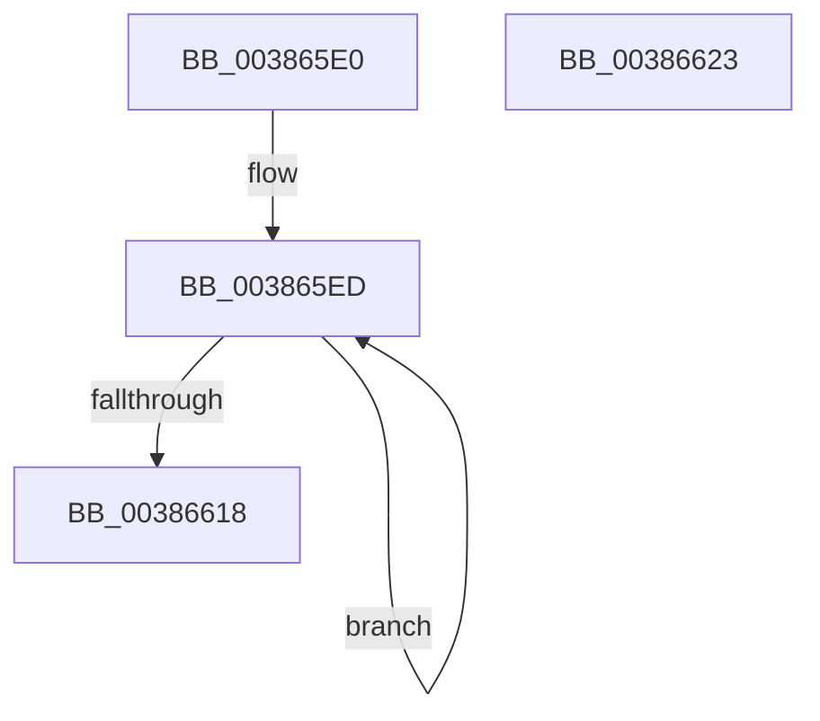

# WheapWorkQueueWorkerRoutine

- RVA: `0x003865E0`–`0x00386624` (길이 `68` bytes)
- VA: `0x00000001403865E0`
- 실행 섹션: `.text`
- PDB 이름 있음: `예`; PDB Function 태그: `아니요`
- unwind 정보 RVA: `0x00068D5C`
- 디코드: `20`개 명령, `68/68` bytes 표시
- 미해석 바이트: `0` (있으면 어셈블리에 `.byte`로 보존)

> 이 문서는 커널 이미지의 기계어와 PDB 기호를 분석해 생성했습니다. 4번과 5번은 함수 원형과 자료형을 바이너리 사용 방식에서 추정한 C 해석이며 원본 소스 복구 결과는 아닙니다.

## 1. Dependencies

- 직접 호출 지점: **2**; 고유 호출 대상: **2**
- 직접 호출자로 확인된 함수: **0**
- RIP 상대 이미지 참조: **0**

### Outgoing calls
- `0x003865F4` → [ExInterlockedRemoveHeadList](ExInterlockedRemoveHeadList_function_003867B0.md) (function, `0x003867B0`)
- `0x00386606` → [guard_dispatch_icall](../6B/guard_dispatch_icall_function_006BAAD0.md) (function, `0x006BAAD0`)

### Direct callers
- 이 함수 시작 RVA로 연결되는 직접 call은 확인되지 않았습니다. 간접 호출은 완전히 역산할 수 없습니다.

### Static image references
- 디코드된 RIP-relative 메모리 참조가 없습니다.

## 2. Other-region calls and transfers

- 다른 실행 섹션으로 향하는 call: **0**
- 별도 외부 분기/꼬리 이동을 확인하지 못했습니다.

## 3. Assembly (complete function range)

```asm
003865E0  48 89 5C 24 10                  mov qword ptr [rsp + 0x10], rbx
003865E5  57                              push rdi
003865E6  48 83 EC 20                     sub rsp, 0x20
003865EA  48 8B D9                        mov rbx, rcx
003865ED  48 8D 53 10                     lea rdx, [rbx + 0x10]
003865F1  48 8B CB                        mov rcx, rbx
003865F4  E8 B7 01 00 00                  call 0x1403867b0
003865F9  48 8B D0                        mov rdx, rax
003865FC  48 8B CB                        mov rcx, rbx
003865FF  48 8B 83 80 00 00 00            mov rax, qword ptr [rbx + 0x80]
00386606  E8 C5 44 33 00                  call 0x1406baad0
0038660B  83 C8 FF                        or eax, 0xffffffff
0038660E  F0 0F C1 43 18                  lock xadd dword ptr [rbx + 0x18], eax
00386613  83 F8 01                        cmp eax, 1
00386616  75 D5                           jne 0x1403865ed
00386618  48 8B 5C 24 38                  mov rbx, qword ptr [rsp + 0x38]
0038661D  48 83 C4 20                     add rsp, 0x20
00386621  5F                              pop rdi
00386622  C3                              ret
00386623  CC                              int3
```

## 4. C-style interpretation (structured pseudocode)

```c
__int64 __fastcall WheapWorkQueueWorkerRoutine(__int64 a1)
{
    __int64 result;
    __int64 v_rsp;
    unsigned __int64 v_stack_p10;

    v_stack_p10 = v_rbx;
    v_rsp = (v_rsp) - (32);
loc_003865ED:
    result = ExInterlockedRemoveHeadList(a1, a1 + 16, a3, a4);
    result = guard_dispatch_icall(a1, result, a3, a4);
    result = (unsigned int)((result) | (0xFFFFFFFFULL));
    if (((unsigned int)(result)) != 1) goto loc_003865ED;
    v_rsp = (v_rsp) + (32);
    return result;
}
```

## 5. (Beta) C Style

```c
int64_t WheapWorkQueueWorkerRoutine(void *Arg1)
{
    uint8_t *arg1 = (uint8_t *)Arg1;

    int64_t result;
    int64_t local_rsp;
    uint64_t v_stack_p10;

    v_stack_p10 = local_rbx;
    local_rsp = (local_rsp) - (32);
loc_003865ED:
    result = ExInterlockedRemoveHeadList(Arg1, Arg1 + 16, a3, a4);
    result = guard_dispatch_icall(Arg1, result, a3, a4);
    result = (uint32_t)((result) | (0xFFFFFFFFULL));
    if (((uint32_t)(result)) != 1) goto loc_003865ED;
    local_rsp = (local_rsp) + (32);
    return result;
}
```

### 관측된 메모리 오프셋

구조체 형식이 확인되지 않은 접근은 인자 기준의 오프셋으로만 기록했습니다.

| 기준 인자 | 오프셋 표현 | 폭 (bit) | 접근 |
|---|---:|---:|---|
| `Arg1` | `+ 0x10` | `64` | `R` |
| `Arg1` | `+ 0x18` | `32` | `R/W` |
| `Arg1` | `+ 0x80` | `64` | `R` |

## 6. Execution-region graph

[열기: 2D/3D 그래프와 함수 탐색 컨트롤 패널](../../../control-panel.html?section=text&rva=0x003865E0&view=graph)

- 2D 그래프는 위에서 아래로 흐르고, 3D 그래프는 빈 공간을 드래그해 회전합니다. Shift+드래그는 이동, 휠은 확대·축소, 함수 노드 선택은 대상 보고서 이동입니다.

### Static fallback


