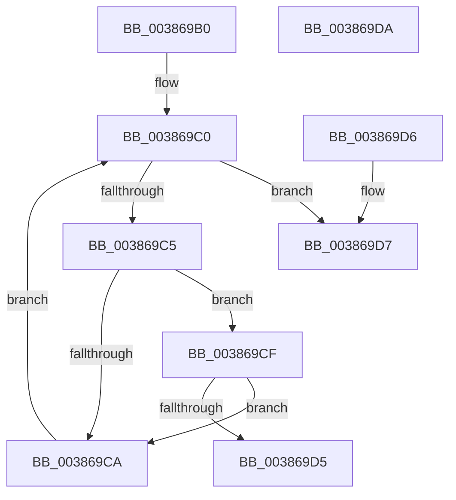

# WmipDoFindRegEntryByProviderId

- RVA: `0x003869B0`–`0x003869DB` (길이 `43` bytes)
- VA: `0x00000001403869B0`
- 실행 섹션: `.text`
- PDB 이름 있음: `예`; PDB Function 태그: `아니요`
- unwind 정보 RVA: `0x000DB714`
- 디코드: `16`개 명령, `43/43` bytes 표시
- 미해석 바이트: `0` (있으면 어셈블리에 `.byte`로 보존)

> 이 문서는 커널 이미지의 기계어와 PDB 기호를 분석해 생성했습니다. 4번과 5번은 함수 원형과 자료형을 바이너리 사용 방식에서 추정한 C 해석이며 원본 소스 복구 결과는 아닙니다.

## 1. Dependencies

- 직접 호출 지점: **0**; 고유 호출 대상: **0**
- 직접 호출자로 확인된 함수: **2**
- RIP 상대 이미지 참조: **1**

### Outgoing calls
- 직접 디코드된 call 명령이 없습니다.

### Direct callers
- [IoWMIWriteEvent](IoWMIWriteEvent_function_00386480.md) at `0x00386536`
- [WmipFindRegEntryByProviderId](WmipFindRegEntryByProviderId_function_00386908.md) at `0x0038693F`

### Static image references
- `0x003869B0` → RVA `0x00E09148` (`.data`; read)

## 2. Other-region calls and transfers

- 다른 실행 섹션으로 향하는 call: **0**
- 별도 외부 분기/꼬리 이동을 확인하지 못했습니다.

## 3. Assembly (complete function range)

```asm
003869B0  48 8B 05 91 27 A8 00            mov rax, qword ptr [rip + 0xa82791]
003869B7  48 8D 15 8A 27 A8 00            lea rdx, [rip + 0xa8278a]
003869BE  66 90                           nop
003869C0  48 3B C2                        cmp rax, rdx
003869C3  74 12                           je 0x1403869d7
003869C5  39 48 38                        cmp dword ptr [rax + 0x38], ecx
003869C8  74 05                           je 0x1403869cf
003869CA  48 8B 00                        mov rax, qword ptr [rax]
003869CD  EB F1                           jmp 0x1403869c0
003869CF  83 78 30 00                     cmp dword ptr [rax + 0x30], 0
003869D3  7C F5                           jl 0x1403869ca
003869D5  C3                              ret
003869D6  CC                              int3
003869D7  33 C0                           xor eax, eax
003869D9  C3                              ret
003869DA  CC                              int3
```

## 4. C-style interpretation (structured pseudocode)

```c
__int64 __fastcall WmipDoFindRegEntryByProviderId(int a1)
{
    __int64 result;

loc_003869C0:
    if ((*(unsigned __int64 *)(v_rip + 11020177)) == (v_rip + 11020170)) goto loc_003869D7;
    if ((*(unsigned int *)(*(unsigned __int64 *)(v_rip + 11020177) + 56)) == a1) goto loc_003869CF;
loc_003869CA:
    goto loc_003869C0;
loc_003869CF:
    if ((*(unsigned int *)(*(unsigned __int64 *)(*(unsigned __int64 *)(v_rip + 11020177)) + 48)) < 0) goto loc_003869CA;
    return *(unsigned __int64 *)(*(unsigned __int64 *)(v_rip + 11020177));
loc_003869D7:
    result = 0;
    return result;
}
```

## 5. (Beta) C Style

```c
int64_t WmipDoFindRegEntryByProviderId(int32_t Arg1)
{
    int64_t result;

loc_003869C0:
    if ((*(uint64_t *)(v_rip + 0xA82791)) == (v_rip + 11020170)) goto loc_003869D7;
    if ((*(uint32_t *)(*(uint64_t *)(v_rip + 0xA82791) + 0x38)) == Arg1) goto loc_003869CF;
loc_003869CA:
    goto loc_003869C0;
loc_003869CF:
    if ((*(uint32_t *)(*(uint64_t *)(*(uint64_t *)(v_rip + 0xA82791)) + 0x30)) < 0) goto loc_003869CA;
    return *(uint64_t *)(*(uint64_t *)(v_rip + 0xA82791));
loc_003869D7:
    result = 0;
    return result;
}
```

## 6. Execution-region graph

[열기: 2D/3D 그래프와 함수 탐색 컨트롤 패널](../../../control-panel.html?section=text&rva=0x003869B0&view=graph)

- 2D 그래프는 위에서 아래로 흐르고, 3D 그래프는 빈 공간을 드래그해 회전합니다. Shift+드래그는 이동, 휠은 확대·축소, 함수 노드 선택은 대상 보고서 이동입니다.

### Static fallback


