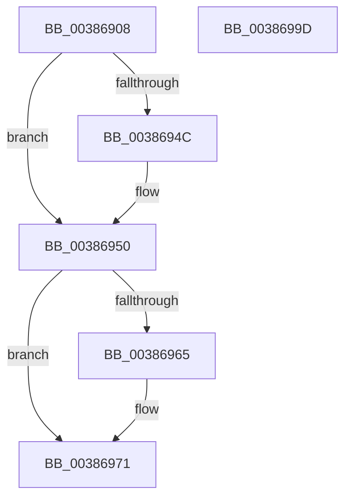

# WmipFindRegEntryByProviderId

- RVA: `0x00386908`–`0x0038699E` (길이 `150` bytes)
- VA: `0x0000000140386908`
- 실행 섹션: `.text`
- PDB 이름 있음: `예`; PDB Function 태그: `아니요`
- unwind 정보 RVA: `0x0006E5F8`
- 디코드: `38`개 명령, `150/150` bytes 표시
- 미해석 바이트: `0` (있으면 어셈블리에 `.byte`로 보존)

> 이 문서는 커널 이미지의 기계어와 PDB 기호를 분석해 생성했습니다. 4번과 5번은 함수 원형과 자료형을 바이너리 사용 방식에서 추정한 C 해석이며 원본 소스 복구 결과는 아닙니다.

## 1. Dependencies

- 직접 호출 지점: **6**; 고유 호출 대상: **6**
- 직접 호출자로 확인된 함수: **2**
- RIP 상대 이미지 참조: **3**

### Outgoing calls
- `0x00386929` → [KeWaitForSingleObject](../20/KeWaitForSingleObject_function_0020E6B0.md) (function, `0x0020E6B0`)
- `0x00386935` → [KeAcquireSpinLockRaiseToDpc](../20/KeAcquireSpinLockRaiseToDpc_function_00208470.md) (function, `0x00208470`)
- `0x0038693F` → [WmipDoFindRegEntryByProviderId](WmipDoFindRegEntryByProviderId_function_003869B0.md) (function, `0x003869B0`)
- `0x00386957` → [KxReleaseSpinLock](../20/KxReleaseSpinLock_function_00206670.md) (function, `0x00206670`)
- `0x0038696C` → [KiLowerIrqlProcessIrqlFlags](../4F/KiLowerIrqlProcessIrqlFlags_function_004F5698.md) (function, `0x004F5698`)
- `0x0038698A` → [KeReleaseMutantEx](../39/KeReleaseMutantEx_function_00396850.md) (function, `0x00396850`)

### Direct callers
- [WmipForwardWmiIrp](../../page/9E/WmipForwardWmiIrp_function_009E0DB4.md) at `0x009E0DEA`
- [IoWMISystemControl](../../page/A4/IoWMISystemControl_function_00A4EB04.md) at `0x00A4ECEB`
- [IoWMISystemControl](../../page/A4/IoWMISystemControl_function_00A4EB04.md) at `0x00A4ED36`

### Static image references
- `0x0038691A` → RVA `0x00EFFA60` (`.data`; read)
- `0x0038692E` → RVA `0x00EFFC28` (`.data`; read)
- `0x0038695C` → RVA `0x00FC6D20` (`ALMOSTRO`; read)

## 2. Other-region calls and transfers

- 다른 실행 섹션으로 향하는 call: **0**
- 별도 외부 분기/꼬리 이동을 확인하지 못했습니다.

## 3. Assembly (complete function range)

```asm
00386908  48 89 5C 24 08                  mov qword ptr [rsp + 8], rbx
0038690D  57                              push rdi
0038690E  48 83 EC 30                     sub rsp, 0x30
00386912  48 83 64 24 20 00               and qword ptr [rsp + 0x20], 0
00386918  8B D9                           mov ebx, ecx
0038691A  48 8D 0D 3F 91 B7 00            lea rcx, [rip + 0xb7913f]
00386921  45 33 C9                        xor r9d, r9d
00386924  45 33 C0                        xor r8d, r8d
00386927  33 D2                           xor edx, edx
00386929  E8 82 7D E8 FF                  call 0x14020e6b0
0038692E  48 8D 0D F3 92 B7 00            lea rcx, [rip + 0xb792f3]
00386935  E8 36 1B E8 FF                  call 0x140208470
0038693A  8B CB                           mov ecx, ebx
0038693C  0F B6 F8                        movzx edi, al
0038693F  E8 6C 00 00 00                  call 0x1403869b0
00386944  48 8B D8                        mov rbx, rax
00386947  48 85 C0                        test rax, rax
0038694A  74 04                           je 0x140386950
0038694C  F0 FF 40 30                     lock inc dword ptr [rax + 0x30]
00386950  48 8D 0D D1 92 B7 00            lea rcx, [rip + 0xb792d1]
00386957  E8 14 FD E7 FF                  call 0x140206670
0038695C  83 3D BD 03 C4 00 00            cmp dword ptr [rip + 0xc403bd], 0
00386963  74 0C                           je 0x140386971
00386965  44 0F 20 C1                     mov rcx, cr8
00386969  40 8A D7                        mov dl, dil
0038696C  E8 27 ED 16 00                  call 0x1404f5698
00386971  44 0F 22 C7                     mov cr8, rdi
00386975  BA 01 00 00 00                  mov edx, 1
0038697A  4C 8D 4C 24 48                  lea r9, [rsp + 0x48]
0038697F  48 8D 0D DA 90 B7 00            lea rcx, [rip + 0xb790da]
00386986  44 8D 42 03                     lea r8d, [rdx + 3]
0038698A  E8 C1 FE 00 00                  call 0x140396850
0038698F  48 8B C3                        mov rax, rbx
00386992  48 8B 5C 24 40                  mov rbx, qword ptr [rsp + 0x40]
00386997  48 83 C4 30                     add rsp, 0x30
0038699B  5F                              pop rdi
0038699C  C3                              ret
0038699D  CC                              int3
```

## 4. C-style interpretation (structured pseudocode)

```c
__int64 __fastcall WmipFindRegEntryByProviderId(int a1, int a2, int a3, int a4)
{
    __int64 result;
    __int64 v_rsp;
    unsigned __int64 v_stack_m18;
    unsigned __int64 v_stack_p10;
    unsigned __int64 v_stack_p8;

    v_stack_p8 = v_rbx;
    v_rsp = (v_rsp) - (48);
    a4 = 0;
    a3 = 0;
    a2 = 0;
    result = KeWaitForSingleObject(v_rip + 12030271, a2, a3, a4);
    result = KeAcquireSpinLockRaiseToDpc(v_rip + 12030707, a2, a3, a4);
    result = WmipDoFindRegEntryByProviderId((unsigned int)((unsigned int)((unsigned int)(a1))), a2, a3, a4);
    if (result != 0) {
    }
    result = KxReleaseSpinLock(v_rip + 12030673, a2, a3, a4);
    if ((*(unsigned int *)(v_rip + 12846013)) != 0) {
        a1 = v_cr8;
        a2 = (unsigned __int8)((unsigned __int8)(result));
        result = KiLowerIrqlProcessIrqlFlags(a1, a2, a3, a4);
    }
    result = KeReleaseMutantEx(v_rip + 12030170, 1, 1 + 3, v_stack_p10);
    v_rsp = (v_rsp) + (48);
    return result;
}
```

## 5. (Beta) C Style

```c
int64_t WmipFindRegEntryByProviderId(int32_t Arg1, int32_t Arg2, int32_t Arg3, int32_t Arg4)
{
    int64_t result;
    int64_t local_rsp;
    uint64_t v_stack_m18;
    uint64_t v_stack_p10;
    uint64_t v_stack_p8;

    v_stack_p8 = local_rbx;
    local_rsp = (local_rsp) - (48);
    Arg4 = 0;
    Arg3 = 0;
    Arg2 = 0;
    result = KeWaitForSingleObject(v_rip + 12030271, Arg2, Arg3, Arg4);
    result = KeAcquireSpinLockRaiseToDpc(v_rip + 12030707, Arg2, Arg3, Arg4);
    result = WmipDoFindRegEntryByProviderId((uint32_t)((uint32_t)((uint32_t)(Arg1))), Arg2, Arg3, Arg4);
    if (result != 0) {
    }
    result = KxReleaseSpinLock(v_rip + 12030673, Arg2, Arg3, Arg4);
    if ((*(uint32_t *)(v_rip + 0xC403BD)) != 0) {
        Arg1 = v_cr8;
        Arg2 = (uint8_t)((uint8_t)(result));
        result = KiLowerIrqlProcessIrqlFlags(Arg1, Arg2, Arg3, Arg4);
    }
    result = KeReleaseMutantEx(v_rip + 12030170, 1, 1 + 3, v_stack_p10);
    local_rsp = (local_rsp) + (48);
    return result;
}
```

## 6. Execution-region graph

[열기: 2D/3D 그래프와 함수 탐색 컨트롤 패널](../../../control-panel.html?section=text&rva=0x00386908&view=graph)

- 2D 그래프는 위에서 아래로 흐르고, 3D 그래프는 빈 공간을 드래그해 회전합니다. Shift+드래그는 이동, 휠은 확대·축소, 함수 노드 선택은 대상 보고서 이동입니다.

### Static fallback


