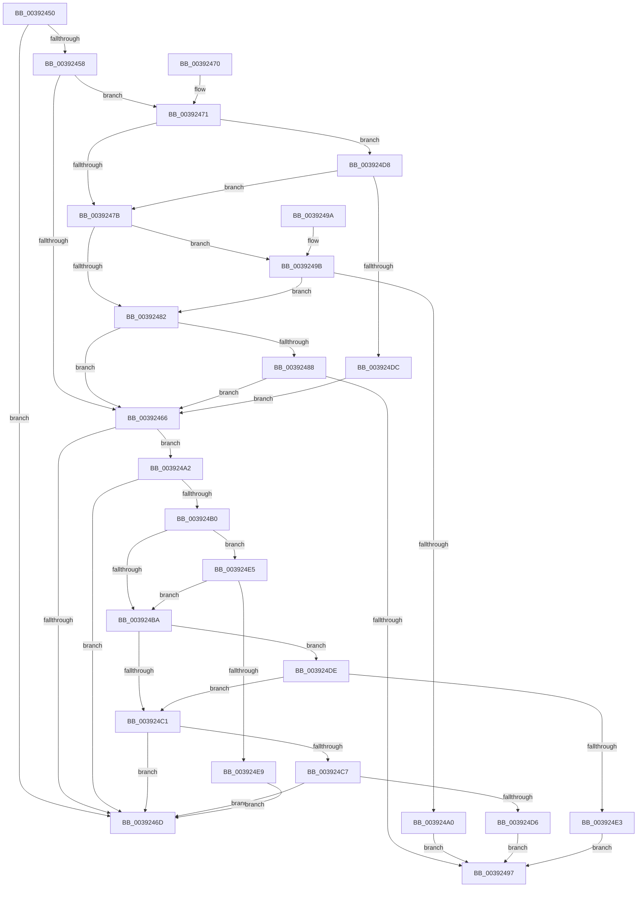

# EtwEventEnabled

- RVA: `0x00392450`–`0x003924EB` (길이 `155` bytes)
- VA: `0x0000000140392450`
- 실행 섹션: `.text`
- PDB 이름 있음: `예`; PDB Function 태그: `아니요`
- unwind 정보 RVA: `0x000DB714`
- 디코드: `58`개 명령, `155/155` bytes 표시
- 미해석 바이트: `0` (있으면 어셈블리에 `.byte`로 보존)

> 이 문서는 커널 이미지의 기계어와 PDB 기호를 분석해 생성했습니다. 4번과 5번은 함수 원형과 자료형을 바이너리 사용 방식에서 추정한 C 해석이며 원본 소스 복구 결과는 아닙니다.

## 1. Dependencies

- 직접 호출 지점: **0**; 고유 호출 대상: **0**
- 직접 호출자로 확인된 함수: **427**
- RIP 상대 이미지 참조: **0**

### Outgoing calls
- 직접 디코드된 call 명령이 없습니다.

### Direct callers
- [EtwpEventWriteFull](../22/EtwpEventWriteFull_function_00225C10.md) at `0x00226975`
- [EtwpLogKernelEvent](../25/EtwpLogKernelEvent_function_0025CC00.md) at `0x0025D38B`
- [PopDiagTraceFxDevicePowerState](../26/PopDiagTraceFxDevicePowerState_function_0026DBC4.md) at `0x0026DC09`
- [PnpDiagnosticTrace](../26/PnpDiagnosticTrace_function_0026E384.md) at `0x0026E3AA`
- [PnpDiagnosticTraceObject](../26/PnpDiagnosticTraceObject_function_0026E834.md) at `0x0026E866`
- [PopDiagTraceIrpFinish](../26/PopDiagTraceIrpFinish_function_0026F2A8.md) at `0x0026F2F4`
- [PpmEventSoftParkRankListChanged](../2D/PpmEventSoftParkRankListChanged_function_002D58D8.md) at `0x002D590B`
- [PpmEventMediaBufferingNotify](../2D/PpmEventMediaBufferingNotify_function_002DA730.md) at `0x002DA75E`
- [EtwpLogSystemEventUnsafe](../2F/EtwpLogSystemEventUnsafe_function_002FBF10.md) at `0x002FC637`
- [PopDiagTraceNonAttributedCpuReferences](../30/PopDiagTraceNonAttributedCpuReferences_function_003036EC.md) at `0x0030371A`
- [PpmEventPlatformVetoRequest](../30/PpmEventPlatformVetoRequest_function_00304B14.md) at `0x00304B58`
- [PpmEventCoreParkingSoftParkedStateChange](../35/PpmEventCoreParkingSoftParkedStateChange_function_003525C4.md) at `0x0035260A`
- [PopDiagTraceDeviceAcquireIrp](PopDiagTraceDeviceAcquireIrp_function_00390498.md) at `0x003904DE`
- [PopDiagTraceSetDeepSleepConstraint](PopDiagTraceSetDeepSleepConstraint_function_003909A4.md) at `0x003909D2`
- [PopDiagTraceClearDeepSleepConstraint](PopDiagTraceClearDeepSleepConstraint_function_00390A44.md) at `0x00390A72`
- [PopDiagTraceFxDevicePowered](PopDiagTraceFxDevicePowered_function_00390AE4.md) at `0x00390B21`
- [SSHSupportEtwEventEnabled](SSHSupportEtwEventEnabled_function_00391484.md) at `0x0039148F`
- [PoTraceSystemTimerResolutionUpdate](PoTraceSystemTimerResolutionUpdate_function_003916DC.md) at `0x00391710`
- [PopDiagTraceFxDevicePowerRequirement](PopDiagTraceFxDevicePowerRequirement_function_00391780.md) at `0x00391856`
- [PoDeviceReleaseIrp](PoDeviceReleaseIrp_function_00391B7C.md) at `0x00391BD2`
- [PpmPerfArbitratorApplyProcessorState](PpmPerfArbitratorApplyProcessorState_function_00391E00.md) at `0x00391F23`
- [EtwTiLogInsertQueueUserApc](../3B/EtwTiLogInsertQueueUserApc_function_003B8FC4.md) at `0x003B9076`
- [PpmEventTraceLatencySensitivityHint](../3B/PpmEventTraceLatencySensitivityHint_function_003BEAFC.md) at `0x003BEB2A`
- [PpmEventTraceFailedPerfCheckStart](../3B/PpmEventTraceFailedPerfCheckStart_function_003BF06C.md) at `0x003BF09B`
- [PpmEventHgsHardwareTable](../3B/PpmEventHgsHardwareTable_function_003BF110.md) at `0x003BF32A`
- [EtwTraceMdlAllocationEvent](../3E/EtwTraceMdlAllocationEvent_function_003E95FC.md) at `0x003E9637`
- [EtwTraceContAllocationEvent](../3E/EtwTraceContAllocationEvent_function_003EA680.md) at `0x003EA6C7`
- [EtwpFailLogging](../3F/EtwpFailLogging_function_003F0A50.md) at `0x003F0B6A`
- [EtwpFailLogging](../3F/EtwpFailLogging_function_003F0A50.md) at `0x003F0C60`
- [EtwTraceContFreeEvent](../3F/EtwTraceContFreeEvent_function_003F7C0C.md) at `0x003F7C39`
- [PpmEventTraceHeteroResponse](../41/PpmEventTraceHeteroResponse_function_004133AC.md) at `0x004133FB`
- [PpmEventTraceMultiClassHeteroResponse](../41/PpmEventTraceMultiClassHeteroResponse_function_004135AC.md) at `0x004135FE`
- [PpmEventParkingCountSelection](../41/PpmEventParkingCountSelection_function_00414388.md) at `0x004143CC`
- [PpmEventHgsContainmentUnparkedCount](../41/PpmEventHgsContainmentUnparkedCount_function_00414808.md) at `0x00414869`
- [EtwpLogContextSwapEvent](../41/EtwpLogContextSwapEvent_function_004175F0.md) at `0x00417B8D`
- [PopDiagTraceFxDeviceAccounting](../42/PopDiagTraceFxDeviceAccounting_function_00426614.md) at `0x004266B7`
- [PpmEventTraceHeteroSets](../42/PpmEventTraceHeteroSets_function_00426DB4.md) at `0x00426E75`
- [PopDiagTraceProcessorThrottlePerfTrack](../42/PopDiagTraceProcessorThrottlePerfTrack_function_0042B2B0.md) at `0x0042B320`
- [PpmEventBiosCapChange](../42/PpmEventBiosCapChange_function_0042B5EC.md) at `0x0042B656`
- [PpmEventThermalCapChange](../42/PpmEventThermalCapChange_function_0042B6E4.md) at `0x0042B7F4`
- [PpmEventTraceProcessorIdleAccounting](../43/PpmEventTraceProcessorIdleAccounting_function_0043A6D0.md) at `0x0043A72B`
- [PopDiagTraceFxDefaultPepWorkerEnd](../44/PopDiagTraceFxDefaultPepWorkerEnd_function_004451E8.md) at `0x00445390`
- [PopDiagTraceFxDefaultPepWorkerEnd](../44/PopDiagTraceFxDefaultPepWorkerEnd_function_004451E8.md) at `0x004453EA`
- [PopDiagTraceFxDefaultPepWorkerEnd](../44/PopDiagTraceFxDefaultPepWorkerEnd_function_004451E8.md) at `0x004454D6`
- [PoFxSendSystemLatencyUpdate](../46/PoFxSendSystemLatencyUpdate_function_0046A008.md) at `0x0046A086`
- [PpmParkComputeUnparkMask](../46/PpmParkComputeUnparkMask_function_0046F9C4.md) at `0x0046FDF7`
- [PopDiagTracePowerRequestChange](../47/PopDiagTracePowerRequestChange_function_00477C9C.md) at `0x00477CD7`
- [PopDiagTraceSystemLatencyUpdate](../47/PopDiagTraceSystemLatencyUpdate_function_0047A78C.md) at `0x0047A7C8`
- [PpmEventHeteroFavoredCoreRotationChange](../47/PpmEventHeteroFavoredCoreRotationChange_function_0047ACB0.md) at `0x0047ACE2`
- [PpmEventTraceExpectedUtility](../47/PpmEventTraceExpectedUtility_function_0047B280.md) at `0x0047B2FD`
- [PpmEventDomainPerfStateChange](../47/PpmEventDomainPerfStateChange_function_0047B720.md) at `0x0047B79B`
- [PopDiagTraceIrpStart](../47/PopDiagTraceIrpStart_function_0047CBBC.md) at `0x0047CC7B`
- [PpmEventTraceSoftCoreParkingSelection](../47/PpmEventTraceSoftCoreParkingSelection_function_0047D4EC.md) at `0x0047D536`
- [PopDiagTraceRegisterSystemState](../48/PopDiagTraceRegisterSystemState_function_0048280C.md) at `0x00482843`
- [PopDiagTraceSetSystemState](../48/PopDiagTraceSetSystemState_function_00482AD4.md) at `0x00482B06`
- [PoTraceForceIdleStateChange](../48/PoTraceForceIdleStateChange_function_0048DCEC.md) at `0x0048DD1E`
- [PpmEventPlatformVetoRundown](../49/PpmEventPlatformVetoRundown_function_00490C38.md) at `0x00490CFA`
- [PpmEventProcessorVetoRundown](../49/PpmEventProcessorVetoRundown_function_00490D88.md) at `0x00490E52`
- [PpmEventTracePreVetoAccounting](../49/PpmEventTracePreVetoAccounting_function_00490F88.md) at `0x00490FD0`
- [SshpTracingWriteBlockerStateRundown](../49/SshpTracingWriteBlockerStateRundown_function_00491A20.md) at `0x00491A5C`
- [PpmEventCoreParkingStateChangeEx](../49/PpmEventCoreParkingStateChangeEx_function_00496018.md) at `0x0049605A`
- [PopDiagTraceEventNoPayload](../49/PopDiagTraceEventNoPayload_function_004982F8.md) at `0x00498314`
- [PpmEventCoreParkingStateChange](../49/PpmEventCoreParkingStateChange_function_004995D8.md) at `0x00499610`
- [EtwpUpdateSelectedGroupMasks](../49/EtwpUpdateSelectedGroupMasks_function_0049B114.md) at `0x0049B3C2`
- [EtwpUpdateSelectedGroupMasks](../49/EtwpUpdateSelectedGroupMasks_function_0049B114.md) at `0x0049B46F`
- [PpmEventTraceMakeupPerfCheck](../49/PpmEventTraceMakeupPerfCheck_function_0049F748.md) at `0x0049F763`
- [PpmEventQosClassPerfSelection](../49/PpmEventQosClassPerfSelection_function_0049F7AC.md) at `0x0049F80D`
- [PpmCheckUpdateDeliveredPerformanceIfTracingEnabled](../49/PpmCheckUpdateDeliveredPerformanceIfTracingEnabled_function_0049FAB0.md) at `0x0049FACB`
- [PopDiagTraceSleepStudyBlocker](../4A/PopDiagTraceSleepStudyBlocker_function_004A5930.md) at `0x004A5950`
- [PopDirectedDripsDiagTraceNotifyDevices](../4A/PopDirectedDripsDiagTraceNotifyDevices_function_004A70AC.md) at `0x004A7120`
- [PnpDiagnosticTraceObjectWithStatus](../4A/PnpDiagnosticTraceObjectWithStatus_function_004A9F58.md) at `0x004A9FB9`
- [PopDiagTraceDeviceIdleCheck](../4A/PopDiagTraceDeviceIdleCheck_function_004AB30C.md) at `0x004AB366`
- [BapdWriteEtwEvents](../4A/BapdWriteEtwEvents_function_004AE884.md) at `0x004AE9C4`
- [PopDiagTraceThermalZoneRundown](../4A/PopDiagTraceThermalZoneRundown_function_004AF240.md) at `0x004AF2A7`
- [PpmEventVetoReasonRundown](../4B/PpmEventVetoReasonRundown_function_004B686C.md) at `0x004B689D`
- [PopDiagTraceSessionDisplayStateChange](../4B/PopDiagTraceSessionDisplayStateChange_function_004B7C00.md) at `0x004B7C52`
- [PoTraceSystemTimerResolutionIgnore](../4B/PoTraceSystemTimerResolutionIgnore_function_004B8A28.md) at `0x004B8A4E`
- [IopIsActivityTracingEventEnabled](../4B/IopIsActivityTracingEventEnabled_function_004BA134.md) at `0x004BA154`
- [PopDiagTraceDeepSleepConstraintRundown](../4B/PopDiagTraceDeepSleepConstraintRundown_function_004BCDDC.md) at `0x004BCE42`
- [PpmHeteroDispatchHgsInterrupt](../4B/PpmHeteroDispatchHgsInterrupt_function_004BE5E0.md) at `0x004BE5FB`
- [HalpIommuTraceFault](../4C/HalpIommuTraceFault_function_004C031C.md) at `0x004C03CC`
- [PopDiagTraceFxPerfRequestComplete](../4C/PopDiagTraceFxPerfRequestComplete_function_004C1854.md) at `0x004C1898`
- [PopDiagTraceFxPerfRequestProgress](../4C/PopDiagTraceFxPerfRequestProgress_function_004C1B78.md) at `0x004C1BB8`
- [PopDiagTraceFxPerfRequest](../4C/PopDiagTraceFxPerfRequest_function_004C1CD8.md) at `0x004C1D21`
- [PpmEventProcessorPerfStateChange](../4C/PpmEventProcessorPerfStateChange_function_004C2470.md) at `0x004C2512`
- [PopDiagTraceFxDeviceDirectedTransition](../4C/PopDiagTraceFxDeviceDirectedTransition_function_004C4130.md) at `0x004C4179`
- [PpmEventTraceLPIState](../4C/PpmEventTraceLPIState_function_004C6494.md) at `0x004C64C2`
- [PpmEventHgsNormalizedTable](../4C/PpmEventHgsNormalizedTable_function_004CC7BC.md) at `0x004CC816`
- [PpmEventHgsHardwareTableResonMapTable](../4C/PpmEventHgsHardwareTableResonMapTable_function_004CDEEC.md) at `0x004CDF23`
- [PpmEventTraceMultiClassHeteroResponseUpdate](../4D/PpmEventTraceMultiClassHeteroResponseUpdate_function_004D0B1C.md) at `0x004D0B89`
- [PnpDiagnosticTraceElamDecision](../4D/PnpDiagnosticTraceElamDecision_function_004D2258.md) at `0x004D2298`
- [PpmEventHgsContainmentHwUpdate](../4D/PpmEventHgsContainmentHwUpdate_function_004D5FFC.md) at `0x004D6056`
- [PpmEventParkNodeClassRecordedStats](../4D/PpmEventParkNodeClassRecordedStats_function_004D66AC.md) at `0x004D66F4`
- [PpmEventHgsHardwareTableResonChanged](../4D/PpmEventHgsHardwareTableResonChanged_function_004D6D5C.md) at `0x004D6DAA`
- [PopDiagTraceRtcWakeInfo](../4D/PopDiagTraceRtcWakeInfo_function_004DEA14.md) at `0x004DECEA`
- [PpmEventTraceHeteroDistributeUtility](../4D/PpmEventTraceHeteroDistributeUtility_function_004DF094.md) at `0x004DF0F7`
- [PopDiagTraceIrpPended](../4D/PopDiagTraceIrpPended_function_004DF56C.md) at `0x004DF59B`
- [PopDiagTraceFxDeviceDirectedCompletion](../4E/PopDiagTraceFxDeviceDirectedCompletion_function_004E04AC.md) at `0x004E04FC`
- [PoDiagTraceIRTimerSleepStudyRundown](../4E/PoDiagTraceIRTimerSleepStudyRundown_function_004E05A8.md) at `0x004E05F5`
- [PpmEventParkNodeParkHintChanged](../4E/PpmEventParkNodeParkHintChanged_function_004E2D74.md) at `0x004E2DB7`
- [PopBatteryTraceSystemBatteryStatus](../4E/PopBatteryTraceSystemBatteryStatus_function_004E93D8.md) at `0x004E942E`
- [PpmEventParkNodeRecordedStatsEx](../4E/PpmEventParkNodeRecordedStatsEx_function_004EF378.md) at `0x004EF3E9`
- [PpmEventTraceCoreParkingSelectionEx](../4F/PpmEventTraceCoreParkingSelectionEx_function_004F09D0.md) at `0x004F0A40`
- [PpmEventTraceHeteroResponseEx](../4F/PpmEventTraceHeteroResponseEx_function_004F1B6C.md) at `0x004F1BD5`
- [PpmEventTraceMultiClassHeteroResponseEx](../4F/PpmEventTraceMultiClassHeteroResponseEx_function_004F204C.md) at `0x004F20B4`
- [PpmEventTraceSoftCoreParkingSelectionEx](../4F/PpmEventTraceSoftCoreParkingSelectionEx_function_004F2424.md) at `0x004F24C9`
- [PpmEventHgsCoresUnparkedCountEx](../4F/PpmEventHgsCoresUnparkedCountEx_function_004F2E48.md) at `0x004F2EA3`
- [PpmEventSoftParkLatencyUpdate](../4F/PpmEventSoftParkLatencyUpdate_function_004F3950.md) at `0x004F399C`
- [PpmEventParkNodeParkHintChangedEx](../4F/PpmEventParkNodeParkHintChangedEx_function_004F3A34.md) at `0x004F3A93`
- [PpmEventHgsActiveWorkloadClassEx](../4F/PpmEventHgsActiveWorkloadClassEx_function_004F3BB0.md) at `0x004F3C25`
- [PpmEventTraceHeteroResponseExV1](../4F/PpmEventTraceHeteroResponseExV1_function_004F3DDC.md) at `0x004F3E45`
- [PpmEventParkingCountSelectionEx](../4F/PpmEventParkingCountSelectionEx_function_004F4188.md) at `0x004F41D3`
- [PpmEventHgsContainmentUnparkedCountEx](../4F/PpmEventHgsContainmentUnparkedCountEx_function_004F5010.md) at `0x004F5074`
- [PpmEventTraceMultiClassHeteroResponseUpdateEx](../4F/PpmEventTraceMultiClassHeteroResponseUpdateEx_function_004F57C0.md) at `0x004F5806`
- [PpmEventTraceHeteroDistributeUtilityEx](../4F/PpmEventTraceHeteroDistributeUtilityEx_function_004F9C24.md) at `0x004F9C84`
- [HalpTscTraceProcessorDelta](../54/HalpTscTraceProcessorDelta_function_0054B184.md) at `0x0054B1CA`
- [HalpTscTraceProcessorSynchronization](../54/HalpTscTraceProcessorSynchronization_function_0054B268.md) at `0x0054B2AE`
- [HalpTscTraceStatus](../54/HalpTscTraceStatus_function_0054B368.md) at `0x0054B396`
- [HalpTscTraceSynchronizationSummary](../54/HalpTscTraceSynchronizationSummary_function_0054B404.md) at `0x0054B44A`
- [HalpIommuLogEarlyFault](../55/HalpIommuLogEarlyFault_function_00555640.md) at `0x0055567B`
- [HalpIommuLogEarlyFault](../55/HalpIommuLogEarlyFault_function_00555640.md) at `0x005556C6`
- [PnpDiagnosticTraceElamStatus](../5A/PnpDiagnosticTraceElamStatus_function_005A581C.md) at `0x005A584D`
- [KsepEvntLogFlagsApplied](../5C/KsepEvntLogFlagsApplied_function_005CBAD0.md) at `0x005CBB1A`
- [KsepEvntLogShimsApplied](../5C/KsepEvntLogShimsApplied_function_005CBBE4.md) at `0x005CBC41`
- [KsepDsEventAddDevice](../5C/KsepDsEventAddDevice_function_005CC658.md) at `0x005CC69B`
- [KsepDsEventDataIrp](../5C/KsepDsEventDataIrp_function_005CC780.md) at `0x005CC7C4`
- [KsepDsEventDevicePowerCompleted](../5C/KsepDsEventDevicePowerCompleted_function_005CC878.md) at `0x005CC8BC`
- [KsepDsEventDevicePowerIrp](../5C/KsepDsEventDevicePowerIrp_function_005CC95C.md) at `0x005CC9A0`
- [KsepDsEventDriverLoad](../5C/KsepDsEventDriverLoad_function_005CCA74.md) at `0x005CCABB`
- [KsepDsEventDriverStartIo](../5C/KsepDsEventDriverStartIo_function_005CCB7C.md) at `0x005CCBB7`
- [KsepDsEventDriverUnload](../5C/KsepDsEventDriverUnload_function_005CCC44.md) at `0x005CCC74`
- [KsepDsEventIoCreateDevice](../5C/KsepDsEventIoCreateDevice_function_005CCD00.md) at `0x005CCD4B`
- [KsepDsEventPnpIrp](../5C/KsepDsEventPnpIrp_function_005CCE10.md) at `0x005CCE54`
- [KsepDsEventPnpStartDevice](../5C/KsepDsEventPnpStartDevice_function_005CCF08.md) at `0x005CCF4C`
- [KsepDsEventPnpStopDevice](../5C/KsepDsEventPnpStopDevice_function_005CCFEC.md) at `0x005CD030`
- [KsepDsEventPoolAllocate](../5C/KsepDsEventPoolAllocate_function_005CD0D0.md) at `0x005CD114`
- [KsepDsEventPoolFree](../5C/KsepDsEventPoolFree_function_005CD1CC.md) at `0x005CD207`
- [KsepDsEventRequestPowerIrp](../5C/KsepDsEventRequestPowerIrp_function_005CD298.md) at `0x005CD2DC`
- [KsepDsEventSystemPowerIrp](../5C/KsepDsEventSystemPowerIrp_function_005CD3A0.md) at `0x005CD3E4`
- [KsepSkipDriverUnloadEventDriverLoad](../5C/KsepSkipDriverUnloadEventDriverLoad_function_005CD63C.md) at `0x005CD683`
- [KsepSkipDriverUnloadEventDriverUnload](../5C/KsepSkipDriverUnloadEventDriverUnload_function_005CD744.md) at `0x005CD774`
- [PoTraceDynamicTickDisabled](../5D/PoTraceDynamicTickDisabled_function_005D5BB8.md) at `0x005D5BEC`
- [PoTraceForceIdleReset](../5D/PoTraceForceIdleReset_function_005D5C5C.md) at `0x005D5D14`
- [PopDiagTraceAbnormalReset](../5D/PopDiagTraceAbnormalReset_function_005D5D84.md) at `0x005D5DB2`
- [PopDiagTraceCsDeepSleepWatchdog](../5D/PopDiagTraceCsDeepSleepWatchdog_function_005D5E24.md) at `0x005D5E6E`
- [PopDiagTraceCsDripsDivergence](../5D/PopDiagTraceCsDripsDivergence_function_005D5F40.md) at `0x005D5F8C`
- [PopDiagTraceCsDripsWatchdog](../5D/PopDiagTraceCsDripsWatchdog_function_005D602C.md) at `0x005D6076`
- [PopDiagTraceCsDripsWatchdogPerfTrack](../5D/PopDiagTraceCsDripsWatchdogPerfTrack_function_005D621C.md) at `0x005D626A`
- [PopDiagTraceCsFanPerfTrack](../5D/PopDiagTraceCsFanPerfTrack_function_005D6374.md) at `0x005D63A6`
- [PopDiagTraceDebuggerTransitionRequirements](../5D/PopDiagTraceDebuggerTransitionRequirements_function_005D6430.md) at `0x005D6476`
- [PopDiagTraceDeviceComplianceUpdate](../5D/PopDiagTraceDeviceComplianceUpdate_function_005D6510.md) at `0x005D6542`
- [PopDiagTraceEsState](../5D/PopDiagTraceEsState_function_005D65CC.md) at `0x005D6605`
- [PopDiagTraceFxComponentIdleConstraints](../5D/PopDiagTraceFxComponentIdleConstraints_function_005D668C.md) at `0x005D66D6`
- [PopDiagTraceFxComponentResidency](../5D/PopDiagTraceFxComponentResidency_function_005D677C.md) at `0x005D67CB`
- [PopDiagTraceFxComponentWake](../5D/PopDiagTraceFxComponentWake_function_005D6860.md) at `0x005D68B5`
- [PopDiagTraceFxDeviceIdleConstraints](../5D/PopDiagTraceFxDeviceIdleConstraints_function_005D6954.md) at `0x005D699A`
- [PopDiagTraceFxPerfNominalChange](../5D/PopDiagTraceFxPerfNominalChange_function_005D6A34.md) at `0x005D6A82`
- [PopDiagTraceIllegalProcessorThrottle](../5D/PopDiagTraceIllegalProcessorThrottle_function_005D6B6C.md) at `0x005D6BB4`
- [PopDiagTraceIllegalProcessorThrottle](../5D/PopDiagTraceIllegalProcessorThrottle_function_005D6B6C.md) at `0x005D6BD6`
- [PopDiagTraceIoCoalescingDiskIdle](../5D/PopDiagTraceIoCoalescingDiskIdle_function_005D6D18.md) at `0x005D6D47`
- [PopDiagTraceProcessorThrottleDurationPerfTrack](../5D/PopDiagTraceProcessorThrottleDurationPerfTrack_function_005D6DB8.md) at `0x005D6E2C`
- [PopDiagTraceShutdownAction](../5D/PopDiagTraceShutdownAction_function_005D6F08.md) at `0x005D6F51`
- [PopDiagTraceThermalStateChange](../5D/PopDiagTraceThermalStateChange_function_005D702C.md) at `0x005D7073`
- [PopDiagTraceThermalZoneEnumeration](../5D/PopDiagTraceThermalZoneEnumeration_function_005D7154.md) at `0x005D7255`
- [PopDiagTraceThermalZoneThrottleDurationPerfTrack](../5D/PopDiagTraceThermalZoneThrottleDurationPerfTrack_function_005D74F4.md) at `0x005D753F`
- [PopDiagTraceThermalZoneThrottlePerfTrack](../5D/PopDiagTraceThermalZoneThrottlePerfTrack_function_005D7628.md) at `0x005D7671`
- [PpmEventAffinityMask](../5D/PpmEventAffinityMask_function_005DA500.md) at `0x005DA550`
- [PpmEventAutonomousModeChange](../5D/PpmEventAutonomousModeChange_function_005DA684.md) at `0x005DA6D9`
- [PpmEventCoreParkingForceParkedStateChange](../5D/PpmEventCoreParkingForceParkedStateChange_function_005DA74C.md) at `0x005DA792`
- [PpmEventHgsContainmentGroupInfo](../5D/PpmEventHgsContainmentGroupInfo_function_005DA8DC.md) at `0x005DA93F`
- [PpmEventHgsContainmentPolicyChange](../5D/PpmEventHgsContainmentPolicyChange_function_005DAA94.md) at `0x005DAB22`
- [PpmEventHiddenProcessorBiosCapChange](../5D/PpmEventHiddenProcessorBiosCapChange_function_005DAC1C.md) at `0x005DAC62`
- [PpmEventHiddenProcessorThermalCapChange](../5D/PpmEventHiddenProcessorThermalCapChange_function_005DAD1C.md) at `0x005DAD62`
- [PpmEventLPICoreParking](../5D/PpmEventLPICoreParking_function_005DAE1C.md) at `0x005DAE54`
- [PpmEventParkNodeCapChange](../5D/PpmEventParkNodeCapChange_function_005DAEDC.md) at `0x005DAF24`
- [PpmEventParkNodePreference](../5D/PpmEventParkNodePreference_function_005DAFC8.md) at `0x005DB010`
- [PpmEventParkNodeRestriction](../5D/PpmEventParkNodeRestriction_function_005DB0E8.md) at `0x005DB155`
- [PpmEventProcessorVetoRequest](../5D/PpmEventProcessorVetoRequest_function_005DB244.md) at `0x005DB29F`
- [PpmEventVpQosChange](../5D/PpmEventVpQosChange_function_005DB35C.md) at `0x005DB3A9`
- [PopDirectedDripsDiagTraceDfxPowerStateFailure](../5D/PopDirectedDripsDiagTraceDfxPowerStateFailure_function_005DD2B4.md) at `0x005DD2EF`
- [PpmEventAffinityMaskEx](../5D/PpmEventAffinityMaskEx_function_005DE490.md) at `0x005DE4DB`
- [PpmEventParkNodeCapChangeEx](../5D/PpmEventParkNodeCapChangeEx_function_005DE580.md) at `0x005DE5ED`
- [PpmEventParkNodeClassRecordedStatsEx](../5D/PpmEventParkNodeClassRecordedStatsEx_function_005DE748.md) at `0x005DE7AD`
- [PpmEventParkNodePreferenceEx](../5D/PpmEventParkNodePreferenceEx_function_005DE8D8.md) at `0x005DE958`
- [PpmEventParkNodeRestrictionEx](../5D/PpmEventParkNodeRestrictionEx_function_005DEB00.md) at `0x005DEB73`
- [SmEtwLogStoreCorruption](../60/SmEtwLogStoreCorruption_function_0060F458.md) at `0x0060F499`
- [EtwTraceCpuPartitionAffinityViolation](../64/EtwTraceCpuPartitionAffinityViolation_function_0064F644.md) at `0x0064F683`
- [EtwTraceCpuPartitionDpcSchedulingViolation](../64/EtwTraceCpuPartitionDpcSchedulingViolation_function_0064F7E8.md) at `0x0064F817`
- [EtwTraceCpuPartitionGenericDpcViolation](../64/EtwTraceCpuPartitionGenericDpcViolation_function_0064F8A4.md) at `0x0064F8CF`
- [EtwTraceJobServerSiloMonitorCallback](../64/EtwTraceJobServerSiloMonitorCallback_function_0064FB68.md) at `0x0064FBE6`
- [EtwTraceMdlFreeEvent](../64/EtwTraceMdlFreeEvent_function_0064FD7C.md) at `0x0064FDB1`
- [EtwTraceWorkQueueHealthMetrics](../65/EtwTraceWorkQueueHealthMetrics_function_006504D8.md) at `0x00650507`
- [EtwTraceWorkQueueHealthMetricsBucketUpperBounds](../65/EtwTraceWorkQueueHealthMetricsBucketUpperBounds_function_0065060C.md) at `0x00650643`
- [EtwpTransitionToRealtime](../65/EtwpTransitionToRealtime_function_006518D8.md) at `0x00651A0F`
- [KitLogFeatureUsage](../65/KitLogFeatureUsage_function_0065C030.md) at `0x0065C08B`
- [sub_006EC7EE](../6E/Unknown_function_006EC7EE.md) at `0x006EC846`
- [sub_006ED1B6](../6E/Unknown_function_006ED1B6.md) at `0x006ED1D1`
- [sub_006FCA3A](../6F/Unknown_function_006FCA3A.md) at `0x006FCA48`
- [PopPowerAggregatorDiagTraceDozeTimerDisarmed](../../page/6F/PopPowerAggregatorDiagTraceDozeTimerDisarmed_function_006FE5E0.md) at `0x006FE625`
- [WdipSemSqmEnabled](../../page/70/WdipSemSqmEnabled_function_0070276C.md) at `0x00702780`
- [WdipSemSqmEnabled](../../page/70/WdipSemSqmEnabled_function_0070276C.md) at `0x00702799`
- [PopDiagTracePolicyChange](../../page/70/PopDiagTracePolicyChange_function_00705718.md) at `0x00705774`
- [HalpSetAcpiRealTimeClock](../../page/70/HalpSetAcpiRealTimeClock_function_00705BFC.md) at `0x00705CFD`
- [PopDiagTraceAcDcStateChange](../../page/76/PopDiagTraceAcDcStateChange_function_0076035C.md) at `0x007603A3`
- [PopDiagTraceAdaptiveBootOverridePrepared](../../page/76/PopDiagTraceAdaptiveBootOverridePrepared_function_00760470.md) at `0x007604BE`
- [PopDiagTraceBatteryCountChange](../../page/76/PopDiagTraceBatteryCountChange_function_00760B54.md) at `0x00760B94`
- [PopDiagTraceBatteryTriggerMet](../../page/76/PopDiagTraceBatteryTriggerMet_function_00760C60.md) at `0x00760D2E`
- [PopDiagTraceCoolingExtensionActiveUpdate](../../page/76/PopDiagTraceCoolingExtensionActiveUpdate_function_00760FFC.md) at `0x0076102B`
- [PopDiagTraceDirectedDripsInitialization](../../page/76/PopDiagTraceDirectedDripsInitialization_function_007610D0.md) at `0x00761176`
- [PopDiagTraceDirectedDripsNotifyAppsAndServices](../../page/76/PopDiagTraceDirectedDripsNotifyAppsAndServices_function_007611EC.md) at `0x00761233`
- [PopDiagTraceFxDeviceStartPowerManagement](../../page/76/PopDiagTraceFxDeviceStartPowerManagement_function_00761610.md) at `0x0076164D`
- [PopDiagTraceFxDeviceUnregistration](../../page/76/PopDiagTraceFxDeviceUnregistration_function_007616AC.md) at `0x007616F8`
- [PopDiagTraceIoCoalescingOn](../../page/76/PopDiagTraceIoCoalescingOn_function_00761AB4.md) at `0x00761B27`
- [PopDiagTraceModernStandbyStateNotification](../../page/76/PopDiagTraceModernStandbyStateNotification_function_00761BB4.md) at `0x00761BFA`
- [PopDiagTracePassiveCooling](../../page/76/PopDiagTracePassiveCooling_function_00761CAC.md) at `0x00761D21`
- [PopDiagTracePassiveCooling](../../page/76/PopDiagTracePassiveCooling_function_00761CAC.md) at `0x00761D42`
- [PopDiagTracePowerLimitExtension](../../page/76/PopDiagTracePowerLimitExtension_function_0076233C.md) at `0x0076238B`
- [PopDiagTracePowerLimitExtensionValueUpdate](../../page/76/PopDiagTracePowerLimitExtensionValueUpdate_function_00762580.md) at `0x007625C1`
- [PopDiagTracePowerLimitRequest](../../page/76/PopDiagTracePowerLimitRequest_function_007626D0.md) at `0x0076273A`
- [PopDiagTracePowerLimitRequestValueUpdate](../../page/76/PopDiagTracePowerLimitRequestValueUpdate_function_007629E8.md) at `0x00762A45`
- [PopDiagTraceSetHiberFileFailurePoint](../../page/76/PopDiagTraceSetHiberFileFailurePoint_function_00762D50.md) at `0x00762D91`
- [PopDiagTraceSkipTick](../../page/76/PopDiagTraceSkipTick_function_00762EA8.md) at `0x00762EDE`
- [PopDiagTraceSleepStudyBlockerData](../../page/76/PopDiagTraceSleepStudyBlockerData_function_00762F60.md) at `0x00762F86`
- [PopDiagTraceSleepStudyStart](../../page/76/PopDiagTraceSleepStudyStart_function_00762FC0.md) at `0x00762FFA`
- [PopDiagTraceStateTransitionFailurePoint](../../page/76/PopDiagTraceStateTransitionFailurePoint_function_00763468.md) at `0x007634B6`
- [PopDiagTraceThermalRequestActiveUpdate](../../page/76/PopDiagTraceThermalRequestActiveUpdate_function_00763684.md) at `0x007636B3`
- [PopDiagTraceZoneCriticalTripPointExceeded](../../page/76/PopDiagTraceZoneCriticalTripPointExceeded_function_007637D8.md) at `0x00763808`
- [PopDiagTraceZoneCriticalTripPointExceeded](../../page/76/PopDiagTraceZoneCriticalTripPointExceeded_function_007637D8.md) at `0x0076381F`
- [PopDiagTraceZoneS4TripPointExceeded](../../page/76/PopDiagTraceZoneS4TripPointExceeded_function_007638CC.md) at `0x007638FC`
- [PopDiagTraceZoneS4TripPointExceeded](../../page/76/PopDiagTraceZoneS4TripPointExceeded_function_007638CC.md) at `0x00763913`
- [PopTraceEsBgActivityPolicyUpdate](../../page/76/PopTraceEsBgActivityPolicyUpdate_function_007639E8.md) at `0x00763AA5`
- [PopTraceNetRefreshTimerArmed](../../page/76/PopTraceNetRefreshTimerArmed_function_00763CD4.md) at `0x00763D03`
- [PopTraceSystemIdleS0LowPowerDoze](../../page/76/PopTraceSystemIdleS0LowPowerDoze_function_00763E18.md) at `0x00763E42`
- [PopTraceSystemIdleS0LowPowerDozeTimerArmed](../../page/76/PopTraceSystemIdleS0LowPowerDozeTimerArmed_function_00763EA8.md) at `0x00763EE6`
- [PopTraceSystemIdleS0LowPowerDozeTimerCancelled](../../page/76/PopTraceSystemIdleS0LowPowerDozeTimerCancelled_function_00763F68.md) at `0x00763F96`
- [PopNetDisarmRefreshTimer](../../page/76/PopNetDisarmRefreshTimer_function_00768AD8.md) at `0x00768B01`
- [PpmEventHiddenProcessorPerformance](../../page/76/PpmEventHiddenProcessorPerformance_function_0076A424.md) at `0x0076A46E`
- [PpmEventStaticPolicyRundown](../../page/76/PpmEventStaticPolicyRundown_function_0076A528.md) at `0x0076A577`
- [PpmEventTraceProcessorPerformanceRundownHv](../../page/76/PpmEventTraceProcessorPerformanceRundownHv_function_0076A718.md) at `0x0076A75D`
- [PopDirectedDripsDiagTraceProblemDevice](../../page/77/PopDirectedDripsDiagTraceProblemDevice_function_0077135C.md) at `0x00771421`
- [PpmEventStaticPolicyRundownEx](../../page/77/PpmEventStaticPolicyRundownEx_function_00772C88.md) at `0x00772CC4`
- [PpmEventTraceParkNodeRundownEx](../../page/77/PpmEventTraceParkNodeRundownEx_function_00772E5C.md) at `0x00772EE2`
- [WdipSemLoadNextScenario](../../page/7A/WdipSemLoadNextScenario_function_007AFDE0.md) at `0x007B01E6`
- [WdipSemLoadNextScenario](../../page/7A/WdipSemLoadNextScenario_function_007AFDE0.md) at `0x007B02B3`
- [WdipSemLoadScenarioTable](../../page/7B/WdipSemLoadScenarioTable_function_007B02D8.md) at `0x007B066D`
- [WdipSemLoadScenarioTable](../../page/7B/WdipSemLoadScenarioTable_function_007B02D8.md) at `0x007B0757`
- [WdipSemUpdateProviderTableWithEvent](../../page/7B/WdipSemUpdateProviderTableWithEvent_function_007B09F8.md) at `0x007B0A89`
- [WdipSemLogInflightLimitExceededInformation](../../page/7B/WdipSemLogInflightLimitExceededInformation_function_007B0B38.md) at `0x007B0B99`
- [WdipSemLogInflightLimitExceededInformation](../../page/7B/WdipSemLogInflightLimitExceededInformation_function_007B0B38.md) at `0x007B0C06`
- [EtwTraceJobServerSiloStateChange](../../page/7B/EtwTraceJobServerSiloStateChange_function_007B7EB8.md) at `0x007B7EE8`
- [EtwpTraceSavePersistedLoggerStop](../../page/7B/EtwpTraceSavePersistedLoggerStop_function_007BFA54.md) at `0x007BFAA1`
- [WheapLogInitEvent](../../page/7D/WheapLogInitEvent_function_007D83F8.md) at `0x007D84B7`
- [CmSaveKey](../../page/7D/CmSaveKey_function_007DDBDC.md) at `0x007DDE3B`
- [CmSaveKey](../../page/7D/CmSaveKey_function_007DDBDC.md) at `0x007DDEBC`
- [CmpTraceHiveMountLogEntryApplied](../../page/7E/CmpTraceHiveMountLogEntryApplied_function_007E6588.md) at `0x007E65BD`
- [CmpTraceHiveRestoreStart](../../page/7E/CmpTraceHiveRestoreStart_function_007E6624.md) at `0x007E666D`
- [CmpTraceHiveRestoreStop](../../page/7E/CmpTraceHiveRestoreStop_function_007E6738.md) at `0x007E6768`
- [CmpTraceHiveSaveStop](../../page/7E/CmpTraceHiveSaveStop_function_007E67C8.md) at `0x007E67F8`
- [CmpTraceShutdownFlushStart](../../page/7E/CmpTraceShutdownFlushStart_function_007E6858.md) at `0x007E6884`
- [CmpTraceShutdownFlushStop](../../page/7E/CmpTraceShutdownFlushStop_function_007E68C4.md) at `0x007E68F0`
- [CmpTraceShutdownRundownComplete](../../page/7E/CmpTraceShutdownRundownComplete_function_007E6930.md) at `0x007E695C`
- [CmpTraceShutdownStart](../../page/7E/CmpTraceShutdownStart_function_007E699C.md) at `0x007E69C8`
- [CmpTraceShutdownStop](../../page/7E/CmpTraceShutdownStop_function_007E6A08.md) at `0x007E6A34`
- [ObpDecrementHandleCount](../../page/86/ObpDecrementHandleCount_function_008632E0.md) at `0x00863482`
- [ObCloseHandleTableEntry](../../page/86/ObCloseHandleTableEntry_function_00869E20.md) at `0x0086A227`
- [ObpCreateHandle](../../page/86/ObpCreateHandle_function_0086B950.md) at `0x0086D60C`
- [CmpTraceHiveLoadStop](../../page/87/CmpTraceHiveLoadStop_function_008769F0.md) at `0x00876A20`
- [CmpTraceHiveLoadStart](../../page/87/CmpTraceHiveLoadStart_function_00876F38.md) at `0x00876F74`
- [EtwTiLogProtectExecVm](../../page/88/EtwTiLogProtectExecVm_function_00881A48.md) at `0x00881B41`
- [EtwTiLogAllocExecVm](../../page/88/EtwTiLogAllocExecVm_function_00882944.md) at `0x008829E8`
- [NtMapViewOfSection](../../page/89/NtMapViewOfSection_function_008986E0.md) at `0x00898A71`
- [PfSnLogEndTrace](../../page/8B/PfSnLogEndTrace_function_008B0A70.md) at `0x008B0ABA`
- [sub_008C2328](../../page/8C/Unknown_function_008C2328.md) at `0x008C27BA`
- [PsImpersonateClient](../../page/8C/PsImpersonateClient_function_008CBE10.md) at `0x008CC065`
- [EtwTiLogImpersonateClient](../../page/8C/EtwTiLogImpersonateClient_function_008CC9D0.md) at `0x008CCA52`
- [EtwTiLogImpersonateClient](../../page/8C/EtwTiLogImpersonateClient_function_008CC9D0.md) at `0x008CCAEC`
- [EtwTiLogImpersonateClient](../../page/8C/EtwTiLogImpersonateClient_function_008CC9D0.md) at `0x008CCC35`
- [EtwTiLogSyscallUsage](../../page/90/EtwTiLogSyscallUsage_function_00903890.md) at `0x009038EE`
- [PopDiagTraceSystemIdleContextUpdate](../../page/91/PopDiagTraceSystemIdleContextUpdate_function_00911D8C.md) at `0x00911DD2`
- [PopPowerAggregatorDiagTraceHandlerInvoke](../../page/91/PopPowerAggregatorDiagTraceHandlerInvoke_function_009120F0.md) at `0x0091213B`
- [PopPowerAggregatorDiagTraceEvent](../../page/91/PopPowerAggregatorDiagTraceEvent_function_00912184.md) at `0x009121AE`
- [PopDiagTraceWin32kCalloutEnd](../../page/91/PopDiagTraceWin32kCalloutEnd_function_009127C4.md) at `0x00912827`
- [PopDiagTraceSessionState](../../page/91/PopDiagTraceSessionState_function_00912C5C.md) at `0x00912C8F`
- [PopDiagTracePowerRequestClose](../../page/91/PopDiagTracePowerRequestClose_function_009131A0.md) at `0x009131CF`
- [PopDiagTraceAdaptiveSessionState](../../page/91/PopDiagTraceAdaptiveSessionState_function_00913AF8.md) at `0x00913B42`
- [PopNotifyConsoleUserPresent](../../page/91/PopNotifyConsoleUserPresent_function_00913C50.md) at `0x00913E01`
- [PopDiagTraceNotifyConsoleUserPresent](../../page/91/PopDiagTraceNotifyConsoleUserPresent_function_00913ED0.md) at `0x00913F19`
- [PopDiagTracePowerStateEvent](../../page/91/PopDiagTracePowerStateEvent_function_009145CC.md) at `0x009145FE`
- [PopPowerAggregatorDiagTraceHandleIntent](../../page/91/PopPowerAggregatorDiagTraceHandleIntent_function_00914A04.md) at `0x00914B05`
- [PopDiagTraceWin32kCalloutStart](../../page/91/PopDiagTraceWin32kCalloutStart_function_0091564C.md) at `0x009156ED`
- [PopDiagTracePowerSettingStop](../../page/91/PopDiagTracePowerSettingStop_function_009163FC.md) at `0x0091642F`
- [PopDiagTracePowerSettingStart](../../page/91/PopDiagTracePowerSettingStart_function_009164C4.md) at `0x0091650D`
- [EtwpRegisterKMProvider](../../page/92/EtwpRegisterKMProvider_function_009209A4.md) at `0x00920A7A`
- [DbgkpStartSystemErrorHandler](../../page/92/DbgkpStartSystemErrorHandler_function_00920F78.md) at `0x00921041`
- [PfSnLogAsyncWorker](../../page/93/PfSnLogAsyncWorker_function_00939B0C.md) at `0x00939B4E`
- [PfSnLogPrefetchMetadata](../../page/93/PfSnLogPrefetchMetadata_function_0093B3E4.md) at `0x0093B446`
- [PfSnLogPrefetchSectionsStop](../../page/93/PfSnLogPrefetchSectionsStop_function_0093BF54.md) at `0x0093BFB1`
- [PfSnLogPrefetchSectionsStart](../../page/93/PfSnLogPrefetchSectionsStart_function_0093C1BC.md) at `0x0093C211`
- [PfSnLogGetReadListsStart](../../page/93/PfSnLogGetReadListsStart_function_0093C2F0.md) at `0x0093C33D`
- [PfSnLogGetReadListsStop](../../page/93/PfSnLogGetReadListsStop_function_0093C3FC.md) at `0x0093C446`
- [PfSnLogScenarioDecision](../../page/95/PfSnLogScenarioDecision_function_0095F2BC.md) at `0x0095F3DA`
- [PopPowerAggregatorNotifyCsStateExited](../../page/98/PopPowerAggregatorNotifyCsStateExited_function_0098A434.md) at `0x0098A5FB`
- [PopPowerAggregatorDiagTraceInternalStateChange](../../page/98/PopPowerAggregatorDiagTraceInternalStateChange_function_0098A6C4.md) at `0x0098A70F`
- [IopLoadDriver](../../page/99/IopLoadDriver_function_00997B54.md) at `0x00997F55`
- [EtwTiLogDeviceObjectLoadUnload](../../page/9A/EtwTiLogDeviceObjectLoadUnload_function_009A5234.md) at `0x009A5288`
- [CmpTraceHiveFlushWrotePrimaryFile](../../page/9B/CmpTraceHiveFlushWrotePrimaryFile_function_009B166C.md) at `0x009B16A1`
- [CmpTraceHiveFlushWroteLogFile](../../page/9B/CmpTraceHiveFlushWroteLogFile_function_009B2D5C.md) at `0x009B2D94`
- [CmpTraceHiveUnloadStop](../../page/9B/CmpTraceHiveUnloadStop_function_009B38B8.md) at `0x009B38E8`
- [CmpTraceHiveUnloadStart](../../page/9B/CmpTraceHiveUnloadStart_function_009B3AC8.md) at `0x009B3B0A`
- [CmpTraceHiveFlushStop](../../page/9B/CmpTraceHiveFlushStop_function_009B4920.md) at `0x009B4950`
- [CmpTraceHiveFlushStart](../../page/9B/CmpTraceHiveFlushStart_function_009B49B0.md) at `0x009B49F6`
- [CmpTraceHiveMountStop](../../page/9B/CmpTraceHiveMountStop_function_009B8038.md) at `0x009B8068`
- [CmpTraceHiveMountStart](../../page/9B/CmpTraceHiveMountStart_function_009B80C8.md) at `0x009B80F4`
- [CmpTraceHiveMountBaseFileMounted](../../page/9B/CmpTraceHiveMountBaseFileMounted_function_009B8D0C.md) at `0x009B8D53`
- [EtwTiLogReadWriteVm](../../page/9B/EtwTiLogReadWriteVm_function_009BB7C8.md) at `0x009BB8A2`
- [EtwpStopTrace](../../page/9B/EtwpStopTrace_function_009BCE84.md) at `0x009BCFC0`
- [EtwpLogger](../../page/9B/EtwpLogger_function_009BE310.md) at `0x009BE5A0`
- [EtwpLogger](../../page/9B/EtwpLogger_function_009BE310.md) at `0x009BE8F2`
- [EtwpFlushBufferToLogfile](../../page/9B/EtwpFlushBufferToLogfile_function_009BFC08.md) at `0x009BFDA7`
- [EtwpFlushBufferToLogfile](../../page/9B/EtwpFlushBufferToLogfile_function_009BFC08.md) at `0x009BFDE4`
- [EtwpRealtimeSaveBuffer](../../page/9B/EtwpRealtimeSaveBuffer_function_009BFF48.md) at `0x009C00A4`
- [EtwpRealtimeSaveBuffer](../../page/9B/EtwpRealtimeSaveBuffer_function_009BFF48.md) at `0x009C0114`
- [EtwpRealtimeSaveBuffer](../../page/9B/EtwpRealtimeSaveBuffer_function_009BFF48.md) at `0x009C0170`
- [EtwpCreateLogFile](../../page/9C/EtwpCreateLogFile_function_009C035C.md) at `0x009C0602`
- [PoTraceSystemTimerResolution](../../page/9C/PoTraceSystemTimerResolution_function_009C5480.md) at `0x009C54C0`
- [PoTraceSystemTimerResolution](../../page/9C/PoTraceSystemTimerResolution_function_009C5480.md) at `0x009C5698`
- [PoTraceSystemTimerResolution](../../page/9C/PoTraceSystemTimerResolution_function_009C5480.md) at `0x009C56AF`
- [EtwpIsRegEntryAllowed](../../page/9E/EtwpIsRegEntryAllowed_function_009EB2D0.md) at `0x009EB439`
- [EtwpSetProviderTraitsKm](../../page/9F/EtwpSetProviderTraitsKm_function_009F3424.md) at `0x009F34F5`
- [EtwpSetProviderTraitsUm](../../page/9F/EtwpSetProviderTraitsUm_function_009F3514.md) at `0x009F36CF`
- [EtwpAddRegEntryToGroup](../../page/9F/EtwpAddRegEntryToGroup_function_009F39D4.md) at `0x009F4225`
- [EtwTracePsIoAttribution](../../page/9F/EtwTracePsIoAttribution_function_009F7E44.md) at `0x009F7E8A`
- [EtwTracePsIoRateControl](../../page/9F/EtwTracePsIoRateControl_function_009F81B0.md) at `0x009F8205`
- [EtwpProviderArrivalCallback](../../page/A0/EtwpProviderArrivalCallback_function_00A03F94.md) at `0x00A040FE`
- [EtwpCloseRegistrationObject](../../page/A0/EtwpCloseRegistrationObject_function_00A0CEB0.md) at `0x00A0CEE5`
- [EtwTiLogSetContextThread](../../page/A2/EtwTiLogSetContextThread_function_00A2FC70.md) at `0x00A2FD2E`
- [PopDiagTraceConsoleDisplayState](../../page/A3/PopDiagTraceConsoleDisplayState_function_00A31978.md) at `0x00A319A6`
- [PopDiagTraceSystemIdleEventAssessment](../../page/A3/PopDiagTraceSystemIdleEventAssessment_function_00A31D34.md) at `0x00A31D7E`
- [PopDiagTraceSystemIdleAction](../../page/A3/PopDiagTraceSystemIdleAction_function_00A31F34.md) at `0x00A31F72`
- [PopDiagTraceSystemIdleAssessment](../../page/A3/PopDiagTraceSystemIdleAssessment_function_00A31FF4.md) at `0x00A32032`
- [EtwTiLogSuspendResumeThread](../../page/A3/EtwTiLogSuspendResumeThread_function_00A34DE0.md) at `0x00A34E73`
- [PopDiagTracePowerRequestCreate](../../page/A3/PopDiagTracePowerRequestCreate_function_00A38EEC.md) at `0x00A38F65`
- [PopDiagTracePlatformRoleRundown](../../page/A3/PopDiagTracePlatformRoleRundown_function_00A392B0.md) at `0x00A392ED`
- [PopDiagTracePowerSetting](../../page/A3/PopDiagTracePowerSetting_function_00A393E0.md) at `0x00A3943A`
- [PopDiagTracePowerStateEventRundown](../../page/A3/PopDiagTracePowerStateEventRundown_function_00A394D4.md) at `0x00A39520`
- [PopDiagTraceDeviceComplianceRundown](../../page/A3/PopDiagTraceDeviceComplianceRundown_function_00A3976C.md) at `0x00A397A9`
- [PopDiagTraceDynamicTickStatusRundown](../../page/A3/PopDiagTraceDynamicTickStatusRundown_function_00A39830.md) at `0x00A3986D`
- [PopDiagTraceSystemIdleRundown](../../page/A3/PopDiagTraceSystemIdleRundown_function_00A3997C.md) at `0x00A399A6`
- [PopTraceStandbyConnectivityRundown](../../page/A3/PopTraceStandbyConnectivityRundown_function_00A39A08.md) at `0x00A39A45`
- [PopDiagTraceCoolingExtension](../../page/A3/PopDiagTraceCoolingExtension_function_00A39C28.md) at `0x00A39C89`
- [PopDirectedDripsDiagTraceDisengageReasonChange](../../page/A4/PopDirectedDripsDiagTraceDisengageReasonChange_function_00A4DA34.md) at `0x00A4DA72`
- [PopDiagTraceThermalCoolingMode](../../page/A4/PopDiagTraceThermalCoolingMode_function_00A4E96C.md) at `0x00A4E9C6`
- [PnpDiagRundownRegisterCallback](../../page/A5/PnpDiagRundownRegisterCallback_function_00A516A0.md) at `0x00A516B8`
- [PnpDiagRundownRegisterCallback](../../page/A5/PnpDiagRundownRegisterCallback_function_00A516A0.md) at `0x00A516DA`
- [PnpDiagRundownRegisterCallback](../../page/A5/PnpDiagRundownRegisterCallback_function_00A516A0.md) at `0x00A516F5`
- [PnpDiagRundownRegisterCallback](../../page/A5/PnpDiagRundownRegisterCallback_function_00A516A0.md) at `0x00A5170C`
- [PpmEventTraceControlCallback](../../page/A5/PpmEventTraceControlCallback_function_00A51F60.md) at `0x00A52289`
- [PpmEventTraceProcessorPerformance](../../page/A5/PpmEventTraceProcessorPerformance_function_00A5237C.md) at `0x00A523CA`
- [PpmEventTracePpmProfileStatusRundown](../../page/A5/PpmEventTracePpmProfileStatusRundown_function_00A5277C.md) at `0x00A527B9`
- [PpmEventTraceProfiles](../../page/A5/PpmEventTraceProfiles_function_00A528A0.md) at `0x00A528FF`
- [PpmEventTraceProfileChange](../../page/A5/PpmEventTraceProfileChange_function_00A52F08.md) at `0x00A52F3E`
- [PopDiagTraceDeviceVerboseRundown](../../page/A5/PopDiagTraceDeviceVerboseRundown_function_00A559E4.md) at `0x00A55BF0`
- [PopDiagTraceDeviceVerboseRundown](../../page/A5/PopDiagTraceDeviceVerboseRundown_function_00A559E4.md) at `0x00A55C35`
- [EtwTiLogMapExecView](../../page/A5/EtwTiLogMapExecView_function_00A573E0.md) at `0x00A5746B`
- [EtwWriteEndScenario](../../page/A5/EtwWriteEndScenario_function_00A5B7F0.md) at `0x00A5B835`
- [WdipSemDisableScenario](../../page/A5/WdipSemDisableScenario_function_00A5BC00.md) at `0x00A5BCD0`
- [WdipSemLogTimeoutInformation](../../page/A5/WdipSemLogTimeoutInformation_function_00A5C02C.md) at `0x00A5C062`
- [WdipSemWriteTimeoutEvent](../../page/A5/WdipSemWriteTimeoutEvent_function_00A5C0C4.md) at `0x00A5C12C`
- [WdipSemEnableScenario](../../page/A5/WdipSemEnableScenario_function_00A5C424.md) at `0x00A5C516`
- [EtwpEnableGuid](../../page/A5/EtwpEnableGuid_function_00A5CD28.md) at `0x00A5CE25`
- [EtwpEnableGuid](../../page/A5/EtwpEnableGuid_function_00A5CD28.md) at `0x00A5D032`
- [EtwpEnableGuid](../../page/A5/EtwpEnableGuid_function_00A5CD28.md) at `0x00A5D8B2`
- [PfSnLogOpenVolumesForPrefetch](../../page/A6/PfSnLogOpenVolumesForPrefetch_function_00A629EC.md) at `0x00A62A46`
- [CmpPublishEventForPcaResolver](../../page/A6/CmpPublishEventForPcaResolver_function_00A66AC0.md) at `0x00A66B17`
- [PpmEventTraceProfileSetting](../../page/A6/PpmEventTraceProfileSetting_function_00A6E1FC.md) at `0x00A6E253`
- [PpmInfoTraceProfileSettings](../../page/A6/PpmInfoTraceProfileSettings_function_00A6E854.md) at `0x00A6E94D`
- [PpmInfoTraceProfileSettings](../../page/A6/PpmInfoTraceProfileSettings_function_00A6E854.md) at `0x00A6EA71`
- [PopFxTraceDeviceRegistration](../../page/A6/PopFxTraceDeviceRegistration_function_00A6F888.md) at `0x00A6F8E6`
- [PopFxTraceDeviceRegistration](../../page/A6/PopFxTraceDeviceRegistration_function_00A6F888.md) at `0x00A6F96B`
- [PopDiagTraceAppPowerMessage](../../page/A7/PopDiagTraceAppPowerMessage_function_00A7080C.md) at `0x00A7085F`
- [PopDiagTraceDirectedDripsWorker](../../page/A7/PopDiagTraceDirectedDripsWorker_function_00A71BF0.md) at `0x00A71C22`
- [EtwUnregister](../../page/A7/EtwUnregister_function_00A723D0.md) at `0x00A72591`
- [PopDiagTraceHiberStats](../../page/A7/PopDiagTraceHiberStats_function_00A72FB4.md) at `0x00A7338C`
- [PopDiagTracePerfTrackData](../../page/A7/PopDiagTracePerfTrackData_function_00A733CC.md) at `0x00A7342E`
- [PopDiagTraceFxComponentAccounting](../../page/A7/PopDiagTraceFxComponentAccounting_function_00A758D4.md) at `0x00A75963`
- [PpmEventQosClassPolicy](../../page/A7/PpmEventQosClassPolicy_function_00A76108.md) at `0x00A76179`
- [PpmEventHeteroConfigUpdate](../../page/A7/PpmEventHeteroConfigUpdate_function_00A77430.md) at `0x00A774B0`
- [EtwTiLogSuspendResumeProcess](../../page/A7/EtwTiLogSuspendResumeProcess_function_00A7956C.md) at `0x00A79612`
- [PopDiagTraceServiceNotification](../../page/A7/PopDiagTraceServiceNotification_function_00A7BBB0.md) at `0x00A7BBFA`
- [PopDiagTraceAppPowerMessageEnd](../../page/A7/PopDiagTraceAppPowerMessageEnd_function_00A7DFA0.md) at `0x00A7DFCF`
- [EtwpCrimsonProvEnableCallback](../../page/A8/EtwpCrimsonProvEnableCallback_function_00A80540.md) at `0x00A80691`
- [EtwpCrimsonProvEnableCallback](../../page/A8/EtwpCrimsonProvEnableCallback_function_00A80540.md) at `0x00A806AC`
- [EtwpCrimsonProvEnableCallback](../../page/A8/EtwpCrimsonProvEnableCallback_function_00A80540.md) at `0x00A806C7`
- [EtwpCrimsonProvEnableCallback](../../page/A8/EtwpCrimsonProvEnableCallback_function_00A80540.md) at `0x00A806E4`
- [EtwpCrimsonProvEnableCallback](../../page/A8/EtwpCrimsonProvEnableCallback_function_00A80540.md) at `0x00A80708`
- [PopDirectedDripsDiagRundownDevices](../../page/A8/PopDirectedDripsDiagRundownDevices_function_00A80E08.md) at `0x00A81256`
- [PopIdleWakeTraceWakeSourceDiagnostic](../../page/A8/PopIdleWakeTraceWakeSourceDiagnostic_function_00A8357C.md) at `0x00A8360D`
- [PpmEventTraceProcessorIdle](../../page/A8/PpmEventTraceProcessorIdle_function_00A857D4.md) at `0x00A857FA`
- [PpmEventTraceParkNodeRundown](../../page/A8/PpmEventTraceParkNodeRundown_function_00A8A8D0.md) at `0x00A8A928`
- [PopDiagTraceFxDevicePreparation](../../page/A8/PopDiagTraceFxDevicePreparation_function_00A8AD78.md) at `0x00A8ADC3`
- [PpmEventTraceProcessorPerformanceDomainRundown](../../page/A8/PpmEventTraceProcessorPerformanceDomainRundown_function_00A8FCC4.md) at `0x00A8FD1F`
- [PpmEventHeteroPolicy](../../page/A9/PpmEventHeteroPolicy_function_00A97794.md) at `0x00A97808`
- [HalpQueryAcpiRealTimeClock](../../page/A9/HalpQueryAcpiRealTimeClock_function_00A98230.md) at `0x00A98343`
- [EtwTiLogDriverObjectLoad](../../page/A9/EtwTiLogDriverObjectLoad_function_00A985E0.md) at `0x00A98616`
- [EtwpStartLogger](../../page/A9/EtwpStartLogger_function_00A99D80.md) at `0x00A9A048`
- [EtwpStartLogger](../../page/A9/EtwpStartLogger_function_00A99D80.md) at `0x00A9A0D0`
- [EtwpStartLogger](../../page/A9/EtwpStartLogger_function_00A99D80.md) at `0x00A9A33C`
- [EtwpStartLogger](../../page/A9/EtwpStartLogger_function_00A99D80.md) at `0x00A9A5EA`
- [EtwpStartLogger](../../page/A9/EtwpStartLogger_function_00A99D80.md) at `0x00A9A6CF`
- [EtwpStartLogger](../../page/A9/EtwpStartLogger_function_00A99D80.md) at `0x00A9A760`
- [EtwpStartLogger](../../page/A9/EtwpStartLogger_function_00A99D80.md) at `0x00A9ACFD`
- [WdipSemWriteEvent](../../page/A9/WdipSemWriteEvent_function_00A9B6D4.md) at `0x00A9B700`
- [PopDiagTracePowerTransitionTime](../../page/A9/PopDiagTracePowerTransitionTime_function_00A9B84C.md) at `0x00A9B89A`
- [CmpTraceHiveFlushStartWaitForActive](../../page/AA/CmpTraceHiveFlushStartWaitForActive_function_00AA01DC.md) at `0x00AA0208`
- [CmpTraceHiveFlushFinishWaitForActive](../../page/AA/CmpTraceHiveFlushFinishWaitForActive_function_00AA0248.md) at `0x00AA0274`
- [PopDiagTraceThermalRequestPassiveUpdate](../../page/AA/PopDiagTraceThermalRequestPassiveUpdate_function_00AA1640.md) at `0x00AA1683`
- [PopDiagTraceSessionStateCounted](../../page/AA/PopDiagTraceSessionStateCounted_function_00AA2C2C.md) at `0x00AA2C84`
- [PpmEventQosSupport](../../page/AA/PpmEventQosSupport_function_00AA3B50.md) at `0x00AA3B92`
- [PopDiagTraceDevicesSuspend](../../page/AA/PopDiagTraceDevicesSuspend_function_00AA4950.md) at `0x00AA498E`
- [EtwTiLogDriverObjectUnLoad](../../page/AA/EtwTiLogDriverObjectUnLoad_function_00AA7C60.md) at `0x00AA7C8A`
- [EtwpUpdateLoggerSecurityDescriptor](../../page/AA/EtwpUpdateLoggerSecurityDescriptor_function_00AA9F64.md) at `0x00AAA024`
- [PoRundownSystemTimer](../../page/AA/PoRundownSystemTimer_function_00AACB3C.md) at `0x00AACB7E`
- [PopDiagTraceFxPluginRegistration](../../page/AA/PopDiagTraceFxPluginRegistration_function_00AAE10C.md) at `0x00AAE152`
- [PopDiagTraceCoolingExtensionPassiveUpdate](../../page/AA/PopDiagTraceCoolingExtensionPassiveUpdate_function_00AAE490.md) at `0x00AAE4BF`
- [PopPowerAggregatorDiagTracePdcSleepTransition](../../page/AB/PopPowerAggregatorDiagTracePdcSleepTransition_function_00AB12AC.md) at `0x00AB1330`
- [PpmEventTraceAccountingBucketIntervalsRundown](../../page/AB/PpmEventTraceAccountingBucketIntervalsRundown_function_00AB137C.md) at `0x00AB13C5`
- [PopDiagTraceExecutePowerAction](../../page/AB/PopDiagTraceExecutePowerAction_function_00AB173C.md) at `0x00AB17C8`
- [PpmEventTracePlatformIdleAccounting](../../page/AB/PpmEventTracePlatformIdleAccounting_function_00AB6128.md) at `0x00AB6181`
- [EtwWriteStartScenario](../../page/AB/EtwWriteStartScenario_function_00AB75B0.md) at `0x00AB7606`
- [PopDiagTraceTripPointExceeded](../../page/AB/PopDiagTraceTripPointExceeded_function_00AB7EEC.md) at `0x00AB7F30`
- [PopDiagTraceUsermodeThermalEvent](../../page/AB/PopDiagTraceUsermodeThermalEvent_function_00AB80C8.md) at `0x00AB8106`
- [PopPowerAggregatorDiagTraceSuspendResume](../../page/AB/PopPowerAggregatorDiagTraceSuspendResume_function_00AB97D0.md) at `0x00AB982F`
- [PpmEventTraceCoordinatedIdleStates](../../page/AB/PpmEventTraceCoordinatedIdleStates_function_00ABBF5C.md) at `0x00ABBF86`
- [EtwpUpdateTrace](../../page/AB/EtwpUpdateTrace_function_00ABCC7C.md) at `0x00ABD101`
- [PpmEventTraceProfileEnable](../../page/AB/PpmEventTraceProfileEnable_function_00ABD348.md) at `0x00ABD387`
- [PpmEventTraceDripsAccountingSnapshot](../../page/AC/PpmEventTraceDripsAccountingSnapshot_function_00AC0010.md) at `0x00AC0055`
- [PopDiagTraceSleepStudyStop](../../page/AC/PopDiagTraceSleepStudyStop_function_00AC016C.md) at `0x00AC0198`
- [EtwpTracingProvEnableCallback](../../page/AC/EtwpTracingProvEnableCallback_function_00AC28B0.md) at `0x00AC298C`
- [EtwpTracingProvEnableCallback](../../page/AC/EtwpTracingProvEnableCallback_function_00AC28B0.md) at `0x00AC29C2`
- [EtwpTracingProvEnableCallback](../../page/AC/EtwpTracingProvEnableCallback_function_00AC28B0.md) at `0x00AC2ACE`
- [EtwpTracingProvEnableCallback](../../page/AC/EtwpTracingProvEnableCallback_function_00AC28B0.md) at `0x00AC2B03`
- [EtwpTracingProvEnableCallback](../../page/AC/EtwpTracingProvEnableCallback_function_00AC28B0.md) at `0x00AC2B39`
- [EtwpRealtimeRestoreState](../../page/AC/EtwpRealtimeRestoreState_function_00AC6A74.md) at `0x00AC6CAD`
- [PopDirectedDripsDiagTraceBroadcastVisit](../../page/AC/PopDirectedDripsDiagTraceBroadcastVisit_function_00ACA95C.md) at `0x00ACAA2C`
- [PopDiagTraceSetThreadExecutionState](../../page/AC/PopDiagTraceSetThreadExecutionState_function_00ACC418.md) at `0x00ACC471`
- [PopDiagTraceSetThreadExecutionState](../../page/AC/PopDiagTraceSetThreadExecutionState_function_00ACC418.md) at `0x00ACC49E`
- [PopDiagTraceCsExitReason](../../page/AC/PopDiagTraceCsExitReason_function_00ACFB24.md) at `0x00AD01A4`
- [PopDiagTraceCsExitReason](../../page/AC/PopDiagTraceCsExitReason_function_00ACFB24.md) at `0x00AD01EE`
- [PopDiagTraceActiveCooling](../../page/AD/PopDiagTraceActiveCooling_function_00AD72A8.md) at `0x00AD731A`
- [PopDiagTraceActiveCooling](../../page/AD/PopDiagTraceActiveCooling_function_00AD72A8.md) at `0x00AD733A`
- [PopFxTracePerfRegistration](../../page/AD/PopFxTracePerfRegistration_function_00AD81B0.md) at `0x00AD8221`
- [PopFxTracePerfRegistration](../../page/AD/PopFxTracePerfRegistration_function_00AD81B0.md) at `0x00AD8267`
- [CmpTraceHiveSaveStart](../../page/AD/CmpTraceHiveSaveStart_function_00AD8A5C.md) at `0x00AD8A96`
- [PopBatteryTracePercentageRemaining](../../page/AD/PopBatteryTracePercentageRemaining_function_00AD8B24.md) at `0x00AD8B74`
- [PopTraceStandbyConnectivityUpdate](../../page/AD/PopTraceStandbyConnectivityUpdate_function_00AD901C.md) at `0x00AD90F6`
- [PopDiagTraceThermalRequest](../../page/AD/PopDiagTraceThermalRequest_function_00ADF828.md) at `0x00ADF8A4`
- [EtwpWriteUserEvent](../../page/AF/EtwpWriteUserEvent_function_00AF2FEC.md) at `0x00AF3B54`
- [EtwpFlushTrace](../../page/AF/EtwpFlushTrace_function_00AF47B4.md) at `0x00AF497D`
- [sub_00B2E9EA](../../page/B2/Unknown_function_00B2E9EA.md) at `0x00B2EA03`
- [sub_00B3DB56](../../page/B3/Unknown_function_00B3DB56.md) at `0x00B3DB95`
- [sub_00B3DC32](../../page/B3/Unknown_function_00B3DC32.md) at `0x00B3DC40`
- [sub_00B4322A](../../page/B4/Unknown_function_00B4322A.md) at `0x00B434AA`
- [sub_00B43DE2](../../page/B4/Unknown_function_00B43DE2.md) at `0x00B43DF0`
- [sub_00B47E0E](../../page/B4/Unknown_function_00B47E0E.md) at `0x00B47E1C`
- [sub_00B4A29A](../../page/B4/Unknown_function_00B4A29A.md) at `0x00B4A2A8`
- [sub_00B4AA28](../../page/B4/Unknown_function_00B4AA28.md) at `0x00B4AA36`
- [PopDiagTraceDriverVeto](../../pagelk/B7/PopDiagTraceDriverVeto_function_00B70F48.md) at `0x00B70F9C`
- [PopDiagTraceHibernateErrorStatus](../../pagelk/B7/PopDiagTraceHibernateErrorStatus_function_00B713B4.md) at `0x00B713E2`
- [PopDiagTraceMtrrError](../../pagelk/B7/PopDiagTraceMtrrError_function_00B71444.md) at `0x00B7146E`
- [PopDiagTraceDevicesLevel](../../pagelk/B7/PopDiagTraceDevicesLevel_function_00B76778.md) at `0x00B767C5`
- [sub_00B80A42](../../pagelk/B8/Unknown_function_00B80A42.md) at `0x00B80A5D`
- [PopDiagTraceAdaptiveBootOverride](../../init/C3/PopDiagTraceAdaptiveBootOverride_function_00C3F580.md) at `0x00C3F5C1`
- [PopDiagTraceDirtyTransition](../../init/C3/PopDiagTraceDirtyTransition_function_00C3F6F0.md) at `0x00C3F7C2`
- [PopTriggerDiagTraceAoAcCapability](../../init/C4/PopTriggerDiagTraceAoAcCapability_function_00C404D4.md) at `0x00C40503`
- [EtwpTraceSystemInitialization](../../init/C4/EtwpTraceSystemInitialization_function_00C4E720.md) at `0x00C4EAC0`
- [EtwpTraceSystemInitialization](../../init/C4/EtwpTraceSystemInitialization_function_00C4E720.md) at `0x00C4EB4E`

### Static image references
- 디코드된 RIP-relative 메모리 참조가 없습니다.

## 2. Other-region calls and transfers

- 다른 실행 섹션으로 향하는 call: **0**
- 별도 외부 분기/꼬리 이동을 확인하지 못했습니다.

## 3. Assembly (complete function range)

```asm
00392450  4C 8B C2                        mov r8, rdx
00392453  48 85 C9                        test rcx, rcx
00392456  74 15                           je 0x14039246d
00392458  4C 8B 4A 08                     mov r9, qword ptr [rdx + 8]
0039245C  48 8B 51 20                     mov rdx, qword ptr [rcx + 0x20]
00392460  83 7A 60 00                     cmp dword ptr [rdx + 0x60], 0
00392464  75 0B                           jne 0x140392471
00392466  66 83 79 66 00                  cmp word ptr [rcx + 0x66], 0
0039246B  75 35                           jne 0x1403924a2
0039246D  32 C0                           xor al, al
0039246F  C3                              ret
00392470  CC                              int3
00392471  0F B6 42 64                     movzx eax, byte ptr [rdx + 0x64]
00392475  41 38 40 04                     cmp byte ptr [r8 + 4], al
00392479  77 5D                           ja 0x1403924d8
0039247B  8B 42 68                        mov eax, dword ptr [rdx + 0x68]
0039247E  A8 40                           test al, 0x40
00392480  75 19                           jne 0x14039249b
00392482  4C 85 4A 70                     test qword ptr [rdx + 0x70], r9
00392486  74 DE                           je 0x140392466
00392488  48 8B 52 78                     mov rdx, qword ptr [rdx + 0x78]
0039248C  48 8B C2                        mov rax, rdx
0039248F  49 23 C1                        and rax, r9
00392492  48 3B C2                        cmp rax, rdx
00392495  75 CF                           jne 0x140392466
00392497  B0 01                           mov al, 1
00392499  C3                              ret
0039249A  CC                              int3
0039249B  4D 85 C9                        test r9, r9
0039249E  75 E2                           jne 0x140392482
003924A0  EB F5                           jmp 0x140392497
003924A2  48 8B 49 28                     mov rcx, qword ptr [rcx + 0x28]
003924A6  49 8B 50 08                     mov rdx, qword ptr [r8 + 8]
003924AA  83 79 60 00                     cmp dword ptr [rcx + 0x60], 0
003924AE  74 BD                           je 0x14039246d
003924B0  0F B6 41 64                     movzx eax, byte ptr [rcx + 0x64]
003924B4  41 38 40 04                     cmp byte ptr [r8 + 4], al
003924B8  77 2B                           ja 0x1403924e5
003924BA  8B 41 68                        mov eax, dword ptr [rcx + 0x68]
003924BD  A8 40                           test al, 0x40
003924BF  75 1D                           jne 0x1403924de
003924C1  48 85 51 70                     test qword ptr [rcx + 0x70], rdx
003924C5  74 A6                           je 0x14039246d
003924C7  48 8B 49 78                     mov rcx, qword ptr [rcx + 0x78]
003924CB  48 8B C1                        mov rax, rcx
003924CE  48 23 C2                        and rax, rdx
003924D1  48 3B C1                        cmp rax, rcx
003924D4  75 97                           jne 0x14039246d
003924D6  EB BF                           jmp 0x140392497
003924D8  84 C0                           test al, al
003924DA  74 9F                           je 0x14039247b
003924DC  EB 88                           jmp 0x140392466
003924DE  48 85 D2                        test rdx, rdx
003924E1  75 DE                           jne 0x1403924c1
003924E3  EB B2                           jmp 0x140392497
003924E5  84 C0                           test al, al
003924E7  74 D1                           je 0x1403924ba
003924E9  EB 82                           jmp 0x14039246d
```

## 4. C-style interpretation (structured pseudocode)

```c
__int64 __fastcall EtwEventEnabled(__int64 a1, __int64 a2)
{
    __int64 result;

    if (a1 == 0) goto loc_0039246D;
    if ((*(unsigned int *)(*(unsigned __int64 *)(a1 + 32) + 96)) != 0) goto loc_00392471;
loc_00392466:
    if ((*(unsigned __int16 *)(a1 + 102)) != 0) goto loc_003924A2;
loc_0039246D:
    result = 0;
    return result;
loc_00392471:
    if ((*(unsigned __int8 *)(a2 + 4)) > ((unsigned __int8)(*(unsigned __int8 *)(*(unsigned __int64 *)(a1 + 32) + 100)))) goto loc_003924D8;
loc_0039247B:
    if ((((unsigned __int8)((unsigned int)(*(unsigned int *)(*(unsigned __int64 *)(a1 + 32) + 104)))) & (64)) != 0) goto loc_0039249B;
loc_00392482:
    if (((*(unsigned __int64 *)(*(unsigned __int64 *)(a1 + 32) + 112)) & (*(unsigned __int64 *)(a2 + 8))) == 0) goto loc_00392466;
    result = (*(unsigned __int64 *)(*(unsigned __int64 *)(a1 + 32) + 120)) & (*(unsigned __int64 *)(a2 + 8));
    if (result != (*(unsigned __int64 *)(*(unsigned __int64 *)(a1 + 32) + 120))) goto loc_00392466;
loc_00392497:
    return 1;
loc_0039249B:
    if (*(unsigned __int64 *)(a2 + 8) != 0) goto loc_00392482;
    goto loc_00392497;
loc_003924A2:
    if ((*(unsigned int *)(*(unsigned __int64 *)(a1 + 40) + 96)) == 0) goto loc_0039246D;
    if ((*(unsigned __int8 *)(a2 + 4)) > ((unsigned __int8)(*(unsigned __int8 *)(*(unsigned __int64 *)(a1 + 40) + 100)))) goto loc_003924E5;
loc_003924BA:
    if ((((unsigned __int8)((unsigned int)(*(unsigned int *)(*(unsigned __int64 *)(a1 + 40) + 104)))) & (64)) != 0) goto loc_003924DE;
loc_003924C1:
    if (((*(unsigned __int64 *)(*(unsigned __int64 *)(a1 + 40) + 112)) & (*(unsigned __int64 *)(a2 + 8))) == 0) goto loc_0039246D;
    result = (*(unsigned __int64 *)(*(unsigned __int64 *)(a1 + 40) + 120)) & (*(unsigned __int64 *)(a2 + 8));
    if (result != (*(unsigned __int64 *)(*(unsigned __int64 *)(a1 + 40) + 120))) goto loc_0039246D;
    goto loc_00392497;
loc_003924D8:
    if ((unsigned __int8)(result) == 0) goto loc_0039247B;
    goto loc_00392466;
loc_003924DE:
    if (*(unsigned __int64 *)(a2 + 8) != 0) goto loc_003924C1;
    goto loc_00392497;
loc_003924E5:
    if ((unsigned __int8)(result) == 0) goto loc_003924BA;
    goto loc_0039246D;
}
```

## 5. (Beta) C Style

```c
int64_t EtwEventEnabled(int64_t Arg1, void *Arg2)
{
    uint8_t *arg2 = (uint8_t *)Arg2;

    int64_t result;

    if (Arg1 == 0) goto loc_0039246D;
    if ((*(uint32_t *)(*(uint64_t *)(Arg1 + 0x20) + 0x60)) != 0) goto loc_00392471;
loc_00392466:
    if ((*(uint16_t *)(Arg1 + 0x66)) != 0) goto loc_003924A2;
loc_0039246D:
    result = 0;
    return result;
loc_00392471:
    if ((*(uint8_t *)(arg2 + 0x4)) > ((uint8_t)(*(uint8_t *)(*(uint64_t *)(Arg1 + 0x20) + 0x64)))) goto loc_003924D8;
loc_0039247B:
    if ((((uint8_t)((uint32_t)(*(uint32_t *)(*(uint64_t *)(Arg1 + 0x20) + 0x68)))) & (64)) != 0) goto loc_0039249B;
loc_00392482:
    if (((*(uint64_t *)(*(uint64_t *)(Arg1 + 0x20) + 0x70)) & (*(uint64_t *)(arg2 + 0x8))) == 0) goto loc_00392466;
    result = (*(uint64_t *)(*(uint64_t *)(Arg1 + 0x20) + 0x78)) & (*(uint64_t *)(arg2 + 0x8));
    if (result != (*(uint64_t *)(*(uint64_t *)(Arg1 + 0x20) + 0x78))) goto loc_00392466;
loc_00392497:
    return 1;
loc_0039249B:
    if (*(uint64_t *)(arg2 + 0x8) != 0) goto loc_00392482;
    goto loc_00392497;
loc_003924A2:
    if ((*(uint32_t *)(*(uint64_t *)(Arg1 + 0x28) + 0x60)) == 0) goto loc_0039246D;
    if ((*(uint8_t *)(arg2 + 0x4)) > ((uint8_t)(*(uint8_t *)(*(uint64_t *)(Arg1 + 0x28) + 0x64)))) goto loc_003924E5;
loc_003924BA:
    if ((((uint8_t)((uint32_t)(*(uint32_t *)(*(uint64_t *)(Arg1 + 0x28) + 0x68)))) & (64)) != 0) goto loc_003924DE;
loc_003924C1:
    if (((*(uint64_t *)(*(uint64_t *)(Arg1 + 0x28) + 0x70)) & (*(uint64_t *)(arg2 + 0x8))) == 0) goto loc_0039246D;
    result = (*(uint64_t *)(*(uint64_t *)(Arg1 + 0x28) + 0x78)) & (*(uint64_t *)(arg2 + 0x8));
    if (result != (*(uint64_t *)(*(uint64_t *)(Arg1 + 0x28) + 0x78))) goto loc_0039246D;
    goto loc_00392497;
loc_003924D8:
    if ((uint8_t)(result) == 0) goto loc_0039247B;
    goto loc_00392466;
loc_003924DE:
    if (*(uint64_t *)(arg2 + 0x8) != 0) goto loc_003924C1;
    goto loc_00392497;
loc_003924E5:
    if ((uint8_t)(result) == 0) goto loc_003924BA;
    goto loc_0039246D;
}
```

### 관측된 메모리 오프셋

구조체 형식이 확인되지 않은 접근은 인자 기준의 오프셋으로만 기록했습니다.

| 기준 인자 | 오프셋 표현 | 폭 (bit) | 접근 |
|---|---:|---:|---|
| `Arg2` | `+ 0x4` | `8` | `R` |
| `Arg2` | `+ 0x8` | `64` | `R` |

## 6. Execution-region graph

[열기: 2D/3D 그래프와 함수 탐색 컨트롤 패널](../../../control-panel.html?section=text&rva=0x00392450&view=graph)

- 2D 그래프는 위에서 아래로 흐르고, 3D 그래프는 빈 공간을 드래그해 회전합니다. Shift+드래그는 이동, 휠은 확대·축소, 함수 노드 선택은 대상 보고서 이동입니다.

### Static fallback


