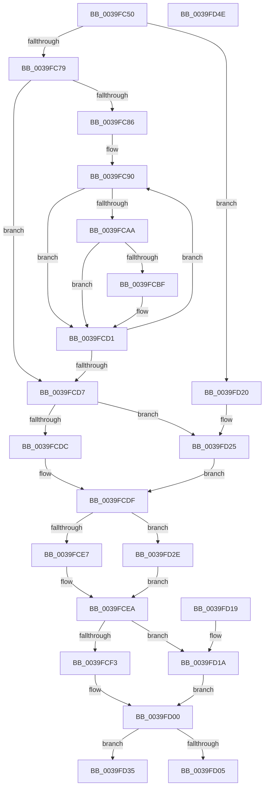

# EtwGetKernelTraceTimestamp

- RVA: `0x0039FC50`–`0x0039FD4F` (길이 `255` bytes)
- VA: `0x000000014039FC50`
- 실행 섹션: `.text`
- PDB 이름 있음: `예`; PDB Function 태그: `아니요`
- unwind 정보 RVA: `0x00081D68`
- 디코드: `73`개 명령, `255/255` bytes 표시
- 미해석 바이트: `0` (있으면 어셈블리에 `.byte`로 보존)

> 이 문서는 커널 이미지의 기계어와 PDB 기호를 분석해 생성했습니다. 4번과 5번은 함수 원형과 자료형을 바이너리 사용 방식에서 추정한 C 해석이며 원본 소스 복구 결과는 아닙니다.

## 1. Dependencies

- 직접 호출 지점: **3**; 고유 호출 대상: **3**
- 직접 호출자로 확인된 함수: **31**
- RIP 상대 이미지 참조: **1**

### Outgoing calls
- `0x0039FD27` → [KeQueryPerformanceCounter](../37/KeQueryPerformanceCounter_function_0037E7E0.md) (function, `0x0037E7E0`)
- `0x0039FD2E` → [RtlGetSystemTimePrecise](../37/RtlGetSystemTimePrecise_function_0037EDD0.md) (function, `0x0037EDD0`)
- `0x0039FD35` → [EtwpGetHostPerfCounter](../3A/EtwpGetHostPerfCounter_function_003A4134.md) (function, `0x003A4134`)

### Direct callers
- [HvlSendSyntheticClusterIpi](../30/HvlSendSyntheticClusterIpi_function_00304E50.md) at `0x00304F39`
- [KiIpiSendRequest](../31/KiIpiSendRequest_function_003113C0.md) at `0x003119D6`
- [sub_003136CC](../31/Unknown_function_003136CC.md) at `0x003136D9`
- [KiInvokeInterruptServiceRoutine](KiInvokeInterruptServiceRoutine_function_0039F8E0.md) at `0x0039F9CE`
- [KeDisableTimer2](KeDisableTimer2_function_0039FD58.md) at `0x0039FED1`
- [KiFinalizeTimer2Disablement](../3A/KiFinalizeTimer2Disablement_function_003A2198.md) at `0x003A2364`
- [KiFinalizeTimer2Disablement](../3A/KiFinalizeTimer2Disablement_function_003A2198.md) at `0x003A2378`
- [KiExpireTimer2](../3A/KiExpireTimer2_function_003A24E0.md) at `0x003A29C4`
- [KiExpireTimer2](../3A/KiExpireTimer2_function_003A24E0.md) at `0x003A2AF8`
- [IopTimerDispatch](../3A/IopTimerDispatch_function_003A3900.md) at `0x003A3A3D`
- [HvlUpdatePerformanceStateCountersForLp](../44/HvlUpdatePerformanceStateCountersForLp_function_0044D5B0.md) at `0x0044D642`
- [KiScanInterruptObjectList](../6B/KiScanInterruptObjectList_function_006B3860.md) at `0x006B38C1`
- [KiScanInterruptObjectList](../6B/KiScanInterruptObjectList_function_006B3860.md) at `0x006B393F`
- [KiInterruptSubDispatch](../6B/KiInterruptSubDispatch_function_006B3990.md) at `0x006B39F1`
- [KiInterruptSubDispatchNoLock](../6B/KiInterruptSubDispatchNoLock_function_006B3A30.md) at `0x006B3A91`
- [KiHvInterruptSubDispatch](../6B/KiHvInterruptSubDispatch_function_006B7F10.md) at `0x006B7F67`
- [KiVmbusInterruptSubDispatch](../6B/KiVmbusInterruptSubDispatch_function_006B7FC0.md) at `0x006B8017`
- [sub_006E9A0A](../6E/Unknown_function_006E9A0A.md) at `0x006E9A5C`
- [CmpReplicateKeyToVirtual](../../page/7E/CmpReplicateKeyToVirtual_function_007EBAEC.md) at `0x007EBB4B`
- [NtSetInformationKey](../../page/84/NtSetInformationKey_function_00843720.md) at `0x00843794`
- [NtSetValueKey](../../page/84/NtSetValueKey_function_00844EA0.md) at `0x00844F41`
- [NtDeleteValueKey](../../page/84/NtDeleteValueKey_function_00848770.md) at `0x0084880D`
- [NtDeleteKey](../../page/84/NtDeleteKey_function_00849920.md) at `0x0084999D`
- [CmpCloseKeyObject](../../page/86/CmpCloseKeyObject_function_00863AD0.md) at `0x00863B34`
- [NtQueryKey](../../page/86/NtQueryKey_function_008676E0.md) at `0x008677AA`
- [CmpSecurityMethod](../../page/87/CmpSecurityMethod_function_00870CC0.md) at `0x00870D49`
- [CmCreateKey](../../page/87/CmCreateKey_function_00875020.md) at `0x008754F1`
- [CmOpenKey](../../page/87/CmOpenKey_function_00876350.md) at `0x00876703`
- [NtQueryMultipleValueKey](../../page/8B/NtQueryMultipleValueKey_function_008B13B0.md) at `0x008B19D2`
- [NtEnumerateKey](../../page/8B/NtEnumerateKey_function_008B1F70.md) at `0x008B23A7`
- [NtQueryValueKey](../../page/8B/NtQueryValueKey_function_008B2A00.md) at `0x008B30A6`
- [NtEnumerateValueKey](../../page/8B/NtEnumerateValueKey_function_008B3B50.md) at `0x008B3C1F`
- [CmKtmNotification](../../page/9B/CmKtmNotification_function_009B1950.md) at `0x009B1D73`
- [NtFlushKey](../../page/A8/NtFlushKey_function_00A8A030.md) at `0x00A8A35D`

### Static image references
- `0x0039FC5F` → RVA `0x00FCFC80` (`CACHEALI`; read)

## 2. Other-region calls and transfers

- 다른 실행 섹션으로 향하는 call: **0**
- 별도 외부 분기/꼬리 이동을 확인하지 못했습니다.

## 3. Assembly (complete function range)

```asm
0039FC50  48 89 5C 24 08                  mov qword ptr [rsp + 8], rbx
0039FC55  48 89 74 24 10                  mov qword ptr [rsp + 0x10], rsi
0039FC5A  57                              push rdi
0039FC5B  48 83 EC 20                     sub rsp, 0x20
0039FC5F  4C 8B 0D 1A 00 C3 00            mov r9, qword ptr [rip + 0xc3001a]
0039FC66  33 F6                           xor esi, esi
0039FC68  44 8B DA                        mov r11d, edx
0039FC6B  48 8B F9                        mov rdi, rcx
0039FC6E  8B DE                           mov ebx, esi
0039FC70  4D 85 C9                        test r9, r9
0039FC73  0F 84 A7 00 00 00               je 0x14039fd20
0039FC79  45 8B 81 A8 11 00 00            mov r8d, dword ptr [r9 + 0x11a8]
0039FC80  45 0F BC D0                     bsf r10d, r8d
0039FC84  74 51                           je 0x14039fcd7
0039FC86  66 66 0F 1F 84 00 00 00 00 00   nop word ptr [rax + rax]
0039FC90  41 8B D2                        mov edx, r10d
0039FC93  41 8D 40 FF                     lea eax, [r8 - 1]
0039FC97  48 C1 E2 05                     shl rdx, 5
0039FC9B  44 23 C0                        and r8d, eax
0039FC9E  48 81 C2 CC 11 00 00            add rdx, 0x11cc
0039FCA5  49 03 D1                        add rdx, r9
0039FCA8  74 27                           je 0x14039fcd1
0039FCAA  49 8B C3                        mov rax, r11
0039FCAD  48 C1 E8 1D                     shr rax, 0x1d
0039FCB1  8B 14 82                        mov edx, dword ptr [rdx + rax*4]
0039FCB4  41 23 D3                        and edx, r11d
0039FCB7  F7 C2 FF FF FF 1F               test edx, 0x1fffffff
0039FCBD  74 12                           je 0x14039fcd1
0039FCBF  43 0F B6 8C 51 99 11 00 00      movzx ecx, byte ptr [r9 + r10*2 + 0x1199]
0039FCC8  B8 01 00 00 00                  mov eax, 1
0039FCCD  D3 E0                           shl eax, cl
0039FCCF  0B D8                           or ebx, eax
0039FCD1  45 0F BC D0                     bsf r10d, r8d
0039FCD5  75 B9                           jne 0x14039fc90
0039FCD7  F6 C3 02                        test bl, 2
0039FCDA  75 49                           jne 0x14039fd25
0039FCDC  48 8B C6                        mov rax, rsi
0039FCDF  48 89 07                        mov qword ptr [rdi], rax
0039FCE2  F6 C3 04                        test bl, 4
0039FCE5  75 47                           jne 0x14039fd2e
0039FCE7  48 8B C6                        mov rax, rsi
0039FCEA  48 89 47 08                     mov qword ptr [rdi + 8], rax
0039FCEE  F6 C3 08                        test bl, 8
0039FCF1  74 27                           je 0x14039fd1a
0039FCF3  0F 31                           rdtsc
0039FCF5  48 C1 E2 20                     shl rdx, 0x20
0039FCF9  48 0B C2                        or rax, rdx
0039FCFC  48 89 47 10                     mov qword ptr [rdi + 0x10], rax
0039FD00  F6 C3 10                        test bl, 0x10
0039FD03  75 30                           jne 0x14039fd35
0039FD05  48 89 77 18                     mov qword ptr [rdi + 0x18], rsi
0039FD09  48 8B 5C 24 30                  mov rbx, qword ptr [rsp + 0x30]
0039FD0E  48 8B 74 24 38                  mov rsi, qword ptr [rsp + 0x38]
0039FD13  48 83 C4 20                     add rsp, 0x20
0039FD17  5F                              pop rdi
0039FD18  C3                              ret
0039FD19  CC                              int3
0039FD1A  48 89 77 10                     mov qword ptr [rdi + 0x10], rsi
0039FD1E  EB E0                           jmp 0x14039fd00
0039FD20  BB 1E 00 00 00                  mov ebx, 0x1e
0039FD25  33 C9                           xor ecx, ecx
0039FD27  E8 B4 EA FD FF                  call 0x14037e7e0
0039FD2C  EB B1                           jmp 0x14039fcdf
0039FD2E  E8 9D F0 FD FF                  call 0x14037edd0
0039FD33  EB B5                           jmp 0x14039fcea
0039FD35  E8 FA 43 00 00                  call 0x1403a4134
0039FD3A  48 89 47 18                     mov qword ptr [rdi + 0x18], rax
0039FD3E  48 8B 5C 24 30                  mov rbx, qword ptr [rsp + 0x30]
0039FD43  48 8B 74 24 38                  mov rsi, qword ptr [rsp + 0x38]
0039FD48  48 83 C4 20                     add rsp, 0x20
0039FD4C  5F                              pop rdi
0039FD4D  C3                              ret
0039FD4E  CC                              int3
```

## 4. C-style interpretation (structured pseudocode)

```c
__int64 __fastcall EtwGetKernelTraceTimestamp(__int64 a1, int a2)
{
    __int64 result;
    __int64 v_rbx;
    __int64 v_rsi;
    __int64 v_rsp;
    unsigned __int64 v_stack_p10;
    unsigned __int64 v_stack_p30;
    unsigned __int64 v_stack_p38;
    unsigned __int64 v_stack_p8;

    v_stack_p8 = v_rbx;
    v_stack_p10 = v_rsi;
    v_rsp = (v_rsp) - (32);
    v_rsi = 0;
    if (*(unsigned __int64 *)(v_rip + 12779546) == 0) goto loc_0039FD20;
    if (*(unsigned __int64 *)(v_rip + 12779546) == 0) goto loc_0039FCD7;
loc_0039FC90:
    a2 = ((unsigned int)((unsigned int)(v_r10))) << (5);
    a3 = (unsigned int)(((unsigned int)(*(unsigned int *)(*(unsigned __int64 *)(v_rip + 12779546) + 4520))) & ((unsigned int)((unsigned int)(*(unsigned int *)(*(unsigned __int64 *)(v_rip + 12779546) + 4520)) - 1)));
    a2 = (a2) + (0x11CCULL);
    a2 = (a2) + (*(unsigned __int64 *)(v_rip + 12779546));
    if (condition_is_equal) goto loc_0039FCD1;
    result = ((unsigned int)(a2)) >> (29);
    a2 = (unsigned int)(((unsigned int)(*(unsigned int *)(a2 + result * 4))) & ((unsigned int)((unsigned int)(a2))));
    v_rbx = 0;
    if (((a2) & (0x1FFFFFFFULL)) != 0) {
        a1 = *(unsigned __int8 *)(*(unsigned __int64 *)(v_rip + 12779546) + v_r10 * 2 + 4505);
        result = 1;
        result = (unsigned int)((result) << ((unsigned __int8)(a1)));
        v_rbx = (unsigned int)((0) | ((unsigned int)(result)));
    }
    if (condition_is_not_equal) goto loc_0039FC90;
loc_0039FCD7:
    if ((((unsigned __int8)(v_rbx)) & (2)) != 0) goto loc_0039FD25;
loc_0039FCDF:
    *(unsigned __int64 *)(a1) = 0;
    if ((((unsigned __int8)(v_rbx)) & (4)) != 0) goto loc_0039FD2E;
loc_0039FCEA:
    *(unsigned __int64 *)(a1 + 8) = 0;
    if ((((unsigned __int8)(v_rbx)) & (8)) == 0) goto loc_0039FD1A;
    a2 = (a2) << (32);
    result = (0) | (a2);
    *(unsigned __int64 *)(a1 + 16) = result;
loc_0039FD00:
    if ((((unsigned __int8)(v_rbx)) & (16)) != 0) goto loc_0039FD35;
    *(unsigned __int64 *)(a1 + 24) = 0;
    v_rsp = (v_rsp) + (32);
    return result;
loc_0039FD1A:
    *(unsigned __int64 *)(a1 + 16) = v_stack_p10;
    goto loc_0039FD00;
loc_0039FD20:
loc_0039FD25:
    a1 = 0;
    result = KeQueryPerformanceCounter(a1, a2, a3, *(unsigned __int64 *)(v_rip + 12779546));
    goto loc_0039FCDF;
loc_0039FD2E:
    result = RtlGetSystemTimePrecise(a1, a2, a3, *(unsigned __int64 *)(v_rip + 12779546));
    goto loc_0039FCEA;
loc_0039FD35:
    result = EtwpGetHostPerfCounter(a1, a2, a3, *(unsigned __int64 *)(v_rip + 12779546));
    *(unsigned __int64 *)(a1 + 24) = result;
    v_rsp = (v_rsp) + (32);
    return result;
}
```

## 5. (Beta) C Style

```c
int64_t EtwGetKernelTraceTimestamp(void *Arg1, int32_t Arg2)
{
    uint8_t *arg1 = (uint8_t *)Arg1;

    int64_t result;
    int64_t local_rbx;
    int64_t local_rsi;
    int64_t local_rsp;
    uint64_t v_stack_p10;
    uint64_t v_stack_p30;
    uint64_t v_stack_p38;
    uint64_t v_stack_p8;

    v_stack_p8 = local_rbx;
    v_stack_p10 = local_rsi;
    local_rsp = (local_rsp) - (32);
    local_rsi = 0;
    if (*(uint64_t *)(v_rip + 0xC3001A) == 0) goto loc_0039FD20;
    if (*(uint64_t *)(v_rip + 0xC3001A) == 0) goto loc_0039FCD7;
loc_0039FC90:
    Arg2 = ((uint32_t)((uint32_t)(local_r10))) << (5);
    a3 = (uint32_t)(((uint32_t)(*(uint32_t *)(*(uint64_t *)(v_rip + 0xC3001A) + 0x11A8))) & ((uint32_t)((uint32_t)(*(uint32_t *)(*(uint64_t *)(v_rip + 0xC3001A) + 0x11A8)) - 1)));
    Arg2 = (Arg2) + (0x11CCULL);
    Arg2 = (Arg2) + (*(uint64_t *)(v_rip + 0xC3001A));
    if (condition_is_equal) goto loc_0039FCD1;
    result = ((uint32_t)(Arg2)) >> (29);
    Arg2 = (uint32_t)(((uint32_t)(*(uint32_t *)(Arg2 + result * 4))) & ((uint32_t)((uint32_t)(Arg2))));
    local_rbx = 0;
    if (((Arg2) & (0x1FFFFFFFULL)) != 0) {
        Arg1 = *(uint8_t *)(*(uint64_t *)(v_rip + 0xC3001A) + local_r10 * 2 + 0x1199);
        result = 1;
        result = (uint32_t)((result) << ((uint8_t)(Arg1)));
        local_rbx = (uint32_t)((0) | ((uint32_t)(result)));
    }
    if (condition_is_not_equal) goto loc_0039FC90;
loc_0039FCD7:
    if ((((uint8_t)(local_rbx)) & (2)) != 0) goto loc_0039FD25;
loc_0039FCDF:
    *(uint64_t *)(arg1) = 0;
    if ((((uint8_t)(local_rbx)) & (4)) != 0) goto loc_0039FD2E;
loc_0039FCEA:
    *(uint64_t *)(arg1 + 0x8) = 0;
    if ((((uint8_t)(local_rbx)) & (8)) == 0) goto loc_0039FD1A;
    Arg2 = (Arg2) << (32);
    result = (0) | (Arg2);
    *(uint64_t *)(arg1 + 0x10) = result;
loc_0039FD00:
    if ((((uint8_t)(local_rbx)) & (16)) != 0) goto loc_0039FD35;
    *(uint64_t *)(arg1 + 0x18) = 0;
    local_rsp = (local_rsp) + (32);
    return result;
loc_0039FD1A:
    *(uint64_t *)(arg1 + 0x10) = v_stack_p10;
    goto loc_0039FD00;
loc_0039FD20:
loc_0039FD25:
    Arg1 = 0;
    result = KeQueryPerformanceCounter(Arg1, Arg2, a3, *(uint64_t *)(v_rip + 0xC3001A));
    goto loc_0039FCDF;
loc_0039FD2E:
    result = RtlGetSystemTimePrecise(Arg1, Arg2, a3, *(uint64_t *)(v_rip + 0xC3001A));
    goto loc_0039FCEA;
loc_0039FD35:
    result = EtwpGetHostPerfCounter(Arg1, Arg2, a3, *(uint64_t *)(v_rip + 0xC3001A));
    *(uint64_t *)(arg1 + 0x18) = result;
    local_rsp = (local_rsp) + (32);
    return result;
}
```

### 관측된 메모리 오프셋

구조체 형식이 확인되지 않은 접근은 인자 기준의 오프셋으로만 기록했습니다.

| 기준 인자 | 오프셋 표현 | 폭 (bit) | 접근 |
|---|---:|---:|---|
| `Arg1` | `+ 0x0` | `64` | `W` |
| `Arg1` | `+ 0x8` | `64` | `W` |
| `Arg1` | `+ 0x10` | `64` | `W` |
| `Arg1` | `+ 0x18` | `64` | `W` |

## 6. Execution-region graph

[열기: 2D/3D 그래프와 함수 탐색 컨트롤 패널](../../../control-panel.html?section=text&rva=0x0039FC50&view=graph)

- 2D 그래프는 위에서 아래로 흐르고, 3D 그래프는 빈 공간을 드래그해 회전합니다. Shift+드래그는 이동, 휠은 확대·축소, 함수 노드 선택은 대상 보고서 이동입니다.

### Static fallback


