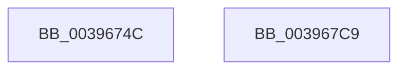

# EtwTraceEnqueueWork

- RVA: `0x0039674C`–`0x003967CA` (길이 `126` bytes)
- VA: `0x000000014039674C`
- 실행 섹션: `.text`
- PDB 이름 있음: `예`; PDB Function 태그: `아니요`
- unwind 정보 RVA: `0x00065FB8`
- 디코드: `29`개 명령, `126/126` bytes 표시
- 미해석 바이트: `0` (있으면 어셈블리에 `.byte`로 보존)

> 이 문서는 커널 이미지의 기계어와 PDB 기호를 분석해 생성했습니다. 4번과 5번은 함수 원형과 자료형을 바이너리 사용 방식에서 추정한 C 해석이며 원본 소스 복구 결과는 아닙니다.

## 1. Dependencies

- 직접 호출 지점: **2**; 고유 호출 대상: **2**
- 직접 호출자로 확인된 함수: **15**
- RIP 상대 이미지 참조: **1**

### Outgoing calls
- `0x003967B2` → [EtwTraceKernelEvent](../23/EtwTraceKernelEvent_function_00235350.md) (function, `0x00235350`)
- `0x003967BF` → [_security_check_cookie](../6A/_security_check_cookie_function_006AC640.md) (function, `0x006AC640`)

### Direct callers
- [KiInsertQueueInternal](../21/KiInsertQueueInternal_function_00219B30.md) at `0x00219D98`
- [IoSetIoCompletionEx3](../24/IoSetIoCompletionEx3_function_0024EEE0.md) at `0x0024F2A8`
- [IopCompleteIrpInFileObjectList](../24/IopCompleteIrpInFileObjectList_function_0024F330.md) at `0x0024F8E1`
- [IoSetIoCompletionEx](../24/IoSetIoCompletionEx_function_0024FA80.md) at `0x0024FDC6`
- [sub_002501D3](../25/Unknown_function_002501D3.md) at `0x002501E5`
- [AlpcpSignalAndWait](../2F/AlpcpSignalAndWait_function_002F9620.md) at `0x002F9A05`
- [sub_00343C9D](../34/Unknown_function_00343C9D.md) at `0x00343D08`
- [AlpcpSignal](AlpcpSignal_function_003955E0.md) at `0x00395CBA`
- [AlpcpQueueIoCompletion](AlpcpQueueIoCompletion_function_00397480.md) at `0x00397859`
- [sub_00397C33](Unknown_function_00397C33.md) at `0x00397C45`
- [AlpcpQueueIoCompletionPort](../3F/AlpcpQueueIoCompletionPort_function_003FF760.md) at `0x003FFD39`
- [IopPassiveInterruptDpc](../46/IopPassiveInterruptDpc_function_00469D40.md) at `0x00469E68`
- [KeInsertQueue](../46/KeInsertQueue_function_0046C8F0.md) at `0x0046CA08`
- [FsRtlpPostStackOverflow](../58/FsRtlpPostStackOverflow_function_0058351C.md) at `0x00583605`
- [KeInsertHeadQueue](../5B/KeInsertHeadQueue_function_005BE5D0.md) at `0x005BE63F`

### Static image references
- `0x00396753` → RVA `0x00E0A740` (`.data`; read)

## 2. Other-region calls and transfers

- 다른 실행 섹션으로 향하는 call: **0**
- 별도 외부 분기/꼬리 이동을 확인하지 못했습니다.

## 3. Assembly (complete function range)

```asm
0039674C  4C 8B DC                        mov r11, rsp
0039674F  48 83 EC 68                     sub rsp, 0x68
00396753  48 8B 05 E6 3F A7 00            mov rax, qword ptr [rip + 0xa73fe6]
0039675A  48 33 C4                        xor rax, rsp
0039675D  48 89 44 24 50                  mov qword ptr [rsp + 0x50], rax
00396762  8B 81 10 05 00 00               mov eax, dword ptr [rcx + 0x510]
00396768  41 B9 3E 05 00 00               mov r9d, 0x53e
0039676E  83 64 24 3C 00                  and dword ptr [rsp + 0x3c], 0
00396773  49 8D 4B D8                     lea rcx, [r11 - 0x28]
00396777  49 89 53 C8                     mov qword ptr [r11 - 0x38], rdx
0039677B  BA 01 00 00 00                  mov edx, 1
00396780  89 44 24 38                     mov dword ptr [rsp + 0x38], eax
00396784  49 8D 43 C8                     lea rax, [r11 - 0x38]
00396788  49 89 43 D8                     mov qword ptr [r11 - 0x28], rax
0039678C  83 64 24 4C 00                  and dword ptr [rsp + 0x4c], 0
00396791  41 F6 D8                        neg r8b
00396794  C7 44 24 48 0C 00 00 00         mov dword ptr [rsp + 0x48], 0xc
0039679C  41 B8 00 00 00 21               mov r8d, 0x21000000
003967A2  1B C0                           sbb eax, eax
003967A4  25 00 18 00 00                  and eax, 0x1800
003967A9  05 02 06 60 00                  add eax, 0x600602
003967AE  89 44 24 20                     mov dword ptr [rsp + 0x20], eax
003967B2  E8 99 EB E9 FF                  call 0x140235350
003967B7  48 8B 4C 24 50                  mov rcx, qword ptr [rsp + 0x50]
003967BC  48 33 CC                        xor rcx, rsp
003967BF  E8 7C 5E 31 00                  call 0x1406ac640
003967C4  48 83 C4 68                     add rsp, 0x68
003967C8  C3                              ret
003967C9  CC                              int3
```

## 4. C-style interpretation (structured pseudocode)

```c
__int64 __fastcall EtwTraceEnqueueWork(__int64 a1, __int64 a2, unsigned __int8 a3)
{
    __int64 result;
    __int64 v_rsp;
    unsigned __int64 v_stack_m18;
    unsigned int v_stack_m1C;
    unsigned int v_stack_m20;
    unsigned int v_stack_m2C;
    unsigned int v_stack_m30;
    unsigned int v_stack_m48;

    v_rsp = (v_rsp) - (104);
    result = (*(unsigned __int64 *)(v_rip + 10960870)) ^ (v_rsp);
    v_stack_m18 = result;
    *(unsigned __int64 *)(v_rsp - 56) = a2;
    v_stack_m30 = (unsigned int)((unsigned int)(*(unsigned int *)(a1 + 1296)));
    *(unsigned __int64 *)(v_rsp - 40) = v_rsp - 56;
    a3 = (unsigned __int8)(-(a3));
    v_stack_m20 = 12;
    result = (unsigned int)((v_rsp - 56) & (0x1800ULL));
    result = (unsigned int)((result) + (0x600602ULL));
    v_stack_m48 = (unsigned int)(result);
    result = EtwTraceKernelEvent(v_rsp - 40, 1, (unsigned int)(0x21000000ULL), (unsigned int)(0x53EULL));
    a1 = (v_stack_m18) ^ (v_rsp);
    result = _security_check_cookie(a1, 1, (unsigned int)(0x21000000ULL), (unsigned int)(0x53EULL));
    v_rsp = (v_rsp) + (104);
    return result;
}
```

## 5. (Beta) C Style

```c
int64_t EtwTraceEnqueueWork(void *Arg1, int64_t Arg2, uint8_t Arg3)
{
    uint8_t *arg1 = (uint8_t *)Arg1;

    int64_t result;
    int64_t local_rsp;
    uint64_t v_stack_m18;
    uint32_t v_stack_m1C;
    uint32_t v_stack_m20;
    uint32_t v_stack_m2C;
    uint32_t v_stack_m30;
    uint32_t v_stack_m48;

    local_rsp = (local_rsp) - (104);
    result = (*(uint64_t *)(v_rip + 0xA73FE6)) ^ (local_rsp);
    v_stack_m18 = result;
    *(uint64_t *)(local_rsp - 0x38) = Arg2;
    v_stack_m30 = (uint32_t)((uint32_t)(*(uint32_t *)(arg1 + 0x510)));
    *(uint64_t *)(local_rsp - 0x28) = local_rsp - 56;
    Arg3 = (uint8_t)(-(Arg3));
    v_stack_m20 = 12;
    result = (uint32_t)((local_rsp - 56) & (0x1800ULL));
    result = (uint32_t)((result) + (0x600602ULL));
    v_stack_m48 = (uint32_t)(result);
    result = EtwTraceKernelEvent(local_rsp - 40, 1, (uint32_t)(0x21000000ULL), (uint32_t)(0x53EULL));
    Arg1 = (v_stack_m18) ^ (local_rsp);
    result = _security_check_cookie(Arg1, 1, (uint32_t)(0x21000000ULL), (uint32_t)(0x53EULL));
    local_rsp = (local_rsp) + (104);
    return result;
}
```

### 관측된 메모리 오프셋

구조체 형식이 확인되지 않은 접근은 인자 기준의 오프셋으로만 기록했습니다.

| 기준 인자 | 오프셋 표현 | 폭 (bit) | 접근 |
|---|---:|---:|---|
| `Arg1` | `+ 0x510` | `32` | `R` |

## 6. Execution-region graph

[열기: 2D/3D 그래프와 함수 탐색 컨트롤 패널](../../../control-panel.html?section=text&rva=0x0039674C&view=graph)

- 2D 그래프는 위에서 아래로 흐르고, 3D 그래프는 빈 공간을 드래그해 회전합니다. Shift+드래그는 이동, 휠은 확대·축소, 함수 노드 선택은 대상 보고서 이동입니다.

### Static fallback


