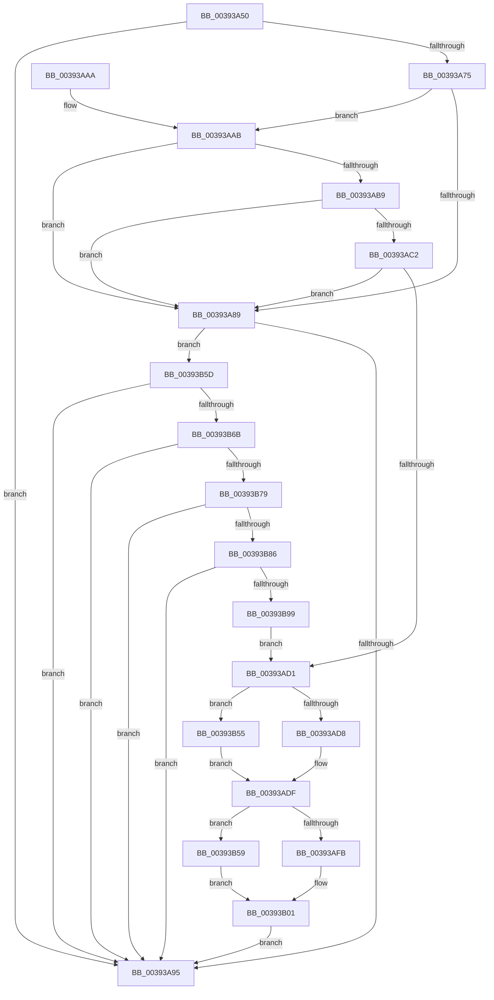

# EtwTraceThreadWorkOnBehalfUpdate

- RVA: `0x00393A50`–`0x00393B9E` (길이 `334` bytes)
- VA: `0x0000000140393A50`
- 실행 섹션: `.text`
- PDB 이름 있음: `예`; PDB Function 태그: `아니요`
- unwind 정보 RVA: `0x00080EBC`
- 디코드: `78`개 명령, `334/334` bytes 표시
- 미해석 바이트: `0` (있으면 어셈블리에 `.byte`로 보존)

> 이 문서는 커널 이미지의 기계어와 PDB 기호를 분석해 생성했습니다. 4번과 5번은 함수 원형과 자료형을 바이너리 사용 방식에서 추정한 C 해석이며 원본 소스 복구 결과는 아닙니다.

## 1. Dependencies

- 직접 호출 지점: **2**; 고유 호출 대상: **2**
- 직접 호출자로 확인된 함수: **2**
- RIP 상대 이미지 참조: **3**

### Outgoing calls
- `0x00393A9D` → [_security_check_cookie](../6A/_security_check_cookie_function_006AC640.md) (function, `0x006AC640`)
- `0x00393B4B` → [EtwWriteEx](../25/EtwWriteEx_function_0025F0D0.md) (function, `0x0025F0D0`)

### Direct callers
- [PspUpdateContainerImpersonation](PspUpdateContainerImpersonation_function_003931EC.md) at `0x003932D1`
- [sub_00393D34](Unknown_function_00393D34.md) at `0x00393DFD`

### Static image references
- `0x00393A57` → RVA `0x00E0A740` (`.data`; read)
- `0x00393A66` → RVA `0x00EFF9E8` (`.data`; read)
- `0x00393B05` → RVA `0x000112C0` (`.rdata`; read)

## 2. Other-region calls and transfers

- 다른 실행 섹션으로 향하는 call: **0**
- 별도 외부 분기/꼬리 이동을 확인하지 못했습니다.

## 3. Assembly (complete function range)

```asm
00393A50  48 81 EC 88 00 00 00            sub rsp, 0x88
00393A57  48 8B 05 E2 6C A7 00            mov rax, qword ptr [rip + 0xa76ce2]
00393A5E  48 33 C4                        xor rax, rsp
00393A61  48 89 44 24 70                  mov qword ptr [rsp + 0x70], rax
00393A66  4C 8B 0D 7B BF B6 00            mov r9, qword ptr [rip + 0xb6bf7b]
00393A6D  4C 8B D1                        mov r10, rcx
00393A70  4D 85 C9                        test r9, r9
00393A73  74 20                           je 0x140393a95
00393A75  49 8B 41 20                     mov rax, qword ptr [r9 + 0x20]
00393A79  49 BB 00 20 00 00 00 00 00 80   movabs r11, 0x8000000000002000
00393A83  83 78 60 00                     cmp dword ptr [rax + 0x60], 0
00393A87  75 22                           jne 0x140393aab
00393A89  66 41 83 79 66 00               cmp word ptr [r9 + 0x66], 0
00393A8F  0F 85 C8 00 00 00               jne 0x140393b5d
00393A95  48 8B 4C 24 70                  mov rcx, qword ptr [rsp + 0x70]
00393A9A  48 33 CC                        xor rcx, rsp
00393A9D  E8 9E 8B 31 00                  call 0x1406ac640
00393AA2  48 81 C4 88 00 00 00            add rsp, 0x88
00393AA9  C3                              ret
00393AAA  CC                              int3
00393AAB  44 0F B6 40 64                  movzx r8d, byte ptr [rax + 0x64]
00393AB0  41 FE C8                        dec r8b
00393AB3  41 80 F8 02                     cmp r8b, 2
00393AB7  76 D0                           jbe 0x140393a89
00393AB9  8B 48 68                        mov ecx, dword ptr [rax + 0x68]
00393ABC  4C 85 58 70                     test qword ptr [rax + 0x70], r11
00393AC0  74 C7                           je 0x140393a89
00393AC2  48 8B 48 78                     mov rcx, qword ptr [rax + 0x78]
00393AC6  48 8B C1                        mov rax, rcx
00393AC9  49 23 C3                        and rax, r11
00393ACC  48 3B C1                        cmp rax, rcx
00393ACF  75 B8                           jne 0x140393a89
00393AD1  33 C9                           xor ecx, ecx
00393AD3  4D 85 D2                        test r10, r10
00393AD6  74 7D                           je 0x140393b55
00393AD8  41 8B 82 10 05 00 00            mov eax, dword ptr [r10 + 0x510]
00393ADF  89 44 24 40                     mov dword ptr [rsp + 0x40], eax
00393AE3  48 8D 44 24 40                  lea rax, [rsp + 0x40]
00393AE8  48 89 44 24 50                  mov qword ptr [rsp + 0x50], rax
00393AED  48 C7 44 24 58 04 00 00 00      mov qword ptr [rsp + 0x58], 4
00393AF6  48 85 D2                        test rdx, rdx
00393AF9  74 5E                           je 0x140393b59
00393AFB  8B 82 10 05 00 00               mov eax, dword ptr [rdx + 0x510]
00393B01  89 44 24 44                     mov dword ptr [rsp + 0x44], eax
00393B05  48 8D 15 B4 D7 C7 FF            lea rdx, [rip - 0x38284c]
00393B0C  48 8D 44 24 44                  lea rax, [rsp + 0x44]
00393B11  48 C7 44 24 68 04 00 00 00      mov qword ptr [rsp + 0x68], 4
00393B1A  48 89 44 24 60                  mov qword ptr [rsp + 0x60], rax
00393B1F  41 B9 01 00 00 00               mov r9d, 1
00393B25  48 8D 44 24 50                  lea rax, [rsp + 0x50]
00393B2A  45 33 C0                        xor r8d, r8d
00393B2D  48 89 44 24 38                  mov qword ptr [rsp + 0x38], rax
00393B32  C7 44 24 30 02 00 00 00         mov dword ptr [rsp + 0x30], 2
00393B3A  48 89 4C 24 28                  mov qword ptr [rsp + 0x28], rcx
00393B3F  48 89 4C 24 20                  mov qword ptr [rsp + 0x20], rcx
00393B44  48 8B 0D 9D BE B6 00            mov rcx, qword ptr [rip + 0xb6be9d]
00393B4B  E8 80 B5 EC FF                  call 0x14025f0d0
00393B50  E9 40 FF FF FF                  jmp 0x140393a95
00393B55  8B C1                           mov eax, ecx
00393B57  EB 86                           jmp 0x140393adf
00393B59  8B C1                           mov eax, ecx
00393B5B  EB A4                           jmp 0x140393b01
00393B5D  49 8B 49 28                     mov rcx, qword ptr [r9 + 0x28]
00393B61  83 79 60 00                     cmp dword ptr [rcx + 0x60], 0
00393B65  0F 84 2A FF FF FF               je 0x140393a95
00393B6B  0F B6 41 64                     movzx eax, byte ptr [rcx + 0x64]
00393B6F  FE C8                           dec al
00393B71  3C 02                           cmp al, 2
00393B73  0F 86 1C FF FF FF               jbe 0x140393a95
00393B79  8B 41 68                        mov eax, dword ptr [rcx + 0x68]
00393B7C  4C 85 59 70                     test qword ptr [rcx + 0x70], r11
00393B80  0F 84 0F FF FF FF               je 0x140393a95
00393B86  48 8B 49 78                     mov rcx, qword ptr [rcx + 0x78]
00393B8A  48 8B C1                        mov rax, rcx
00393B8D  49 23 C3                        and rax, r11
00393B90  48 3B C1                        cmp rax, rcx
00393B93  0F 85 FC FE FF FF               jne 0x140393a95
00393B99  E9 33 FF FF FF                  jmp 0x140393ad1
```

## 4. C-style interpretation (structured pseudocode)

```c
__int64 __fastcall EtwTraceThreadWorkOnBehalfUpdate(__int64 a1, __int64 a2)
{
    __int64 result;
    __int64 v_rsp;
    unsigned __int64 v_stack_m18;
    unsigned __int64 v_stack_p20;
    unsigned __int64 v_stack_p28;
    unsigned int v_stack_p30;
    unsigned __int64 v_stack_p38;
    unsigned int v_stack_p40;
    unsigned int v_stack_p44;
    unsigned __int64 v_stack_p50;
    unsigned __int64 v_stack_p58;
    unsigned __int64 v_stack_p60;
    unsigned __int64 v_stack_p68;

    v_rsp = (v_rsp) - (136);
    result = (*(unsigned __int64 *)(v_rip + 10972386)) ^ (v_rsp);
    v_stack_m18 = result;
    if (*(unsigned __int64 *)(v_rip + 11976571) == 0) goto loc_00393A95;
    if ((*(unsigned int *)(*(unsigned __int64 *)(*(unsigned __int64 *)(v_rip + 11976571) + 32) + 96)) != 0) goto loc_00393AAB;
loc_00393A89:
    if ((*(unsigned __int16 *)(*(unsigned __int64 *)(v_rip + 11976571) + 102)) != 0) goto loc_00393B5D;
loc_00393A95:
    a1 = (v_stack_m18) ^ (v_rsp);
    result = _security_check_cookie(a1, a2, a3, *(unsigned __int64 *)(v_rip + 11976571));
    v_rsp = (v_rsp) + (136);
    return result;
loc_00393AAB:
    a3 = (unsigned __int8)((*(unsigned __int8 *)(result + 100)) - 1);
    if (((unsigned __int8)(a3)) <= 2) goto loc_00393A89;
    if (((*(unsigned __int64 *)(result + 112)) & (v_r11)) == 0) goto loc_00393A89;
    result = (*(unsigned __int64 *)(result + 120)) & (v_r11);
    if (result != (*(unsigned __int64 *)(result + 120))) goto loc_00393A89;
loc_00393AD1:
    a1 = 0;
    if (0 == 0) goto loc_00393B55;
loc_00393ADF:
    v_stack_p40 = (unsigned int)((unsigned int)(*(unsigned int *)(a1 + 1296)));
    v_stack_p50 = v_stack_p40;
    v_stack_p58 = 4;
    if (a2 == 0) goto loc_00393B59;
loc_00393B01:
    v_stack_p44 = (unsigned int)((unsigned int)(*(unsigned int *)(a2 + 1296)));
    v_stack_p68 = 4;
    v_stack_p60 = v_stack_p44;
    a3 = 0;
    v_stack_p38 = v_stack_p50;
    v_stack_p30 = 2;
    v_stack_p28 = 0;
    v_stack_p20 = 0;
    result = EtwWriteEx(*(unsigned __int64 *)(v_rip + 11976349), v_rip - 3680332, a3, 1);
    goto loc_00393A95;
loc_00393B55:
    goto loc_00393ADF;
loc_00393B59:
    goto loc_00393B01;
loc_00393B5D:
    if ((*(unsigned int *)(*(unsigned __int64 *)(1 + 40) + 96)) == 0) goto loc_00393A95;
    result = (unsigned __int8)((*(unsigned __int8 *)(*(unsigned __int64 *)(1 + 40) + 100)) - 1);
    if (((unsigned __int8)(result)) <= 2) goto loc_00393A95;
    if (((*(unsigned __int64 *)(*(unsigned __int64 *)(1 + 40) + 112)) & (v_r11)) == 0) goto loc_00393A95;
    result = (*(unsigned __int64 *)(*(unsigned __int64 *)(1 + 40) + 120)) & (v_r11);
    if (result != (*(unsigned __int64 *)(*(unsigned __int64 *)(1 + 40) + 120))) goto loc_00393A95;
    goto loc_00393AD1;
}
```

## 5. (Beta) C Style

```c
int64_t EtwTraceThreadWorkOnBehalfUpdate(int64_t Arg1, int64_t Arg2)
{
    int64_t result;
    int64_t local_rsp;
    uint64_t v_stack_m18;
    uint64_t v_stack_p20;
    uint64_t v_stack_p28;
    uint32_t v_stack_p30;
    uint64_t v_stack_p38;
    uint32_t v_stack_p40;
    uint32_t v_stack_p44;
    uint64_t v_stack_p50;
    uint64_t v_stack_p58;
    uint64_t v_stack_p60;
    uint64_t v_stack_p68;

    local_rsp = (local_rsp) - (136);
    result = (*(uint64_t *)(v_rip + 0xA76CE2)) ^ (local_rsp);
    v_stack_m18 = result;
    if (*(uint64_t *)(v_rip + 0xB6BF7B) == 0) goto loc_00393A95;
    if ((*(uint32_t *)(*(uint64_t *)(*(uint64_t *)(v_rip + 0xB6BF7B) + 0x20) + 0x60)) != 0) goto loc_00393AAB;
loc_00393A89:
    if ((*(uint16_t *)(*(uint64_t *)(v_rip + 0xB6BF7B) + 0x66)) != 0) goto loc_00393B5D;
loc_00393A95:
    Arg1 = (v_stack_m18) ^ (local_rsp);
    result = _security_check_cookie(Arg1, Arg2, a3, *(uint64_t *)(v_rip + 0xB6BF7B));
    local_rsp = (local_rsp) + (136);
    return result;
loc_00393AAB:
    a3 = (uint8_t)((*(uint8_t *)(result + 0x64)) - 1);
    if (((uint8_t)(a3)) <= 2) goto loc_00393A89;
    if (((*(uint64_t *)(result + 0x70)) & (local_r11)) == 0) goto loc_00393A89;
    result = (*(uint64_t *)(result + 0x78)) & (local_r11);
    if (result != (*(uint64_t *)(result + 0x78))) goto loc_00393A89;
loc_00393AD1:
    Arg1 = 0;
    if (0 == 0) goto loc_00393B55;
loc_00393ADF:
    v_stack_p40 = (uint32_t)((uint32_t)(*(uint32_t *)(Arg1 + 0x510)));
    v_stack_p50 = v_stack_p40;
    v_stack_p58 = 4;
    if (Arg2 == 0) goto loc_00393B59;
loc_00393B01:
    v_stack_p44 = (uint32_t)((uint32_t)(*(uint32_t *)(Arg2 + 0x510)));
    v_stack_p68 = 4;
    v_stack_p60 = v_stack_p44;
    a3 = 0;
    v_stack_p38 = v_stack_p50;
    v_stack_p30 = 2;
    v_stack_p28 = 0;
    v_stack_p20 = 0;
    result = EtwWriteEx(*(uint64_t *)(v_rip + 0xB6BE9D), v_rip - 3680332, a3, 1);
    goto loc_00393A95;
loc_00393B55:
    goto loc_00393ADF;
loc_00393B59:
    goto loc_00393B01;
loc_00393B5D:
    if ((*(uint32_t *)(*(uint64_t *)(1 + 0x28) + 0x60)) == 0) goto loc_00393A95;
    result = (uint8_t)((*(uint8_t *)(*(uint64_t *)(1 + 0x28) + 0x64)) - 1);
    if (((uint8_t)(result)) <= 2) goto loc_00393A95;
    if (((*(uint64_t *)(*(uint64_t *)(1 + 0x28) + 0x70)) & (local_r11)) == 0) goto loc_00393A95;
    result = (*(uint64_t *)(*(uint64_t *)(1 + 0x28) + 0x78)) & (local_r11);
    if (result != (*(uint64_t *)(*(uint64_t *)(1 + 0x28) + 0x78))) goto loc_00393A95;
    goto loc_00393AD1;
}
```

## 6. Execution-region graph

[열기: 2D/3D 그래프와 함수 탐색 컨트롤 패널](../../../control-panel.html?section=text&rva=0x00393A50&view=graph)

- 2D 그래프는 위에서 아래로 흐르고, 3D 그래프는 빈 공간을 드래그해 회전합니다. Shift+드래그는 이동, 휠은 확대·축소, 함수 노드 선택은 대상 보고서 이동입니다.

### Static fallback


