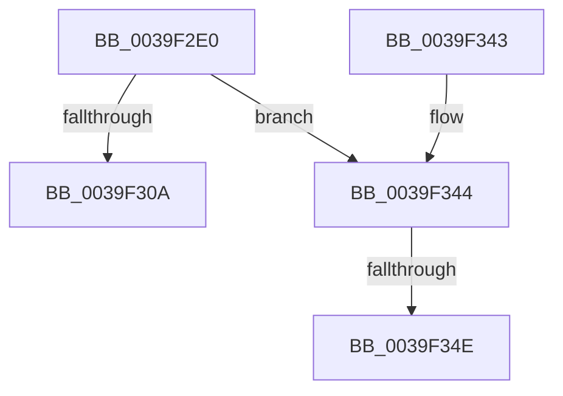

# ExDeleteTimer

- RVA: `0x0039F2E0`–`0x0039F36B` (길이 `139` bytes)
- VA: `0x000000014039F2E0`
- 실행 섹션: `.text`
- PDB 이름 있음: `예`; PDB Function 태그: `예`
- unwind 정보 RVA: `0x00081C90`
- 디코드: `37`개 명령, `139/139` bytes 표시
- 미해석 바이트: `0` (있으면 어셈블리에 `.byte`로 보존)

> 이 문서는 커널 이미지의 기계어와 PDB 기호를 분석해 생성했습니다. 4번과 5번은 함수 원형과 자료형을 바이너리 사용 방식에서 추정한 C 해석이며 원본 소스 복구 결과는 아닙니다.

## 1. Dependencies

- 직접 호출 지점: **3**; 고유 호출 대상: **3**
- 직접 호출자로 확인된 함수: **4**
- RIP 상대 이미지 참조: **1**

### Outgoing calls
- `0x0039F300` → [ExpCheckForFreedEnhancedTimer](../3A/ExpCheckForFreedEnhancedTimer_function_003A0148.md) (function, `0x003A0148`)
- `0x0039F329` → [KeDisableTimer2](KeDisableTimer2_function_0039FD58.md) (function, `0x0039FD58`)
- `0x0039F365` → [KeBugCheckEx](../4F/KeBugCheckEx_function_004FD660.md) (function, `0x004FD660`)

### Direct callers
- [CancelTimerCallbacksAndDeleteTimer](../../page/83/CancelTimerCallbacksAndDeleteTimer_function_00835ED4.md) at `0x00835F3C`
- [WdtpCancelTimer](../../page/95/WdtpCancelTimer_function_00955C70.md) at `0x00955C8A`
- [EtwpFreeLoggerContext](../../page/9C/EtwpFreeLoggerContext_function_009C1688.md) at `0x009C19BD`
- [HalpUnregisterPmuNotification](../../page/AC/HalpUnregisterPmuNotification_function_00ACAB7C.md) at `0x00ACAD4D`

### Static image references
- `0x0039F30A` → RVA `0x003A33B0` (`ExpFinalizeTimerDeletion`; read)

## 2. Other-region calls and transfers

- 다른 실행 섹션으로 향하는 call: **0**
- call이 아닌 외부 분기/꼬리 이동: **1**
  - `0x0039F348` → [sub_006E61A8](../6E/Unknown_function_006E61A8.md) (`tail-transfer`)

## 3. Assembly (complete function range)

```asm
0039F2E0  48 89 5C 24 08                  mov qword ptr [rsp + 8], rbx
0039F2E5  48 89 6C 24 10                  mov qword ptr [rsp + 0x10], rbp
0039F2EA  48 89 74 24 18                  mov qword ptr [rsp + 0x18], rsi
0039F2EF  57                              push rdi
0039F2F0  48 83 EC 40                     sub rsp, 0x40
0039F2F4  49 8B F9                        mov rdi, r9
0039F2F7  41 8A F0                        mov sil, r8b
0039F2FA  40 8A EA                        mov bpl, dl
0039F2FD  48 8B D9                        mov rbx, rcx
0039F300  E8 43 0E 00 00                  call 0x1403a0148
0039F305  48 85 FF                        test rdi, rdi
0039F308  75 3A                           jne 0x14039f344
0039F30A  48 8D 05 9F 40 00 00            lea rax, [rip + 0x409f]
0039F311  48 89 5C 24 38                  mov qword ptr [rsp + 0x38], rbx
0039F316  4C 8D 4C 24 30                  lea r9, [rsp + 0x30]
0039F31B  48 89 44 24 30                  mov qword ptr [rsp + 0x30], rax
0039F320  44 8A C6                        mov r8b, sil
0039F323  40 8A D5                        mov dl, bpl
0039F326  48 8B CB                        mov rcx, rbx
0039F329  E8 2A 0A 00 00                  call 0x14039fd58
0039F32E  48 8B 5C 24 50                  mov rbx, qword ptr [rsp + 0x50]
0039F333  48 8B 6C 24 58                  mov rbp, qword ptr [rsp + 0x58]
0039F338  48 8B 74 24 60                  mov rsi, qword ptr [rsp + 0x60]
0039F33D  48 83 C4 40                     add rsp, 0x40
0039F341  5F                              pop rdi
0039F342  C3                              ret
0039F343  CC                              int3
0039F344  8B 07                           mov eax, dword ptr [rdi]
0039F346  85 C0                           test eax, eax
0039F348  0F 84 5A 6E 34 00               je 0x1406e61a8
0039F34E  48 83 64 24 20 00               and qword ptr [rsp + 0x20], 0
0039F354  BA 09 00 00 00                  mov edx, 9
0039F359  44 8B C8                        mov r9d, eax
0039F35C  B9 C7 00 00 00                  mov ecx, 0xc7
0039F361  44 8D 42 F8                     lea r8d, [rdx - 8]
0039F365  E8 F6 E2 15 00                  call 0x1404fd660
0039F36A  CC                              int3
```

## 4. C-style interpretation (structured pseudocode)

```c
__int64 __fastcall ExDeleteTimer(__int64 a1, unsigned __int8 a2, unsigned __int8 a3, __int64 a4)
{
    __int64 result;
    __int64 v_rsp;
    unsigned __int64 v_stack_m10;
    unsigned __int64 v_stack_m18;
    unsigned __int64 v_stack_p10;
    unsigned __int64 v_stack_p18;
    unsigned __int64 v_stack_p20;
    unsigned __int64 v_stack_p8;

    v_stack_p8 = v_rbx;
    v_stack_p10 = v_rbp;
    v_stack_p18 = v_rsi;
    v_rsp = (v_rsp) - (64);
    result = ExpCheckForFreedEnhancedTimer(a1, a2, a3, a4);
    if (a4 != 0) goto loc_0039F344;
    v_stack_m10 = a1;
    v_stack_m18 = v_rip + 16543;
    result = KeDisableTimer2(a1, a2, a3, v_stack_m18);
    v_rsp = (v_rsp) + (64);
    return result;
loc_0039F344:
    result = KeBugCheckEx(199, 9, 9 - 8, (unsigned int)((unsigned int)((unsigned int)(*(unsigned int *)(a4)))));
    return result;
}
```

## 5. (Beta) C Style

```c
int64_t ExDeleteTimer(int64_t Arg1, uint8_t Arg2, uint8_t Arg3, int64_t Arg4)
{
    int64_t result;
    int64_t local_rsp;
    uint64_t v_stack_m10;
    uint64_t v_stack_m18;
    uint64_t v_stack_p10;
    uint64_t v_stack_p18;
    uint64_t v_stack_p20;
    uint64_t v_stack_p8;

    v_stack_p8 = local_rbx;
    v_stack_p10 = local_rbp;
    v_stack_p18 = local_rsi;
    local_rsp = (local_rsp) - (64);
    result = ExpCheckForFreedEnhancedTimer(Arg1, Arg2, Arg3, Arg4);
    if (Arg4 != 0) goto loc_0039F344;
    v_stack_m10 = Arg1;
    v_stack_m18 = v_rip + 16543;
    result = KeDisableTimer2(Arg1, Arg2, Arg3, v_stack_m18);
    local_rsp = (local_rsp) + (64);
    return result;
loc_0039F344:
    result = KeBugCheckEx(199, 9, 9 - 8, (uint32_t)((uint32_t)((uint32_t)(*(uint32_t *)(Arg4)))));
    return result;
}
```

## 6. Execution-region graph

[열기: 2D/3D 그래프와 함수 탐색 컨트롤 패널](../../../control-panel.html?section=text&rva=0x0039F2E0&view=graph)

- 2D 그래프는 위에서 아래로 흐르고, 3D 그래프는 빈 공간을 드래그해 회전합니다. Shift+드래그는 이동, 휠은 확대·축소, 함수 노드 선택은 대상 보고서 이동입니다.

### Static fallback


