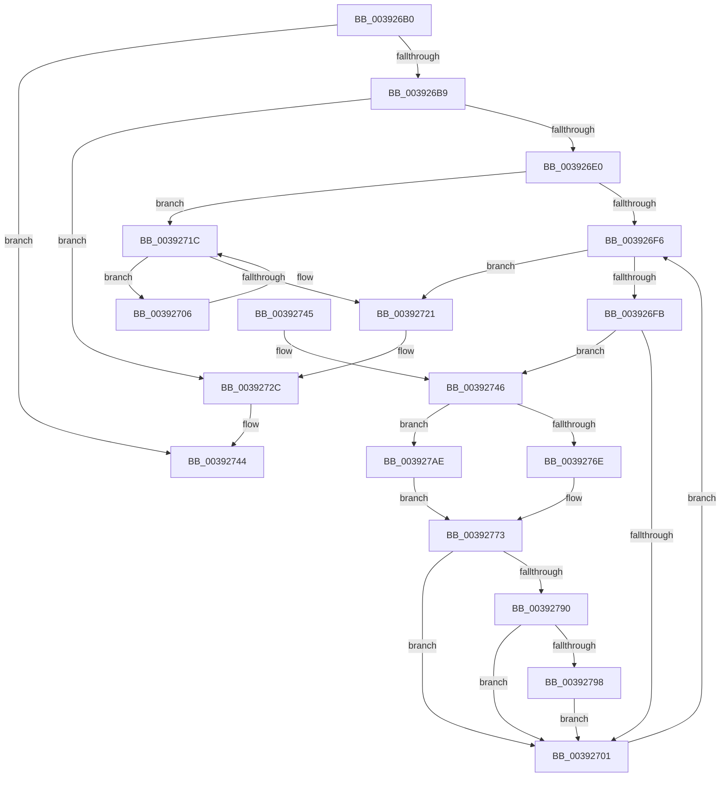

# ExNotifyCallback

- RVA: `0x003926B0`–`0x003927B5` (길이 `261` bytes)
- VA: `0x00000001403926B0`
- 실행 섹션: `.text`
- PDB 이름 있음: `예`; PDB Function 태그: `아니요`
- unwind 정보 RVA: `0x00080D08`
- 디코드: `76`개 명령, `261/261` bytes 표시
- 미해석 바이트: `0` (있으면 어셈블리에 `.byte`로 보존)

> 이 문서는 커널 이미지의 기계어와 PDB 기호를 분석해 생성했습니다. 4번과 5번은 함수 원형과 자료형을 바이너리 사용 방식에서 추정한 C 해석이며 원본 소스 복구 결과는 아닙니다.

## 1. Dependencies

- 직접 호출 지점: **8**; 고유 호출 대상: **5**
- 직접 호출자로 확인된 함수: **12**
- RIP 상대 이미지 참조: **2**

### Outgoing calls
- `0x003926E7` → [KeAcquireSpinLockRaiseToDpc](../20/KeAcquireSpinLockRaiseToDpc_function_00208470.md) (function, `0x00208470`)
- `0x00392714` → [guard_dispatch_icall](../6B/guard_dispatch_icall_function_006BAAD0.md) (function, `0x006BAAD0`)
- `0x00392727` → [KeReleaseSpinLock](KeReleaseSpinLock_function_00392BA0.md) (function, `0x00392BA0`)
- `0x0039274F` → [KeReleaseSpinLock](KeReleaseSpinLock_function_00392BA0.md) (function, `0x00392BA0`)
- `0x0039276E` → [PopUmpoMessageCallback](../45/PopUmpoMessageCallback_function_00452600.md) (function, `0x00452600`)
- `0x00392776` → [KeAcquireSpinLockRaiseToDpc](../20/KeAcquireSpinLockRaiseToDpc_function_00208470.md) (function, `0x00208470`)
- `0x003927A4` → [KeSetEvent](../33/KeSetEvent_function_0033F310.md) (function, `0x0033F310`)
- `0x003927AE` → [guard_dispatch_icall](../6B/guard_dispatch_icall_function_006BAAD0.md) (function, `0x006BAAD0`)

### Direct callers
- [PnprLockPagesForReplace](../../page/73/PnprLockPagesForReplace_function_0073A150.md) at `0x0073A16E`
- [PnprUnlockPagesForReplace](../../page/73/PnprUnlockPagesForReplace_function_0073AA5C.md) at `0x0073AA7C`
- [PopBroadcastLegacyLidSwitchChangeCallback](../../page/75/PopBroadcastLegacyLidSwitchChangeCallback_function_0075F190.md) at `0x0075F1CD`
- [PopDispatchAcDcCallback](../../page/76/PopDispatchAcDcCallback_function_00765BD0.md) at `0x00765BEE`
- [PopDispatchCallback](../../page/76/PopDispatchCallback_function_00765C20.md) at `0x00765C30`
- [SLSendPolicyChangeNotifications](../../page/7C/SLSendPolicyChangeNotifications_function_007C9BDC.md) at `0x007C9BF1`
- [sub_0088EC77](../../page/88/Unknown_function_0088EC77.md) at `0x0088F044`
- [NtPowerInformation](../../page/95/NtPowerInformation_function_00955D80.md) at `0x00957E77`
- [NtNotifyChangeSession](../../page/A7/NtNotifyChangeSession_function_00A7E630.md) at `0x00A7E7F6`
- [PopNotifyCallbacksPreSleep](../../page/AD/PopNotifyCallbacksPreSleep_function_00AD3440.md) at `0x00AD3468`
- [PopUnlockAfterSleepWorker](../../pagelk/B7/PopUnlockAfterSleepWorker_function_00B782A0.md) at `0x00B78326`
- [KiFilterFiberContext](../../init/BE/KiFilterFiberContext_function_00BEFB50.md) at `0x00BEFC66`

### Static image references
- `0x00392758` → RVA `0x00452600` (`PopUmpoMessageCallback`; read)
- `0x0039279B` → RVA `0x00EFACE0` (`.data`; read)

## 2. Other-region calls and transfers

- 다른 실행 섹션으로 향하는 call: **0**
- 별도 외부 분기/꼬리 이동을 확인하지 못했습니다.

## 3. Assembly (complete function range)

```asm
003926B0  48 85 C9                        test rcx, rcx
003926B3  0F 84 8B 00 00 00               je 0x140392744
003926B9  48 89 5C 24 08                  mov qword ptr [rsp + 8], rbx
003926BE  48 89 6C 24 10                  mov qword ptr [rsp + 0x10], rbp
003926C3  48 89 74 24 18                  mov qword ptr [rsp + 0x18], rsi
003926C8  57                              push rdi
003926C9  41 56                           push r14
003926CB  41 57                           push r15
003926CD  48 83 EC 20                     sub rsp, 0x20
003926D1  48 8D 79 10                     lea rdi, [rcx + 0x10]
003926D5  4D 8B F0                        mov r14, r8
003926D8  4C 8B FA                        mov r15, rdx
003926DB  48 39 3F                        cmp qword ptr [rdi], rdi
003926DE  74 4C                           je 0x14039272c
003926E0  48 8D 69 08                     lea rbp, [rcx + 8]
003926E4  48 8B CD                        mov rcx, rbp
003926E7  E8 84 5D E7 FF                  call 0x140208470
003926EC  48 8B 1F                        mov rbx, qword ptr [rdi]
003926EF  40 8A F0                        mov sil, al
003926F2  3C 02                           cmp al, 2
003926F4  74 26                           je 0x14039271c
003926F6  48 3B DF                        cmp rbx, rdi
003926F9  74 26                           je 0x140392721
003926FB  80 7B 2C 00                     cmp byte ptr [rbx + 0x2c], 0
003926FF  74 45                           je 0x140392746
00392701  48 8B 1B                        mov rbx, qword ptr [rbx]
00392704  EB F0                           jmp 0x1403926f6
00392706  48 8B 43 18                     mov rax, qword ptr [rbx + 0x18]
0039270A  4D 8B C6                        mov r8, r14
0039270D  48 8B 4B 20                     mov rcx, qword ptr [rbx + 0x20]
00392711  49 8B D7                        mov rdx, r15
00392714  E8 B7 83 32 00                  call 0x1406baad0
00392719  48 8B 1B                        mov rbx, qword ptr [rbx]
0039271C  48 3B DF                        cmp rbx, rdi
0039271F  75 E5                           jne 0x140392706
00392721  40 8A D6                        mov dl, sil
00392724  48 8B CD                        mov rcx, rbp
00392727  E8 74 04 00 00                  call 0x140392ba0
0039272C  48 8B 5C 24 40                  mov rbx, qword ptr [rsp + 0x40]
00392731  48 8B 6C 24 48                  mov rbp, qword ptr [rsp + 0x48]
00392736  48 8B 74 24 50                  mov rsi, qword ptr [rsp + 0x50]
0039273B  48 83 C4 20                     add rsp, 0x20
0039273F  41 5F                           pop r15
00392741  41 5E                           pop r14
00392743  5F                              pop rdi
00392744  C3                              ret
00392745  CC                              int3
00392746  FF 43 28                        inc dword ptr [rbx + 0x28]
00392749  40 8A D6                        mov dl, sil
0039274C  48 8B CD                        mov rcx, rbp
0039274F  E8 4C 04 00 00                  call 0x140392ba0
00392754  48 8B 43 18                     mov rax, qword ptr [rbx + 0x18]
00392758  48 8D 15 A1 FE 0B 00            lea rdx, [rip + 0xbfea1]
0039275F  48 8B 4B 20                     mov rcx, qword ptr [rbx + 0x20]
00392763  48 3B C2                        cmp rax, rdx
00392766  49 8B D7                        mov rdx, r15
00392769  4D 8B C6                        mov r8, r14
0039276C  75 40                           jne 0x1403927ae
0039276E  E8 8D FE 0B 00                  call 0x140452600
00392773  48 8B CD                        mov rcx, rbp
00392776  E8 F5 5C E7 FF                  call 0x140208470
0039277B  40 8A F0                        mov sil, al
0039277E  8B 43 28                        mov eax, dword ptr [rbx + 0x28]
00392781  FF C8                           dec eax
00392783  80 7B 2C 00                     cmp byte ptr [rbx + 0x2c], 0
00392787  89 43 28                        mov dword ptr [rbx + 0x28], eax
0039278A  0F 84 71 FF FF FF               je 0x140392701
00392790  85 C0                           test eax, eax
00392792  0F 85 69 FF FF FF               jne 0x140392701
00392798  45 33 C0                        xor r8d, r8d
0039279B  48 8D 0D 3E 85 B6 00            lea rcx, [rip + 0xb6853e]
003927A2  33 D2                           xor edx, edx
003927A4  E8 67 CB FA FF                  call 0x14033f310
003927A9  E9 53 FF FF FF                  jmp 0x140392701
003927AE  E8 1D 83 32 00                  call 0x1406baad0
003927B3  EB BE                           jmp 0x140392773
```

## 4. C-style interpretation (structured pseudocode)

```c
__int64 __fastcall ExNotifyCallback(__int64 a1, __int64 a2, __int64 a3)
{
    __int64 result;
    __int64 v_rsp;
    unsigned __int64 v_stack_p10;
    unsigned __int64 v_stack_p18;
    unsigned __int64 v_stack_p8;

    if (a1 == 0) goto loc_00392744;
    v_stack_p8 = v_rbx;
    v_stack_p10 = v_rbp;
    v_stack_p18 = v_rsi;
    v_rsp = (v_rsp) - (32);
    if ((*(unsigned __int64 *)(a1 + 16)) == (a1 + 16)) goto loc_0039272C;
    result = KeAcquireSpinLockRaiseToDpc(a1 + 8, a2, a3, a4);
    if (((unsigned __int8)(result)) == 2) goto loc_0039271C;
loc_003926F6:
    if ((*(unsigned __int64 *)(a1 + 16)) == (a1 + 16)) goto loc_00392721;
    if ((*(unsigned __int8 *)(*(unsigned __int64 *)(a1 + 16) + 44)) == 0) goto loc_00392746;
loc_00392701:
    goto loc_003926F6;
loc_00392706:
    result = guard_dispatch_icall(*(unsigned __int64 *)(*(unsigned __int64 *)(*(unsigned __int64 *)(a1 + 16)) + 32), a2, a3, a4);
loc_0039271C:
    if ((*(unsigned __int64 *)(*(unsigned __int64 *)(*(unsigned __int64 *)(a1 + 16)))) != (a1 + 16)) goto loc_00392706;
loc_00392721:
    result = KeReleaseSpinLock(a1 + 8, (unsigned __int8)((unsigned __int8)(result)), a3, a4);
loc_0039272C:
    v_rsp = (v_rsp) + (32);
loc_00392744:
    return result;
loc_00392746:
    result = KeReleaseSpinLock(v_stack_p10, (unsigned __int8)(v_stack_p18), a3, a4);
    if ((*(unsigned __int64 *)(v_stack_p8 + 24)) != (v_rip + 786081)) goto loc_003927AE;
    result = PopUmpoMessageCallback(*(unsigned __int64 *)(v_stack_p8 + 32), a2, a3, a4);
loc_00392773:
    result = KeAcquireSpinLockRaiseToDpc(v_stack_p10, a2, a3, a4);
    result = (unsigned int)(((unsigned int)(*(unsigned int *)(v_stack_p8 + 40))) - 1);
    *(unsigned int *)(v_stack_p8 + 40) = (unsigned int)(result);
    if ((*(unsigned __int8 *)(v_stack_p8 + 44)) == 0) goto loc_00392701;
    if ((unsigned int)(result) != 0) goto loc_00392701;
    a3 = 0;
    a2 = 0;
    result = KeSetEvent(v_rip + 11961662, a2, a3, a4);
    goto loc_00392701;
loc_003927AE:
    result = guard_dispatch_icall(v_rip + 11961662, a2, a3, a4);
    goto loc_00392773;
}
```

## 5. (Beta) C Style

```c
int64_t ExNotifyCallback(int64_t Arg1, int64_t Arg2, int64_t Arg3)
{
    int64_t result;
    int64_t local_rsp;
    uint64_t v_stack_p10;
    uint64_t v_stack_p18;
    uint64_t v_stack_p8;

    if (Arg1 == 0) goto loc_00392744;
    v_stack_p8 = local_rbx;
    v_stack_p10 = local_rbp;
    v_stack_p18 = local_rsi;
    local_rsp = (local_rsp) - (32);
    if ((*(uint64_t *)(Arg1 + 0x10)) == (Arg1 + 16)) goto loc_0039272C;
    result = KeAcquireSpinLockRaiseToDpc(Arg1 + 8, Arg2, Arg3, a4);
    if (((uint8_t)(result)) == 2) goto loc_0039271C;
loc_003926F6:
    if ((*(uint64_t *)(Arg1 + 0x10)) == (Arg1 + 16)) goto loc_00392721;
    if ((*(uint8_t *)(*(uint64_t *)(Arg1 + 0x10) + 0x2C)) == 0) goto loc_00392746;
loc_00392701:
    goto loc_003926F6;
loc_00392706:
    result = guard_dispatch_icall(*(uint64_t *)(*(uint64_t *)(*(uint64_t *)(Arg1 + 0x10)) + 0x20), Arg2, Arg3, a4);
loc_0039271C:
    if ((*(uint64_t *)(*(uint64_t *)(*(uint64_t *)(Arg1 + 0x10)))) != (Arg1 + 16)) goto loc_00392706;
loc_00392721:
    result = KeReleaseSpinLock(Arg1 + 8, (uint8_t)((uint8_t)(result)), Arg3, a4);
loc_0039272C:
    local_rsp = (local_rsp) + (32);
loc_00392744:
    return result;
loc_00392746:
    result = KeReleaseSpinLock(v_stack_p10, (uint8_t)(v_stack_p18), Arg3, a4);
    if ((*(uint64_t *)(v_stack_p8 + 0x18)) != (v_rip + 786081)) goto loc_003927AE;
    result = PopUmpoMessageCallback(*(uint64_t *)(v_stack_p8 + 0x20), Arg2, Arg3, a4);
loc_00392773:
    result = KeAcquireSpinLockRaiseToDpc(v_stack_p10, Arg2, Arg3, a4);
    result = (uint32_t)(((uint32_t)(*(uint32_t *)(v_stack_p8 + 0x28))) - 1);
    *(uint32_t *)(v_stack_p8 + 0x28) = (uint32_t)(result);
    if ((*(uint8_t *)(v_stack_p8 + 0x2C)) == 0) goto loc_00392701;
    if ((uint32_t)(result) != 0) goto loc_00392701;
    Arg3 = 0;
    Arg2 = 0;
    result = KeSetEvent(v_rip + 11961662, Arg2, Arg3, a4);
    goto loc_00392701;
loc_003927AE:
    result = guard_dispatch_icall(v_rip + 11961662, Arg2, Arg3, a4);
    goto loc_00392773;
}
```

## 6. Execution-region graph

[열기: 2D/3D 그래프와 함수 탐색 컨트롤 패널](../../../control-panel.html?section=text&rva=0x003926B0&view=graph)

- 2D 그래프는 위에서 아래로 흐르고, 3D 그래프는 빈 공간을 드래그해 회전합니다. Shift+드래그는 이동, 휠은 확대·축소, 함수 노드 선택은 대상 보고서 이동입니다.

### Static fallback


