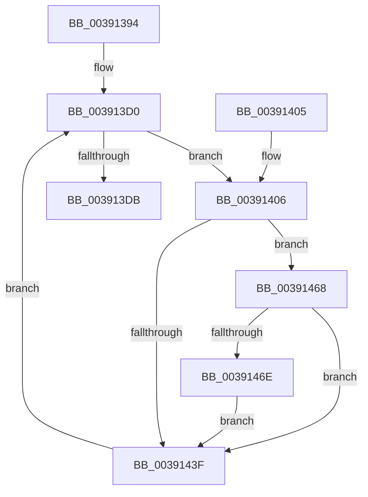

# ExTimerRundown

- RVA: `0x00391394`–`0x0039147B` (길이 `231` bytes)
- VA: `0x0000000140391394`
- 실행 섹션: `.text`
- PDB 이름 있음: `예`; PDB Function 태그: `아니요`
- unwind 정보 RVA: `0x00080A68`
- 디코드: `60`개 명령, `231/231` bytes 표시
- 미해석 바이트: `0` (있으면 어셈블리에 `.byte`로 보존)

> 이 문서는 커널 이미지의 기계어와 PDB 기호를 분석해 생성했습니다. 4번과 5번은 함수 원형과 자료형을 바이너리 사용 방식에서 추정한 C 해석이며 원본 소스 복구 결과는 아닙니다.

## 1. Dependencies

- 직접 호출 지점: **9**; 고유 호출 대상: **5**
- 직접 호출자로 확인된 함수: **1**
- RIP 상대 이미지 참조: **0**

### Outgoing calls
- `0x003913C4` → [KeAcquireSpinLockRaiseToDpc](../20/KeAcquireSpinLockRaiseToDpc_function_00208470.md) (function, `0x00208470`)
- `0x003913E1` → [KeReleaseSpinLock](KeReleaseSpinLock_function_00392BA0.md) (function, `0x00392BA0`)
- `0x00391415` → [ObfReferenceObjectWithTag](../21/ObfReferenceObjectWithTag_function_00210710.md) (function, `0x00210710`)
- `0x00391420` → [KeReleaseSpinLock](KeReleaseSpinLock_function_00392BA0.md) (function, `0x00392BA0`)
- `0x0039142E` → [KeAcquireSpinLockRaiseToDpc](../20/KeAcquireSpinLockRaiseToDpc_function_00208470.md) (function, `0x00208470`)
- `0x00391446` → [KeReleaseSpinLock](KeReleaseSpinLock_function_00392BA0.md) (function, `0x00392BA0`)
- `0x00391456` → [ObDereferenceObjectExWithTag](../43/ObDereferenceObjectExWithTag_function_0043CBC0.md) (function, `0x0043CBC0`)
- `0x0039145E` → [KeAcquireSpinLockRaiseToDpc](../20/KeAcquireSpinLockRaiseToDpc_function_00208470.md) (function, `0x00208470`)
- `0x00391471` → [ExpCancelTimer](../23/ExpCancelTimer_function_00232700.md) (function, `0x00232700`)

### Direct callers
- [PspExitThread](../../page/90/PspExitThread_function_00905F60.md) at `0x009062A5`

### Static image references
- 디코드된 RIP-relative 메모리 참조가 없습니다.

## 2. Other-region calls and transfers

- 다른 실행 섹션으로 향하는 call: **0**
- 별도 외부 분기/꼬리 이동을 확인하지 못했습니다.

## 3. Assembly (complete function range)

```asm
00391394  48 8B C4                        mov rax, rsp
00391397  48 89 58 08                     mov qword ptr [rax + 8], rbx
0039139B  48 89 68 10                     mov qword ptr [rax + 0x10], rbp
0039139F  48 89 70 18                     mov qword ptr [rax + 0x18], rsi
003913A3  48 89 78 20                     mov qword ptr [rax + 0x20], rdi
003913A7  41 54                           push r12
003913A9  41 56                           push r14
003913AB  41 57                           push r15
003913AD  48 83 EC 20                     sub rsp, 0x20
003913B1  65 48 8B 3C 25 88 01 00 00      mov rdi, qword ptr gs:[0x188]
003913BA  48 8D 9F F0 04 00 00            lea rbx, [rdi + 0x4f0]
003913C1  48 8B CB                        mov rcx, rbx
003913C4  E8 A7 70 E7 FF                  call 0x140208470
003913C9  4C 8D B7 F8 04 00 00            lea r14, [rdi + 0x4f8]
003913D0  40 8A E8                        mov bpl, al
003913D3  49 8B 06                        mov rax, qword ptr [r14]
003913D6  49 3B C6                        cmp rax, r14
003913D9  75 2B                           jne 0x140391406
003913DB  40 8A D5                        mov dl, bpl
003913DE  48 8B CB                        mov rcx, rbx
003913E1  E8 BA 17 00 00                  call 0x140392ba0
003913E6  48 8B 5C 24 40                  mov rbx, qword ptr [rsp + 0x40]
003913EB  48 8B 6C 24 48                  mov rbp, qword ptr [rsp + 0x48]
003913F0  48 8B 74 24 50                  mov rsi, qword ptr [rsp + 0x50]
003913F5  48 8B 7C 24 58                  mov rdi, qword ptr [rsp + 0x58]
003913FA  48 83 C4 20                     add rsp, 0x20
003913FE  41 5F                           pop r15
00391400  41 5E                           pop r14
00391402  41 5C                           pop r12
00391404  C3                              ret
00391405  CC                              int3
00391406  48 8D B0 20 FF FF FF            lea rsi, [rax - 0xe0]
0039140D  BA 44 66 6C 74                  mov edx, 0x746c6644
00391412  48 8B CE                        mov rcx, rsi
00391415  E8 F6 F2 E7 FF                  call 0x140210710
0039141A  40 8A D5                        mov dl, bpl
0039141D  48 8B CB                        mov rcx, rbx
00391420  E8 7B 17 00 00                  call 0x140392ba0
00391425  48 8D 4E 40                     lea rcx, [rsi + 0x40]
00391429  BD 01 00 00 00                  mov ebp, 1
0039142E  E8 3D 70 E7 FF                  call 0x140208470
00391433  44 8A E0                        mov r12b, al
00391436  40 84 AE 30 01 00 00            test byte ptr [rsi + 0x130], bpl
0039143D  75 29                           jne 0x140391468
0039143F  41 8A D4                        mov dl, r12b
00391442  48 8D 4E 40                     lea rcx, [rsi + 0x40]
00391446  E8 55 17 00 00                  call 0x140392ba0
0039144B  41 B8 44 66 6C 74               mov r8d, 0x746c6644
00391451  8B D5                           mov edx, ebp
00391453  48 8B CE                        mov rcx, rsi
00391456  E8 65 B7 0A 00                  call 0x14043cbc0
0039145B  48 8B CB                        mov rcx, rbx
0039145E  E8 0D 70 E7 FF                  call 0x140208470
00391463  E9 68 FF FF FF                  jmp 0x1403913d0
00391468  48 3B 7E 50                     cmp rdi, qword ptr [rsi + 0x50]
0039146C  75 D1                           jne 0x14039143f
0039146E  48 8B CE                        mov rcx, rsi
00391471  E8 8A 12 EA FF                  call 0x140232700
00391476  8D 68 01                        lea ebp, [rax + 1]
00391479  EB C4                           jmp 0x14039143f
```

## 4. C-style interpretation (structured pseudocode)

```c
__int64 __fastcall ExTimerRundown(void)
{
    __int64 result;
    __int64 v_rsp;
    unsigned __int64 v_stack_p10;
    unsigned __int64 v_stack_p18;
    unsigned __int64 v_stack_p20;
    unsigned __int64 v_stack_p8;

    *(unsigned __int64 *)(v_rsp + 8) = v_rbx;
    *(unsigned __int64 *)(v_rsp + 16) = v_rbp;
    *(unsigned __int64 *)(v_rsp + 24) = v_rsi;
    *(unsigned __int64 *)(v_rsp + 32) = v_rdi;
    v_rsp = (v_rsp) - (32);
    result = KeAcquireSpinLockRaiseToDpc(*(unsigned __int64 *)(gs_base + (0 + 392)) + 1264, a2, a3, a4);
loc_003913D0:
    if ((*(unsigned __int64 *)(*(unsigned __int64 *)(gs_base + (0 + 392)) + 1272)) != (*(unsigned __int64 *)(gs_base + (0 + 392)) + 1272)) goto loc_00391406;
    result = KeReleaseSpinLock(*(unsigned __int64 *)(gs_base + (0 + 392)) + 1264, (unsigned __int8)((unsigned __int8)(result)), a3, a4);
    v_rsp = (v_rsp) + (32);
    return result;
loc_00391406:
    result = ObfReferenceObjectWithTag(result - 224, (unsigned int)(0x746C6644ULL), a3, a4);
    result = KeReleaseSpinLock(v_stack_p8, (unsigned __int8)(v_stack_p10), a3, a4);
    result = KeAcquireSpinLockRaiseToDpc(result - 224 + 64, (unsigned __int8)(v_stack_p10), a3, a4);
    if (((*(unsigned __int8 *)(result - 224 + 304)) & (1)) != 0) goto loc_00391468;
loc_0039143F:
    result = KeReleaseSpinLock(result - 224 + 64, (unsigned __int8)((unsigned __int8)(result)), a3, a4);
    result = ObDereferenceObjectExWithTag(result - 224, 1, (unsigned int)(0x746C6644ULL), a4);
    result = KeAcquireSpinLockRaiseToDpc(v_stack_p8, 1, (unsigned int)(0x746C6644ULL), a4);
    goto loc_003913D0;
loc_00391468:
    if (v_stack_p20 != (*(unsigned __int64 *)(result - 224 + 80))) goto loc_0039143F;
    result = ExpCancelTimer(result - 224, 1, (unsigned int)(0x746C6644ULL), a4);
    goto loc_0039143F;
}
```

## 5. (Beta) C Style

```c
void ExTimerRundown(void)
{
    int64_t result;
    int64_t local_rsp;
    uint64_t v_stack_p10;
    uint64_t v_stack_p18;
    uint64_t v_stack_p20;
    uint64_t v_stack_p8;

    *(uint64_t *)(local_rsp + 0x8) = local_rbx;
    *(uint64_t *)(local_rsp + 0x10) = local_rbp;
    *(uint64_t *)(local_rsp + 0x18) = local_rsi;
    *(uint64_t *)(local_rsp + 0x20) = local_rdi;
    local_rsp = (local_rsp) - (32);
    result = KeAcquireSpinLockRaiseToDpc(*(uint64_t *)(gs_base + (0 + 0x188)) + 1264, a2, a3, a4);
loc_003913D0:
    if ((*(uint64_t *)(*(uint64_t *)(gs_base + (0 + 0x188)) + 0x4F8)) != (*(uint64_t *)(gs_base + (0 + 0x188)) + 1272)) goto loc_00391406;
    result = KeReleaseSpinLock(*(uint64_t *)(gs_base + (0 + 0x188)) + 1264, (uint8_t)((uint8_t)(result)), a3, a4);
    local_rsp = (local_rsp) + (32);
    return result;
loc_00391406:
    result = ObfReferenceObjectWithTag(result - 224, (uint32_t)(0x746C6644ULL), a3, a4);
    result = KeReleaseSpinLock(v_stack_p8, (uint8_t)(v_stack_p10), a3, a4);
    result = KeAcquireSpinLockRaiseToDpc(result - 224 + 64, (uint8_t)(v_stack_p10), a3, a4);
    if (((*(uint8_t *)(result - 0xE0 + 0x130)) & (1)) != 0) goto loc_00391468;
loc_0039143F:
    result = KeReleaseSpinLock(result - 224 + 64, (uint8_t)((uint8_t)(result)), a3, a4);
    result = ObDereferenceObjectExWithTag(result - 224, 1, (uint32_t)(0x746C6644ULL), a4);
    result = KeAcquireSpinLockRaiseToDpc(v_stack_p8, 1, (uint32_t)(0x746C6644ULL), a4);
    goto loc_003913D0;
loc_00391468:
    if (v_stack_p20 != (*(uint64_t *)(result - 0xE0 + 0x50))) goto loc_0039143F;
    result = ExpCancelTimer(result - 224, 1, (uint32_t)(0x746C6644ULL), a4);
    goto loc_0039143F;
}
```

## 6. Execution-region graph

[열기: 2D/3D 그래프와 함수 탐색 컨트롤 패널](../../../control-panel.html?section=text&rva=0x00391394&view=graph)

- 2D 그래프는 위에서 아래로 흐르고, 3D 그래프는 빈 공간을 드래그해 회전합니다. Shift+드래그는 이동, 휠은 확대·축소, 함수 노드 선택은 대상 보고서 이동입니다.

### Static fallback


