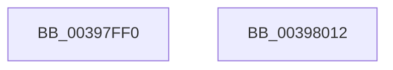

# ExTryQueueWorkItem

- RVA: `0x00397FF0`–`0x00398013` (길이 `35` bytes)
- VA: `0x0000000140397FF0`
- 실행 섹션: `.text`
- PDB 이름 있음: `예`; PDB Function 태그: `아니요`
- unwind 정보 RVA: `0x0005C788`
- 디코드: `10`개 명령, `35/35` bytes 표시
- 미해석 바이트: `0` (있으면 어셈블리에 `.byte`로 보존)

> 이 문서는 커널 이미지의 기계어와 PDB 기호를 분석해 생성했습니다. 4번과 5번은 함수 원형과 자료형을 바이너리 사용 방식에서 추정한 C 해석이며 원본 소스 복구 결과는 아닙니다.

## 1. Dependencies

- 직접 호출 지점: **1**; 고유 호출 대상: **1**
- 직접 호출자로 확인된 함수: **2**
- RIP 상대 이미지 참조: **1**

### Outgoing calls
- `0x00398008` → [ExpTryQueueWorkItem](ExpTryQueueWorkItem_function_0039801C.md) (function, `0x0039801C`)

### Direct callers
- [PopFxHandleReportDevicePoweredOn](../26/PopFxHandleReportDevicePoweredOn_function_0026D980.md) at `0x0026D9CC`
- [PopHandleDevicePowerIrpCompletion](../26/PopHandleDevicePowerIrpCompletion_function_0026F030.md) at `0x0026F0DE`

### Static image references
- `0x00397FFD` → RVA `0x00FC6EA0` (`ALMOSTRO`; read)

## 2. Other-region calls and transfers

- 다른 실행 섹션으로 향하는 call: **0**
- 별도 외부 분기/꼬리 이동을 확인하지 못했습니다.

## 3. Assembly (complete function range)

```asm
00397FF0  48 83 EC 28                     sub rsp, 0x28
00397FF4  44 8B C2                        mov r8d, edx
00397FF7  45 33 C9                        xor r9d, r9d
00397FFA  48 8B D1                        mov rdx, rcx
00397FFD  48 8B 0D 9C EE C2 00            mov rcx, qword ptr [rip + 0xc2ee9c]
00398004  48 8B 49 10                     mov rcx, qword ptr [rcx + 0x10]
00398008  E8 0F 00 00 00                  call 0x14039801c
0039800D  48 83 C4 28                     add rsp, 0x28
00398011  C3                              ret
00398012  CC                              int3
```

## 4. C-style interpretation (structured pseudocode)

```c
__int64 __fastcall ExTryQueueWorkItem(__int64 a1, int a2, __int64 a3, int a4)
{
    __int64 result;
    __int64 v_rsp;

    v_rsp = (v_rsp) - (40);
    a4 = 0;
    result = ExpTryQueueWorkItem(*(unsigned __int64 *)(*(unsigned __int64 *)(v_rip + 12775068) + 16), a1, (unsigned int)(a2), a4);
    v_rsp = (v_rsp) + (40);
    return result;
}
```

## 5. (Beta) C Style

```c
int64_t ExTryQueueWorkItem(int64_t Arg1, int32_t Arg2, int64_t Arg3, int32_t Arg4)
{
    int64_t result;
    int64_t local_rsp;

    local_rsp = (local_rsp) - (40);
    Arg4 = 0;
    result = ExpTryQueueWorkItem(*(uint64_t *)(*(uint64_t *)(v_rip + 0xC2EE9C) + 0x10), Arg1, (uint32_t)(Arg2), Arg4);
    local_rsp = (local_rsp) + (40);
    return result;
}
```

## 6. Execution-region graph

[열기: 2D/3D 그래프와 함수 탐색 컨트롤 패널](../../../control-panel.html?section=text&rva=0x00397FF0&view=graph)

- 2D 그래프는 위에서 아래로 흐르고, 3D 그래프는 빈 공간을 드래그해 회전합니다. Shift+드래그는 이동, 휠은 확대·축소, 함수 노드 선택은 대상 보고서 이동입니다.

### Static fallback


