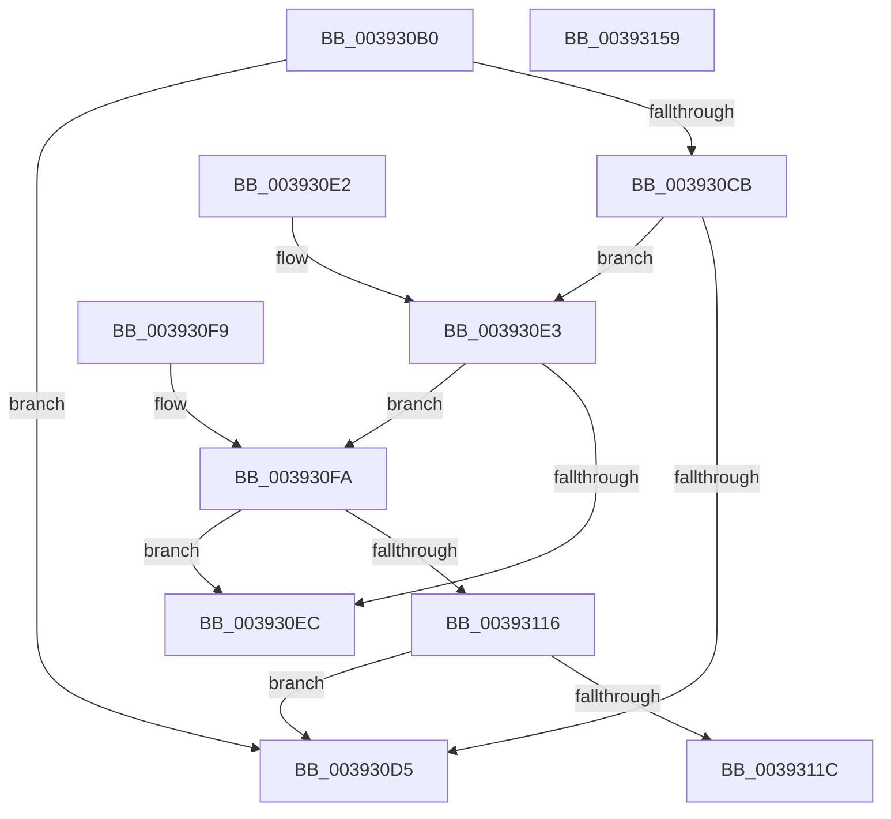

# ExpTryEnterWorkerFactoryAwayMode

- RVA: `0x003930B0`–`0x0039315A` (길이 `170` bytes)
- VA: `0x00000001403930B0`
- 실행 섹션: `.text`
- PDB 이름 있음: `예`; PDB Function 태그: `아니요`
- unwind 정보 RVA: `0x00080E00`
- 디코드: `48`개 명령, `170/170` bytes 표시
- 미해석 바이트: `0` (있으면 어셈블리에 `.byte`로 보존)

> 이 문서는 커널 이미지의 기계어와 PDB 기호를 분석해 생성했습니다. 4번과 5번은 함수 원형과 자료형을 바이너리 사용 방식에서 추정한 C 해석이며 원본 소스 복구 결과는 아닙니다.

## 1. Dependencies

- 직접 호출 지점: **2**; 고유 호출 대상: **2**
- 직접 호출자로 확인된 함수: **2**
- RIP 상대 이미지 참조: **1**

### Outgoing calls
- `0x00393130` → [ObfReferenceObjectWithTag](../21/ObfReferenceObjectWithTag_function_00210710.md) (function, `0x00210710`)
- `0x00393147` → [KeRegisterObjectNotification](KeRegisterObjectNotification_function_00393454.md) (function, `0x00393454`)

### Direct callers
- [NtSetInformationWorkerFactory](../35/NtSetInformationWorkerFactory_function_00350A30.md) at `0x00350FB2`
- [ExpWorkerFactoryManagerThread](../65/ExpWorkerFactoryManagerThread_function_0065CCC0.md) at `0x0065CD6F`

### Static image references
- `0x00393140` → RVA `0x00EFA1A0` (`.data`; read)

## 2. Other-region calls and transfers

- 다른 실행 섹션으로 향하는 call: **0**
- 별도 외부 분기/꼬리 이동을 확인하지 못했습니다.

## 3. Assembly (complete function range)

```asm
003930B0  48 89 5C 24 08                  mov qword ptr [rsp + 8], rbx
003930B5  57                              push rdi
003930B6  48 83 EC 20                     sub rsp, 0x20
003930BA  8B 81 7C 01 00 00               mov eax, dword ptr [rcx + 0x17c]
003930C0  48 8B D9                        mov rbx, rcx
003930C3  39 81 80 01 00 00               cmp dword ptr [rcx + 0x180], eax
003930C9  73 0A                           jae 0x1403930d5
003930CB  48 8B 79 10                     mov rdi, qword ptr [rcx + 0x10]
003930CF  83 7F 1C 00                     cmp dword ptr [rdi + 0x1c], 0
003930D3  74 0E                           je 0x1403930e3
003930D5  32 C0                           xor al, al
003930D7  48 8B 5C 24 30                  mov rbx, qword ptr [rsp + 0x30]
003930DC  48 83 C4 20                     add rsp, 0x20
003930E0  5F                              pop rdi
003930E1  C3                              ret
003930E2  CC                              int3
003930E3  83 B9 94 01 00 00 00            cmp dword ptr [rcx + 0x194], 0
003930EA  75 0E                           jne 0x1403930fa
003930EC  B0 01                           mov al, 1
003930EE  48 8B 5C 24 30                  mov rbx, qword ptr [rsp + 0x30]
003930F3  48 83 C4 20                     add rsp, 0x20
003930F7  5F                              pop rdi
003930F8  C3                              ret
003930F9  CC                              int3
003930FA  8B 89 98 01 00 00               mov ecx, dword ptr [rcx + 0x198]
00393100  8B C1                           mov eax, ecx
00393102  0F BA E8 09                     bts eax, 9
00393106  89 83 98 01 00 00               mov dword ptr [rbx + 0x198], eax
0039310C  48 8B 47 08                     mov rax, qword ptr [rdi + 8]
00393110  83 78 04 00                     cmp dword ptr [rax + 4], 0
00393114  75 D6                           jne 0x1403930ec
00393116  0F BA E1 0A                     bt ecx, 0xa
0039311A  72 B9                           jb 0x1403930d5
0039311C  81 C9 00 06 00 00               or ecx, 0x600
00393122  BA 44 66 6C 74                  mov edx, 0x746c6644
00393127  89 8B 98 01 00 00               mov dword ptr [rbx + 0x198], ecx
0039312D  48 8B CB                        mov rcx, rbx
00393130  E8 DB D5 E7 FF                  call 0x140210710
00393135  48 8B 4F 08                     mov rcx, qword ptr [rdi + 8]
00393139  4C 8D 83 68 02 00 00            lea r8, [rbx + 0x268]
00393140  48 8D 15 59 70 B6 00            lea rdx, [rip + 0xb67059]
00393147  E8 08 03 00 00                  call 0x140393454
0039314C  48 8B 5C 24 30                  mov rbx, qword ptr [rsp + 0x30]
00393151  32 C0                           xor al, al
00393153  48 83 C4 20                     add rsp, 0x20
00393157  5F                              pop rdi
00393158  C3                              ret
00393159  CC                              int3
```

## 4. C-style interpretation (structured pseudocode)

```c
__int64 __fastcall ExpTryEnterWorkerFactoryAwayMode(__int64 a1)
{
    __int64 result;
    __int64 v_rsp;
    unsigned __int64 v_stack_p30;
    unsigned __int64 v_stack_p58;
    unsigned __int64 v_stack_p8;

    v_stack_p8 = v_rbx;
    v_rsp = (v_rsp) - (32);
    if ((*(unsigned int *)(a1 + 384)) >= ((unsigned int)((unsigned int)(*(unsigned int *)(a1 + 380))))) goto loc_003930D5;
    if ((*(unsigned int *)(*(unsigned __int64 *)(a1 + 16) + 28)) == 0) goto loc_003930E3;
loc_003930D5:
    result = 0;
    v_rsp = (v_rsp) + (32);
    return result;
loc_003930E3:
    if ((*(unsigned int *)(a1 + 404)) != 0) goto loc_003930FA;
loc_003930EC:
    v_rsp = (v_rsp) + (32);
    return 1;
loc_003930FA:
    *(unsigned int *)(v_stack_p30 + 408) = (unsigned int)((unsigned int)((unsigned int)((unsigned int)(*(unsigned int *)(a1 + 408)))));
    if ((*(unsigned int *)(*(unsigned __int64 *)(*(unsigned __int64 *)(a1 + 16) + 8) + 4)) != 0) goto loc_003930EC;
    if ((*(unsigned int *)(*(unsigned __int64 *)(*(unsigned __int64 *)(a1 + 16) + 8) + 4)) < 0) goto loc_003930D5;
    a1 = (unsigned int)(((unsigned int)(*(unsigned int *)(a1 + 408))) | (0x600ULL));
    *(unsigned int *)(v_stack_p30 + 408) = (unsigned int)(a1);
    result = ObfReferenceObjectWithTag(v_stack_p30, (unsigned int)(0x746C6644ULL), a3, a4);
    result = KeRegisterObjectNotification(*(unsigned __int64 *)(*(unsigned __int64 *)(a1 + 16) + 8), v_rip + 11956313, v_stack_p30 + 616, a4);
    result = 0;
    v_rsp = (v_rsp) + (32);
    return result;
}
```

## 5. (Beta) C Style

```c
int64_t ExpTryEnterWorkerFactoryAwayMode(void *Arg1)
{
    uint8_t *arg1 = (uint8_t *)Arg1;

    int64_t result;
    int64_t local_rsp;
    uint64_t v_stack_p30;
    uint64_t v_stack_p58;
    uint64_t v_stack_p8;

    v_stack_p8 = local_rbx;
    local_rsp = (local_rsp) - (32);
    if ((*(uint32_t *)(arg1 + 0x180)) >= ((uint32_t)((uint32_t)(*(uint32_t *)(arg1 + 0x17C))))) goto loc_003930D5;
    if ((*(uint32_t *)(*(uint64_t *)(arg1 + 0x10) + 0x1C)) == 0) goto loc_003930E3;
loc_003930D5:
    result = 0;
    local_rsp = (local_rsp) + (32);
    return result;
loc_003930E3:
    if ((*(uint32_t *)(arg1 + 0x194)) != 0) goto loc_003930FA;
loc_003930EC:
    local_rsp = (local_rsp) + (32);
    return 1;
loc_003930FA:
    *(uint32_t *)(v_stack_p30 + 0x198) = (uint32_t)((uint32_t)((uint32_t)((uint32_t)(*(uint32_t *)(arg1 + 0x198)))));
    if ((*(uint32_t *)(*(uint64_t *)(*(uint64_t *)(arg1 + 0x10) + 0x8) + 0x4)) != 0) goto loc_003930EC;
    if ((*(uint32_t *)(*(uint64_t *)(*(uint64_t *)(arg1 + 0x10) + 0x8) + 0x4)) < 0) goto loc_003930D5;
    Arg1 = (uint32_t)(((uint32_t)(*(uint32_t *)(arg1 + 0x198))) | (0x600ULL));
    *(uint32_t *)(v_stack_p30 + 0x198) = (uint32_t)(Arg1);
    result = ObfReferenceObjectWithTag(v_stack_p30, (uint32_t)(0x746C6644ULL), a3, a4);
    result = KeRegisterObjectNotification(*(uint64_t *)(*(uint64_t *)(arg1 + 0x10) + 0x8), v_rip + 11956313, v_stack_p30 + 616, a4);
    result = 0;
    local_rsp = (local_rsp) + (32);
    return result;
}
```

### 관측된 메모리 오프셋

구조체 형식이 확인되지 않은 접근은 인자 기준의 오프셋으로만 기록했습니다.

| 기준 인자 | 오프셋 표현 | 폭 (bit) | 접근 |
|---|---:|---:|---|
| `Arg1` | `+ 0x10` | `64` | `R` |
| `Arg1` | `+ 0x17C` | `32` | `R` |
| `Arg1` | `+ 0x180` | `32` | `R` |
| `Arg1` | `+ 0x194` | `32` | `R` |
| `Arg1` | `+ 0x198` | `32` | `R` |
| `Arg1` | `+ 0x198` | `32` | `W` |
| `Arg1` | `+ 0x268` | `64` | `R` |

## 6. Execution-region graph

[열기: 2D/3D 그래프와 함수 탐색 컨트롤 패널](../../../control-panel.html?section=text&rva=0x003930B0&view=graph)

- 2D 그래프는 위에서 아래로 흐르고, 3D 그래프는 빈 공간을 드래그해 회전합니다. Shift+드래그는 이동, 휠은 확대·축소, 함수 노드 선택은 대상 보고서 이동입니다.

### Static fallback


