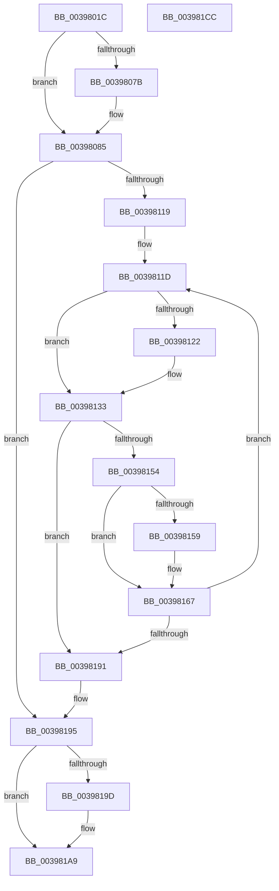

# ExpTryQueueWorkItem

- RVA: `0x0039801C`–`0x003981CD` (길이 `433` bytes)
- VA: `0x000000014039801C`
- 실행 섹션: `.text`
- PDB 이름 있음: `예`; PDB Function 태그: `아니요`
- unwind 정보 RVA: `0x00081478`
- 디코드: `118`개 명령, `433/433` bytes 표시
- 미해석 바이트: `0` (있으면 어셈블리에 `.byte`로 보존)

> 이 문서는 커널 이미지의 기계어와 PDB 기호를 분석해 생성했습니다. 4번과 5번은 함수 원형과 자료형을 바이너리 사용 방식에서 추정한 C 해석이며 원본 소스 복구 결과는 아닙니다.

## 1. Dependencies

- 직접 호출 지점: **10**; 고유 호출 대상: **9**
- 직접 호출자로 확인된 함수: **6**
- RIP 상대 이미지 참조: **3**

### Outgoing calls
- `0x00398055` → [ExpValidateWorkItem](../35/ExpValidateWorkItem_function_00358680.md) (function, `0x00358680`)
- `0x0039805C` → [ExpTypeToPriority](../35/ExpTypeToPriority_function_00358660.md) (function, `0x00358660`)
- `0x00398080` → [KiRaiseIrqlProcessIrqlFlags](../4F/KiRaiseIrqlProcessIrqlFlags_function_004F56FC.md) (function, `0x004F56FC`)
- `0x003980D9` → [ExpWorkQueueHealthMetricsEnabled](../65/ExpWorkQueueHealthMetricsEnabled_function_0065A7AC.md) (function, `0x0065A7AC`)
- `0x00398110` → [ExpEnumerateNextActiveWorkSubQueue](../65/ExpEnumerateNextActiveWorkSubQueue_function_0065A3B4.md) (function, `0x0065A3B4`)
- `0x00398148` → [KeInsertPriQueue](../21/KeInsertPriQueue_function_0021EDD0.md) (function, `0x0021EDD0`)
- `0x00398162` → [ExpWorkQueueUpdateHealthMetricsOnRemove](../65/ExpWorkQueueUpdateHealthMetricsOnRemove_function_0065A99C.md) (function, `0x0065A99C`)
- `0x0039817B` → [ExpPartitionCreateThreadIfNecessary](../33/ExpPartitionCreateThreadIfNecessary_function_0033FAA0.md) (function, `0x0033FAA0`)
- `0x00398188` → [ExpEnumerateNextActiveWorkSubQueue](../65/ExpEnumerateNextActiveWorkSubQueue_function_0065A3B4.md) (function, `0x0065A3B4`)
- `0x003981A4` → [KiLowerIrqlProcessIrqlFlags](../4F/KiLowerIrqlProcessIrqlFlags_function_004F5698.md) (function, `0x004F5698`)

### Direct callers
- [PopPepProcessEvent](../24/PopPepProcessEvent_function_0024B930.md) at `0x0024C5DE`
- [PopPepProcessEvent](../24/PopPepProcessEvent_function_0024B930.md) at `0x0024C88D`
- [PopFxQueueWorkItem](../2B/PopFxQueueWorkItem_function_002BFE08.md) at `0x002BFE2F`
- [PopFxRequestWorkerInternal](PopFxRequestWorkerInternal_function_00397CC4.md) at `0x00397D4C`
- [ExTryQueueWorkItem](ExTryQueueWorkItem_function_00397FF0.md) at `0x00398008`
- [PopPepRequestWork](PopPepRequestWork_function_003986F0.md) at `0x0039878E`
- [PopPepRequestWork](PopPepRequestWork_function_003986F0.md) at `0x00398825`
- [IoTryQueueWorkItem](../4E/IoTryQueueWorkItem_function_004E8390.md) at `0x004E83C1`

### Static image references
- `0x00398073` → RVA `0x00FC6D20` (`ALMOSTRO`; read)
- `0x0039808E` → RVA `0x00FCF6C0` (`CACHEALI`; read)
- `0x003980A6` → RVA `0x00FDAEC0` (`PAGEDATA`; read)

## 2. Other-region calls and transfers

- 다른 실행 섹션으로 향하는 call: **0**
- 별도 외부 분기/꼬리 이동을 확인하지 못했습니다.

## 3. Assembly (complete function range)

```asm
0039801C  48 89 5C 24 10                  mov qword ptr [rsp + 0x10], rbx
00398021  44 89 4C 24 20                  mov dword ptr [rsp + 0x20], r9d
00398026  48 89 4C 24 08                  mov qword ptr [rsp + 8], rcx
0039802B  55                              push rbp
0039802C  56                              push rsi
0039802D  57                              push rdi
0039802E  41 54                           push r12
00398030  41 55                           push r13
00398032  41 56                           push r14
00398034  41 57                           push r15
00398036  48 8B EC                        mov rbp, rsp
00398039  48 83 EC 70                     sub rsp, 0x70
0039803D  4C 8B FA                        mov r15, rdx
00398040  4C 8B E9                        mov r13, rcx
00398043  33 FF                           xor edi, edi
00398045  49 8B CF                        mov rcx, r15
00398048  41 8B D0                        mov edx, r8d
0039804B  48 89 7D C0                     mov qword ptr [rbp - 0x40], rdi
0039804F  41 8B D8                        mov ebx, r8d
00398052  44 8A F7                        mov r14b, dil
00398055  E8 26 06 FC FF                  call 0x140358680
0039805A  8B CB                           mov ecx, ebx
0039805C  E8 FF 05 FC FF                  call 0x140358660
00398061  4C 63 E0                        movsxd r12, eax
00398064  44 0F 20 C6                     mov rsi, cr8
00398068  48 89 75 C8                     mov qword ptr [rbp - 0x38], rsi
0039806C  8D 47 02                        lea eax, [rdi + 2]
0039806F  44 0F 22 C0                     mov cr8, rax
00398073  39 3D A7 EC C2 00               cmp dword ptr [rip + 0xc2eca7], edi
00398079  74 0A                           je 0x140398085
0039807B  8A D0                           mov dl, al
0039807D  40 8A CE                        mov cl, sil
00398080  E8 77 D6 15 00                  call 0x1404f56fc
00398085  65 48 8B 04 25 20 00 00 00      mov rax, qword ptr gs:[0x20]
0039808E  48 8D 3D 2B 76 C3 00            lea rdi, [rip + 0xc3762b]
00398095  8B 55 58                        mov edx, dword ptr [rbp + 0x58]
00398098  48 8B 88 C0 00 00 00            mov rcx, qword ptr [rax + 0xc0]
0039809F  0F B7 81 8A 00 00 00            movzx eax, word ptr [rcx + 0x8a]
003980A6  48 8D 0D 13 2E C4 00            lea rcx, [rip + 0xc42e13]
003980AD  48 8B 3C C7                     mov rdi, qword ptr [rdi + rax*8]
003980B1  48 69 C0 38 03 00 00            imul rax, rax, 0x338
003980B8  48 03 C1                        add rax, rcx
003980BB  49 8B CD                        mov rcx, r13
003980BE  48 3B F8                        cmp rdi, rax
003980C1  B8 00 00 00 00                  mov eax, 0
003980C6  48 0F 44 F8                     cmove rdi, rax
003980CA  65 48 8B 04 25 20 00 00 00      mov rax, qword ptr gs:[0x20]
003980D3  8B 98 28 83 00 00               mov ebx, dword ptr [rax + 0x8328]
003980D9  E8 CE 26 2C 00                  call 0x14065a7ac
003980DE  44 8A E8                        mov r13b, al
003980E1  48 89 7D E0                     mov qword ptr [rbp - 0x20], rdi
003980E5  33 C0                           xor eax, eax
003980E7  48 89 7D E8                     mov qword ptr [rbp - 0x18], rdi
003980EB  89 45 DC                        mov dword ptr [rbp - 0x24], eax
003980EE  48 8D 55 C0                     lea rdx, [rbp - 0x40]
003980F2  48 89 45 F8                     mov qword ptr [rbp - 8], rax
003980F6  48 8D 4D D0                     lea rcx, [rbp - 0x30]
003980FA  48 8B 45 40                     mov rax, qword ptr [rbp + 0x40]
003980FE  33 FF                           xor edi, edi
00398100  48 89 45 D0                     mov qword ptr [rbp - 0x30], rax
00398104  8B 45 58                        mov eax, dword ptr [rbp + 0x58]
00398107  89 45 D8                        mov dword ptr [rbp - 0x28], eax
0039810A  89 7D F0                        mov dword ptr [rbp - 0x10], edi
0039810D  89 5D F4                        mov dword ptr [rbp - 0xc], ebx
00398110  E8 9F 22 2C 00                  call 0x14065a3b4
00398115  85 C0                           test eax, eax
00398117  75 7C                           jne 0x140398195
00398119  48 8B 75 40                     mov rsi, qword ptr [rbp + 0x40]
0039811D  45 84 ED                        test r13b, r13b
00398120  74 11                           je 0x140398133
00398122  48 8B 45 C0                     mov rax, qword ptr [rbp - 0x40]
00398126  48 8B 88 E8 02 00 00            mov rcx, qword ptr [rax + 0x2e8]
0039812D  F0 4A FF 44 E1 10               lock inc qword ptr [rcx + r12*8 + 0x10]
00398133  48 8B 5D C0                     mov rbx, qword ptr [rbp - 0x40]
00398137  45 8B C4                        mov r8d, r12d
0039813A  48 8B CB                        mov rcx, rbx
0039813D  C7 44 24 20 02 00 00 00         mov dword ptr [rsp + 0x20], 2
00398145  49 8B D7                        mov rdx, r15
00398148  E8 83 6C E8 FF                  call 0x14021edd0
0039814D  44 8A F0                        mov r14b, al
00398150  84 C0                           test al, al
00398152  75 3D                           jne 0x140398191
00398154  45 84 ED                        test r13b, r13b
00398157  74 0E                           je 0x140398167
00398159  41 B0 01                        mov r8b, 1
0039815C  49 8B D7                        mov rdx, r15
0039815F  48 8B CB                        mov rcx, rbx
00398162  E8 35 28 2C 00                  call 0x14065a99c
00398167  C6 83 D0 02 00 00 01            mov byte ptr [rbx + 0x2d0], 1
0039816E  4C 8B C3                        mov r8, rbx
00398171  48 8B 93 B8 02 00 00            mov rdx, qword ptr [rbx + 0x2b8]
00398178  48 8B CE                        mov rcx, rsi
0039817B  E8 20 79 FA FF                  call 0x14033faa0
00398180  48 8D 55 C0                     lea rdx, [rbp - 0x40]
00398184  48 8D 4D D0                     lea rcx, [rbp - 0x30]
00398188  E8 27 22 2C 00                  call 0x14065a3b4
0039818D  85 C0                           test eax, eax
0039818F  74 8C                           je 0x14039811d
00398191  48 8B 75 C8                     mov rsi, qword ptr [rbp - 0x38]
00398195  39 3D 85 EB C2 00               cmp dword ptr [rip + 0xc2eb85], edi
0039819B  74 0C                           je 0x1403981a9
0039819D  44 0F 20 C1                     mov rcx, cr8
003981A1  40 8A D6                        mov dl, sil
003981A4  E8 EF D4 15 00                  call 0x1404f5698
003981A9  40 0F B6 C6                     movzx eax, sil
003981AD  44 0F 22 C0                     mov cr8, rax
003981B1  48 8B 9C 24 B8 00 00 00         mov rbx, qword ptr [rsp + 0xb8]
003981B9  41 8A C6                        mov al, r14b
003981BC  48 83 C4 70                     add rsp, 0x70
003981C0  41 5F                           pop r15
003981C2  41 5E                           pop r14
003981C4  41 5D                           pop r13
003981C6  41 5C                           pop r12
003981C8  5F                              pop rdi
003981C9  5E                              pop rsi
003981CA  5D                              pop rbp
003981CB  C3                              ret
003981CC  CC                              int3
```

## 4. C-style interpretation (structured pseudocode)

```c
__int64 __fastcall ExpTryQueueWorkItem(__int64 a1, __int64 a2, int a3, int a4)
{
    __int64 result;
    __int64 v_rdi;
    __int64 v_rsp;
    unsigned __int64 v_stack_m40;
    unsigned int v_stack_m44;
    unsigned int v_stack_m48;
    unsigned __int64 v_stack_m50;
    unsigned __int64 v_stack_m58;
    unsigned int v_stack_m5C;
    unsigned int v_stack_m60;
    unsigned __int64 v_stack_m68;
    unsigned __int64 v_stack_m70;
    unsigned __int64 v_stack_m78;
    unsigned int v_stack_m88;
    unsigned __int64 v_stack_p10;
    unsigned int v_stack_p20;
    unsigned __int64 v_stack_p8;

    v_stack_p10 = v_rbx;
    v_stack_p20 = a4;
    v_stack_p8 = a1;
    v_rsp = (v_rsp) - (112);
    v_rdi = 0;
    v_stack_m78 = 0;
    result = ExpValidateWorkItem(a2, (unsigned int)(a3), a3, a4);
    result = ExpTypeToPriority((unsigned int)((unsigned int)((unsigned int)(a3))), (unsigned int)(a3), a3, a4);
    v_stack_m70 = v_cr8;
    result = v_rdi + 2;
    if ((*(unsigned int *)(v_rip + 12774567)) != 0) {
        a2 = (unsigned __int8)(v_rdi + 2);
        a1 = (unsigned __int8)(v_cr8);
        result = KiRaiseIrqlProcessIrqlFlags(a1, a2, a3, a4);
    }
    result = (*(unsigned __int16 *)(*(unsigned __int64 *)(*(unsigned __int64 *)(gs_base + (0 + 32)) + 192) + 138)) * (*(unsigned __int16 *)(*(unsigned __int64 *)(*(unsigned __int64 *)(gs_base + (0 + 32)) + 192) + 138));
    result = (result) + (v_rip + 12856851);
    v_rdi = *(unsigned __int64 *)(v_rip + 12809771 + *(unsigned __int16 *)(*(unsigned __int64 *)(*(unsigned __int64 *)(gs_base + (0 + 32)) + 192) + 138) * 8);
    if ((*(unsigned __int64 *)(v_rip + 12809771 + *(unsigned __int16 *)(*(unsigned __int64 *)(*(unsigned __int64 *)(gs_base + (0 + 32)) + 192) + 138) * 8)) == result) { v_rdi = 0; }
    result = ExpWorkQueueHealthMetricsEnabled(a1, (unsigned int)(v_stack_p20), a3, a4);
    v_stack_m58 = v_rdi;
    result = 0;
    v_stack_m50 = v_rdi;
    v_stack_m5C = 0;
    v_stack_m40 = 0;
    v_rdi = 0;
    v_stack_m68 = v_stack_p8;
    v_stack_m60 = (unsigned int)((unsigned int)(v_stack_p20));
    v_stack_m48 = 0;
    v_stack_m44 = (unsigned int)((unsigned int)(*(unsigned int *)(*(unsigned __int64 *)(gs_base + (0 + 32)) + 33576)));
    result = ExpEnumerateNextActiveWorkSubQueue(v_stack_m68, v_stack_m78, a3, a4);
    if ((unsigned int)(result) != 0) goto loc_00398195;
loc_0039811D:
    if ((unsigned __int8)((unsigned __int8)(result)) != 0) {
        result = v_stack_m78;
        a1 = *(unsigned __int64 *)(result + 744);
    }
    v_stack_m88 = 2;
    result = KeInsertPriQueue(v_stack_m78, a2, (unsigned int)((unsigned int)((int)((unsigned int)(result)))), a4);
    if ((unsigned __int8)(result) != 0) goto loc_00398191;
    if ((unsigned __int8)((unsigned __int8)(result)) != 0) {
        a3 = 1;
        a2 = a2;
        a1 = v_stack_m78;
        result = ExpWorkQueueUpdateHealthMetricsOnRemove(a1, a2, a3, a4);
    }
    *(unsigned __int8 *)(v_stack_m78 + 720) = 1;
    result = ExpPartitionCreateThreadIfNecessary(v_stack_p8, *(unsigned __int64 *)(v_stack_m78 + 696), v_stack_m78, a4);
    result = ExpEnumerateNextActiveWorkSubQueue(v_stack_m68, v_stack_m78, v_stack_m78, a4);
    if ((unsigned int)(result) == 0) goto loc_0039811D;
loc_00398191:
loc_00398195:
    if ((*(unsigned int *)(v_rip + 12774277)) != 0) {
        a1 = v_rdi + 2;
        a2 = (unsigned __int8)(v_stack_m70);
        result = KiLowerIrqlProcessIrqlFlags(a1, a2, v_stack_m78, a4);
    }
    v_rsp = (v_rsp) + (112);
    return (unsigned __int8)((unsigned __int8)(result));
}
```

## 5. (Beta) C Style

```c
int64_t ExpTryQueueWorkItem(int64_t Arg1, int64_t Arg2, int32_t Arg3, int32_t Arg4)
{
    int64_t result;
    int64_t local_rdi;
    int64_t local_rsp;
    uint64_t v_stack_m40;
    uint32_t v_stack_m44;
    uint32_t v_stack_m48;
    uint64_t v_stack_m50;
    uint64_t v_stack_m58;
    uint32_t v_stack_m5C;
    uint32_t v_stack_m60;
    uint64_t v_stack_m68;
    uint64_t v_stack_m70;
    uint64_t v_stack_m78;
    uint32_t v_stack_m88;
    uint64_t v_stack_p10;
    uint32_t v_stack_p20;
    uint64_t v_stack_p8;

    v_stack_p10 = local_rbx;
    v_stack_p20 = Arg4;
    v_stack_p8 = Arg1;
    local_rsp = (local_rsp) - (112);
    local_rdi = 0;
    v_stack_m78 = 0;
    result = ExpValidateWorkItem(Arg2, (uint32_t)(Arg3), Arg3, Arg4);
    result = ExpTypeToPriority((uint32_t)((uint32_t)((uint32_t)(Arg3))), (uint32_t)(Arg3), Arg3, Arg4);
    v_stack_m70 = v_cr8;
    result = local_rdi + 2;
    if ((*(uint32_t *)(v_rip + 0xC2ECA7)) != 0) {
        Arg2 = (uint8_t)(local_rdi + 2);
        Arg1 = (uint8_t)(v_cr8);
        result = KiRaiseIrqlProcessIrqlFlags(Arg1, Arg2, Arg3, Arg4);
    }
    result = (*(uint16_t *)(*(uint64_t *)(*(uint64_t *)(gs_base + (0 + 0x20)) + 0xC0) + 0x8A)) * (*(uint16_t *)(*(uint64_t *)(*(uint64_t *)(gs_base + (0 + 0x20)) + 0xC0) + 0x8A));
    result = (result) + (v_rip + 12856851);
    local_rdi = *(uint64_t *)(v_rip + 0xC3762B + *(uint16_t *)(*(uint64_t *)(*(uint64_t *)(gs_base + (0 + 0x20)) + 0xC0) + 0x8A) * 8);
    if ((*(uint64_t *)(v_rip + 0xC3762B + *(uint16_t *)(*(uint64_t *)(*(uint64_t *)(gs_base + (0 + 0x20)) + 0xC0) + 0x8A) * 8)) == result) { local_rdi = 0; }
    result = ExpWorkQueueHealthMetricsEnabled(Arg1, (uint32_t)(v_stack_p20), Arg3, Arg4);
    v_stack_m58 = local_rdi;
    result = 0;
    v_stack_m50 = local_rdi;
    v_stack_m5C = 0;
    v_stack_m40 = 0;
    local_rdi = 0;
    v_stack_m68 = v_stack_p8;
    v_stack_m60 = (uint32_t)((uint32_t)(v_stack_p20));
    v_stack_m48 = 0;
    v_stack_m44 = (uint32_t)((uint32_t)(*(uint32_t *)(*(uint64_t *)(gs_base + (0 + 0x20)) + 0x8328)));
    result = ExpEnumerateNextActiveWorkSubQueue(v_stack_m68, v_stack_m78, Arg3, Arg4);
    if ((uint32_t)(result) != 0) goto loc_00398195;
loc_0039811D:
    if ((uint8_t)((uint8_t)(result)) != 0) {
        result = v_stack_m78;
        Arg1 = *(uint64_t *)(result + 0x2E8);
    }
    v_stack_m88 = 2;
    result = KeInsertPriQueue(v_stack_m78, Arg2, (uint32_t)((uint32_t)((int32_t)((uint32_t)(result)))), Arg4);
    if ((uint8_t)(result) != 0) goto loc_00398191;
    if ((uint8_t)((uint8_t)(result)) != 0) {
        Arg3 = 1;
        Arg2 = Arg2;
        Arg1 = v_stack_m78;
        result = ExpWorkQueueUpdateHealthMetricsOnRemove(Arg1, Arg2, Arg3, Arg4);
    }
    *(uint8_t *)(v_stack_m78 + 0x2D0) = 1;
    result = ExpPartitionCreateThreadIfNecessary(v_stack_p8, *(uint64_t *)(v_stack_m78 + 0x2B8), v_stack_m78, Arg4);
    result = ExpEnumerateNextActiveWorkSubQueue(v_stack_m68, v_stack_m78, v_stack_m78, Arg4);
    if ((uint32_t)(result) == 0) goto loc_0039811D;
loc_00398191:
loc_00398195:
    if ((*(uint32_t *)(v_rip + 0xC2EB85)) != 0) {
        Arg1 = local_rdi + 2;
        Arg2 = (uint8_t)(v_stack_m70);
        result = KiLowerIrqlProcessIrqlFlags(Arg1, Arg2, v_stack_m78, Arg4);
    }
    local_rsp = (local_rsp) + (112);
    return (uint8_t)((uint8_t)(result));
}
```

## 6. Execution-region graph

[열기: 2D/3D 그래프와 함수 탐색 컨트롤 패널](../../../control-panel.html?section=text&rva=0x0039801C&view=graph)

- 2D 그래프는 위에서 아래로 흐르고, 3D 그래프는 빈 공간을 드래그해 회전합니다. Shift+드래그는 이동, 휠은 확대·축소, 함수 노드 선택은 대상 보고서 이동입니다.

### Static fallback


