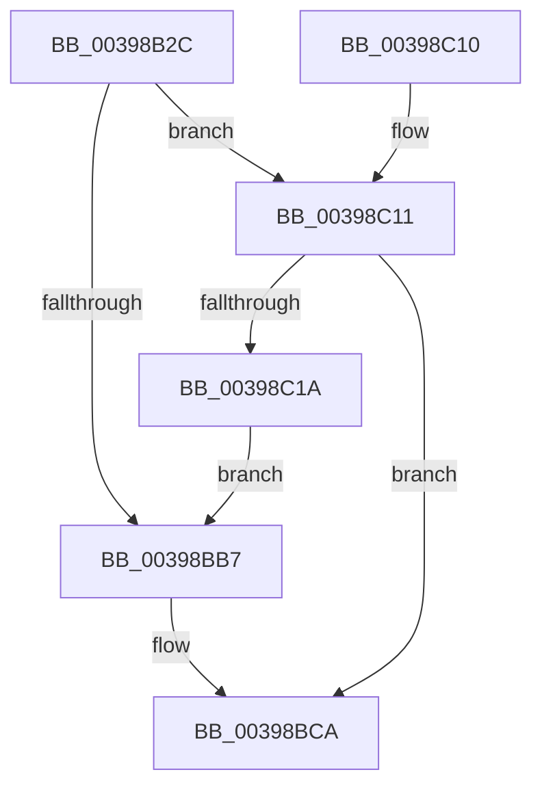

# ExpUpdateTimerConfiguration

- RVA: `0x00398B2C`–`0x00398C25` (길이 `249` bytes)
- VA: `0x0000000140398B2C`
- 실행 섹션: `.text`
- PDB 이름 있음: `예`; PDB Function 태그: `아니요`
- unwind 정보 RVA: `0x0008163C`
- 디코드: `65`개 명령, `249/249` bytes 표시
- 미해석 바이트: `0` (있으면 어셈블리에 `.byte`로 보존)

> 이 문서는 커널 이미지의 기계어와 PDB 기호를 분석해 생성했습니다. 4번과 5번은 함수 원형과 자료형을 바이너리 사용 방식에서 추정한 C 해석이며 원본 소스 복구 결과는 아닙니다.

## 1. Dependencies

- 직접 호출 지점: **4**; 고유 호출 대상: **3**
- 직접 호출자로 확인된 함수: **2**
- RIP 상대 이미지 참조: **4**

### Outgoing calls
- `0x00398B63` → [memset](../6C/memset_function_006C6C40.md) (function, `0x006C6C40`)
- `0x00398B8E` → [memset](../6C/memset_function_006C6C40.md) (function, `0x006C6C40`)
- `0x00398BED` → [KeGenericProcessorCallback](KeGenericProcessorCallback_function_00398C2C.md) (function, `0x00398C2C`)
- `0x00398BFD` → [_security_check_cookie](../6A/_security_check_cookie_function_006AC640.md) (function, `0x006AC640`)

### Direct callers
- [ExpUpdateTimerResolution](ExpUpdateTimerResolution_function_003914A0.md) at `0x00391668`
- [NtSetSystemInformation](../../page/AF/NtSetSystemInformation_function_00AF4A60.md) at `0x00AF4DA0`

### Static image references
- `0x00398B3F` → RVA `0x00E0A740` (`.data`; read)
- `0x00398B93` → RVA `0x00F21FB0` (`.data`; read)
- `0x00398B99` → RVA `0x00F231B0` (`.data`; read)
- `0x00398BDC` → RVA `0x00235410` (`ExpUpdateTimerConfigurationWorker`; read)

## 2. Other-region calls and transfers

- 다른 실행 섹션으로 향하는 call: **0**
- 별도 외부 분기/꼬리 이동을 확인하지 못했습니다.

## 3. Assembly (complete function range)

```asm
00398B2C  40 55                           push rbp
00398B2E  53                              push rbx
00398B2F  56                              push rsi
00398B30  57                              push rdi
00398B31  41 57                           push r15
00398B33  48 8D 6C 24 A0                  lea rbp, [rsp - 0x60]
00398B38  48 81 EC 60 01 00 00            sub rsp, 0x160
00398B3F  48 8B 05 FA 1B A7 00            mov rax, qword ptr [rip + 0xa71bfa]
00398B46  48 33 C4                        xor rax, rsp
00398B49  48 89 45 50                     mov qword ptr [rbp + 0x50], rax
00398B4D  49 8B F0                        mov rsi, r8
00398B50  48 8B FA                        mov rdi, rdx
00398B53  48 8B D9                        mov rbx, rcx
00398B56  33 D2                           xor edx, edx
00398B58  41 B8 00 01 00 00               mov r8d, 0x100
00398B5E  48 8D 4C 24 48                  lea rcx, [rsp + 0x48]
00398B63  E8 D8 E0 32 00                  call 0x1406c6c40
00398B68  48 83 64 24 38 00               and qword ptr [rsp + 0x38], 0
00398B6E  48 8D 4C 24 48                  lea rcx, [rsp + 0x48]
00398B73  83 64 24 44 00                  and dword ptr [rsp + 0x44], 0
00398B78  33 D2                           xor edx, edx
00398B7A  41 B8 00 01 00 00               mov r8d, 0x100
00398B80  C7 44 24 40 01 00 20 00         mov dword ptr [rsp + 0x40], 0x200001
00398B88  41 BF 01 00 00 00               mov r15d, 1
00398B8E  E8 AD E0 32 00                  call 0x1406c6c40
00398B93  8B 0D 17 94 B8 00               mov ecx, dword ptr [rip + 0xb89417]
00398B99  48 8B 05 10 A6 B8 00            mov rax, qword ptr [rip + 0xb8a610]
00398BA0  44 8B 04 88                     mov r8d, dword ptr [rax + rcx*4]
00398BA4  41 8B C8                        mov ecx, r8d
00398BA7  0F B7 44 24 40                  movzx eax, word ptr [rsp + 0x40]
00398BAC  41 83 E0 3F                     and r8d, 0x3f
00398BB0  C1 E9 06                        shr ecx, 6
00398BB3  3B C1                           cmp eax, ecx
00398BB5  76 5A                           jbe 0x140398c11
00398BB7  8B D1                           mov edx, ecx
00398BB9  48 8B 4C CC 48                  mov rcx, qword ptr [rsp + rcx*8 + 0x48]
00398BBE  41 8B C0                        mov eax, r8d
00398BC1  48 0F AB C1                     bts rcx, rax
00398BC5  48 89 4C D4 48                  mov qword ptr [rsp + rdx*8 + 0x48], rcx
00398BCA  45 8B CF                        mov r9d, r15d
00398BCD  48 89 5C 24 20                  mov qword ptr [rsp + 0x20], rbx
00398BD2  4C 8D 44 24 20                  lea r8, [rsp + 0x20]
00398BD7  48 89 7C 24 28                  mov qword ptr [rsp + 0x28], rdi
00398BDC  48 8D 15 2D C8 E9 FF            lea rdx, [rip - 0x1637d3]
00398BE3  48 89 74 24 30                  mov qword ptr [rsp + 0x30], rsi
00398BE8  48 8D 4C 24 40                  lea rcx, [rsp + 0x40]
00398BED  E8 3A 00 00 00                  call 0x140398c2c
00398BF2  8B 44 24 38                     mov eax, dword ptr [rsp + 0x38]
00398BF6  48 8B 4D 50                     mov rcx, qword ptr [rbp + 0x50]
00398BFA  48 33 CC                        xor rcx, rsp
00398BFD  E8 3E 3A 31 00                  call 0x1406ac640
00398C02  48 81 C4 60 01 00 00            add rsp, 0x160
00398C09  41 5F                           pop r15
00398C0B  5F                              pop rdi
00398C0C  5E                              pop rsi
00398C0D  5B                              pop rbx
00398C0E  5D                              pop rbp
00398C0F  C3                              ret
00398C10  CC                              int3
00398C11  0F B7 44 24 42                  movzx eax, word ptr [rsp + 0x42]
00398C16  3B C1                           cmp eax, ecx
00398C18  76 B0                           jbe 0x140398bca
00398C1A  41 8D 04 0F                     lea eax, [r15 + rcx]
00398C1E  66 89 44 24 40                  mov word ptr [rsp + 0x40], ax
00398C23  EB 92                           jmp 0x140398bb7
```

## 4. C-style interpretation (structured pseudocode)

```c
__int64 __fastcall ExpUpdateTimerConfiguration(__int64 a1, __int64 a2, __int64 a3)
{
    __int64 result;
    __int64 v_rsp;
    unsigned __int64 v_stack_m140;
    unsigned int v_stack_m144;
    unsigned int v_stack_m148;
    unsigned __int64 v_stack_m150;
    unsigned __int64 v_stack_m158;
    unsigned __int64 v_stack_m160;
    unsigned __int64 v_stack_m168;
    unsigned __int64 v_stack_m38;
    unsigned __int64 v_stack_m88;
    unsigned __int16 v_stack_p40;
    unsigned __int16 v_stack_p42;

    v_rsp = (v_rsp) - (352);
    result = (*(unsigned __int64 *)(v_rip + 10951674)) ^ (v_rsp);
    v_stack_m38 = result;
    a2 = 0;
    result = memset(v_stack_m140, a2, 256, a4);
    a2 = 0;
    v_stack_m148 = 0x200001ULL;
    result = memset(v_stack_m140, a2, 256, a4);
    a3 = (unsigned int)(((unsigned int)(*(unsigned int *)(*(unsigned __int64 *)(v_rip + 12101136) + (unsigned int)(*(unsigned int *)(v_rip + 12096535)) * 4))) & (63));
    a1 = (unsigned int)(((unsigned int)((unsigned int)((unsigned int)(*(unsigned int *)(*(unsigned __int64 *)(v_rip + 12101136) + (unsigned int)(*(unsigned int *)(v_rip + 12096535)) * 4))))) >> (6));
    if (((unsigned int)(v_stack_m148)) <= ((unsigned int)(a1))) goto loc_00398C11;
loc_00398BB7:
    *(unsigned __int64 *)(v_rsp + (unsigned int)((unsigned int)(a1)) * 8 + 72) = *(unsigned __int64 *)(v_rsp + a1 * 8 + 72);
loc_00398BCA:
    v_stack_m168 = a1;
    v_stack_m160 = 0;
    v_stack_m158 = a3;
    result = KeGenericProcessorCallback(v_stack_m148, v_rip - 1456083, v_stack_m168, 1);
    a1 = (v_stack_m38) ^ (v_rsp);
    result = _security_check_cookie(a1, v_rip - 1456083, v_stack_m168, 1);
    v_rsp = (v_rsp) + (352);
    return result;
loc_00398C11:
    if (((unsigned int)(v_stack_p42)) <= ((unsigned int)(a1))) goto loc_00398BCA;
    v_stack_p40 = (unsigned __int16)(1 + a1 * 1);
    goto loc_00398BB7;
}
```

## 5. (Beta) C Style

```c
int64_t ExpUpdateTimerConfiguration(int64_t Arg1, int64_t Arg2, int64_t Arg3)
{
    int64_t result;
    int64_t local_rsp;
    uint64_t v_stack_m140;
    uint32_t v_stack_m144;
    uint32_t v_stack_m148;
    uint64_t v_stack_m150;
    uint64_t v_stack_m158;
    uint64_t v_stack_m160;
    uint64_t v_stack_m168;
    uint64_t v_stack_m38;
    uint64_t v_stack_m88;
    uint16_t v_stack_p40;
    uint16_t v_stack_p42;

    local_rsp = (local_rsp) - (352);
    result = (*(uint64_t *)(v_rip + 0xA71BFA)) ^ (local_rsp);
    v_stack_m38 = result;
    Arg2 = 0;
    result = memset(v_stack_m140, Arg2, 256, a4);
    Arg2 = 0;
    v_stack_m148 = 0x200001ULL;
    result = memset(v_stack_m140, Arg2, 256, a4);
    Arg3 = (uint32_t)(((uint32_t)(*(uint32_t *)(*(uint64_t *)(v_rip + 0xB8A610) + (uint32_t)(*(uint32_t *)(v_rip + 0xB89417)) * 4))) & (63));
    Arg1 = (uint32_t)(((uint32_t)((uint32_t)((uint32_t)(*(uint32_t *)(*(uint64_t *)(v_rip + 0xB8A610) + (uint32_t)(*(uint32_t *)(v_rip + 0xB89417)) * 4))))) >> (6));
    if (((uint32_t)(v_stack_m148)) <= ((uint32_t)(Arg1))) goto loc_00398C11;
loc_00398BB7:
    *(uint64_t *)(local_rsp + (uint32_t)((uint32_t)(Arg1)) * 8 + 0x48) = *(uint64_t *)(local_rsp + Arg1 * 8 + 0x48);
loc_00398BCA:
    v_stack_m168 = Arg1;
    v_stack_m160 = 0;
    v_stack_m158 = Arg3;
    result = KeGenericProcessorCallback(v_stack_m148, v_rip - 1456083, v_stack_m168, 1);
    Arg1 = (v_stack_m38) ^ (local_rsp);
    result = _security_check_cookie(Arg1, v_rip - 1456083, v_stack_m168, 1);
    local_rsp = (local_rsp) + (352);
    return result;
loc_00398C11:
    if (((uint32_t)(v_stack_p42)) <= ((uint32_t)(Arg1))) goto loc_00398BCA;
    v_stack_p40 = (uint16_t)(1 + Arg1 * 1);
    goto loc_00398BB7;
}
```

## 6. Execution-region graph

[열기: 2D/3D 그래프와 함수 탐색 컨트롤 패널](../../../control-panel.html?section=text&rva=0x00398B2C&view=graph)

- 2D 그래프는 위에서 아래로 흐르고, 3D 그래프는 빈 공간을 드래그해 회전합니다. Shift+드래그는 이동, 휠은 확대·축소, 함수 노드 선택은 대상 보고서 이동입니다.

### Static fallback


