# ExpUpdateTimerResolution

- RVA: `0x003914A0`–`0x003916D6` (길이 `566` bytes)
- VA: `0x00000001403914A0`
- 실행 섹션: `.text`
- PDB 이름 있음: `예`; PDB Function 태그: `아니요`
- unwind 정보 RVA: `0x00080A88`
- 디코드: `122`개 명령, `566/566` bytes 표시
- 미해석 바이트: `0` (있으면 어셈블리에 `.byte`로 보존)

> 이 문서는 커널 이미지의 기계어와 PDB 기호를 분석해 생성했습니다. 4번과 5번은 함수 원형과 자료형을 바이너리 사용 방식에서 추정한 C 해석이며 원본 소스 복구 결과는 아닙니다.

## 1. Dependencies

- 직접 호출 지점: **9**; 고유 호출 대상: **8**
- 직접 호출자로 확인된 함수: **3**
- RIP 상대 이미지 참조: **13**

### Outgoing calls
- `0x003914F9` → [KiAcquireSpinLockInstrumented](../20/KiAcquireSpinLockInstrumented_function_002084F0.md) (function, `0x002084F0`)
- `0x0039159A` → [KiLowerIrqlProcessIrqlFlags](../4F/KiLowerIrqlProcessIrqlFlags_function_004F5698.md) (function, `0x004F5698`)
- `0x003915ED` → [KxWaitForSpinLockAndAcquire](../20/KxWaitForSpinLockAndAcquire_function_002085C0.md) (function, `0x002085C0`)
- `0x0039161D` → [KiRaiseIrqlProcessIrqlFlags](../4F/KiRaiseIrqlProcessIrqlFlags_function_004F56FC.md) (function, `0x004F56FC`)
- `0x0039163B` → [KxReleaseSpinLock](../20/KxReleaseSpinLock_function_00206670.md) (function, `0x00206670`)
- `0x00391651` → [KiLowerIrqlProcessIrqlFlags](../4F/KiLowerIrqlProcessIrqlFlags_function_004F5698.md) (function, `0x004F5698`)
- `0x00391668` → [ExpUpdateTimerConfiguration](ExpUpdateTimerConfiguration_function_00398B2C.md) (function, `0x00398B2C`)
- `0x00391679` → [PoTraceSystemTimerResolutionUpdate](PoTraceSystemTimerResolutionUpdate_function_003916DC.md) (function, `0x003916DC`)
- `0x003916CC` → [KiReleaseSpinLockInstrumented](KiReleaseSpinLockInstrumented_function_00392EF0.md) (function, `0x00392EF0`)

### Direct callers
- [ExSetTimerResolution](../49/ExSetTimerResolution_function_0049E7D0.md) at `0x0049E887`
- [NtSetTimerResolution](../../page/9C/NtSetTimerResolution_function_009C5170.md) at `0x009C5285`
- [NtSetTimerResolution](../../page/9C/NtSetTimerResolution_function_009C5170.md) at `0x009C53A2`
- [ExUpdateTimerResolutionPolicy](../../page/9C/ExUpdateTimerResolutionPolicy_function_009C579C.md) at `0x009C57E4`

### Static image references
- `0x003914CA` → RVA `0x00FC6D20` (`ALMOSTRO`; read)
- `0x003914D7` → RVA `0x00FC6B06` (`ALMOSTRO`; read)
- `0x003914E4` → RVA `0x00F0DE58` (`.data`; read)
- `0x003914F2` → RVA `0x00EFEE50` (`.data`; read)
- `0x0039150B` → RVA `0x00EFEE64` (`.data`; read)
- `0x00391512` → RVA `0x00FC6AA0` (`ALMOSTRO`; read)
- `0x00391524` → RVA `0x00EFEE40` (`.data`; read)
- `0x00391554` → RVA `0x00FC6B3C` (`ALMOSTRO`; read)
- `0x00391566` → RVA `0x00E0EB94` (`.data`; read)
- `0x00391580` → RVA `0x00EFEE50` (`.data`; read/write)
- `0x003915A7` → RVA `0x00FC6BB8` (`ALMOSTRO`; read)
- `0x00391634` → RVA `0x00E0EB94` (`.data`; write)
- `0x0039168E` → RVA `0x00EFEE60` (`.data`; read)

## 2. Other-region calls and transfers

- 다른 실행 섹션으로 향하는 call: **0**
- 별도 외부 분기/꼬리 이동을 확인하지 못했습니다.

## 3. Assembly (complete function range)

```asm
003914A0  48 89 5C 24 08                  mov qword ptr [rsp + 8], rbx
003914A5  89 54 24 10                     mov dword ptr [rsp + 0x10], edx
003914A9  57                              push rdi
003914AA  48 83 EC 20                     sub rsp, 0x20
003914AE  44 8B CA                        mov r9d, edx
003914B1  0F B6 D9                        movzx ebx, cl
003914B4  4D 85 C0                        test r8, r8
003914B7  0F 85 EC 01 00 00               jne 0x1403916a9
003914BD  44 0F 20 C7                     mov rdi, cr8
003914C1  B8 02 00 00 00                  mov eax, 2
003914C6  44 0F 22 C0                     mov cr8, rax
003914CA  44 39 05 4F 58 C3 00            cmp dword ptr [rip + 0xc3584f], r8d
003914D1  0F 85 3F 01 00 00               jne 0x140391616
003914D7  F6 05 28 56 C3 00 21            test byte ptr [rip + 0xc35628], 0x21
003914DE  0F 84 F2 00 00 00               je 0x1403915d6
003914E4  8B 05 6E C9 B7 00               mov eax, dword ptr [rip + 0xb7c96e]
003914EA  85 C0                           test eax, eax
003914EC  0F 85 E4 00 00 00               jne 0x1403915d6
003914F2  48 8D 0D 57 D9 B6 00            lea rcx, [rip + 0xb6d957]
003914F9  E8 F2 6F E7 FF                  call 0x1402084f0
003914FE  44 8B 4C 24 38                  mov r9d, dword ptr [rsp + 0x38]
00391503  84 DB                           test bl, bl
00391505  0F 85 EC 00 00 00               jne 0x1403915f7
0039150B  83 3D 52 D9 B6 00 00            cmp dword ptr [rip + 0xb6d952], 0
00391512  44 8B 0D 87 55 C3 00            mov r9d, dword ptr [rip + 0xc35587]
00391519  44 89 4C 24 38                  mov dword ptr [rsp + 0x38], r9d
0039151E  0F 85 6A 01 00 00               jne 0x14039168e
00391524  48 8B 05 15 D9 B6 00            mov rax, qword ptr [rip + 0xb6d915]
0039152B  4C 8D 05 0E D9 B6 00            lea r8, [rip + 0xb6d90e]
00391532  49 3B C0                        cmp rax, r8
00391535  74 1D                           je 0x140391554
00391537  66 0F 1F 84 00 00 00 00 00      nop word ptr [rax + rax]
00391540  F7 80 54 FC FF FF 00 10 00 00   test dword ptr [rax - 0x3ac], 0x1000
0039154A  75 6D                           jne 0x1403915b9
0039154C  48 8B 00                        mov rax, qword ptr [rax]
0039154F  49 3B C0                        cmp rax, r8
00391552  75 EC                           jne 0x140391540
00391554  8B 05 E2 55 C3 00               mov eax, dword ptr [rip + 0xc355e2]
0039155A  44 3B C8                        cmp r9d, eax
0039155D  73 07                           jae 0x140391566
0039155F  44 8B C8                        mov r9d, eax
00391562  89 44 24 38                     mov dword ptr [rsp + 0x38], eax
00391566  44 3B 0D 27 D6 A7 00            cmp r9d, dword ptr [rip + 0xa7d627]
0039156D  0F 85 B4 00 00 00               jne 0x140391627
00391573  F6 05 8C 55 C3 00 01            test byte ptr [rip + 0xc3558c], 1
0039157A  0F 85 32 01 00 00               jne 0x1403916b2
00391580  F0 48 83 25 C7 D8 B6 00 00      lock and qword ptr [rip + 0xb6d8c7], 0
00391589  83 3D 90 57 C3 00 00            cmp dword ptr [rip + 0xc35790], 0
00391590  74 0D                           je 0x14039159f
00391592  44 0F 20 C1                     mov rcx, cr8
00391596  40 0F B6 D7                     movzx edx, dil
0039159A  E8 F9 40 16 00                  call 0x1404f5698
0039159F  40 0F B6 C7                     movzx eax, dil
003915A3  44 0F 22 C0                     mov cr8, rax
003915A7  8B 05 0B 56 C3 00               mov eax, dword ptr [rip + 0xc3560b]
003915AD  48 8B 5C 24 30                  mov rbx, qword ptr [rsp + 0x30]
003915B2  48 83 C4 20                     add rsp, 0x20
003915B6  5F                              pop rdi
003915B7  C3                              ret
003915B8  CC                              int3
003915B9  8B 50 18                        mov edx, dword ptr [rax + 0x18]
003915BC  41 3B D1                        cmp edx, r9d
003915BF  73 8B                           jae 0x14039154c
003915C1  F7 40 5C 00 00 00 04            test dword ptr [rax + 0x5c], 0x4000000
003915C8  75 82                           jne 0x14039154c
003915CA  44 8B CA                        mov r9d, edx
003915CD  89 54 24 38                     mov dword ptr [rsp + 0x38], edx
003915D1  E9 76 FF FF FF                  jmp 0x14039154c
003915D6  F0 48 0F BA 2D 70 D8 B6 00 00   lock bts qword ptr [rip + 0xb6d870], 0
003915E0  0F 83 18 FF FF FF               jae 0x1403914fe
003915E6  48 8D 0D 63 D8 B6 00            lea rcx, [rip + 0xb6d863]
003915ED  E8 CE 6F E7 FF                  call 0x1402085c0
003915F2  E9 07 FF FF FF                  jmp 0x1403914fe
003915F7  44 3B 0D 96 D5 A7 00            cmp r9d, dword ptr [rip + 0xa7d596]
003915FE  0F 83 6F FF FF FF               jae 0x140391573
00391604  44 39 0D 95 54 C3 00            cmp dword ptr [rip + 0xc35495], r9d
0039160B  0F 86 62 FF FF FF               jbe 0x140391573
00391611  E9 3E FF FF FF                  jmp 0x140391554
00391616  0F B6 D0                        movzx edx, al
00391619  40 0F B6 CF                     movzx ecx, dil
0039161D  E8 DA 40 16 00                  call 0x1404f56fc
00391622  E9 B0 FE FF FF                  jmp 0x1403914d7
00391627  8B 1D 8B 55 C3 00               mov ebx, dword ptr [rip + 0xc3558b]
0039162D  48 8D 0D 1C D8 B6 00            lea rcx, [rip + 0xb6d81c]
00391634  44 89 0D 59 D5 A7 00            mov dword ptr [rip + 0xa7d559], r9d
0039163B  E8 30 50 E7 FF                  call 0x140206670
00391640  83 3D D9 56 C3 00 00            cmp dword ptr [rip + 0xc356d9], 0
00391647  74 0D                           je 0x140391656
00391649  44 0F 20 C1                     mov rcx, cr8
0039164D  40 0F B6 D7                     movzx edx, dil
00391651  E8 42 40 16 00                  call 0x1404f5698
00391656  40 0F B6 C7                     movzx eax, dil
0039165A  44 0F 22 C0                     mov cr8, rax
0039165E  45 33 C0                        xor r8d, r8d
00391661  48 8D 4C 24 38                  lea rcx, [rsp + 0x38]
00391666  33 D2                           xor edx, edx
00391668  E8 BF 74 00 00                  call 0x140398b2c
0039166D  8B 44 24 38                     mov eax, dword ptr [rsp + 0x38]
00391671  3B D8                           cmp ebx, eax
00391673  0F 84 34 FF FF FF               je 0x1403915ad
00391679  E8 5E 00 00 00                  call 0x1403916dc
0039167E  8B 44 24 38                     mov eax, dword ptr [rsp + 0x38]
00391682  48 8B 5C 24 30                  mov rbx, qword ptr [rsp + 0x30]
00391687  48 83 C4 20                     add rsp, 0x20
0039168B  5F                              pop rdi
0039168C  C3                              ret
0039168D  CC                              int3
0039168E  8B 05 CC D7 B6 00               mov eax, dword ptr [rip + 0xb6d7cc]
00391694  41 3B C1                        cmp eax, r9d
00391697  0F 83 87 FE FF FF               jae 0x140391524
0039169D  44 8B C8                        mov r9d, eax
003916A0  89 44 24 38                     mov dword ptr [rsp + 0x38], eax
003916A4  E9 7B FE FF FF                  jmp 0x140391524
003916A9  41 0F B6 38                     movzx edi, byte ptr [r8]
003916AD  E9 51 FE FF FF                  jmp 0x140391503
003916B2  8B 05 A0 C7 B7 00               mov eax, dword ptr [rip + 0xb7c7a0]
003916B8  85 C0                           test eax, eax
003916BA  0F 85 C0 FE FF FF               jne 0x140391580
003916C0  48 8B 54 24 28                  mov rdx, qword ptr [rsp + 0x28]
003916C5  48 8D 0D 84 D7 B6 00            lea rcx, [rip + 0xb6d784]
003916CC  E8 1F 18 00 00                  call 0x140392ef0
003916D1  E9 B3 FE FF FF                  jmp 0x140391589
```

## 4. C-style interpretation (structured pseudocode)

```c
__int64 __fastcall ExpUpdateTimerResolution(unsigned __int8 a1, int a2, __int64 a3)
{
    __int64 result;
    __int64 v_rsp;
    unsigned int v_stack_p10;
    unsigned __int64 v_stack_p30;
    unsigned int v_stack_p38;
    unsigned __int64 v_stack_p50;
    unsigned int v_stack_p60;
    unsigned __int64 v_stack_p8;

    v_stack_p8 = v_rbx;
    v_stack_p10 = a2;
    v_rsp = (v_rsp) - (32);
    if (a3 != 0) goto loc_003916A9;
    if ((*(unsigned int *)(v_rip + 12802127)) != ((unsigned int)(a3))) goto loc_00391616;
loc_003914D7:
    if (((*(unsigned __int8 *)(v_rip + 12801576)) & (33)) == 0) goto loc_003915D6;
    if ((unsigned int)((unsigned int)(*(unsigned int *)(v_rip + 12044654))) != 0) goto loc_003915D6;
    result = KiAcquireSpinLockInstrumented(v_rip + 11983191, a2, a3, (unsigned int)(a2));
loc_003914FE:
loc_00391503:
    if (a1 != 0) goto loc_003915F7;
    v_stack_p10 = (unsigned int)((unsigned int)(*(unsigned int *)(v_rip + 12801415)));
    if ((*(unsigned int *)(v_rip + 11983186)) != 0) goto loc_0039168E;
loc_00391524:
    if ((*(unsigned __int64 *)(v_rip + 11983125)) == (v_rip + 11983118)) goto loc_00391554;
loc_00391540:
    if (((*(unsigned int *)(*(unsigned __int64 *)(v_rip + 11983125) - 940)) & (0x1000ULL)) != 0) goto loc_003915B9;
loc_0039154C:
    if ((*(unsigned __int64 *)(*(unsigned __int64 *)(v_rip + 11983125))) != (v_rip + 11983118)) goto loc_00391540;
loc_00391554:
    if (((unsigned int)((unsigned int)(*(unsigned int *)(v_rip + 12801415)))) < ((unsigned int)((unsigned int)(*(unsigned int *)(v_rip + 12801506))))) {
        a4 = (unsigned int)((unsigned int)(*(unsigned int *)(v_rip + 12801506)));
        v_stack_p10 = (unsigned int)((unsigned int)(*(unsigned int *)(v_rip + 12801506)));
    }
    if (((unsigned int)(a4)) != (*(unsigned int *)(v_rip + 10999335))) goto loc_00391627;
loc_00391573:
    if (((*(unsigned __int8 *)(v_rip + 12801420)) & (1)) != 0) goto loc_003916B2;
loc_00391580:
loc_00391589:
    result = (unsigned int)(*(unsigned int *)(v_rip + 12801506));
    if ((*(unsigned int *)(v_rip + 12801936)) != 0) {
        a1 = 2;
        a2 = (unsigned __int8)(v_cr8);
        result = KiLowerIrqlProcessIrqlFlags(a1, a2, v_rip + 11983118, a4);
    }
loc_003915AD:
    v_rsp = (v_rsp) + (32);
    return (unsigned int)(*(unsigned int *)(v_rip + 12801547));
loc_003915B9:
    if (((unsigned int)((unsigned int)(*(unsigned int *)((unsigned int)(*(unsigned int *)(v_rip + 12801547)) + 24)))) >= ((unsigned int)(a4))) goto loc_0039154C;
    if (((*(unsigned int *)((unsigned int)(*(unsigned int *)(v_rip + 12801547)) + 92)) & (0x4000000ULL)) != 0) goto loc_0039154C;
    v_stack_p38 = (unsigned int)((unsigned int)(*(unsigned int *)((unsigned int)(*(unsigned int *)(v_rip + 12801547)) + 24)));
    goto loc_0039154C;
loc_003915D6:
    if (condition_is_above_or_equal) goto loc_003914FE;
    result = KxWaitForSpinLockAndAcquire(v_rip + 11982947, (unsigned int)(*(unsigned int *)((unsigned int)(*(unsigned int *)(v_rip + 12801547)) + 24)), v_rip + 11983118, (unsigned int)((unsigned int)((unsigned int)(*(unsigned int *)((unsigned int)(*(unsigned int *)(v_rip + 12801547)) + 24)))));
    goto loc_003914FE;
loc_003915F7:
    if (((unsigned int)((unsigned int)((unsigned int)((unsigned int)(*(unsigned int *)((unsigned int)(*(unsigned int *)(v_rip + 12801547)) + 24)))))) >= (*(unsigned int *)(v_rip + 10999190))) goto loc_00391573;
    if ((*(unsigned int *)(v_rip + 12801173)) <= ((unsigned int)((unsigned int)((unsigned int)((unsigned int)(*(unsigned int *)((unsigned int)(*(unsigned int *)(v_rip + 12801547)) + 24))))))) goto loc_00391573;
    goto loc_00391554;
loc_00391616:
    result = KiRaiseIrqlProcessIrqlFlags((unsigned __int8)(v_cr8), (unsigned __int8)(result), v_rip + 11983118, (unsigned int)((unsigned int)((unsigned int)(*(unsigned int *)((unsigned int)(*(unsigned int *)(v_rip + 12801547)) + 24)))));
    goto loc_003914D7;
loc_00391627:
    *(unsigned int *)(v_rip + 10999129) = (unsigned int)((unsigned int)((unsigned int)((unsigned int)(*(unsigned int *)((unsigned int)(*(unsigned int *)(v_rip + 12801547)) + 24)))));
    result = KxReleaseSpinLock(v_rip + 11982876, (unsigned __int8)(result), v_rip + 11983118, (unsigned int)((unsigned int)((unsigned int)(*(unsigned int *)((unsigned int)(*(unsigned int *)(v_rip + 12801547)) + 24)))));
    if ((*(unsigned int *)(v_rip + 12801753)) != 0) {
        a1 = (unsigned __int8)(v_cr8);
        a2 = (unsigned __int8)(v_cr8);
        result = KiLowerIrqlProcessIrqlFlags(a1, a2, v_rip + 11983118, (unsigned int)((unsigned int)((unsigned int)(*(unsigned int *)((unsigned int)(*(unsigned int *)(v_rip + 12801547)) + 24)))));
    }
    a3 = 0;
    a2 = 0;
    result = ExpUpdateTimerConfiguration(v_stack_p38, a2, a3, (unsigned int)((unsigned int)((unsigned int)(*(unsigned int *)((unsigned int)(*(unsigned int *)(v_rip + 12801547)) + 24)))));
    if (((unsigned int)((unsigned int)(*(unsigned int *)(v_rip + 12801419)))) == ((unsigned int)((unsigned int)(v_stack_p38)))) goto loc_003915AD;
    result = PoTraceSystemTimerResolutionUpdate(v_stack_p38, a2, a3, (unsigned int)((unsigned int)((unsigned int)(*(unsigned int *)((unsigned int)(*(unsigned int *)(v_rip + 12801547)) + 24)))));
    v_rsp = (v_rsp) + (32);
    return (unsigned int)(v_stack_p38);
loc_0039168E:
    if (((unsigned int)((unsigned int)(*(unsigned int *)(v_rip + 11982796)))) >= ((unsigned int)((unsigned int)((unsigned int)((unsigned int)(*(unsigned int *)((unsigned int)(*(unsigned int *)(v_rip + 12801547)) + 24))))))) goto loc_00391524;
    v_stack_p60 = (unsigned int)((unsigned int)(*(unsigned int *)(v_rip + 11982796)));
    goto loc_00391524;
loc_003916A9:
    goto loc_00391503;
loc_003916B2:
    if ((unsigned int)((unsigned int)(*(unsigned int *)(v_rip + 12044192))) != 0) goto loc_00391580;
    result = KiReleaseSpinLockInstrumented(v_rip + 11982724, v_stack_p50, a3, (unsigned int)((unsigned int)((unsigned int)(*(unsigned int *)(v_rip + 11982796)))));
    goto loc_00391589;
}
```

## 5. (Beta) C Style

```c
int64_t ExpUpdateTimerResolution(uint8_t Arg1, int32_t Arg2, int64_t Arg3)
{
    int64_t result;
    int64_t local_rsp;
    uint32_t v_stack_p10;
    uint64_t v_stack_p30;
    uint32_t v_stack_p38;
    uint64_t v_stack_p50;
    uint32_t v_stack_p60;
    uint64_t v_stack_p8;

    v_stack_p8 = local_rbx;
    v_stack_p10 = Arg2;
    local_rsp = (local_rsp) - (32);
    if (Arg3 != 0) goto loc_003916A9;
    if ((*(uint32_t *)(v_rip + 0xC3584F)) != ((uint32_t)(Arg3))) goto loc_00391616;
loc_003914D7:
    if (((*(uint8_t *)(v_rip + 0xC35628)) & (33)) == 0) goto loc_003915D6;
    if ((uint32_t)((uint32_t)(*(uint32_t *)(v_rip + 0xB7C96E))) != 0) goto loc_003915D6;
    result = KiAcquireSpinLockInstrumented(v_rip + 11983191, Arg2, Arg3, (uint32_t)(Arg2));
loc_003914FE:
loc_00391503:
    if (Arg1 != 0) goto loc_003915F7;
    v_stack_p10 = (uint32_t)((uint32_t)(*(uint32_t *)(v_rip + 0xC35587)));
    if ((*(uint32_t *)(v_rip + 0xB6D952)) != 0) goto loc_0039168E;
loc_00391524:
    if ((*(uint64_t *)(v_rip + 0xB6D915)) == (v_rip + 11983118)) goto loc_00391554;
loc_00391540:
    if (((*(uint32_t *)(*(uint64_t *)(v_rip + 0xB6D915) - 0x3AC)) & (0x1000ULL)) != 0) goto loc_003915B9;
loc_0039154C:
    if ((*(uint64_t *)(*(uint64_t *)(v_rip + 0xB6D915))) != (v_rip + 11983118)) goto loc_00391540;
loc_00391554:
    if (((uint32_t)((uint32_t)(*(uint32_t *)(v_rip + 0xC35587)))) < ((uint32_t)((uint32_t)(*(uint32_t *)(v_rip + 0xC355E2))))) {
        a4 = (uint32_t)((uint32_t)(*(uint32_t *)(v_rip + 0xC355E2)));
        v_stack_p10 = (uint32_t)((uint32_t)(*(uint32_t *)(v_rip + 0xC355E2)));
    }
    if (((uint32_t)(a4)) != (*(uint32_t *)(v_rip + 0xA7D627))) goto loc_00391627;
loc_00391573:
    if (((*(uint8_t *)(v_rip + 0xC3558C)) & (1)) != 0) goto loc_003916B2;
loc_00391580:
loc_00391589:
    result = (uint32_t)(*(uint32_t *)(v_rip + 0xC355E2));
    if ((*(uint32_t *)(v_rip + 0xC35790)) != 0) {
        Arg1 = 2;
        Arg2 = (uint8_t)(v_cr8);
        result = KiLowerIrqlProcessIrqlFlags(Arg1, Arg2, v_rip + 11983118, a4);
    }
loc_003915AD:
    local_rsp = (local_rsp) + (32);
    return (uint32_t)(*(uint32_t *)(v_rip + 0xC3560B));
loc_003915B9:
    if (((uint32_t)((uint32_t)(*(uint32_t *)((uint32_t)(*(uint32_t *)(v_rip + 0xC3560B)) + 0x18)))) >= ((uint32_t)(a4))) goto loc_0039154C;
    if (((*(uint32_t *)((uint32_t)(*(uint32_t *)(v_rip + 0xC3560B)) + 0x5C)) & (0x4000000ULL)) != 0) goto loc_0039154C;
    v_stack_p38 = (uint32_t)((uint32_t)(*(uint32_t *)((uint32_t)(*(uint32_t *)(v_rip + 0xC3560B)) + 0x18)));
    goto loc_0039154C;
loc_003915D6:
    if (condition_is_above_or_equal) goto loc_003914FE;
    result = KxWaitForSpinLockAndAcquire(v_rip + 11982947, (uint32_t)(*(uint32_t *)((uint32_t)(*(uint32_t *)(v_rip + 0xC3560B)) + 0x18)), v_rip + 11983118, (uint32_t)((uint32_t)((uint32_t)(*(uint32_t *)((uint32_t)(*(uint32_t *)(v_rip + 0xC3560B)) + 0x18)))));
    goto loc_003914FE;
loc_003915F7:
    if (((uint32_t)((uint32_t)((uint32_t)((uint32_t)(*(uint32_t *)((uint32_t)(*(uint32_t *)(v_rip + 0xC3560B)) + 0x18)))))) >= (*(uint32_t *)(v_rip + 0xA7D596))) goto loc_00391573;
    if ((*(uint32_t *)(v_rip + 0xC35495)) <= ((uint32_t)((uint32_t)((uint32_t)((uint32_t)(*(uint32_t *)((uint32_t)(*(uint32_t *)(v_rip + 0xC3560B)) + 0x18))))))) goto loc_00391573;
    goto loc_00391554;
loc_00391616:
    result = KiRaiseIrqlProcessIrqlFlags((uint8_t)(v_cr8), (uint8_t)(result), v_rip + 11983118, (uint32_t)((uint32_t)((uint32_t)(*(uint32_t *)((uint32_t)(*(uint32_t *)(v_rip + 0xC3560B)) + 0x18)))));
    goto loc_003914D7;
loc_00391627:
    *(uint32_t *)(v_rip + 0xA7D559) = (uint32_t)((uint32_t)((uint32_t)((uint32_t)(*(uint32_t *)((uint32_t)(*(uint32_t *)(v_rip + 0xC3560B)) + 0x18)))));
    result = KxReleaseSpinLock(v_rip + 11982876, (uint8_t)(result), v_rip + 11983118, (uint32_t)((uint32_t)((uint32_t)(*(uint32_t *)((uint32_t)(*(uint32_t *)(v_rip + 0xC3560B)) + 0x18)))));
    if ((*(uint32_t *)(v_rip + 0xC356D9)) != 0) {
        Arg1 = (uint8_t)(v_cr8);
        Arg2 = (uint8_t)(v_cr8);
        result = KiLowerIrqlProcessIrqlFlags(Arg1, Arg2, v_rip + 11983118, (uint32_t)((uint32_t)((uint32_t)(*(uint32_t *)((uint32_t)(*(uint32_t *)(v_rip + 0xC3560B)) + 0x18)))));
    }
    Arg3 = 0;
    Arg2 = 0;
    result = ExpUpdateTimerConfiguration(v_stack_p38, Arg2, Arg3, (uint32_t)((uint32_t)((uint32_t)(*(uint32_t *)((uint32_t)(*(uint32_t *)(v_rip + 0xC3560B)) + 0x18)))));
    if (((uint32_t)((uint32_t)(*(uint32_t *)(v_rip + 0xC3558B)))) == ((uint32_t)((uint32_t)(v_stack_p38)))) goto loc_003915AD;
    result = PoTraceSystemTimerResolutionUpdate(v_stack_p38, Arg2, Arg3, (uint32_t)((uint32_t)((uint32_t)(*(uint32_t *)((uint32_t)(*(uint32_t *)(v_rip + 0xC3560B)) + 0x18)))));
    local_rsp = (local_rsp) + (32);
    return (uint32_t)(v_stack_p38);
loc_0039168E:
    if (((uint32_t)((uint32_t)(*(uint32_t *)(v_rip + 0xB6D7CC)))) >= ((uint32_t)((uint32_t)((uint32_t)((uint32_t)(*(uint32_t *)((uint32_t)(*(uint32_t *)(v_rip + 0xC3560B)) + 0x18))))))) goto loc_00391524;
    v_stack_p60 = (uint32_t)((uint32_t)(*(uint32_t *)(v_rip + 0xB6D7CC)));
    goto loc_00391524;
loc_003916A9:
    goto loc_00391503;
loc_003916B2:
    if ((uint32_t)((uint32_t)(*(uint32_t *)(v_rip + 0xB7C7A0))) != 0) goto loc_00391580;
    result = KiReleaseSpinLockInstrumented(v_rip + 11982724, v_stack_p50, Arg3, (uint32_t)((uint32_t)((uint32_t)(*(uint32_t *)(v_rip + 0xB6D7CC)))));
    goto loc_00391589;
}
```

## 6. Execution-region graph

[열기: 2D/3D 그래프와 함수 탐색 컨트롤 패널](../../../control-panel.html?section=text&rva=0x003914A0&view=graph)

- 2D 그래프는 위에서 아래로 흐르고, 3D 그래프는 빈 공간을 드래그해 회전합니다. Shift+드래그는 이동, 휠은 확대·축소, 함수 노드 선택은 대상 보고서 이동입니다.

### Static fallback

```mermaid
flowchart TD
  bb_003914A0[BB_003914A0]
  bb_003914BD[BB_003914BD]
  bb_003914D7[BB_003914D7]
  bb_003914E4[BB_003914E4]
  bb_003914F2[BB_003914F2]
  bb_003914FE[BB_003914FE]
  bb_00391503[BB_00391503]
  bb_0039150B[BB_0039150B]
  bb_00391524[BB_00391524]
  bb_00391537[BB_00391537]
  bb_00391540[BB_00391540]
  bb_0039154C[BB_0039154C]
  bb_00391554[BB_00391554]
  bb_0039155F[BB_0039155F]
  bb_00391566[BB_00391566]
  bb_00391573[BB_00391573]
  bb_00391580[BB_00391580]
  bb_00391589[BB_00391589]
  bb_00391592[BB_00391592]
  bb_0039159F[BB_0039159F]
  bb_003915AD[BB_003915AD]
  bb_003915B8[BB_003915B8]
  bb_003915B9[BB_003915B9]
  bb_003915C1[BB_003915C1]
  bb_003915CA[BB_003915CA]
  bb_003915D6[BB_003915D6]
  bb_003915E6[BB_003915E6]
  bb_003915F7[BB_003915F7]
  bb_00391604[BB_00391604]
  bb_00391611[BB_00391611]
  bb_00391616[BB_00391616]
  bb_00391627[BB_00391627]
  bb_00391649[BB_00391649]
  bb_00391656[BB_00391656]
  bb_00391679[BB_00391679]
  bb_0039168D[BB_0039168D]
  bb_0039168E[BB_0039168E]
  bb_0039169D[BB_0039169D]
  bb_003916A9[BB_003916A9]
  bb_003916B2[BB_003916B2]
  bb_003916C0[BB_003916C0]
  bb_003914A0 -->|branch| bb_003916A9
  bb_003914A0 -->|fallthrough| bb_003914BD
  bb_003914BD -->|branch| bb_00391616
  bb_003914BD -->|fallthrough| bb_003914D7
  bb_003914D7 -->|branch| bb_003915D6
  bb_003914D7 -->|fallthrough| bb_003914E4
  bb_003914E4 -->|branch| bb_003915D6
  bb_003914E4 -->|fallthrough| bb_003914F2
  bb_003914F2 -->|flow| bb_003914FE
  bb_003914FE -->|flow| bb_00391503
  bb_00391503 -->|branch| bb_003915F7
  bb_00391503 -->|fallthrough| bb_0039150B
  bb_0039150B -->|branch| bb_0039168E
  bb_0039150B -->|fallthrough| bb_00391524
  bb_00391524 -->|branch| bb_00391554
  bb_00391524 -->|fallthrough| bb_00391537
  bb_00391537 -->|flow| bb_00391540
  bb_00391540 -->|branch| bb_003915B9
  bb_00391540 -->|fallthrough| bb_0039154C
  bb_0039154C -->|branch| bb_00391540
  bb_0039154C -->|fallthrough| bb_00391554
  bb_00391554 -->|branch| bb_00391566
  bb_00391554 -->|fallthrough| bb_0039155F
  bb_0039155F -->|flow| bb_00391566
  bb_00391566 -->|branch| bb_00391627
  bb_00391566 -->|fallthrough| bb_00391573
  bb_00391573 -->|branch| bb_003916B2
  bb_00391573 -->|fallthrough| bb_00391580
  bb_00391580 -->|flow| bb_00391589
  bb_00391589 -->|branch| bb_0039159F
  bb_00391589 -->|fallthrough| bb_00391592
  bb_00391592 -->|flow| bb_0039159F
  bb_0039159F -->|flow| bb_003915AD
  bb_003915B8 -->|flow| bb_003915B9
  bb_003915B9 -->|branch| bb_0039154C
  bb_003915B9 -->|fallthrough| bb_003915C1
  bb_003915C1 -->|branch| bb_0039154C
  bb_003915C1 -->|fallthrough| bb_003915CA
  bb_003915CA -->|branch| bb_0039154C
  bb_003915D6 -->|branch| bb_003914FE
  bb_003915D6 -->|fallthrough| bb_003915E6
  bb_003915E6 -->|branch| bb_003914FE
  bb_003915F7 -->|branch| bb_00391573
  bb_003915F7 -->|fallthrough| bb_00391604
  bb_00391604 -->|branch| bb_00391573
  bb_00391604 -->|fallthrough| bb_00391611
  bb_00391611 -->|branch| bb_00391554
  bb_00391616 -->|branch| bb_003914D7
  bb_00391627 -->|branch| bb_00391656
  bb_00391627 -->|fallthrough| bb_00391649
  bb_00391649 -->|flow| bb_00391656
  bb_00391656 -->|branch| bb_003915AD
  bb_00391656 -->|fallthrough| bb_00391679
  bb_0039168D -->|flow| bb_0039168E
  bb_0039168E -->|branch| bb_00391524
  bb_0039168E -->|fallthrough| bb_0039169D
  bb_0039169D -->|branch| bb_00391524
  bb_003916A9 -->|branch| bb_00391503
  bb_003916B2 -->|branch| bb_00391580
  bb_003916B2 -->|fallthrough| bb_003916C0
  bb_003916C0 -->|branch| bb_00391589
```


