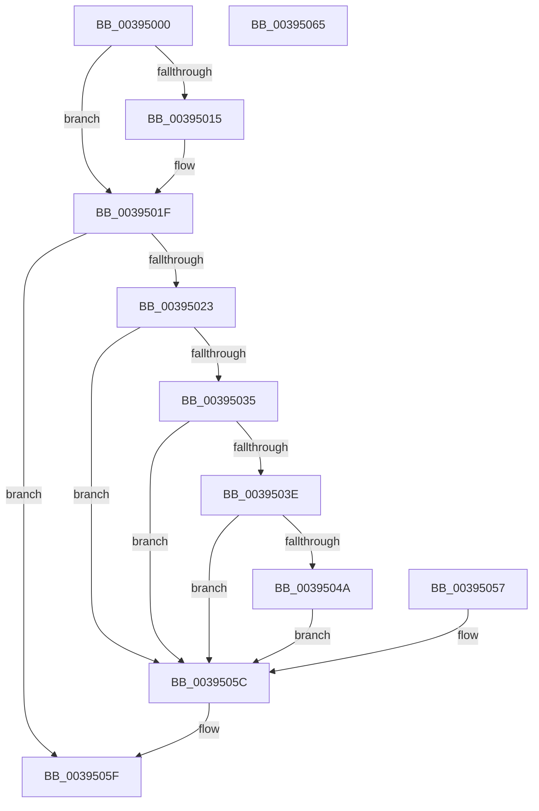

# ExpWorkerFactoryFinishDeferredWork

- RVA: `0x00395000`–`0x00395066` (길이 `102` bytes)
- VA: `0x0000000140395000`
- 실행 섹션: `.text`
- PDB 이름 있음: `예`; PDB Function 태그: `아니요`
- unwind 정보 RVA: `0x0008101C`
- 디코드: `28`개 명령, `102/102` bytes 표시
- 미해석 바이트: `0` (있으면 어셈블리에 `.byte`로 보존)

> 이 문서는 커널 이미지의 기계어와 PDB 기호를 분석해 생성했습니다. 4번과 5번은 함수 원형과 자료형을 바이너리 사용 방식에서 추정한 C 해석이며 원본 소스 복구 결과는 아닙니다.

## 1. Dependencies

- 직접 호출 지점: **1**; 고유 호출 대상: **1**
- 직접 호출자로 확인된 함수: **1**
- RIP 상대 이미지 참조: **0**

### Outgoing calls
- `0x00395015` → [AlpciDestroyDeferredMessageContext](../../page/9E/AlpciDestroyDeferredMessageContext_function_009E62A0.md) (function, `0x009E62A0`)

### Direct callers
- [NtWaitForWorkViaWorkerFactory](NtWaitForWorkViaWorkerFactory_function_00394270.md) at `0x0039493A`

### Static image references
- 디코드된 RIP-relative 메모리 참조가 없습니다.

## 2. Other-region calls and transfers

- 다른 실행 섹션으로 향하는 call: **1**
  - `0x00395015` → [AlpciDestroyDeferredMessageContext](../../page/9E/AlpciDestroyDeferredMessageContext_function_009E62A0.md) (`.text` → `PAGE`)
- 별도 외부 분기/꼬리 이동을 확인하지 못했습니다.

## 3. Assembly (complete function range)

```asm
00395000  40 53                           push rbx
00395002  48 83 EC 20                     sub rsp, 0x20
00395006  48 8D 59 24                     lea rbx, [rcx + 0x24]
0039500A  48 89 5C 24 30                  mov qword ptr [rsp + 0x30], rbx
0039500F  8B 03                           mov eax, dword ptr [rbx]
00395011  A8 01                           test al, 1
00395013  74 0A                           je 0x14039501f
00395015  E8 86 12 65 00                  call 0x1409e62a0
0039501A  83 23 FE                        and dword ptr [rbx], 0xfffffffe
0039501D  8B 03                           mov eax, dword ptr [rbx]
0039501F  A8 02                           test al, 2
00395021  74 3C                           je 0x14039505f
00395023  65 48 8B 0C 25 88 01 00 00      mov rcx, qword ptr gs:[0x188]
0039502C  F7 41 74 00 04 00 00            test dword ptr [rcx + 0x74], 0x400
00395033  75 27                           jne 0x14039505c
00395035  80 B9 4A 02 00 00 01            cmp byte ptr [rcx + 0x24a], 1
0039503C  74 1E                           je 0x14039505c
0039503E  48 8B 81 F0 00 00 00            mov rax, qword ptr [rcx + 0xf0]
00395045  48 85 C0                        test rax, rax
00395048  74 12                           je 0x14039505c
0039504A  48 C7 80 B8 02 00 00 00 00 00 00  mov qword ptr [rax + 0x2b8], 0
00395055  EB 05                           jmp 0x14039505c
00395057  48 8B 5C 24 30                  mov rbx, qword ptr [rsp + 0x30]
0039505C  83 23 FD                        and dword ptr [rbx], 0xfffffffd
0039505F  48 83 C4 20                     add rsp, 0x20
00395063  5B                              pop rbx
00395064  C3                              ret
00395065  CC                              int3
```

## 4. C-style interpretation (structured pseudocode)

```c
__int64 __fastcall ExpWorkerFactoryFinishDeferredWork(__int64 a1)
{
    __int64 result;
    __int64 v_rsp;
    unsigned __int64 v_stack_p8;

    v_rsp = (v_rsp) - (32);
    v_stack_p8 = a1 + 36;
    result = (unsigned int)(*(unsigned int *)(a1 + 36));
    if ((((unsigned __int8)((unsigned int)(*(unsigned int *)(a1 + 36)))) & (1)) != 0) {
        result = AlpciDestroyDeferredMessageContext(a1, a2, a3, a4);
        result = *(unsigned int *)(a1 + 36);
    }
    if ((((unsigned __int8)(result)) & (2)) == 0) goto loc_0039505F;
    if (((*(unsigned int *)(*(unsigned __int64 *)(gs_base + (0 + 392)) + 116)) & (0x400ULL)) != 0) goto loc_0039505C;
    if ((*(unsigned __int8 *)(*(unsigned __int64 *)(gs_base + (0 + 392)) + 586)) == 1) goto loc_0039505C;
    if (*(unsigned __int64 *)(*(unsigned __int64 *)(gs_base + (0 + 392)) + 240) == 0) goto loc_0039505C;
    *(unsigned __int64 *)(*(unsigned __int64 *)(*(unsigned __int64 *)(gs_base + (0 + 392)) + 240) + 696) = 0;
    goto loc_0039505C;
loc_0039505C:
loc_0039505F:
    v_rsp = (v_rsp) + (32);
    return *(unsigned __int64 *)(*(unsigned __int64 *)(gs_base + (0 + 392)) + 240);
}
```

## 5. (Beta) C Style

```c
int64_t ExpWorkerFactoryFinishDeferredWork(void *Arg1)
{
    uint8_t *arg1 = (uint8_t *)Arg1;

    int64_t result;
    int64_t local_rsp;
    uint64_t v_stack_p8;

    local_rsp = (local_rsp) - (32);
    v_stack_p8 = Arg1 + 36;
    result = (uint32_t)(*(uint32_t *)(arg1 + 0x24));
    if ((((uint8_t)((uint32_t)(*(uint32_t *)(arg1 + 0x24)))) & (1)) != 0) {
        result = AlpciDestroyDeferredMessageContext(Arg1, a2, a3, a4);
        result = *(uint32_t *)(arg1 + 0x24);
    }
    if ((((uint8_t)(result)) & (2)) == 0) goto loc_0039505F;
    if (((*(uint32_t *)(*(uint64_t *)(gs_base + (0 + 0x188)) + 0x74)) & (0x400ULL)) != 0) goto loc_0039505C;
    if ((*(uint8_t *)(*(uint64_t *)(gs_base + (0 + 0x188)) + 0x24A)) == 1) goto loc_0039505C;
    if (*(uint64_t *)(*(uint64_t *)(gs_base + (0 + 0x188)) + 0xF0) == 0) goto loc_0039505C;
    *(uint64_t *)(*(uint64_t *)(*(uint64_t *)(gs_base + (0 + 0x188)) + 0xF0) + 0x2B8) = 0;
    goto loc_0039505C;
loc_0039505C:
loc_0039505F:
    local_rsp = (local_rsp) + (32);
    return *(uint64_t *)(*(uint64_t *)(gs_base + (0 + 0x188)) + 0xF0);
}
```

### 관측된 메모리 오프셋

구조체 형식이 확인되지 않은 접근은 인자 기준의 오프셋으로만 기록했습니다.

| 기준 인자 | 오프셋 표현 | 폭 (bit) | 접근 |
|---|---:|---:|---|
| `Arg1` | `+ 0x0` | `32` | `R` |
| `Arg1` | `+ 0x0` | `32` | `R/W` |
| `Arg1` | `+ 0x24` | `64` | `R` |

## 6. Execution-region graph

[열기: 2D/3D 그래프와 함수 탐색 컨트롤 패널](../../../control-panel.html?section=text&rva=0x00395000&view=graph)

- 2D 그래프는 위에서 아래로 흐르고, 3D 그래프는 빈 공간을 드래그해 회전합니다. Shift+드래그는 이동, 휠은 확대·축소, 함수 노드 선택은 대상 보고서 이동입니다.

### Static fallback


