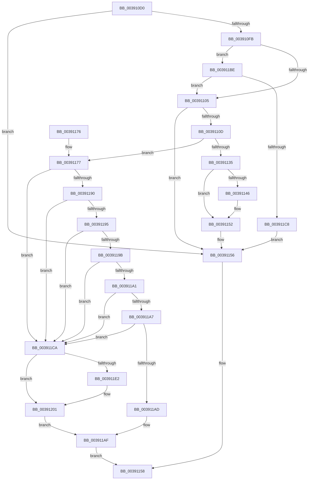

# FsRtlFastCheckLockForWrite

- RVA: `0x003910D0`–`0x00391205` (길이 `309` bytes)
- VA: `0x00000001403910D0`
- 실행 섹션: `.text`
- PDB 이름 있음: `예`; PDB Function 태그: `아니요`
- unwind 정보 RVA: `0x00080A28`
- 디코드: `91`개 명령, `309/309` bytes 표시
- 미해석 바이트: `0` (있으면 어셈블리에 `.byte`로 보존)

> 이 문서는 커널 이미지의 기계어와 PDB 기호를 분석해 생성했습니다. 4번과 5번은 함수 원형과 자료형을 바이너리 사용 방식에서 추정한 C 해석이며 원본 소스 복구 결과는 아닙니다.

## 1. Dependencies

- 직접 호출 지점: **6**; 고유 호출 대상: **6**
- 직접 호출자로 확인된 함수: **1**
- RIP 상대 이미지 참조: **1**

### Outgoing calls
- `0x00391128` → [KeAcquireSpinLockRaiseToDpc](../20/KeAcquireSpinLockRaiseToDpc_function_00208470.md) (function, `0x00208470`)
- `0x00391138` → [KxReleaseSpinLock](../20/KxReleaseSpinLock_function_00206670.md) (function, `0x00206670`)
- `0x0039114D` → [KiLowerIrqlProcessIrqlFlags](../4F/KiLowerIrqlProcessIrqlFlags_function_004F5698.md) (function, `0x004F5698`)
- `0x003911B5` → [KeReleaseSpinLock](KeReleaseSpinLock_function_00392BA0.md) (function, `0x00392BA0`)
- `0x003911D7` → [FsRtlCheckNoSharedConflict](../38/FsRtlCheckNoSharedConflict_function_0038FB8C.md) (function, `0x0038FB8C`)
- `0x003911FC` → [FsRtlCheckNoExclusiveConflict](../38/FsRtlCheckNoExclusiveConflict_function_0038FA54.md) (function, `0x0038FA54`)

### Direct callers
- [FsRtlCheckLockForWriteAccess](../3F/FsRtlCheckLockForWriteAccess_function_003FD260.md) at `0x003FD2E9`

### Static image references
- `0x0039113D` → RVA `0x00FC6D20` (`ALMOSTRO`; read)

## 2. Other-region calls and transfers

- 다른 실행 섹션으로 향하는 call: **0**
- 별도 외부 분기/꼬리 이동을 확인하지 못했습니다.

## 3. Assembly (complete function range)

```asm
003910D0  48 89 5C 24 10                  mov qword ptr [rsp + 0x10], rbx
003910D5  48 89 6C 24 18                  mov qword ptr [rsp + 0x18], rbp
003910DA  48 89 74 24 20                  mov qword ptr [rsp + 0x20], rsi
003910DF  57                              push rdi
003910E0  41 54                           push r12
003910E2  41 55                           push r13
003910E4  41 56                           push r14
003910E6  41 57                           push r15
003910E8  48 83 EC 40                     sub rsp, 0x40
003910EC  48 8B 59 18                     mov rbx, qword ptr [rcx + 0x18]
003910F0  45 33 FF                        xor r15d, r15d
003910F3  45 8B E1                        mov r12d, r9d
003910F6  48 85 DB                        test rbx, rbx
003910F9  74 5B                           je 0x140391156
003910FB  4C 39 7B 20                     cmp qword ptr [rbx + 0x20], r15
003910FF  0F 84 B9 00 00 00               je 0x1403911be
00391105  49 8B 00                        mov rax, qword ptr [r8]
00391108  48 85 C0                        test rax, rax
0039110B  74 49                           je 0x140391156
0039110D  48 8B 2A                        mov rbp, qword ptr [rdx]
00391110  4C 8D 70 FF                     lea r14, [rax - 1]
00391114  48 8D 7B 18                     lea rdi, [rbx + 0x18]
00391118  48 89 6C 24 30                  mov qword ptr [rsp + 0x30], rbp
0039111D  4C 03 F5                        add r14, rbp
00391120  48 8B CF                        mov rcx, rdi
00391123  4C 89 74 24 70                  mov qword ptr [rsp + 0x70], r14
00391128  E8 43 73 E7 FF                  call 0x140208470
0039112D  0F B6 F0                        movzx esi, al
00391130  4C 3B 33                        cmp r14, qword ptr [rbx]
00391133  73 42                           jae 0x140391177
00391135  48 8B CF                        mov rcx, rdi
00391138  E8 33 55 E7 FF                  call 0x140206670
0039113D  44 39 3D DC 5B C3 00            cmp dword ptr [rip + 0xc35bdc], r15d
00391144  74 0C                           je 0x140391152
00391146  44 0F 20 C1                     mov rcx, cr8
0039114A  40 8A D6                        mov dl, sil
0039114D  E8 46 45 16 00                  call 0x1404f5698
00391152  44 0F 22 C6                     mov cr8, rsi
00391156  B0 01                           mov al, 1
00391158  4C 8D 5C 24 40                  lea r11, [rsp + 0x40]
0039115D  49 8B 5B 38                     mov rbx, qword ptr [r11 + 0x38]
00391161  49 8B 6B 40                     mov rbp, qword ptr [r11 + 0x40]
00391165  49 8B 73 48                     mov rsi, qword ptr [r11 + 0x48]
00391169  49 8B E3                        mov rsp, r11
0039116C  41 5F                           pop r15
0039116E  41 5E                           pop r14
00391170  41 5D                           pop r13
00391172  41 5C                           pop r12
00391174  5F                              pop rdi
00391175  C3                              ret
00391176  CC                              int3
00391177  4C 8B AC 24 90 00 00 00         mov r13, qword ptr [rsp + 0x90]
0039117F  4C 8B BC 24 98 00 00 00         mov r15, qword ptr [rsp + 0x98]
00391187  49 8B 45 78                     mov rax, qword ptr [r13 + 0x78]
0039118B  48 85 C0                        test rax, rax
0039118E  74 3A                           je 0x1403911ca
00391190  48 3B 28                        cmp rbp, qword ptr [rax]
00391193  72 35                           jb 0x1403911ca
00391195  4C 3B 70 28                     cmp r14, qword ptr [rax + 0x28]
00391199  77 2F                           ja 0x1403911ca
0039119B  44 39 60 14                     cmp dword ptr [rax + 0x14], r12d
0039119F  75 29                           jne 0x1403911ca
003911A1  4C 39 78 20                     cmp qword ptr [rax + 0x20], r15
003911A5  75 23                           jne 0x1403911ca
003911A7  80 78 10 00                     cmp byte ptr [rax + 0x10], 0
003911AB  74 1D                           je 0x1403911ca
003911AD  B3 01                           mov bl, 1
003911AF  40 8A D6                        mov dl, sil
003911B2  48 8B CF                        mov rcx, rdi
003911B5  E8 E6 19 00 00                  call 0x140392ba0
003911BA  8A C3                           mov al, bl
003911BC  EB 9A                           jmp 0x140391158
003911BE  4C 39 7B 28                     cmp qword ptr [rbx + 0x28], r15
003911C2  0F 85 3D FF FF FF               jne 0x140391105
003911C8  EB 8C                           jmp 0x140391156
003911CA  4C 8D 44 24 70                  lea r8, [rsp + 0x70]
003911CF  48 8B CF                        mov rcx, rdi
003911D2  48 8D 54 24 30                  lea rdx, [rsp + 0x30]
003911D7  E8 B0 E9 FF FF                  call 0x14038fb8c
003911DC  B3 01                           mov bl, 1
003911DE  3A C3                           cmp al, bl
003911E0  75 1F                           jne 0x140391201
003911E2  4C 89 7C 24 28                  mov qword ptr [rsp + 0x28], r15
003911E7  4C 8D 44 24 70                  lea r8, [rsp + 0x70]
003911EC  45 8B CC                        mov r9d, r12d
003911EF  4C 89 6C 24 20                  mov qword ptr [rsp + 0x20], r13
003911F4  48 8D 54 24 30                  lea rdx, [rsp + 0x30]
003911F9  48 8B CF                        mov rcx, rdi
003911FC  E8 53 E8 FF FF                  call 0x14038fa54
00391201  8A D8                           mov bl, al
00391203  EB AA                           jmp 0x1403911af
```

## 4. C-style interpretation (structured pseudocode)

```c
__int64 __fastcall FsRtlFastCheckLockForWrite(__int64 a1, __int64 a2, __int64 a3, int a4, __int64 a5, __int64 a6)
{
    __int64 result;
    __int64 v_r14;
    __int64 v_r15;
    __int64 v_rsp;
    unsigned __int64 v_stack_m10;
    unsigned __int64 v_stack_m18;
    unsigned __int64 v_stack_m20;
    unsigned __int64 v_stack_m28;
    unsigned __int64 v_stack_m38;
    unsigned __int64 v_stack_p10;
    unsigned __int64 v_stack_p18;
    unsigned __int64 v_stack_p20;
    unsigned __int64 v_stack_p30;
    unsigned __int64 v_stack_p8;

    v_stack_p10 = v_rbx;
    v_stack_p18 = v_rbp;
    v_stack_p20 = v_rsi;
    v_rsp = (v_rsp) - (64);
    v_r15 = 0;
    if (*(unsigned __int64 *)(a1 + 24) == 0) goto loc_00391156;
    if ((*(unsigned __int64 *)(*(unsigned __int64 *)(a1 + 24) + 32)) == 0) goto loc_003911BE;
loc_00391105:
    if (*(unsigned __int64 *)(a3) == 0) goto loc_00391156;
    v_stack_m38 = *(unsigned __int64 *)(a2);
    v_r14 = (*(unsigned __int64 *)(a3) - 1) + (*(unsigned __int64 *)(a2));
    v_stack_p8 = v_r14;
    result = KeAcquireSpinLockRaiseToDpc(*(unsigned __int64 *)(a1 + 24) + 24, a2, a3, a4);
    if (v_r14 >= (*(unsigned __int64 *)(*(unsigned __int64 *)(a1 + 24)))) goto loc_00391177;
    result = KxReleaseSpinLock(*(unsigned __int64 *)(a1 + 24) + 24, a2, a3, a4);
    if ((*(unsigned int *)(v_rip + 12803036)) != 0) {
        a1 = v_cr8;
        a2 = (unsigned __int8)((unsigned __int8)(result));
        result = KiLowerIrqlProcessIrqlFlags(a1, a2, a3, a4);
    }
loc_00391156:
loc_00391158:
    return 1;
loc_00391177:
    if (*(unsigned __int64 *)(a5 + 120) == 0) goto loc_003911CA;
    if ((*(unsigned __int64 *)(v_stack_m28 + 64)) < (*(unsigned __int64 *)(*(unsigned __int64 *)(a5 + 120)))) goto loc_003911CA;
    if (v_r14 > (*(unsigned __int64 *)(*(unsigned __int64 *)(a5 + 120) + 40))) goto loc_003911CA;
    if ((*(unsigned int *)(*(unsigned __int64 *)(a5 + 120) + 20)) != ((unsigned int)((unsigned int)(a4)))) goto loc_003911CA;
    if ((*(unsigned __int64 *)(*(unsigned __int64 *)(a5 + 120) + 32)) != a6) goto loc_003911CA;
    if ((*(unsigned __int8 *)(*(unsigned __int64 *)(a5 + 120) + 16)) == 0) goto loc_003911CA;
loc_003911AF:
    result = KeReleaseSpinLock(*(unsigned __int64 *)(a1 + 24) + 24, (unsigned __int8)(*(unsigned __int64 *)(v_stack_m28 + 72)), a3, a4);
    goto loc_00391158;
loc_003911BE:
    if ((*(unsigned __int64 *)(1 + 40)) != a6) goto loc_00391105;
    goto loc_00391156;
loc_003911CA:
    result = FsRtlCheckNoSharedConflict(*(unsigned __int64 *)(a1 + 24) + 24, v_stack_m10, v_stack_p30, a4);
    if (((unsigned __int8)(result)) == 1) {
        v_stack_m18 = a6;
        a3 = v_stack_p30;
        a4 = (unsigned int)((unsigned int)(a4));
        v_stack_m20 = a5;
        a2 = v_stack_m10;
        a1 = *(unsigned __int64 *)(a1 + 24) + 24;
        result = FsRtlCheckNoExclusiveConflict(a1, a2, a3, a4);
    }
    goto loc_003911AF;
}
```

## 5. (Beta) C Style

```c
int64_t FsRtlFastCheckLockForWrite(void *Arg1, void *Arg2, void *Arg3, int32_t Arg4, void *Arg5, int64_t Arg6)
{
    uint8_t *arg1 = (uint8_t *)Arg1;
    uint8_t *arg2 = (uint8_t *)Arg2;
    uint8_t *arg3 = (uint8_t *)Arg3;
    uint8_t *arg5 = (uint8_t *)Arg5;

    int64_t result;
    int64_t local_r14;
    int64_t local_r15;
    int64_t local_rsp;
    uint64_t v_stack_m10;
    uint64_t v_stack_m18;
    uint64_t v_stack_m20;
    uint64_t v_stack_m28;
    uint64_t v_stack_m38;
    uint64_t v_stack_p10;
    uint64_t v_stack_p18;
    uint64_t v_stack_p20;
    uint64_t v_stack_p30;
    uint64_t v_stack_p8;

    v_stack_p10 = local_rbx;
    v_stack_p18 = local_rbp;
    v_stack_p20 = local_rsi;
    local_rsp = (local_rsp) - (64);
    local_r15 = 0;
    if (*(uint64_t *)(arg1 + 0x18) == 0) goto loc_00391156;
    if ((*(uint64_t *)(*(uint64_t *)(arg1 + 0x18) + 0x20)) == 0) goto loc_003911BE;
loc_00391105:
    if (*(uint64_t *)(arg3) == 0) goto loc_00391156;
    v_stack_m38 = *(uint64_t *)(arg2);
    local_r14 = (*(uint64_t *)(arg3) - 1) + (*(uint64_t *)(arg2));
    v_stack_p8 = local_r14;
    result = KeAcquireSpinLockRaiseToDpc(*(uint64_t *)(arg1 + 0x18) + 24, Arg2, Arg3, Arg4);
    if (local_r14 >= (*(uint64_t *)(*(uint64_t *)(arg1 + 0x18)))) goto loc_00391177;
    result = KxReleaseSpinLock(*(uint64_t *)(arg1 + 0x18) + 24, Arg2, Arg3, Arg4);
    if ((*(uint32_t *)(v_rip + 0xC35BDC)) != 0) {
        Arg1 = v_cr8;
        Arg2 = (uint8_t)((uint8_t)(result));
        result = KiLowerIrqlProcessIrqlFlags(Arg1, Arg2, Arg3, Arg4);
    }
loc_00391156:
loc_00391158:
    return 1;
loc_00391177:
    if (*(uint64_t *)(arg5 + 0x78) == 0) goto loc_003911CA;
    if ((*(uint64_t *)(v_stack_m28 + 0x40)) < (*(uint64_t *)(*(uint64_t *)(arg5 + 0x78)))) goto loc_003911CA;
    if (local_r14 > (*(uint64_t *)(*(uint64_t *)(arg5 + 0x78) + 0x28))) goto loc_003911CA;
    if ((*(uint32_t *)(*(uint64_t *)(arg5 + 0x78) + 0x14)) != ((uint32_t)((uint32_t)(Arg4)))) goto loc_003911CA;
    if ((*(uint64_t *)(*(uint64_t *)(arg5 + 0x78) + 0x20)) != Arg6) goto loc_003911CA;
    if ((*(uint8_t *)(*(uint64_t *)(arg5 + 0x78) + 0x10)) == 0) goto loc_003911CA;
loc_003911AF:
    result = KeReleaseSpinLock(*(uint64_t *)(arg1 + 0x18) + 24, (uint8_t)(*(uint64_t *)(v_stack_m28 + 0x48)), Arg3, Arg4);
    goto loc_00391158;
loc_003911BE:
    if ((*(uint64_t *)(1 + 0x28)) != Arg6) goto loc_00391105;
    goto loc_00391156;
loc_003911CA:
    result = FsRtlCheckNoSharedConflict(*(uint64_t *)(arg1 + 0x18) + 24, v_stack_m10, v_stack_p30, Arg4);
    if (((uint8_t)(result)) == 1) {
        v_stack_m18 = Arg6;
        Arg3 = v_stack_p30;
        Arg4 = (uint32_t)((uint32_t)(Arg4));
        v_stack_m20 = Arg5;
        Arg2 = v_stack_m10;
        Arg1 = *(uint64_t *)(arg1 + 0x18) + 24;
        result = FsRtlCheckNoExclusiveConflict(Arg1, Arg2, Arg3, Arg4);
    }
    goto loc_003911AF;
}
```

### 관측된 메모리 오프셋

구조체 형식이 확인되지 않은 접근은 인자 기준의 오프셋으로만 기록했습니다.

| 기준 인자 | 오프셋 표현 | 폭 (bit) | 접근 |
|---|---:|---:|---|
| `Arg1` | `+ 0x18` | `64` | `R` |
| `Arg2` | `+ 0x0` | `64` | `R` |
| `Arg3` | `+ 0x0` | `64` | `R` |
| `Arg5` | `+ 0x78` | `64` | `R` |

## 6. Execution-region graph

[열기: 2D/3D 그래프와 함수 탐색 컨트롤 패널](../../../control-panel.html?section=text&rva=0x003910D0&view=graph)

- 2D 그래프는 위에서 아래로 흐르고, 3D 그래프는 빈 공간을 드래그해 회전합니다. Shift+드래그는 이동, 휠은 확대·축소, 함수 노드 선택은 대상 보고서 이동입니다.

### Static fallback


