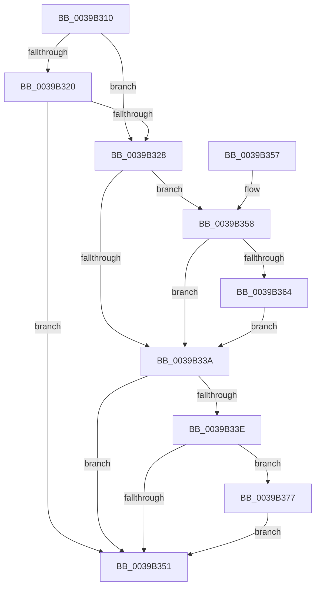

# HalpTimerClockInterruptWork

- RVA: `0x0039B310`–`0x0039B39C` (길이 `140` bytes)
- VA: `0x000000014039B310`
- 실행 섹션: `.text`
- PDB 이름 있음: `예`; PDB Function 태그: `아니요`
- unwind 정보 RVA: `0x000818CC`
- 디코드: `37`개 명령, `140/140` bytes 표시
- 미해석 바이트: `0` (있으면 어셈블리에 `.byte`로 보존)

> 이 문서는 커널 이미지의 기계어와 PDB 기호를 분석해 생성했습니다. 4번과 5번은 함수 원형과 자료형을 바이너리 사용 방식에서 추정한 C 해석이며 원본 소스 복구 결과는 아닙니다.

## 1. Dependencies

- 직접 호출 지점: **2**; 고유 호출 대상: **2**
- 직접 호출자로 확인된 함수: **3**
- RIP 상대 이미지 참조: **5**

### Outgoing calls
- `0x0039B370` → [guard_dispatch_icall](../6B/guard_dispatch_icall_function_006BAAD0.md) (function, `0x006BAAD0`)
- `0x0039B395` → [KeInsertQueueDpc](../20/KeInsertQueueDpc_function_00207C50.md) (function, `0x00207C50`)

### Direct callers
- [HalpTimerClockInterrupt](../20/HalpTimerClockInterrupt_function_002086A0.md) at `0x002087F0`
- [sub_00208C94](../20/Unknown_function_00208C94.md) at `0x00208CF1`
- [HalpTimerAlwaysOnClockInterrupt](../56/HalpTimerAlwaysOnClockInterrupt_function_00560240.md) at `0x00560384`

### Static image references
- `0x0039B316` → RVA `0x00FC22E0` (`.data`; read)
- `0x0039B320` → RVA `0x00FC22E1` (`.data`; read)
- `0x0039B32E` → RVA `0x00FC22E0` (`.data`; read/write)
- `0x0039B33E` → RVA `0x00FC8C40` (`ALMOSTRO`; read)
- `0x0039B358` → RVA `0x00E10250` (`.data`; read)

## 2. Other-region calls and transfers

- 다른 실행 섹션으로 향하는 call: **0**
- 별도 외부 분기/꼬리 이동을 확인하지 못했습니다.

## 3. Assembly (complete function range)

```asm
0039B310  40 53                           push rbx
0039B312  48 83 EC 20                     sub rsp, 0x20
0039B316  8A 05 C4 6F C2 00               mov al, byte ptr [rip + 0xc26fc4]
0039B31C  84 C0                           test al, al
0039B31E  75 08                           jne 0x14039b328
0039B320  38 05 BB 6F C2 00               cmp byte ptr [rip + 0xc26fbb], al
0039B326  74 29                           je 0x14039b351
0039B328  8A 1D B3 6F C2 00               mov bl, byte ptr [rip + 0xc26fb3]
0039B32E  66 83 25 AA 6F C2 00 00         and word ptr [rip + 0xc26faa], 0
0039B336  84 C0                           test al, al
0039B338  75 1E                           jne 0x14039b358
0039B33A  84 DB                           test bl, bl
0039B33C  74 13                           je 0x14039b351
0039B33E  48 8B 05 FB D8 C2 00            mov rax, qword ptr [rip + 0xc2d8fb]
0039B345  48 8B 88 80 00 00 00            mov rcx, qword ptr [rax + 0x80]
0039B34C  48 85 C9                        test rcx, rcx
0039B34F  75 26                           jne 0x14039b377
0039B351  48 83 C4 20                     add rsp, 0x20
0039B355  5B                              pop rbx
0039B356  C3                              ret
0039B357  CC                              int3
0039B358  48 8B 05 F1 4E A7 00            mov rax, qword ptr [rip + 0xa74ef1]
0039B35F  48 85 C0                        test rax, rax
0039B362  74 D6                           je 0x14039b33a
0039B364  45 33 C0                        xor r8d, r8d
0039B367  B9 17 41 36 59                  mov ecx, 0x59364117
0039B36C  41 8D 50 01                     lea edx, [r8 + 1]
0039B370  E8 5B F7 31 00                  call 0x1406baad0
0039B375  EB C3                           jmp 0x14039b33a
0039B377  48 83 A0 80 00 00 00 00         and qword ptr [rax + 0x80], 0
0039B37F  48 B8 14 00 00 00 80 F7 FF FF   movabs rax, 0xfffff78000000014
0039B389  48 8B 00                        mov rax, qword ptr [rax]
0039B38C  4C 8B C0                        mov r8, rax
0039B38F  8B D0                           mov edx, eax
0039B391  49 C1 E8 20                     shr r8, 0x20
0039B395  E8 B6 C8 E6 FF                  call 0x140207c50
0039B39A  EB B5                           jmp 0x14039b351
```

## 4. C-style interpretation (structured pseudocode)

```c
__int64 __fastcall HalpTimerClockInterruptWork(__int64 a1, __int64 a2, int a3)
{
    __int64 result;
    __int64 v_rsp;

    v_rsp = (v_rsp) - (32);
    if ((unsigned __int8)(*(unsigned __int8 *)(v_rip + 12742596)) != 0) goto loc_0039B328;
    if ((*(unsigned __int8 *)(v_rip + 12742587)) == ((unsigned __int8)(*(unsigned __int8 *)(v_rip + 12742596)))) goto loc_0039B351;
loc_0039B328:
    if ((unsigned __int8)(*(unsigned __int8 *)(v_rip + 12742596)) != 0) goto loc_0039B358;
loc_0039B33A:
    if ((unsigned __int8)(*(unsigned __int8 *)(v_rip + 12742579)) == 0) goto loc_0039B351;
    if (*(unsigned __int64 *)(*(unsigned __int64 *)(v_rip + 12769531) + 128) != 0) goto loc_0039B377;
loc_0039B351:
    v_rsp = (v_rsp) + (32);
    return *(unsigned __int64 *)(v_rip + 12769531);
loc_0039B358:
    if (*(unsigned __int64 *)(v_rip + 10964721) == 0) goto loc_0039B33A;
    a3 = 0;
    result = guard_dispatch_icall((unsigned int)(0x59364117ULL), a3 + 1, a3, a4);
    goto loc_0039B33A;
loc_0039B377:
    a3 = (*(unsigned __int64 *)(result)) >> (32);
    result = KeInsertQueueDpc((unsigned int)(0x59364117ULL), (unsigned int)((unsigned int)(*(unsigned __int64 *)(result))), a3, a4);
    goto loc_0039B351;
}
```

## 5. (Beta) C Style

```c
int64_t HalpTimerClockInterruptWork(int64_t Arg1, int64_t Arg2, int32_t Arg3)
{
    int64_t result;
    int64_t local_rsp;

    local_rsp = (local_rsp) - (32);
    if ((uint8_t)(*(uint8_t *)(v_rip + 0xC26FC4)) != 0) goto loc_0039B328;
    if ((*(uint8_t *)(v_rip + 0xC26FBB)) == ((uint8_t)(*(uint8_t *)(v_rip + 0xC26FC4)))) goto loc_0039B351;
loc_0039B328:
    if ((uint8_t)(*(uint8_t *)(v_rip + 0xC26FC4)) != 0) goto loc_0039B358;
loc_0039B33A:
    if ((uint8_t)(*(uint8_t *)(v_rip + 0xC26FB3)) == 0) goto loc_0039B351;
    if (*(uint64_t *)(*(uint64_t *)(v_rip + 0xC2D8FB) + 0x80) != 0) goto loc_0039B377;
loc_0039B351:
    local_rsp = (local_rsp) + (32);
    return *(uint64_t *)(v_rip + 0xC2D8FB);
loc_0039B358:
    if (*(uint64_t *)(v_rip + 0xA74EF1) == 0) goto loc_0039B33A;
    Arg3 = 0;
    result = guard_dispatch_icall((uint32_t)(0x59364117ULL), Arg3 + 1, Arg3, a4);
    goto loc_0039B33A;
loc_0039B377:
    Arg3 = (*(uint64_t *)(result)) >> (32);
    result = KeInsertQueueDpc((uint32_t)(0x59364117ULL), (uint32_t)((uint32_t)(*(uint64_t *)(result))), Arg3, a4);
    goto loc_0039B351;
}
```

## 6. Execution-region graph

[열기: 2D/3D 그래프와 함수 탐색 컨트롤 패널](../../../control-panel.html?section=text&rva=0x0039B310&view=graph)

- 2D 그래프는 위에서 아래로 흐르고, 3D 그래프는 빈 공간을 드래그해 회전합니다. Shift+드래그는 이동, 휠은 확대·축소, 함수 노드 선택은 대상 보고서 이동입니다.

### Static fallback


