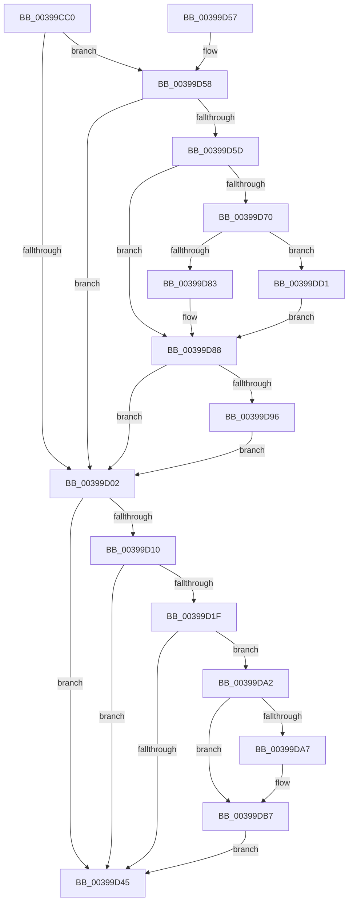

# HalpTimerClockIpiRoutine

- RVA: `0x00399CC0`–`0x00399DD8` (길이 `280` bytes)
- VA: `0x0000000140399CC0`
- 실행 섹션: `.text`
- PDB 이름 있음: `예`; PDB Function 태그: `아니요`
- unwind 정보 RVA: `0x000817F8`
- 디코드: `63`개 명령, `280/280` bytes 표시
- 미해석 바이트: `0` (있으면 어셈블리에 `.byte`로 보존)

> 이 문서는 커널 이미지의 기계어와 PDB 기호를 분석해 생성했습니다. 4번과 5번은 함수 원형과 자료형을 바이너리 사용 방식에서 추정한 C 해석이며 원본 소스 복구 결과는 아닙니다.

## 1. Dependencies

- 직접 호출 지점: **6**; 고유 호출 대상: **5**
- 직접 호출자로 확인된 함수: **1**
- RIP 상대 이미지 참조: **7**

### Outgoing calls
- `0x00399CDF` → [KeClockInterruptNotify](KeClockInterruptNotify_function_0039A970.md) (function, `0x0039A970`)
- `0x00399D83` → [HalpTimerWatchdogResetCountdown](HalpTimerWatchdogResetCountdown_function_0039B3B0.md) (function, `0x0039B3B0`)
- `0x00399D98` → [HalpTimerWatchdogTriggerSystemReset](HalpTimerWatchdogTriggerSystemReset_function_0039B410.md) (function, `0x0039B410`)
- `0x00399DB2` → [guard_dispatch_icall](../6B/guard_dispatch_icall_function_006BAAD0.md) (function, `0x006BAAD0`)
- `0x00399DB9` → [HalpScanForProfilingCorruption](../44/HalpScanForProfilingCorruption_function_00445A00.md) (function, `0x00445A00`)
- `0x00399DD1` → [guard_dispatch_icall](../6B/guard_dispatch_icall_function_006BAAD0.md) (function, `0x006BAAD0`)

### Direct callers
- [sub_00208F20](../20/Unknown_function_00208F20.md) at `0x00208F2F`

### Static image references
- `0x00399CEF` → RVA `0x00FC4028` (`.data`; read)
- `0x00399D27` → RVA `0x00FC2C30` (`.data`; read)
- `0x00399D60` → RVA `0x00FC2188` (`.data`; read)
- `0x00399D67` → RVA `0x00FC2178` (`.data`; read)
- `0x00399D70` → RVA `0x00E00B20` (`.data`; read)
- `0x00399D77` → RVA `0x0039B3B0` (`HalpTimerWatchdogResetCountdown`; read)
- `0x00399DA7` → RVA `0x00E00A38` (`.data`; read)

## 2. Other-region calls and transfers

- 다른 실행 섹션으로 향하는 call: **0**
- 별도 외부 분기/꼬리 이동을 확인하지 못했습니다.

## 3. Assembly (complete function range)

```asm
00399CC0  48 89 5C 24 08                  mov qword ptr [rsp + 8], rbx
00399CC5  48 89 74 24 10                  mov qword ptr [rsp + 0x10], rsi
00399CCA  57                              push rdi
00399CCB  48 83 EC 20                     sub rsp, 0x20
00399CCF  48 8B 89 88 00 00 00            mov rcx, qword ptr [rcx + 0x88]
00399CD6  41 B8 02 00 00 00               mov r8d, 2
00399CDC  8A 51 29                        mov dl, byte ptr [rcx + 0x29]
00399CDF  E8 8C 0C 00 00                  call 0x14039a970
00399CE4  65 48 8B 04 25 20 00 00 00      mov rax, qword ptr gs:[0x20]
00399CED  33 DB                           xor ebx, ebx
00399CEF  48 39 1D 32 A3 C2 00            cmp qword ptr [rip + 0xc2a332], rbx
00399CF6  48 BE 08 00 00 00 80 F7 FF FF   movabs rsi, 0xfffff78000000008
00399D00  75 56                           jne 0x140399d58
00399D02  65 48 8B 04 25 20 00 00 00      mov rax, qword ptr gs:[0x20]
00399D0B  39 58 60                        cmp dword ptr [rax + 0x60], ebx
00399D0E  7E 35                           jle 0x140399d45
00399D10  65 48 8B 04 25 20 00 00 00      mov rax, qword ptr gs:[0x20]
00399D19  F6 40 60 01                     test byte ptr [rax + 0x60], 1
00399D1D  75 26                           jne 0x140399d45
00399D1F  65 8B 3C 25 A4 01 00 00         mov edi, dword ptr gs:[0x1a4]
00399D27  48 8B 05 02 8F C2 00            mov rax, qword ptr [rip + 0xc28f02]
00399D2E  48 8D 0C 7F                     lea rcx, [rdi + rdi*2]
00399D32  48 8D 1C C8                     lea rbx, [rax + rcx*8]
00399D36  48 8B 06                        mov rax, qword ptr [rsi]
00399D39  48 2B 43 10                     sub rax, qword ptr [rbx + 0x10]
00399D3D  48 3D 40 4B 4C 00               cmp rax, 0x4c4b40
00399D43  73 5D                           jae 0x140399da2
00399D45  48 8B 5C 24 30                  mov rbx, qword ptr [rsp + 0x30]
00399D4A  B0 01                           mov al, 1
00399D4C  48 8B 74 24 38                  mov rsi, qword ptr [rsp + 0x38]
00399D51  48 83 C4 20                     add rsp, 0x20
00399D55  5F                              pop rdi
00399D56  C3                              ret
00399D57  CC                              int3
00399D58  38 58 21                        cmp byte ptr [rax + 0x21], bl
00399D5B  74 A5                           je 0x140399d02
00399D5D  48 8B 06                        mov rax, qword ptr [rsi]
00399D60  48 2B 05 21 84 C2 00            sub rax, qword ptr [rip + 0xc28421]
00399D67  48 3B 05 0A 84 C2 00            cmp rax, qword ptr [rip + 0xc2840a]
00399D6E  76 18                           jbe 0x140399d88
00399D70  48 8B 05 A9 6D A6 00            mov rax, qword ptr [rip + 0xa66da9]
00399D77  48 8D 0D 32 16 00 00            lea rcx, [rip + 0x1632]
00399D7E  48 3B C1                        cmp rax, rcx
00399D81  75 4E                           jne 0x140399dd1
00399D83  E8 28 16 00 00                  call 0x14039b3b0
00399D88  48 83 3D E8 83 C2 00 FF         cmp qword ptr [rip + 0xc283e8], -1
00399D90  0F 85 6C FF FF FF               jne 0x140399d02
00399D96  33 C9                           xor ecx, ecx
00399D98  E8 73 16 00 00                  call 0x14039b410
00399D9D  E9 60 FF FF FF                  jmp 0x140399d02
00399DA2  48 39 1B                        cmp qword ptr [rbx], rbx
00399DA5  74 10                           je 0x140399db7
00399DA7  48 8B 05 8A 6C A6 00            mov rax, qword ptr [rip + 0xa66c8a]
00399DAE  33 D2                           xor edx, edx
00399DB0  33 C9                           xor ecx, ecx
00399DB2  E8 19 0D 32 00                  call 0x1406baad0
00399DB7  8B CF                           mov ecx, edi
00399DB9  E8 42 BC 0A 00                  call 0x140445a00
00399DBE  48 A1 08 00 00 00 80 F7 FF FF   movabs rax, qword ptr [0xfffff78000000008]
00399DC8  48 89 43 10                     mov qword ptr [rbx + 0x10], rax
00399DCC  E9 74 FF FF FF                  jmp 0x140399d45
00399DD1  E8 FA 0C 32 00                  call 0x1406baad0
00399DD6  EB B0                           jmp 0x140399d88
```

## 4. C-style interpretation (structured pseudocode)

```c
__int64 __fastcall HalpTimerClockIpiRoutine(__int64 a1)
{
    __int64 result;
    __int64 v_rbx;
    __int64 v_rsp;
    unsigned __int64 v_stack_p10;
    unsigned __int64 v_stack_p8;

    v_stack_p8 = v_rbx;
    v_stack_p10 = v_rsi;
    v_rsp = (v_rsp) - (32);
    result = KeClockInterruptNotify(*(unsigned __int64 *)(a1 + 136), *(unsigned __int8 *)(*(unsigned __int64 *)(a1 + 136) + 41), 2, a4);
    v_rbx = 0;
    if ((*(unsigned __int64 *)(v_rip + 12755762)) != 0) goto loc_00399D58;
loc_00399D02:
    if ((*(unsigned int *)(*(unsigned __int64 *)(gs_base + (0 + 32)) + 96)) <= 0) goto loc_00399D45;
    if (((*(unsigned __int8 *)(*(unsigned __int64 *)(gs_base + (0 + 32)) + 96)) & (1)) != 0) goto loc_00399D45;
    result = (*(unsigned __int64 *)(v_rsi)) - (*(unsigned __int64 *)(*(unsigned __int64 *)(v_rip + 12750594) + (unsigned int)(*(unsigned int *)(gs_base + (0 + 420))) + (unsigned int)(*(unsigned int *)(gs_base + (0 + 420))) * 2 * 8 + 16));
    if (result >= 0x4C4B40ULL) goto loc_00399DA2;
loc_00399D45:
    v_rsp = (v_rsp) + (32);
    return 1;
loc_00399D58:
    if ((*(unsigned __int8 *)(1 + 33)) == ((unsigned __int8)(v_stack_p8))) goto loc_00399D02;
    result = (*(unsigned __int64 *)(v_stack_p10)) - (*(unsigned __int64 *)(v_rip + 12747809));
    if (result <= (*(unsigned __int64 *)(v_rip + 12747786))) goto loc_00399D88;
    if ((*(unsigned __int64 *)(v_rip + 10907049)) != (v_rip + 5682)) goto loc_00399DD1;
    result = HalpTimerWatchdogResetCountdown(v_rip + 5682, *(unsigned __int8 *)(*(unsigned __int64 *)(a1 + 136) + 41), 2, a4);
loc_00399D88:
    if ((*(unsigned __int64 *)(v_rip + 12747752)) != -1) goto loc_00399D02;
    a1 = 0;
    result = HalpTimerWatchdogTriggerSystemReset(a1, *(unsigned __int8 *)(*(unsigned __int64 *)(a1 + 136) + 41), 2, a4);
    goto loc_00399D02;
loc_00399DA2:
    if ((*(unsigned __int64 *)(v_stack_p8)) != v_stack_p8) {
        result = *(unsigned __int64 *)(v_rip + 10906762);
        a2 = 0;
        a1 = 0;
        result = guard_dispatch_icall(a1, a2, 2, a4);
    }
    result = HalpScanForProfilingCorruption((unsigned int)((unsigned int)((unsigned int)(*(unsigned int *)(gs_base + (0 + 420))))), a2, 2, a4);
    *(unsigned __int64 *)(v_stack_p8 + 16) = result;
    goto loc_00399D45;
loc_00399DD1:
    result = guard_dispatch_icall((unsigned int)((unsigned int)((unsigned int)(*(unsigned int *)(gs_base + (0 + 420))))), a2, 2, a4);
    goto loc_00399D88;
}
```

## 5. (Beta) C Style

```c
int64_t HalpTimerClockIpiRoutine(void *Arg1)
{
    uint8_t *arg1 = (uint8_t *)Arg1;

    int64_t result;
    int64_t local_rbx;
    int64_t local_rsp;
    uint64_t v_stack_p10;
    uint64_t v_stack_p8;

    v_stack_p8 = local_rbx;
    v_stack_p10 = local_rsi;
    local_rsp = (local_rsp) - (32);
    result = KeClockInterruptNotify(*(uint64_t *)(arg1 + 0x88), *(uint8_t *)(*(uint64_t *)(arg1 + 0x88) + 0x29), 2, a4);
    local_rbx = 0;
    if ((*(uint64_t *)(v_rip + 0xC2A332)) != 0) goto loc_00399D58;
loc_00399D02:
    if ((*(uint32_t *)(*(uint64_t *)(gs_base + (0 + 0x20)) + 0x60)) <= 0) goto loc_00399D45;
    if (((*(uint8_t *)(*(uint64_t *)(gs_base + (0 + 0x20)) + 0x60)) & (1)) != 0) goto loc_00399D45;
    result = (*(uint64_t *)(local_rsi)) - (*(uint64_t *)(*(uint64_t *)(v_rip + 0xC28F02) + (uint32_t)(*(uint32_t *)(gs_base + (0 + 0x1A4))) + (uint32_t)(*(uint32_t *)(gs_base + (0 + 0x1A4))) * 2 * 8 + 0x10));
    if (result >= 0x4C4B40ULL) goto loc_00399DA2;
loc_00399D45:
    local_rsp = (local_rsp) + (32);
    return 1;
loc_00399D58:
    if ((*(uint8_t *)(1 + 0x21)) == ((uint8_t)(v_stack_p8))) goto loc_00399D02;
    result = (*(uint64_t *)(v_stack_p10)) - (*(uint64_t *)(v_rip + 0xC28421));
    if (result <= (*(uint64_t *)(v_rip + 0xC2840A))) goto loc_00399D88;
    if ((*(uint64_t *)(v_rip + 0xA66DA9)) != (v_rip + 5682)) goto loc_00399DD1;
    result = HalpTimerWatchdogResetCountdown(v_rip + 5682, *(uint8_t *)(*(uint64_t *)(arg1 + 0x88) + 0x29), 2, a4);
loc_00399D88:
    if ((*(uint64_t *)(v_rip + 0xC283E8)) != -1) goto loc_00399D02;
    Arg1 = 0;
    result = HalpTimerWatchdogTriggerSystemReset(Arg1, *(uint8_t *)(*(uint64_t *)(arg1 + 0x88) + 0x29), 2, a4);
    goto loc_00399D02;
loc_00399DA2:
    if ((*(uint64_t *)(v_stack_p8)) != v_stack_p8) {
        result = *(uint64_t *)(v_rip + 0xA66C8A);
        a2 = 0;
        Arg1 = 0;
        result = guard_dispatch_icall(Arg1, a2, 2, a4);
    }
    result = HalpScanForProfilingCorruption((uint32_t)((uint32_t)((uint32_t)(*(uint32_t *)(gs_base + (0 + 0x1A4))))), a2, 2, a4);
    *(uint64_t *)(v_stack_p8 + 0x10) = result;
    goto loc_00399D45;
loc_00399DD1:
    result = guard_dispatch_icall((uint32_t)((uint32_t)((uint32_t)(*(uint32_t *)(gs_base + (0 + 0x1A4))))), a2, 2, a4);
    goto loc_00399D88;
}
```

### 관측된 메모리 오프셋

구조체 형식이 확인되지 않은 접근은 인자 기준의 오프셋으로만 기록했습니다.

| 기준 인자 | 오프셋 표현 | 폭 (bit) | 접근 |
|---|---:|---:|---|
| `Arg1` | `+ 0x88` | `64` | `R` |

## 6. Execution-region graph

[열기: 2D/3D 그래프와 함수 탐색 컨트롤 패널](../../../control-panel.html?section=text&rva=0x00399CC0&view=graph)

- 2D 그래프는 위에서 아래로 흐르고, 3D 그래프는 빈 공간을 드래그해 회전합니다. Shift+드래그는 이동, 휠은 확대·축소, 함수 노드 선택은 대상 보고서 이동입니다.

### Static fallback


