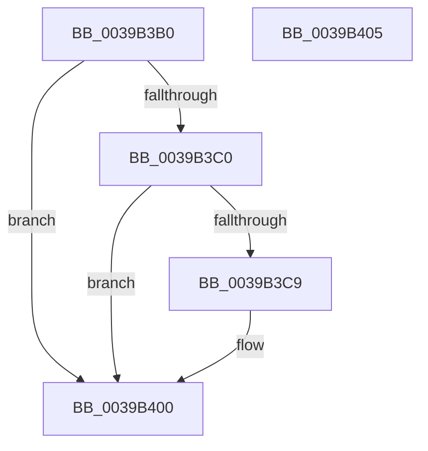

# HalpTimerWatchdogResetCountdown

- RVA: `0x0039B3B0`–`0x0039B406` (길이 `86` bytes)
- VA: `0x000000014039B3B0`
- 실행 섹션: `.text`
- PDB 이름 있음: `예`; PDB Function 태그: `아니요`
- unwind 정보 RVA: `0x0005D2F4`
- 디코드: `19`개 명령, `86/86` bytes 표시
- 미해석 바이트: `0` (있으면 어셈블리에 `.byte`로 보존)

> 이 문서는 커널 이미지의 기계어와 PDB 기호를 분석해 생성했습니다. 4번과 5번은 함수 원형과 자료형을 바이너리 사용 방식에서 추정한 C 해석이며 원본 소스 복구 결과는 아닙니다.

## 1. Dependencies

- 직접 호출 지점: **2**; 고유 호출 대상: **2**
- 직접 호출자로 확인된 함수: **5**
- RIP 상대 이미지 참조: **4**

### Outgoing calls
- `0x0039B3E2` → [HalpSetTimer](../42/HalpSetTimer_function_0042BD30.md) (function, `0x0042BD30`)
- `0x0039B3FB` → [HalpTimerWatchdogWakeSetDueTime](../4C/HalpTimerWatchdogWakeSetDueTime_function_004CFDF4.md) (function, `0x004CFDF4`)

### Direct callers
- [HalpTimerClockInterrupt](../20/HalpTimerClockInterrupt_function_002086A0.md) at `0x002088B7`
- [sub_00208D99](../20/Unknown_function_00208D99.md) at `0x00208DCE`
- [HalpTimerClockIpiRoutine](HalpTimerClockIpiRoutine_function_00399CC0.md) at `0x00399D83`
- [HalpTimerAlwaysOnClockInterrupt](../56/HalpTimerAlwaysOnClockInterrupt_function_00560240.md) at `0x005603C8`
- [HalpTimerWatchdogPreResetInterrupt](../56/HalpTimerWatchdogPreResetInterrupt_function_005605C0.md) at `0x0056063E`

### Static image references
- `0x0039B3B4` → RVA `0x00FC4028` (`.data`; read)
- `0x0039B3C0` → RVA `0x00FC2184` (`.data`; read)
- `0x0039B3C9` → RVA `0x00FC2168` (`.data`; read)
- `0x0039B3F4` → RVA `0x00FC2188` (`.data`; write)

## 2. Other-region calls and transfers

- 다른 실행 섹션으로 향하는 call: **0**
- 별도 외부 분기/꼬리 이동을 확인하지 못했습니다.

## 3. Assembly (complete function range)

```asm
0039B3B0  48 83 EC 38                     sub rsp, 0x38
0039B3B4  48 8B 0D 6D 8C C2 00            mov rcx, qword ptr [rip + 0xc28c6d]
0039B3BB  48 85 C9                        test rcx, rcx
0039B3BE  74 40                           je 0x14039b400
0039B3C0  80 3D BD 6D C2 00 00            cmp byte ptr [rip + 0xc26dbd], 0
0039B3C7  74 37                           je 0x14039b400
0039B3C9  4C 8B 05 98 6D C2 00            mov r8, qword ptr [rip + 0xc26d98]
0039B3D0  48 8D 44 24 40                  lea rax, [rsp + 0x40]
0039B3D5  41 B1 01                        mov r9b, 1
0039B3D8  48 89 44 24 20                  mov qword ptr [rsp + 0x20], rax
0039B3DD  BA 03 00 00 00                  mov edx, 3
0039B3E2  E8 49 09 09 00                  call 0x14042bd30
0039B3E7  48 B8 08 00 00 00 80 F7 FF FF   movabs rax, 0xfffff78000000008
0039B3F1  48 8B 00                        mov rax, qword ptr [rax]
0039B3F4  48 89 05 8D 6D C2 00            mov qword ptr [rip + 0xc26d8d], rax
0039B3FB  E8 F4 49 13 00                  call 0x1404cfdf4
0039B400  48 83 C4 38                     add rsp, 0x38
0039B404  C3                              ret
0039B405  CC                              int3
```

## 4. C-style interpretation (structured pseudocode)

```c
__int64 __fastcall HalpTimerWatchdogResetCountdown(void)
{
    __int64 result;
    __int64 v_rsp;
    unsigned __int64 v_stack_m18;
    unsigned __int64 v_stack_p8;

    v_rsp = (v_rsp) - (56);
    if (*(unsigned __int64 *)(v_rip + 12749933) == 0) goto loc_0039B400;
    if ((*(unsigned __int8 *)(v_rip + 12742077)) != 0) {
        a3 = *(unsigned __int64 *)(v_rip + 12742040);
        result = v_stack_p8;
        a4 = 1;
        v_stack_m18 = result;
        a2 = 3;
        result = HalpSetTimer(*(unsigned __int64 *)(v_rip + 12749933), a2, a3, a4);
        result = *(unsigned __int64 *)(result);
        *(unsigned __int64 *)(v_rip + 12742029) = result;
        result = HalpTimerWatchdogWakeSetDueTime(*(unsigned __int64 *)(v_rip + 12749933), a2, a3, a4);
    }
    v_rsp = (v_rsp) + (56);
    return result;
}
```

## 5. (Beta) C Style

```c
void HalpTimerWatchdogResetCountdown(void)
{
    int64_t result;
    int64_t local_rsp;
    uint64_t v_stack_m18;
    uint64_t v_stack_p8;

    local_rsp = (local_rsp) - (56);
    if (*(uint64_t *)(v_rip + 0xC28C6D) == 0) goto loc_0039B400;
    if ((*(uint8_t *)(v_rip + 0xC26DBD)) != 0) {
        a3 = *(uint64_t *)(v_rip + 0xC26D98);
        result = v_stack_p8;
        a4 = 1;
        v_stack_m18 = result;
        a2 = 3;
        result = HalpSetTimer(*(uint64_t *)(v_rip + 0xC28C6D), a2, a3, a4);
        result = *(uint64_t *)(result);
        *(uint64_t *)(v_rip + 0xC26D8D) = result;
        result = HalpTimerWatchdogWakeSetDueTime(*(uint64_t *)(v_rip + 0xC28C6D), a2, a3, a4);
    }
    local_rsp = (local_rsp) + (56);
    return result;
}
```

## 6. Execution-region graph

[열기: 2D/3D 그래프와 함수 탐색 컨트롤 패널](../../../control-panel.html?section=text&rva=0x0039B3B0&view=graph)

- 2D 그래프는 위에서 아래로 흐르고, 3D 그래프는 빈 공간을 드래그해 회전합니다. Shift+드래그는 이동, 휠은 확대·축소, 함수 노드 선택은 대상 보고서 이동입니다.

### Static fallback


