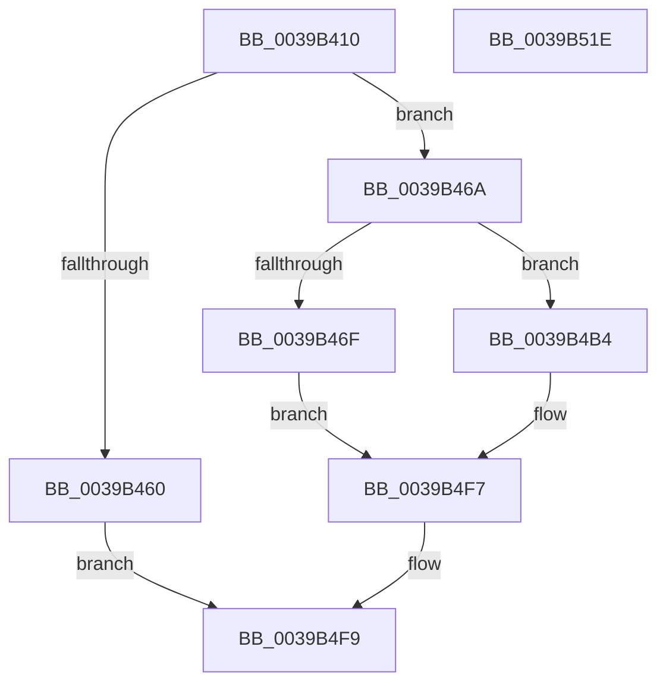

# HalpTimerWatchdogTriggerSystemReset

- RVA: `0x0039B410`–`0x0039B51F` (길이 `271` bytes)
- VA: `0x000000014039B410`
- 실행 섹션: `.text`
- PDB 이름 있음: `예`; PDB Function 태그: `아니요`
- unwind 정보 RVA: `0x000818D8`
- 디코드: `64`개 명령, `271/271` bytes 표시
- 미해석 바이트: `0` (있으면 어셈블리에 `.byte`로 보존)

> 이 문서는 커널 이미지의 기계어와 PDB 기호를 분석해 생성했습니다. 4번과 5번은 함수 원형과 자료형을 바이너리 사용 방식에서 추정한 C 해석이며 원본 소스 복구 결과는 아닙니다.

## 1. Dependencies

- 직접 호출 지점: **7**; 고유 호출 대상: **6**
- 직접 호출자로 확인된 함수: **4**
- RIP 상대 이미지 참조: **5**

### Outgoing calls
- `0x0039B449` → [memset](../6C/memset_function_006C6C40.md) (function, `0x006C6C40`)
- `0x0039B491` → [memset](../6C/memset_function_006C6C40.md) (function, `0x006C6C40`)
- `0x0039B4A1` → [KeAddProcessorAffinityEx](../25/KeAddProcessorAffinityEx_function_0025B6F0.md) (function, `0x0025B6F0`)
- `0x0039B4AD` → [HalRequestClockInterrupt](../2D/HalRequestClockInterrupt_function_002D14C0.md) (function, `0x002D14C0`)
- `0x0039B4D0` → [HalpTimerGetClockRates](../54/HalpTimerGetClockRates_function_005483AC.md) (function, `0x005483AC`)
- `0x0039B4F0` → [HalpSetTimer](../42/HalpSetTimer_function_0042BD30.md) (function, `0x0042BD30`)
- `0x0039B500` → [_security_check_cookie](../6A/_security_check_cookie_function_006AC640.md) (function, `0x006AC640`)

### Direct callers
- [HalpTimerClockInterrupt](../20/HalpTimerClockInterrupt_function_002086A0.md) at `0x002088CC`
- [sub_00208D99](../20/Unknown_function_00208D99.md) at `0x00208DE3`
- [HalpTimerClockIpiRoutine](HalpTimerClockIpiRoutine_function_00399CC0.md) at `0x00399D98`
- [HalpTimerAlwaysOnClockInterrupt](../56/HalpTimerAlwaysOnClockInterrupt_function_00560240.md) at `0x005603E0`

### Static image references
- `0x0039B42B` → RVA `0x00E0A740` (`.data`; read)
- `0x0039B44E` → RVA `0x00FC4028` (`.data`; read)
- `0x0039B46F` → RVA `0x00FC2178` (`.data`; read/write)
- `0x0039B496` → RVA `0x00F21FB0` (`.data`; read)
- `0x0039B4B4` → RVA `0x00FC2178` (`.data`; write)

## 2. Other-region calls and transfers

- 다른 실행 섹션으로 향하는 call: **0**
- 별도 외부 분기/꼬리 이동을 확인하지 못했습니다.

## 3. Assembly (complete function range)

```asm
0039B410  48 8B C4                        mov rax, rsp
0039B413  48 89 58 08                     mov qword ptr [rax + 8], rbx
0039B417  48 89 70 10                     mov qword ptr [rax + 0x10], rsi
0039B41B  48 89 78 18                     mov qword ptr [rax + 0x18], rdi
0039B41F  55                              push rbp
0039B420  48 8D 68 88                     lea rbp, [rax - 0x78]
0039B424  48 81 EC 70 01 00 00            sub rsp, 0x170
0039B42B  48 8B 05 0E F3 A6 00            mov rax, qword ptr [rip + 0xa6f30e]
0039B432  48 33 C4                        xor rax, rsp
0039B435  48 89 45 60                     mov qword ptr [rbp + 0x60], rax
0039B439  40 8A F1                        mov sil, cl
0039B43C  33 D2                           xor edx, edx
0039B43E  48 8D 4C 24 58                  lea rcx, [rsp + 0x58]
0039B443  41 B8 00 01 00 00               mov r8d, 0x100
0039B449  E8 F2 B7 32 00                  call 0x1406c6c40
0039B44E  48 8B 3D D3 8B C2 00            mov rdi, qword ptr [rip + 0xc28bd3]
0039B455  33 DB                           xor ebx, ebx
0039B457  89 5C 24 30                     mov dword ptr [rsp + 0x30], ebx
0039B45B  48 85 FF                        test rdi, rdi
0039B45E  75 0A                           jne 0x14039b46a
0039B460  B8 01 00 00 C0                  mov eax, 0xc0000001
0039B465  E9 8F 00 00 00                  jmp 0x14039b4f9
0039B46A  40 84 F6                        test sil, sil
0039B46D  74 45                           je 0x14039b4b4
0039B46F  48 83 0D 01 6D C2 00 FF         or qword ptr [rip + 0xc26d01], 0xffffffffffffffff
0039B477  F0 09 1C 24                     lock or dword ptr [rsp], ebx
0039B47B  33 D2                           xor edx, edx
0039B47D  48 C7 44 24 50 01 00 20 00      mov qword ptr [rsp + 0x50], 0x200001
0039B486  41 B8 00 01 00 00               mov r8d, 0x100
0039B48C  48 8D 4C 24 58                  lea rcx, [rsp + 0x58]
0039B491  E8 AA B7 32 00                  call 0x1406c6c40
0039B496  8B 15 14 6B B8 00               mov edx, dword ptr [rip + 0xb86b14]
0039B49C  48 8D 4C 24 50                  lea rcx, [rsp + 0x50]
0039B4A1  E8 4A 02 EC FF                  call 0x14025b6f0
0039B4A6  48 8D 54 24 50                  lea rdx, [rsp + 0x50]
0039B4AB  33 C9                           xor ecx, ecx
0039B4AD  E8 0E 60 F3 FF                  call 0x1402d14c0
0039B4B2  EB 43                           jmp 0x14039b4f7
0039B4B4  48 C7 05 B9 6C C2 00 FE FF FF FF  mov qword ptr [rip + 0xc26cb9], 0xfffffffffffffffe
0039B4BF  F0 09 1C 24                     lock or dword ptr [rsp], ebx
0039B4C3  4C 8D 44 24 30                  lea r8, [rsp + 0x30]
0039B4C8  48 8B CF                        mov rcx, rdi
0039B4CB  48 8D 54 24 38                  lea rdx, [rsp + 0x38]
0039B4D0  E8 D7 CE 1A 00                  call 0x1405483ac
0039B4D5  44 8B 44 24 30                  mov r8d, dword ptr [rsp + 0x30]
0039B4DA  48 8D 44 24 40                  lea rax, [rsp + 0x40]
0039B4DF  BA 03 00 00 00                  mov edx, 3
0039B4E4  48 89 44 24 20                  mov qword ptr [rsp + 0x20], rax
0039B4E9  48 8B CF                        mov rcx, rdi
0039B4EC  44 8D 4A FE                     lea r9d, [rdx - 2]
0039B4F0  E8 3B 08 09 00                  call 0x14042bd30
0039B4F5  8B D8                           mov ebx, eax
0039B4F7  8B C3                           mov eax, ebx
0039B4F9  48 8B 4D 60                     mov rcx, qword ptr [rbp + 0x60]
0039B4FD  48 33 CC                        xor rcx, rsp
0039B500  E8 3B 11 31 00                  call 0x1406ac640
0039B505  4C 8D 9C 24 70 01 00 00         lea r11, [rsp + 0x170]
0039B50D  49 8B 5B 10                     mov rbx, qword ptr [r11 + 0x10]
0039B511  49 8B 73 18                     mov rsi, qword ptr [r11 + 0x18]
0039B515  49 8B 7B 20                     mov rdi, qword ptr [r11 + 0x20]
0039B519  49 8B E3                        mov rsp, r11
0039B51C  5D                              pop rbp
0039B51D  C3                              ret
0039B51E  CC                              int3
```

## 4. C-style interpretation (structured pseudocode)

```c
__int64 __fastcall HalpTimerWatchdogTriggerSystemReset(unsigned __int8 a1, int a2)
{
    __int64 result;
    __int64 v_rbx;
    __int64 v_rsp;
    unsigned __int64 v_stack_m120;
    unsigned __int64 v_stack_m128;
    unsigned __int64 v_stack_m138;
    unsigned __int64 v_stack_m140;
    unsigned int v_stack_m148;
    unsigned __int64 v_stack_m158;
    unsigned int v_stack_m178;
    unsigned __int64 v_stack_m8;

    *(unsigned __int64 *)(v_rsp + 8) = v_rbx;
    *(unsigned __int64 *)(v_rsp + 16) = v_rsi;
    *(unsigned __int64 *)(v_rsp + 24) = v_rdi;
    v_rsp = (v_rsp) - (368);
    result = (*(unsigned __int64 *)(v_rip + 10941198)) ^ (v_rsp);
    *(unsigned __int64 *)(v_rsp - 120 + 96) = result;
    a2 = 0;
    result = memset(v_stack_m120, a2, 256, a4);
    v_rbx = 0;
    v_stack_m148 = 0;
    if (*(unsigned __int64 *)(v_rip + 12749779) != 0) goto loc_0039B46A;
    goto loc_0039B4F9;
loc_0039B46A:
    if (a1 == 0) goto loc_0039B4B4;
    a2 = 0;
    v_stack_m128 = 0x200001ULL;
    result = memset(v_stack_m120, a2, 256, a4);
    result = KeAddProcessorAffinityEx(v_stack_m128, (unsigned int)(*(unsigned int *)(v_rip + 12086036)), 256, a4);
    a1 = 0;
    result = HalRequestClockInterrupt(a1, v_stack_m128, 256, a4);
    goto loc_0039B4F7;
loc_0039B4B4:
    *(unsigned __int64 *)(v_rip + 12741817) = -2;
    result = HalpTimerGetClockRates(*(unsigned __int64 *)(v_rip + 12749779), v_stack_m140, v_stack_m148, a4);
    v_stack_m158 = v_stack_m138;
    result = HalpSetTimer(*(unsigned __int64 *)(v_rip + 12749779), 3, (unsigned int)(v_stack_m148), 3 - 2);
loc_0039B4F7:
loc_0039B4F9:
    a1 = (*(unsigned __int64 *)(v_rsp - 120 + 96)) ^ (v_rsp);
    result = _security_check_cookie(a1, 3, (unsigned int)(v_stack_m148), 3 - 2);
    return result;
}
```

## 5. (Beta) C Style

```c
int64_t HalpTimerWatchdogTriggerSystemReset(uint8_t Arg1, int32_t Arg2)
{
    int64_t result;
    int64_t local_rbx;
    int64_t local_rsp;
    uint64_t v_stack_m120;
    uint64_t v_stack_m128;
    uint64_t v_stack_m138;
    uint64_t v_stack_m140;
    uint32_t v_stack_m148;
    uint64_t v_stack_m158;
    uint32_t v_stack_m178;
    uint64_t v_stack_m8;

    *(uint64_t *)(local_rsp + 0x8) = local_rbx;
    *(uint64_t *)(local_rsp + 0x10) = local_rsi;
    *(uint64_t *)(local_rsp + 0x18) = local_rdi;
    local_rsp = (local_rsp) - (368);
    result = (*(uint64_t *)(v_rip + 0xA6F30E)) ^ (local_rsp);
    *(uint64_t *)(local_rsp - 0x78 + 0x60) = result;
    Arg2 = 0;
    result = memset(v_stack_m120, Arg2, 256, a4);
    local_rbx = 0;
    v_stack_m148 = 0;
    if (*(uint64_t *)(v_rip + 0xC28BD3) != 0) goto loc_0039B46A;
    goto loc_0039B4F9;
loc_0039B46A:
    if (Arg1 == 0) goto loc_0039B4B4;
    Arg2 = 0;
    v_stack_m128 = 0x200001ULL;
    result = memset(v_stack_m120, Arg2, 256, a4);
    result = KeAddProcessorAffinityEx(v_stack_m128, (uint32_t)(*(uint32_t *)(v_rip + 0xB86B14)), 256, a4);
    Arg1 = 0;
    result = HalRequestClockInterrupt(Arg1, v_stack_m128, 256, a4);
    goto loc_0039B4F7;
loc_0039B4B4:
    *(uint64_t *)(v_rip + 0xC26CB9) = -2;
    result = HalpTimerGetClockRates(*(uint64_t *)(v_rip + 0xC28BD3), v_stack_m140, v_stack_m148, a4);
    v_stack_m158 = v_stack_m138;
    result = HalpSetTimer(*(uint64_t *)(v_rip + 0xC28BD3), 3, (uint32_t)(v_stack_m148), 3 - 2);
loc_0039B4F7:
loc_0039B4F9:
    Arg1 = (*(uint64_t *)(local_rsp - 0x78 + 0x60)) ^ (local_rsp);
    result = _security_check_cookie(Arg1, 3, (uint32_t)(v_stack_m148), 3 - 2);
    return result;
}
```

## 6. Execution-region graph

[열기: 2D/3D 그래프와 함수 탐색 컨트롤 패널](../../../control-panel.html?section=text&rva=0x0039B410&view=graph)

- 2D 그래프는 위에서 아래로 흐르고, 3D 그래프는 빈 공간을 드래그해 회전합니다. Shift+드래그는 이동, 휠은 확대·축소, 함수 노드 선택은 대상 보고서 이동입니다.

### Static fallback


