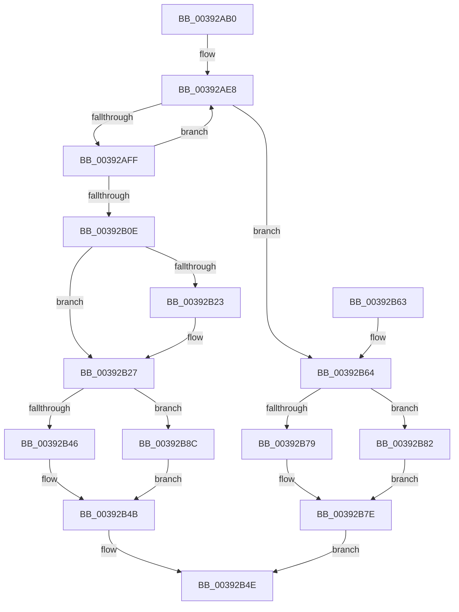

# IoCsqRemoveNextIrp

- RVA: `0x00392AB0`–`0x00392B96` (길이 `230` bytes)
- VA: `0x0000000140392AB0`
- 실행 섹션: `.text`
- PDB 이름 있음: `예`; PDB Function 태그: `아니요`
- unwind 정보 RVA: `0x00080D44`
- 디코드: `63`개 명령, `230/230` bytes 표시
- 미해석 바이트: `0` (있으면 어셈블리에 `.byte`로 보존)

> 이 문서는 커널 이미지의 기계어와 PDB 기호를 분석해 생성했습니다. 4번과 5번은 함수 원형과 자료형을 바이너리 사용 방식에서 추정한 C 해석이며 원본 소스 복구 결과는 아닙니다.

## 1. Dependencies

- 직접 호출 지점: **7**; 고유 호출 대상: **2**
- 직접 호출자로 확인된 함수: **0**
- RIP 상대 이미지 참조: **1**

### Outgoing calls
- `0x00392ADE` → [guard_dispatch_icall](../6B/guard_dispatch_icall_function_006BAAD0.md) (function, `0x006BAAD0`)
- `0x00392AEF` → [guard_dispatch_icall](../6B/guard_dispatch_icall_function_006BAAD0.md) (function, `0x006BAAD0`)
- `0x00392B12` → [guard_dispatch_icall](../6B/guard_dispatch_icall_function_006BAAD0.md) (function, `0x006BAAD0`)
- `0x00392B46` → [KeReleaseSpinLock](KeReleaseSpinLock_function_00392BA0.md) (function, `0x00392BA0`)
- `0x00392B79` → [KeReleaseSpinLock](KeReleaseSpinLock_function_00392BA0.md) (function, `0x00392BA0`)
- `0x00392B85` → [guard_dispatch_icall](../6B/guard_dispatch_icall_function_006BAAD0.md) (function, `0x006BAAD0`)
- `0x00392B8F` → [guard_dispatch_icall](../6B/guard_dispatch_icall_function_006BAAD0.md) (function, `0x006BAAD0`)

### Direct callers
- 이 함수 시작 RVA로 연결되는 직접 call은 확인되지 않았습니다. 간접 호출은 완전히 역산할 수 없습니다.

### Static image references
- `0x00392B2E` → RVA `0x00392BA0` (`KeReleaseSpinLock`; read)

## 2. Other-region calls and transfers

- 다른 실행 섹션으로 향하는 call: **0**
- 별도 외부 분기/꼬리 이동을 확인하지 못했습니다.

## 3. Assembly (complete function range)

```asm
00392AB0  48 89 5C 24 10                  mov qword ptr [rsp + 0x10], rbx
00392AB5  48 89 6C 24 18                  mov qword ptr [rsp + 0x18], rbp
00392ABA  48 89 74 24 20                  mov qword ptr [rsp + 0x20], rsi
00392ABF  57                              push rdi
00392AC0  48 83 EC 20                     sub rsp, 0x20
00392AC4  48 8B 41 20                     mov rax, qword ptr [rcx + 0x20]
00392AC8  48 8B F2                        mov rsi, rdx
00392ACB  33 ED                           xor ebp, ebp
00392ACD  C6 44 24 30 00                  mov byte ptr [rsp + 0x30], 0
00392AD2  48 8D 54 24 30                  lea rdx, [rsp + 0x30]
00392AD7  48 89 69 38                     mov qword ptr [rcx + 0x38], rbp
00392ADB  48 8B F9                        mov rdi, rcx
00392ADE  E8 ED 7F 32 00                  call 0x1406baad0
00392AE3  33 D2                           xor edx, edx
00392AE5  48 8B CF                        mov rcx, rdi
00392AE8  48 8B 47 18                     mov rax, qword ptr [rdi + 0x18]
00392AEC  4C 8B C6                        mov r8, rsi
00392AEF  E8 DC 7F 32 00                  call 0x1406baad0
00392AF4  48 8B D8                        mov rbx, rax
00392AF7  48 8B CF                        mov rcx, rdi
00392AFA  48 85 C0                        test rax, rax
00392AFD  74 65                           je 0x140392b64
00392AFF  48 8B C5                        mov rax, rbp
00392B02  48 8B D3                        mov rdx, rbx
00392B05  48 87 43 68                     xchg qword ptr [rbx + 0x68], rax
00392B09  48 85 C0                        test rax, rax
00392B0C  74 DA                           je 0x140392ae8
00392B0E  48 8B 47 10                     mov rax, qword ptr [rdi + 0x10]
00392B12  E8 B9 7F 32 00                  call 0x1406baad0
00392B17  48 8B 83 90 00 00 00            mov rax, qword ptr [rbx + 0x90]
00392B1E  83 38 01                        cmp dword ptr [rax], 1
00392B21  75 04                           jne 0x140392b27
00392B23  48 89 68 08                     mov qword ptr [rax + 8], rbp
00392B27  48 89 AB 90 00 00 00            mov qword ptr [rbx + 0x90], rbp
00392B2E  48 8D 05 6B 00 00 00            lea rax, [rip + 0x6b]
00392B35  4C 8B 47 28                     mov r8, qword ptr [rdi + 0x28]
00392B39  48 8B CF                        mov rcx, rdi
00392B3C  0F B6 54 24 30                  movzx edx, byte ptr [rsp + 0x30]
00392B41  4C 3B C0                        cmp r8, rax
00392B44  75 46                           jne 0x140392b8c
00392B46  E8 55 00 00 00                  call 0x140392ba0
00392B4B  48 8B C3                        mov rax, rbx
00392B4E  48 8B 5C 24 38                  mov rbx, qword ptr [rsp + 0x38]
00392B53  48 8B 6C 24 40                  mov rbp, qword ptr [rsp + 0x40]
00392B58  48 8B 74 24 48                  mov rsi, qword ptr [rsp + 0x48]
00392B5D  48 83 C4 20                     add rsp, 0x20
00392B61  5F                              pop rdi
00392B62  C3                              ret
00392B63  CC                              int3
00392B64  4C 8B 47 28                     mov r8, qword ptr [rdi + 0x28]
00392B68  48 8D 05 31 00 00 00            lea rax, [rip + 0x31]
00392B6F  0F B6 54 24 30                  movzx edx, byte ptr [rsp + 0x30]
00392B74  4C 3B C0                        cmp r8, rax
00392B77  75 09                           jne 0x140392b82
00392B79  E8 22 00 00 00                  call 0x140392ba0
00392B7E  33 C0                           xor eax, eax
00392B80  EB CC                           jmp 0x140392b4e
00392B82  49 8B C0                        mov rax, r8
00392B85  E8 46 7F 32 00                  call 0x1406baad0
00392B8A  EB F2                           jmp 0x140392b7e
00392B8C  49 8B C0                        mov rax, r8
00392B8F  E8 3C 7F 32 00                  call 0x1406baad0
00392B94  EB B5                           jmp 0x140392b4b
```

## 4. C-style interpretation (structured pseudocode)

```c
__int64 __fastcall IoCsqRemoveNextIrp(__int64 a1, __int64 a2)
{
    __int64 result;
    __int64 v_rbp;
    __int64 v_rsp;
    unsigned __int64 v_stack_p10;
    unsigned __int64 v_stack_p18;
    unsigned __int64 v_stack_p20;
    unsigned __int8 v_stack_p30;
    unsigned __int8 v_stack_p8;

    v_stack_p10 = v_rbx;
    v_stack_p18 = v_rbp;
    v_stack_p20 = v_rsi;
    v_rsp = (v_rsp) - (32);
    v_rbp = 0;
    v_stack_p8 = 0;
    *(unsigned __int64 *)(a1 + 56) = 0;
    result = guard_dispatch_icall(a1, v_stack_p8, a3, a4);
    a2 = 0;
loc_00392AE8:
    result = guard_dispatch_icall(a1, a2, 0, a4);
    if (result == 0) goto loc_00392B64;
    if (0 == 0) goto loc_00392AE8;
    result = guard_dispatch_icall(a1, result, 0, a4);
    if ((*(unsigned int *)(*(unsigned __int64 *)(result + 144))) == 1) {
        *(unsigned __int64 *)(*(unsigned __int64 *)(result + 144) + 8) = 0;
    }
    *(unsigned __int64 *)(result + 144) = 0;
    if ((*(unsigned __int64 *)(a1 + 40)) != (v_rip + 107)) goto loc_00392B8C;
    result = KeReleaseSpinLock(a1, v_stack_p8, *(unsigned __int64 *)(a1 + 40), a4);
loc_00392B4B:
loc_00392B4E:
    v_rsp = (v_rsp) + (32);
    return result;
loc_00392B64:
    if ((*(unsigned __int64 *)(a1 + 40)) != (v_rip + 49)) goto loc_00392B82;
    result = KeReleaseSpinLock(a1, v_stack_p30, *(unsigned __int64 *)(a1 + 40), a4);
loc_00392B7E:
    result = 0;
    goto loc_00392B4E;
loc_00392B82:
    result = guard_dispatch_icall(a1, v_stack_p30, *(unsigned __int64 *)(a1 + 40), a4);
    goto loc_00392B7E;
loc_00392B8C:
    result = guard_dispatch_icall(a1, v_stack_p30, *(unsigned __int64 *)(a1 + 40), a4);
    goto loc_00392B4B;
}
```

## 5. (Beta) C Style

```c
int64_t IoCsqRemoveNextIrp(void *Arg1, int64_t Arg2)
{
    uint8_t *arg1 = (uint8_t *)Arg1;

    int64_t result;
    int64_t local_rbp;
    int64_t local_rsp;
    uint64_t v_stack_p10;
    uint64_t v_stack_p18;
    uint64_t v_stack_p20;
    uint8_t v_stack_p30;
    uint8_t v_stack_p8;

    v_stack_p10 = local_rbx;
    v_stack_p18 = local_rbp;
    v_stack_p20 = local_rsi;
    local_rsp = (local_rsp) - (32);
    local_rbp = 0;
    v_stack_p8 = 0;
    *(uint64_t *)(arg1 + 0x38) = 0;
    result = guard_dispatch_icall(Arg1, v_stack_p8, a3, a4);
    Arg2 = 0;
loc_00392AE8:
    result = guard_dispatch_icall(Arg1, Arg2, 0, a4);
    if (result == 0) goto loc_00392B64;
    if (0 == 0) goto loc_00392AE8;
    result = guard_dispatch_icall(Arg1, result, 0, a4);
    if ((*(uint32_t *)(*(uint64_t *)(result + 0x90))) == 1) {
        *(uint64_t *)(*(uint64_t *)(result + 0x90) + 0x8) = 0;
    }
    *(uint64_t *)(result + 0x90) = 0;
    if ((*(uint64_t *)(arg1 + 0x28)) != (v_rip + 107)) goto loc_00392B8C;
    result = KeReleaseSpinLock(Arg1, v_stack_p8, *(uint64_t *)(arg1 + 0x28), a4);
loc_00392B4B:
loc_00392B4E:
    local_rsp = (local_rsp) + (32);
    return result;
loc_00392B64:
    if ((*(uint64_t *)(arg1 + 0x28)) != (v_rip + 49)) goto loc_00392B82;
    result = KeReleaseSpinLock(Arg1, v_stack_p30, *(uint64_t *)(arg1 + 0x28), a4);
loc_00392B7E:
    result = 0;
    goto loc_00392B4E;
loc_00392B82:
    result = guard_dispatch_icall(Arg1, v_stack_p30, *(uint64_t *)(arg1 + 0x28), a4);
    goto loc_00392B7E;
loc_00392B8C:
    result = guard_dispatch_icall(Arg1, v_stack_p30, *(uint64_t *)(arg1 + 0x28), a4);
    goto loc_00392B4B;
}
```

### 관측된 메모리 오프셋

구조체 형식이 확인되지 않은 접근은 인자 기준의 오프셋으로만 기록했습니다.

| 기준 인자 | 오프셋 표현 | 폭 (bit) | 접근 |
|---|---:|---:|---|
| `Arg1` | `+ 0x10` | `64` | `R` |
| `Arg1` | `+ 0x18` | `64` | `R` |
| `Arg1` | `+ 0x20` | `64` | `R` |
| `Arg1` | `+ 0x28` | `64` | `R` |
| `Arg1` | `+ 0x38` | `64` | `W` |

## 6. Execution-region graph

[열기: 2D/3D 그래프와 함수 탐색 컨트롤 패널](../../../control-panel.html?section=text&rva=0x00392AB0&view=graph)

- 2D 그래프는 위에서 아래로 흐르고, 3D 그래프는 빈 공간을 드래그해 회전합니다. Shift+드래그는 이동, 휠은 확대·축소, 함수 노드 선택은 대상 보고서 이동입니다.

### Static fallback


