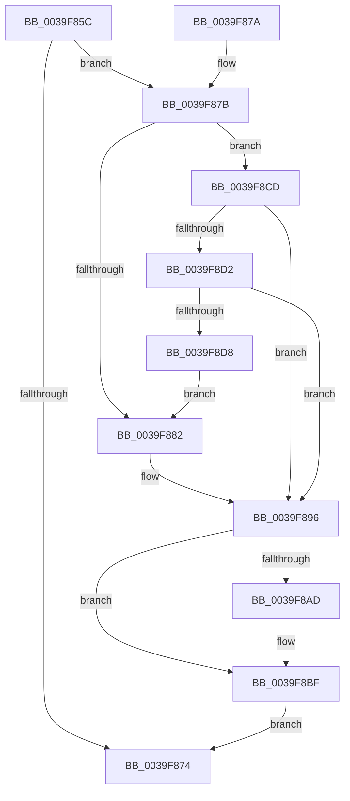

# IoProcessPassiveInterrupts

- RVA: `0x0039F85C`–`0x0039F8DA` (길이 `126` bytes)
- VA: `0x000000014039F85C`
- 실행 섹션: `.text`
- PDB 이름 있음: `예`; PDB Function 태그: `아니요`
- unwind 정보 RVA: `0x00075F7C`
- 디코드: `38`개 명령, `126/126` bytes 표시
- 미해석 바이트: `0` (있으면 어셈블리에 `.byte`로 보존)

> 이 문서는 커널 이미지의 기계어와 PDB 기호를 분석해 생성했습니다. 4번과 5번은 함수 원형과 자료형을 바이너리 사용 방식에서 추정한 C 해석이며 원본 소스 복구 결과는 아닙니다.

## 1. Dependencies

- 직접 호출 지점: **5**; 고유 호출 대상: **5**
- 직접 호출자로 확인된 함수: **2**
- RIP 상대 이미지 참조: **1**

### Outgoing calls
- `0x0039F867` → [IopFindPassiveInterruptBlock](../45/IopFindPassiveInterruptBlock_function_0045F4BC.md) (function, `0x0045F4BC`)
- `0x0039F891` → [guard_dispatch_icall](../6B/guard_dispatch_icall_function_006BAAD0.md) (function, `0x006BAAD0`)
- `0x0039F89E` → [IopAcquirePassiveInterruptBlockLock](../45/IopAcquirePassiveInterruptBlockLock_function_0045F6B0.md) (function, `0x0045F6B0`)
- `0x0039F8BA` → [KeInsertQueueDpc](../20/KeInsertQueueDpc_function_00207C50.md) (function, `0x00207C50`)
- `0x0039F8C6` → [IopReleasePassiveInterruptBlockLock](../45/IopReleasePassiveInterruptBlockLock_function_0045F62C.md) (function, `0x0045F62C`)

### Direct callers
- [KiInterruptDispatchCommon](KiInterruptDispatchCommon_function_0039F3D0.md) at `0x0039F69C`
- [KiDispatchPassiveInterrupts](../4C/KiDispatchPassiveInterrupts_function_004C7610.md) at `0x004C7635`

### Static image references
- `0x0039F882` → RVA `0x00E009D0` (`.data`; read)

## 2. Other-region calls and transfers

- 다른 실행 섹션으로 향하는 call: **0**
- 별도 외부 분기/꼬리 이동을 확인하지 못했습니다.

## 3. Assembly (complete function range)

```asm
0039F85C  40 53                           push rbx
0039F85E  48 83 EC 20                     sub rsp, 0x20
0039F862  C6 44 24 38 00                  mov byte ptr [rsp + 0x38], 0
0039F867  E8 50 FC 0B 00                  call 0x14045f4bc
0039F86C  48 8B D8                        mov rbx, rax
0039F86F  48 85 C0                        test rax, rax
0039F872  75 07                           jne 0x14039f87b
0039F874  48 83 C4 20                     add rsp, 0x20
0039F878  5B                              pop rbx
0039F879  C3                              ret
0039F87A  CC                              int3
0039F87B  8B 40 20                        mov eax, dword ptr [rax + 0x20]
0039F87E  85 C0                           test eax, eax
0039F880  75 4B                           jne 0x14039f8cd
0039F882  48 8B 05 47 11 A6 00            mov rax, qword ptr [rip + 0xa61147]
0039F889  BA 01 00 00 00                  mov edx, 1
0039F88E  8B 4B 18                        mov ecx, dword ptr [rbx + 0x18]
0039F891  E8 3A B2 31 00                  call 0x1406baad0
0039F896  48 8D 54 24 38                  lea rdx, [rsp + 0x38]
0039F89B  48 8B CB                        mov rcx, rbx
0039F89E  E8 0D FE 0B 00                  call 0x14045f6b0
0039F8A3  80 7B 40 00                     cmp byte ptr [rbx + 0x40], 0
0039F8A7  C6 43 41 01                     mov byte ptr [rbx + 0x41], 1
0039F8AB  75 12                           jne 0x14039f8bf
0039F8AD  48 8D 4B 68                     lea rcx, [rbx + 0x68]
0039F8B1  C6 43 40 01                     mov byte ptr [rbx + 0x40], 1
0039F8B5  45 33 C0                        xor r8d, r8d
0039F8B8  33 D2                           xor edx, edx
0039F8BA  E8 91 83 E6 FF                  call 0x140207c50
0039F8BF  8A 54 24 38                     mov dl, byte ptr [rsp + 0x38]
0039F8C3  48 8B CB                        mov rcx, rbx
0039F8C6  E8 61 FD 0B 00                  call 0x14045f62c
0039F8CB  EB A7                           jmp 0x14039f874
0039F8CD  83 F8 01                        cmp eax, 1
0039F8D0  75 C4                           jne 0x14039f896
0039F8D2  80 7B 1C 00                     cmp byte ptr [rbx + 0x1c], 0
0039F8D6  75 BE                           jne 0x14039f896
0039F8D8  EB A8                           jmp 0x14039f882
```

## 4. C-style interpretation (structured pseudocode)

```c
__int64 __fastcall IoProcessPassiveInterrupts(__int64 a1, __int64 a2, int a3)
{
    __int64 result;
    __int64 v_rsp;
    unsigned __int8 v_stack_p10;
    unsigned __int64 v_stack_p38;

    v_rsp = (v_rsp) - (32);
    v_stack_p10 = 0;
    result = IopFindPassiveInterruptBlock(a1, a2, a3, a4);
    if (result != 0) goto loc_0039F87B;
loc_0039F874:
    v_rsp = (v_rsp) + (32);
    return result;
loc_0039F87B:
    if ((unsigned int)((unsigned int)(*(unsigned int *)(result + 32))) != 0) goto loc_0039F8CD;
loc_0039F882:
    result = guard_dispatch_icall((unsigned int)(*(unsigned int *)(result + 24)), 1, a3, a4);
loc_0039F896:
    result = IopAcquirePassiveInterruptBlockLock(result, v_stack_p38, a3, a4);
    *(unsigned __int8 *)(result + 65) = 1;
    if ((*(unsigned __int8 *)(result + 64)) == 0) {
        a1 = result + 104;
        *(unsigned __int8 *)(result + 64) = 1;
        a3 = 0;
        a2 = 0;
        result = KeInsertQueueDpc(a1, a2, a3, a4);
    }
    result = IopReleasePassiveInterruptBlockLock(result, v_stack_p38, a3, a4);
    goto loc_0039F874;
loc_0039F8CD:
    if (((unsigned int)(result)) != 1) goto loc_0039F896;
    if ((*(unsigned __int8 *)(result + 28)) != 0) goto loc_0039F896;
    goto loc_0039F882;
}
```

## 5. (Beta) C Style

```c
int64_t IoProcessPassiveInterrupts(int64_t Arg1, int64_t Arg2, int32_t Arg3)
{
    int64_t result;
    int64_t local_rsp;
    uint8_t v_stack_p10;
    uint64_t v_stack_p38;

    local_rsp = (local_rsp) - (32);
    v_stack_p10 = 0;
    result = IopFindPassiveInterruptBlock(Arg1, Arg2, Arg3, a4);
    if (result != 0) goto loc_0039F87B;
loc_0039F874:
    local_rsp = (local_rsp) + (32);
    return result;
loc_0039F87B:
    if ((uint32_t)((uint32_t)(*(uint32_t *)(result + 0x20))) != 0) goto loc_0039F8CD;
loc_0039F882:
    result = guard_dispatch_icall((uint32_t)(*(uint32_t *)(result + 0x18)), 1, Arg3, a4);
loc_0039F896:
    result = IopAcquirePassiveInterruptBlockLock(result, v_stack_p38, Arg3, a4);
    *(uint8_t *)(result + 0x41) = 1;
    if ((*(uint8_t *)(result + 0x40)) == 0) {
        Arg1 = result + 104;
        *(uint8_t *)(result + 0x40) = 1;
        Arg3 = 0;
        Arg2 = 0;
        result = KeInsertQueueDpc(Arg1, Arg2, Arg3, a4);
    }
    result = IopReleasePassiveInterruptBlockLock(result, v_stack_p38, Arg3, a4);
    goto loc_0039F874;
loc_0039F8CD:
    if (((uint32_t)(result)) != 1) goto loc_0039F896;
    if ((*(uint8_t *)(result + 0x1C)) != 0) goto loc_0039F896;
    goto loc_0039F882;
}
```

## 6. Execution-region graph

[열기: 2D/3D 그래프와 함수 탐색 컨트롤 패널](../../../control-panel.html?section=text&rva=0x0039F85C&view=graph)

- 2D 그래프는 위에서 아래로 흐르고, 3D 그래프는 빈 공간을 드래그해 회전합니다. Shift+드래그는 이동, 휠은 확대·축소, 함수 노드 선택은 대상 보고서 이동입니다.

### Static fallback


