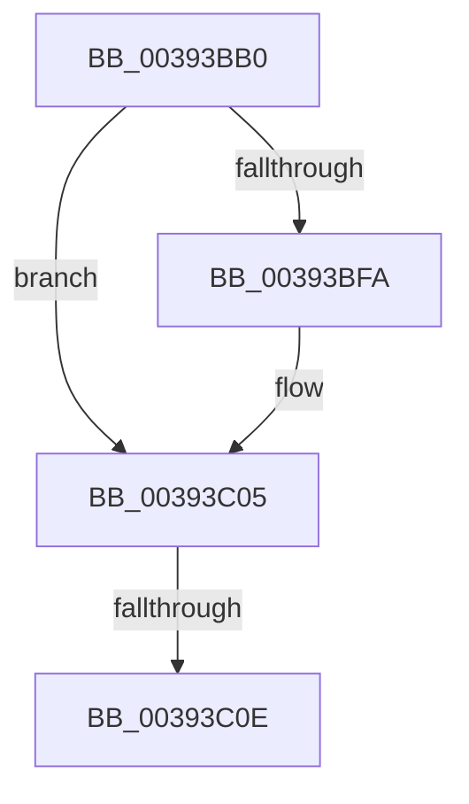

# IopProcessWorkItem

- RVA: `0x00393BB0`–`0x00393C19` (길이 `105` bytes)
- VA: `0x0000000140393BB0`
- 실행 섹션: `.text`
- PDB 이름 있음: `예`; PDB Function 태그: `아니요`
- unwind 정보 RVA: `0x00080ED0`
- 디코드: `27`개 명령, `105/105` bytes 표시
- 미해석 바이트: `0` (있으면 어셈블리에 `.byte`로 보존)

> 이 문서는 커널 이미지의 기계어와 PDB 기호를 분석해 생성했습니다. 4번과 5번은 함수 원형과 자료형을 바이너리 사용 방식에서 추정한 C 해석이며 원본 소스 복구 결과는 아닙니다.

## 1. Dependencies

- 직접 호출 지점: **0**; 고유 호출 대상: **0**
- 직접 호출자로 확인된 함수: **0**
- RIP 상대 이미지 참조: **3**

### Outgoing calls
- 직접 디코드된 call 명령이 없습니다.

### Direct callers
- 이 함수 시작 RVA로 연결되는 직접 call은 확인되지 않았습니다. 간접 호출은 완전히 역산할 수 없습니다.

### Static image references
- `0x00393BC0` → RVA `0x00E0A740` (`.data`; read)
- `0x00393BDC` → RVA `0x000112D0` (`.rdata`; read)
- `0x00393BFA` → RVA `0x000112D8` (`.rdata`; read)

## 2. Other-region calls and transfers

- 다른 실행 섹션으로 향하는 call: **0**
- call이 아닌 외부 분기/꼬리 이동: **1**
  - `0x00393C08` → [sub_003941C4](Unknown_function_003941C4.md) (`tail-transfer`)

## 3. Assembly (complete function range)

```asm
00393BB0  48 89 5C 24 20                  mov qword ptr [rsp + 0x20], rbx
00393BB5  55                              push rbp
00393BB6  56                              push rsi
00393BB7  57                              push rdi
00393BB8  41 54                           push r12
00393BBA  41 57                           push r15
00393BBC  48 83 EC 60                     sub rsp, 0x60
00393BC0  48 8B 05 79 6B A7 00            mov rax, qword ptr [rip + 0xa76b79]
00393BC7  48 33 C4                        xor rax, rsp
00393BCA  48 89 44 24 50                  mov qword ptr [rsp + 0x50], rax
00393BCF  4C 8B 61 20                     mov r12, qword ptr [rcx + 0x20]
00393BD3  48 8B D9                        mov rbx, rcx
00393BD6  4C 8B 79 28                     mov r15, qword ptr [rcx + 0x28]
00393BDA  33 ED                           xor ebp, ebp
00393BDC  48 8B 0D ED D6 C7 FF            mov rcx, qword ptr [rip - 0x382913]
00393BE3  0F 57 C0                        xorps xmm0, xmm0
00393BE6  89 6C 24 30                     mov dword ptr [rsp + 0x30], ebp
00393BEA  0F 11 44 24 40                  movups xmmword ptr [rsp + 0x40], xmm0
00393BEF  4C 89 64 24 38                  mov qword ptr [rsp + 0x38], r12
00393BF4  48 2B 4B 44                     sub rcx, qword ptr [rbx + 0x44]
00393BF8  75 0B                           jne 0x140393c05
00393BFA  48 8B 0D D7 D6 C7 FF            mov rcx, qword ptr [rip - 0x382929]
00393C01  48 2B 4B 4C                     sub rcx, qword ptr [rbx + 0x4c]
00393C05  48 85 C9                        test rcx, rcx
00393C08  0F 85 B6 05 00 00               jne 0x1403941c4
00393C0E  48 8B 73 38                     mov rsi, qword ptr [rbx + 0x38]
00393C12  48 C7 C7 FF FF FF FF            mov rdi, 0xffffffffffffffff
```

## 4. C-style interpretation (structured pseudocode)

```c
__int64 __fastcall IopProcessWorkItem(__int64 a1)
{
    __int64 result;
    __int64 v_rbp;
    __int64 v_rsp;
    unsigned __int64 v_stack_m38;
    unsigned __int64 v_stack_m48;
    unsigned __int64 v_stack_m50;
    unsigned int v_stack_m58;
    unsigned __int64 v_stack_p20;

    v_stack_p20 = v_rbx;
    v_rsp = (v_rsp) - (96);
    result = (*(unsigned __int64 *)(v_rip + 10972025)) ^ (v_rsp);
    v_stack_m38 = result;
    v_rbp = 0;
    v_stack_m58 = 0;
    v_stack_m48 = v_xmm0;
    v_stack_m50 = *(unsigned __int64 *)(a1 + 32);
    a1 = (*(unsigned __int64 *)(v_rip - 3680531)) - (*(unsigned __int64 *)(a1 + 68));
    if (!(condition_is_not_equal)) {
        a1 = *(unsigned __int64 *)(v_rip - 3680553);
        a1 = (a1) - (*(unsigned __int64 *)(a1 + 76));
    }
    return result;
}
```

## 5. (Beta) C Style

```c
int64_t IopProcessWorkItem(void *Arg1)
{
    uint8_t *arg1 = (uint8_t *)Arg1;

    int64_t result;
    int64_t local_rbp;
    int64_t local_rsp;
    uint64_t v_stack_m38;
    uint64_t v_stack_m48;
    uint64_t v_stack_m50;
    uint32_t v_stack_m58;
    uint64_t v_stack_p20;

    v_stack_p20 = local_rbx;
    local_rsp = (local_rsp) - (96);
    result = (*(uint64_t *)(v_rip + 0xA76B79)) ^ (local_rsp);
    v_stack_m38 = result;
    local_rbp = 0;
    v_stack_m58 = 0;
    v_stack_m48 = v_xmm0;
    v_stack_m50 = *(uint64_t *)(arg1 + 0x20);
    Arg1 = (*(uint64_t *)(v_rip - 0x382913)) - (*(uint64_t *)(arg1 + 0x44));
    if (!(condition_is_not_equal)) {
        Arg1 = *(uint64_t *)(v_rip - 0x382929);
        Arg1 = (Arg1) - (*(uint64_t *)(arg1 + 0x4C));
    }
    return result;
}
```

### 관측된 메모리 오프셋

구조체 형식이 확인되지 않은 접근은 인자 기준의 오프셋으로만 기록했습니다.

| 기준 인자 | 오프셋 표현 | 폭 (bit) | 접근 |
|---|---:|---:|---|
| `Arg1` | `+ 0x20` | `64` | `R` |
| `Arg1` | `+ 0x28` | `64` | `R` |
| `Arg1` | `+ 0x38` | `64` | `R` |
| `Arg1` | `+ 0x44` | `64` | `R` |
| `Arg1` | `+ 0x4C` | `64` | `R` |

## 6. Execution-region graph

[열기: 2D/3D 그래프와 함수 탐색 컨트롤 패널](../../../control-panel.html?section=text&rva=0x00393BB0&view=graph)

- 2D 그래프는 위에서 아래로 흐르고, 3D 그래프는 빈 공간을 드래그해 회전합니다. Shift+드래그는 이동, 휠은 확대·축소, 함수 노드 선택은 대상 보고서 이동입니다.

### Static fallback


