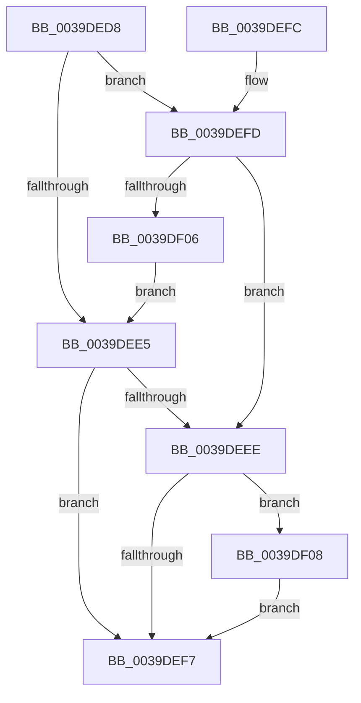

# KdCheckForDebugBreak

- RVA: `0x0039DED8`–`0x0039DF14` (길이 `60` bytes)
- VA: `0x000000014039DED8`
- 실행 섹션: `.text`
- PDB 이름 있음: `예`; PDB Function 태그: `아니요`
- unwind 정보 RVA: `0x0006DBD4`
- 디코드: `17`개 명령, `60/60` bytes 표시
- 미해석 바이트: `0` (있으면 어셈블리에 `.byte`로 보존)

> 이 문서는 커널 이미지의 기계어와 PDB 기호를 분석해 생성했습니다. 4번과 5번은 함수 원형과 자료형을 바이너리 사용 방식에서 추정한 C 해석이며 원본 소스 복구 결과는 아닙니다.

## 1. Dependencies

- 직접 호출 지점: **2**; 고유 호출 대상: **2**
- 직접 호출자로 확인된 함수: **3**
- RIP 상대 이미지 참조: **3**

### Outgoing calls
- `0x0039DEEE` → [KdPollBreakIn](KdPollBreakIn_function_0039CE80.md) (function, `0x0039CE80`)
- `0x0039DF0D` → [DbgBreakPointWithStatus](../4F/DbgBreakPointWithStatus_function_004FE4E0.md) (function, `0x004FE4E0`)

### Direct callers
- [MiWalkPageTablesRecursivelyNoSynch](../2C/MiWalkPageTablesRecursivelyNoSynch_function_002C2A28.md) at `0x002C2A8F`
- [IoWriteCrashDump](../59/IoWriteCrashDump_function_005936D8.md) at `0x0059373F`
- [PopHiberCheckForDebugBreak](../../pagelk/B7/PopHiberCheckForDebugBreak_function_00B78258.md) at `0x00B78283`

### Static image references
- `0x0039DEDC` → RVA `0x00E0AA1C` (`.data`; read)
- `0x0039DEE5` → RVA `0x00F59CC8` (`.data`; read)
- `0x0039DEFD` → RVA `0x00F475F8` (`.data`; read)

## 2. Other-region calls and transfers

- 다른 실행 섹션으로 향하는 call: **0**
- 별도 외부 분기/꼬리 이동을 확인하지 못했습니다.

## 3. Assembly (complete function range)

```asm
0039DED8  48 83 EC 28                     sub rsp, 0x28
0039DEDC  80 3D 39 CB A6 00 00            cmp byte ptr [rip + 0xa6cb39], 0
0039DEE3  74 18                           je 0x14039defd
0039DEE5  80 3D DC BD BB 00 00            cmp byte ptr [rip + 0xbbbddc], 0
0039DEEC  74 09                           je 0x14039def7
0039DEEE  E8 8D EF FF FF                  call 0x14039ce80
0039DEF3  84 C0                           test al, al
0039DEF5  75 11                           jne 0x14039df08
0039DEF7  48 83 C4 28                     add rsp, 0x28
0039DEFB  C3                              ret
0039DEFC  CC                              int3
0039DEFD  80 3D F4 96 BA 00 00            cmp byte ptr [rip + 0xba96f4], 0
0039DF04  75 E8                           jne 0x14039deee
0039DF06  EB DD                           jmp 0x14039dee5
0039DF08  B9 01 00 00 00                  mov ecx, 1
0039DF0D  E8 CE 05 16 00                  call 0x1404fe4e0
0039DF12  EB E3                           jmp 0x14039def7
```

## 4. C-style interpretation (structured pseudocode)

```c
__int64 __fastcall KdCheckForDebugBreak(void)
{
    __int64 result;
    __int64 v_rsp;

    v_rsp = (v_rsp) - (40);
    if ((*(unsigned __int8 *)(v_rip + 10931001)) == 0) goto loc_0039DEFD;
loc_0039DEE5:
    if ((*(unsigned __int8 *)(v_rip + 12303836)) == 0) goto loc_0039DEF7;
loc_0039DEEE:
    result = KdPollBreakIn(a1, a2, a3, a4);
    if ((unsigned __int8)(result) != 0) goto loc_0039DF08;
loc_0039DEF7:
    v_rsp = (v_rsp) + (40);
    return result;
loc_0039DEFD:
    if ((*(unsigned __int8 *)(v_rip + 12228340)) != 0) goto loc_0039DEEE;
    goto loc_0039DEE5;
loc_0039DF08:
    result = DbgBreakPointWithStatus(1, a2, a3, a4);
    goto loc_0039DEF7;
}
```

## 5. (Beta) C Style

```c
void KdCheckForDebugBreak(void)
{
    int64_t result;
    int64_t local_rsp;

    local_rsp = (local_rsp) - (40);
    if ((*(uint8_t *)(v_rip + 0xA6CB39)) == 0) goto loc_0039DEFD;
loc_0039DEE5:
    if ((*(uint8_t *)(v_rip + 0xBBBDDC)) == 0) goto loc_0039DEF7;
loc_0039DEEE:
    result = KdPollBreakIn(a1, a2, a3, a4);
    if ((uint8_t)(result) != 0) goto loc_0039DF08;
loc_0039DEF7:
    local_rsp = (local_rsp) + (40);
    return result;
loc_0039DEFD:
    if ((*(uint8_t *)(v_rip + 0xBA96F4)) != 0) goto loc_0039DEEE;
    goto loc_0039DEE5;
loc_0039DF08:
    result = DbgBreakPointWithStatus(1, a2, a3, a4);
    goto loc_0039DEF7;
}
```

## 6. Execution-region graph

[열기: 2D/3D 그래프와 함수 탐색 컨트롤 패널](../../../control-panel.html?section=text&rva=0x0039DED8&view=graph)

- 2D 그래프는 위에서 아래로 흐르고, 3D 그래프는 빈 공간을 드래그해 회전합니다. Shift+드래그는 이동, 휠은 확대·축소, 함수 노드 선택은 대상 보고서 이동입니다.

### Static fallback


