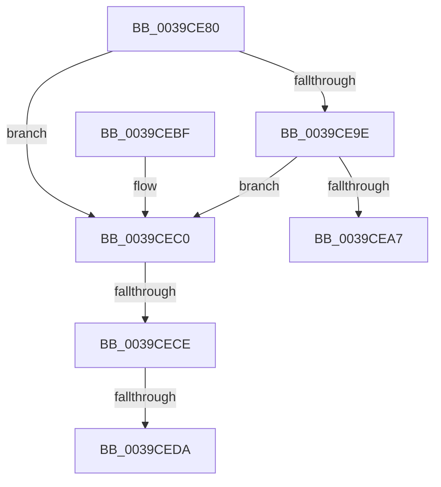

# KdPollBreakIn

- RVA: `0x0039CE80`–`0x0039CEDF` (길이 `95` bytes)
- VA: `0x000000014039CE80`
- 실행 섹션: `.text`
- PDB 이름 있음: `예`; PDB Function 태그: `예`
- unwind 정보 RVA: `0x00081A0C`
- 디코드: `23`개 명령, `95/95` bytes 표시
- 미해석 바이트: `0` (있으면 어셈블리에 `.byte`로 보존)

> 이 문서는 커널 이미지의 기계어와 PDB 기호를 분석해 생성했습니다. 4번과 5번은 함수 원형과 자료형을 바이너리 사용 방식에서 추정한 C 해석이며 원본 소스 복구 결과는 아닙니다.

## 1. Dependencies

- 직접 호출 지점: **0**; 고유 호출 대상: **0**
- 직접 호출자로 확인된 함수: **3**
- RIP 상대 이미지 참조: **3**

### Outgoing calls
- 직접 디코드된 call 명령이 없습니다.

### Direct callers
- [KeAccumulateTicks](KeAccumulateTicks_function_0039C140.md) at `0x0039C24B`
- [KdCheckForDebugBreak](KdCheckForDebugBreak_function_0039DED8.md) at `0x0039DEEE`
- [KdInitSystem](../../pagekd/B8/KdInitSystem_function_00B85E30.md) at `0x00B864BD`

### Static image references
- `0x0039CE95` → RVA `0x00E0AA1C` (`.data`; read)
- `0x0039CE9E` → RVA `0x00F59CC8` (`.data`; read)
- `0x0039CEC2` → RVA `0x00F475F8` (`.data`; read)

## 2. Other-region calls and transfers

- 다른 실행 섹션으로 향하는 call: **0**
- call이 아닌 외부 분기/꼬리 이동: **3**
  - `0x0039CEC8` → [sub_006E5E2E](../6E/Unknown_function_006E5E2E.md) (`tail-transfer`)
  - `0x0039CED4` → [sub_006E5E2E](../6E/Unknown_function_006E5E2E.md) (`tail-transfer`)
  - `0x0039CEDA` → [sub_006E5E2E + 0x140](../6E/Unknown_function_006E5E2E.md) (`tail-transfer`)

## 3. Assembly (complete function range)

```asm
0039CE80  48 89 5C 24 08                  mov qword ptr [rsp + 8], rbx
0039CE85  48 89 74 24 10                  mov qword ptr [rsp + 0x10], rsi
0039CE8A  48 89 7C 24 18                  mov qword ptr [rsp + 0x18], rdi
0039CE8F  41 56                           push r14
0039CE91  48 83 EC 30                     sub rsp, 0x30
0039CE95  80 3D 80 DB A6 00 00            cmp byte ptr [rip + 0xa6db80], 0
0039CE9C  74 22                           je 0x14039cec0
0039CE9E  80 3D 23 CE BB 00 00            cmp byte ptr [rip + 0xbbce23], 0
0039CEA5  75 19                           jne 0x14039cec0
0039CEA7  32 C0                           xor al, al
0039CEA9  48 8B 5C 24 40                  mov rbx, qword ptr [rsp + 0x40]
0039CEAE  48 8B 74 24 48                  mov rsi, qword ptr [rsp + 0x48]
0039CEB3  48 8B 7C 24 50                  mov rdi, qword ptr [rsp + 0x50]
0039CEB8  48 83 C4 30                     add rsp, 0x30
0039CEBC  41 5E                           pop r14
0039CEBE  C3                              ret
0039CEBF  CC                              int3
0039CEC0  32 DB                           xor bl, bl
0039CEC2  38 1D 30 A7 BA 00               cmp byte ptr [rip + 0xbaa730], bl
0039CEC8  0F 85 60 8F 34 00               jne 0x1406e5e2e
0039CECE  38 1D F4 CD BB 00               cmp byte ptr [rip + 0xbbcdf4], bl
0039CED4  0F 85 54 8F 34 00               jne 0x1406e5e2e
0039CEDA  E9 8F 90 34 00                  jmp 0x1406e5f6e
```

## 4. C-style interpretation (structured pseudocode)

```c
__int64 __fastcall KdPollBreakIn(void)
{
    __int64 result;
    __int64 v_rbx;
    __int64 v_rsp;
    unsigned __int64 v_stack_p10;
    unsigned __int64 v_stack_p18;
    unsigned __int64 v_stack_p8;

    v_stack_p8 = v_rbx;
    v_stack_p10 = v_rsi;
    v_stack_p18 = v_rdi;
    v_rsp = (v_rsp) - (48);
    if ((*(unsigned __int8 *)(v_rip + 10935168)) == 0) goto loc_0039CEC0;
    if ((*(unsigned __int8 *)(v_rip + 12308003)) != 0) goto loc_0039CEC0;
    result = 0;
    v_rsp = (v_rsp) + (48);
    return result;
loc_0039CEC0:
    v_rbx = 0;
}
```

## 5. (Beta) C Style

```c
void KdPollBreakIn(void)
{
    int64_t result;
    int64_t local_rbx;
    int64_t local_rsp;
    uint64_t v_stack_p10;
    uint64_t v_stack_p18;
    uint64_t v_stack_p8;

    v_stack_p8 = local_rbx;
    v_stack_p10 = local_rsi;
    v_stack_p18 = local_rdi;
    local_rsp = (local_rsp) - (48);
    if ((*(uint8_t *)(v_rip + 0xA6DB80)) == 0) goto loc_0039CEC0;
    if ((*(uint8_t *)(v_rip + 0xBBCE23)) != 0) goto loc_0039CEC0;
    result = 0;
    local_rsp = (local_rsp) + (48);
    return result;
loc_0039CEC0:
    local_rbx = 0;
}
```

## 6. Execution-region graph

[열기: 2D/3D 그래프와 함수 탐색 컨트롤 패널](../../../control-panel.html?section=text&rva=0x0039CE80&view=graph)

- 2D 그래프는 위에서 아래로 흐르고, 3D 그래프는 빈 공간을 드래그해 회전합니다. Shift+드래그는 이동, 휠은 확대·축소, 함수 노드 선택은 대상 보고서 이동입니다.

### Static fallback


