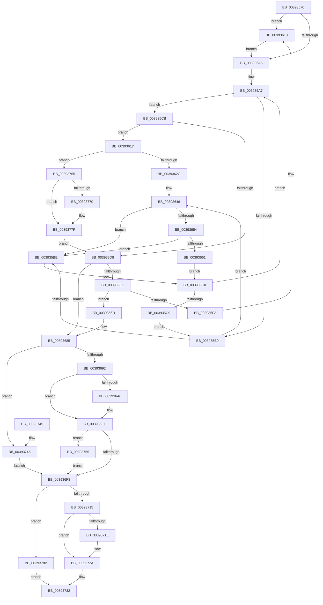

# KeAdjustWobPriority

- RVA: `0x00393570`–`0x003937A3` (길이 `563` bytes)
- VA: `0x0000000140393570`
- 실행 섹션: `.text`
- PDB 이름 있음: `예`; PDB Function 태그: `아니요`
- unwind 정보 RVA: `0x00080E80`
- 디코드: `144`개 명령, `563/563` bytes 표시
- 미해석 바이트: `0` (있으면 어셈블리에 `.byte`로 보존)

> 이 문서는 커널 이미지의 기계어와 PDB 기호를 분석해 생성했습니다. 4번과 5번은 함수 원형과 자료형을 바이너리 사용 방식에서 추정한 C 해석이며 원본 소스 복구 결과는 아닙니다.

## 1. Dependencies

- 직접 호출 지점: **10**; 고유 호출 대상: **9**
- 직접 호출자로 확인된 함수: **2**
- RIP 상대 이미지 참조: **3**

### Outgoing calls
- `0x0039360A` → [KeBugCheckEx](../4F/KeBugCheckEx_function_004FD660.md) (function, `0x004FD660`)
- `0x00393616` → [KiRaiseIrqlProcessIrqlFlags](../4F/KiRaiseIrqlProcessIrqlFlags_function_004F56FC.md) (function, `0x004F56FC`)
- `0x00393640` → [KeBugCheckEx](../4F/KeBugCheckEx_function_004FD660.md) (function, `0x004FD660`)
- `0x00393654` → [KiCheckVpBackingLongSpinWaitHypercall](../30/KiCheckVpBackingLongSpinWaitHypercall_function_0030F490.md) (function, `0x0030F490`)
- `0x00393663` → [HvlNotifyLongSpinWait](../30/HvlNotifyLongSpinWait_function_0030F460.md) (function, `0x0030F460`)
- `0x00393685` → [Feature_StackingDecayBoosts__private_IsEnabledNoReportingNoInline](../4E/Feature_StackingDecayBoosts__private_IsEnabledNoReportingNoInline_function_004EF7C0.md) (function, `0x004EF7C0`)
- `0x00393700` → [KiSetPriorityThread](../22/KiSetPriorityThread_function_00220E78.md) (function, `0x00220E78`)
- `0x00393725` → [KiLowerIrqlProcessIrqlFlags](../4F/KiLowerIrqlProcessIrqlFlags_function_004F5698.md) (function, `0x004F5698`)
- `0x0039374B` → [KiComputeThreadPriorityNonStacking](../5C/KiComputeThreadPriorityNonStacking_function_005CA81C.md) (function, `0x005CA81C`)
- `0x0039379C` → [KiProcessDeferredReadyList](../25/KiProcessDeferredReadyList_function_00250800.md) (function, `0x00250800`)

### Direct callers
- [PspUpdateContainerImpersonation](PspUpdateContainerImpersonation_function_003931EC.md) at `0x0039325E`
- [sub_00393D34](Unknown_function_00393D34.md) at `0x00393D86`

### Static image references
- `0x0039359C` → RVA `0x00FC6D20` (`ALMOSTRO`; read)
- `0x003935B2` → RVA `0x00FC52AC` (`ALMOSTRO`; reference)
- `0x00393646` → RVA `0x00FC6AB8` (`ALMOSTRO`; read)

## 2. Other-region calls and transfers

- 다른 실행 섹션으로 향하는 call: **0**
- 별도 외부 분기/꼬리 이동을 확인하지 못했습니다.

## 3. Assembly (complete function range)

```asm
00393570  48 89 5C 24 10                  mov qword ptr [rsp + 0x10], rbx
00393575  48 89 6C 24 20                  mov qword ptr [rsp + 0x20], rbp
0039357A  56                              push rsi
0039357B  57                              push rdi
0039357C  41 54                           push r12
0039357E  48 83 EC 30                     sub rsp, 0x30
00393582  48 83 64 24 60 00               and qword ptr [rsp + 0x60], 0
00393588  48 8B D9                        mov rbx, rcx
0039358B  48 63 EA                        movsxd rbp, edx
0039358E  44 0F 20 C6                     mov rsi, cr8
00393592  41 BC 02 00 00 00               mov r12d, 2
00393598  45 0F 22 C4                     mov cr8, r12
0039359C  83 3D 7D 37 C3 00 00            cmp dword ptr [rip + 0xc3377d], 0
003935A3  75 6B                           jne 0x140393610
003935A5  33 FF                           xor edi, edi
003935A7  F0 48 0F BA 6B 40 00            lock bts qword ptr [rbx + 0x40], 0
003935AE  73 1B                           jae 0x1403935cb
003935B0  FF C7                           inc edi
003935B2  85 3D F4 1C C3 00               test dword ptr [rip + 0xc31cf4], edi
003935B8  0F 84 88 00 00 00               je 0x140393646
003935BE  F3 90                           pause
003935C0  48 8B 43 40                     mov rax, qword ptr [rbx + 0x40]
003935C4  48 85 C0                        test rax, rax
003935C7  74 DE                           je 0x1403935a7
003935C9  EB E5                           jmp 0x1403935b0
003935CB  48 0F BE 8B 1B 03 00 00         movsx rcx, byte ptr [rbx + 0x31b]
003935D3  83 F9 20                        cmp ecx, 0x20
003935D6  75 45                           jne 0x14039361d
003935D8  83 FD 20                        cmp ebp, 0x20
003935DB  0F 84 A4 00 00 00               je 0x140393685
003935E1  40 88 AB 1B 03 00 00            mov byte ptr [rbx + 0x31b], bpl
003935E8  8A 84 1D 38 03 00 00            mov al, byte ptr [rbp + rbx + 0x338]
003935EF  3C FF                           cmp al, 0xff
003935F1  75 7A                           jne 0x14039366d
003935F3  48 83 64 24 20 00               and qword ptr [rsp + 0x20], 0
003935F9  41 B9 01 00 00 00               mov r9d, 1
003935FF  4C 8B C5                        mov r8, rbp
00393602  48 8B D3                        mov rdx, rbx
00393605  B9 57 01 00 00                  mov ecx, 0x157
0039360A  E8 51 A0 16 00                  call 0x1404fd660
0039360F  CC                              int3
00393610  41 8A D4                        mov dl, r12b
00393613  40 8A CE                        mov cl, sil
00393616  E8 E1 20 16 00                  call 0x1404f56fc
0039361B  EB 88                           jmp 0x1403935a5
0039361D  8A 84 19 38 03 00 00            mov al, byte ptr [rcx + rbx + 0x338]
00393624  84 C0                           test al, al
00393626  0F 85 39 01 00 00               jne 0x140393765
0039362C  48 83 64 24 20 00               and qword ptr [rsp + 0x20], 0
00393632  4C 8B C1                        mov r8, rcx
00393635  B9 57 01 00 00                  mov ecx, 0x157
0039363A  4D 8B CC                        mov r9, r12
0039363D  48 8B D3                        mov rdx, rbx
00393640  E8 1B A0 16 00                  call 0x1404fd660
00393645  CC                              int3
00393646  8B 05 6C 34 C3 00               mov eax, dword ptr [rip + 0xc3346c]
0039364C  A8 40                           test al, 0x40
0039364E  0F 84 6A FF FF FF               je 0x1403935be
00393654  E8 37 BE F7 FF                  call 0x14030f490
00393659  84 C0                           test al, al
0039365B  0F 84 5D FF FF FF               je 0x1403935be
00393661  8B CF                           mov ecx, edi
00393663  E8 F8 BD F7 FF                  call 0x14030f460
00393668  E9 53 FF FF FF                  jmp 0x1403935c0
0039366D  FE C0                           inc al
0039366F  88 84 1D 38 03 00 00            mov byte ptr [rbp + rbx + 0x338], al
00393676  8B 83 58 03 00 00               mov eax, dword ptr [rbx + 0x358]
0039367C  0F AB E8                        bts eax, ebp
0039367F  89 83 58 03 00 00               mov dword ptr [rbx + 0x358], eax
00393685  E8 36 C1 15 00                  call 0x1404ef7c0
0039368A  85 C0                           test eax, eax
0039368C  0F 84 B4 00 00 00               je 0x140393746
00393692  44 0F BE 83 33 02 00 00         movsx r8d, byte ptr [rbx + 0x233]
0039369A  45 8B D0                        mov r10d, r8d
0039369D  45 8B C8                        mov r9d, r8d
003936A0  41 83 F8 10                     cmp r8d, 0x10
003936A4  7D 48                           jge 0x1403936ee
003936A6  0F B7 93 06 02 00 00            movzx edx, word ptr [rbx + 0x206]
003936AD  41 BB 0F 00 00 00               mov r11d, 0xf
003936B3  0F B6 8B 66 03 00 00            movzx ecx, byte ptr [rbx + 0x366]
003936BA  8B C2                           mov eax, edx
003936BC  41 23 C3                        and eax, r11d
003936BF  41 03 C0                        add eax, r8d
003936C2  41 3B C1                        cmp eax, r9d
003936C5  44 8B C0                        mov r8d, eax
003936C8  45 0F 4E C1                     cmovle r8d, r9d
003936CC  33 C0                           xor eax, eax
003936CE  84 C9                           test cl, cl
003936D0  0F 4F C1                        cmovg eax, ecx
003936D3  0F BE C0                        movsx eax, al
003936D6  44 03 C0                        add r8d, eax
003936D9  41 83 F8 10                     cmp r8d, 0x10
003936DD  45 0F 4D C3                     cmovge r8d, r11d
003936E1  C1 EA 04                        shr edx, 4
003936E4  0F B6 C2                        movzx eax, dl
003936E7  41 3B C0                        cmp eax, r8d
003936EA  44 0F 4F C0                     cmovg r8d, eax
003936EE  8B 83 58 03 00 00               mov eax, dword ptr [rbx + 0x358]
003936F4  85 C0                           test eax, eax
003936F6  75 5D                           jne 0x140393755
003936F8  48 8D 54 24 60                  lea rdx, [rsp + 0x60]
003936FD  48 8B CB                        mov rcx, rbx
00393700  E8 73 D7 E8 FF                  call 0x140220e78
00393705  48 83 7C 24 60 00               cmp qword ptr [rsp + 0x60], 0
0039370B  48 C7 43 40 00 00 00 00         mov qword ptr [rbx + 0x40], 0
00393713  75 76                           jne 0x14039378b
00393715  83 3D 04 36 C3 00 00            cmp dword ptr [rip + 0xc33604], 0
0039371C  74 0C                           je 0x14039372a
0039371E  44 0F 20 C1                     mov rcx, cr8
00393722  40 8A D6                        mov dl, sil
00393725  E8 6E 1F 16 00                  call 0x1404f5698
0039372A  40 0F B6 C6                     movzx eax, sil
0039372E  44 0F 22 C0                     mov cr8, rax
00393732  48 8B 5C 24 58                  mov rbx, qword ptr [rsp + 0x58]
00393737  48 8B 6C 24 68                  mov rbp, qword ptr [rsp + 0x68]
0039373C  48 83 C4 30                     add rsp, 0x30
00393740  41 5C                           pop r12
00393742  5F                              pop rdi
00393743  5E                              pop rsi
00393744  C3                              ret
00393745  CC                              int3
00393746  33 D2                           xor edx, edx
00393748  48 8B CB                        mov rcx, rbx
0039374B  E8 CC 70 23 00                  call 0x1405ca81c
00393750  44 8B C0                        mov r8d, eax
00393753  EB A3                           jmp 0x1403936f8
00393755  0F BD C0                        bsr eax, eax
00393758  44 3B C0                        cmp r8d, eax
0039375B  89 44 24 50                     mov dword ptr [rsp + 0x50], eax
0039375F  44 0F 4C C0                     cmovl r8d, eax
00393763  EB 93                           jmp 0x1403936f8
00393765  2C 01                           sub al, 1
00393767  88 84 19 38 03 00 00            mov byte ptr [rcx + rbx + 0x338], al
0039376E  75 0F                           jne 0x14039377f
00393770  8B 83 58 03 00 00               mov eax, dword ptr [rbx + 0x358]
00393776  0F BB C8                        btc eax, ecx
00393779  89 83 58 03 00 00               mov dword ptr [rbx + 0x358], eax
0039377F  C6 83 1B 03 00 00 20            mov byte ptr [rbx + 0x31b], 0x20
00393786  E9 4D FE FF FF                  jmp 0x1403935d8
0039378B  65 48 8B 0C 25 20 00 00 00      mov rcx, qword ptr gs:[0x20]
00393794  48 8D 54 24 60                  lea rdx, [rsp + 0x60]
00393799  44 8A C6                        mov r8b, sil
0039379C  E8 5F D0 EB FF                  call 0x140250800
003937A1  EB 8F                           jmp 0x140393732
```

## 4. C-style interpretation (structured pseudocode)

```c
__int64 __fastcall KeAdjustWobPriority(__int64 a1, int a2)
{
    __int64 result;
    __int64 v_r11;
    __int64 v_rdi;
    __int64 v_rsp;
    unsigned __int64 v_stack_m28;
    unsigned __int64 v_stack_p10;
    unsigned __int64 v_stack_p18;
    unsigned __int64 v_stack_p20;
    unsigned int v_stack_p50;
    unsigned __int64 v_stack_p60;

    v_stack_p10 = v_rbx;
    v_stack_p20 = v_rbp;
    v_rsp = (v_rsp) - (48);
    if ((*(unsigned int *)(v_rip + 12793725)) != 0) goto loc_00393610;
loc_003935A5:
    v_rdi = 0;
loc_003935A7:
    if (condition_is_above_or_equal) goto loc_003935CB;
loc_003935B0:
    v_rdi = (unsigned int)((v_rdi) + 1);
    if (((*(unsigned int *)(v_rip + 12786932)) & ((unsigned int)(v_rdi))) == 0) goto loc_00393646;
loc_003935BE:
loc_003935C0:
    if (*(unsigned __int64 *)(a1 + 64) == 0) goto loc_003935A7;
    goto loc_003935B0;
loc_003935CB:
    if (((unsigned int)((__int8)(*(unsigned __int8 *)(a1 + 795)))) != 32) goto loc_0039361D;
loc_003935D8:
    if (((unsigned int)((int)(a2))) == 32) goto loc_00393685;
    *(unsigned __int8 *)(a1 + 795) = (unsigned __int8)((int)(a2));
    if (((unsigned __int8)(*(unsigned __int8 *)((int)(a2) + a1 * 1 + 824))) != 255) goto loc_0039366D;
    result = KeBugCheckEx(343, a1, (int)(a2), 1);
loc_00393610:
    result = KiRaiseIrqlProcessIrqlFlags((unsigned __int8)(v_cr8), 2, (int)(a2), 1);
    goto loc_003935A5;
loc_0039361D:
    if ((unsigned __int8)(*(unsigned __int8 *)((unsigned __int8)(v_cr8) + a1 * 1 + 824)) != 0) goto loc_00393765;
    result = KeBugCheckEx(343, a1, (unsigned __int8)(v_cr8), 2);
loc_00393646:
    if ((((unsigned __int8)((unsigned int)(*(unsigned int *)(v_rip + 12792940)))) & (64)) == 0) goto loc_003935BE;
    result = KiCheckVpBackingLongSpinWaitHypercall(343, a1, (unsigned __int8)(v_cr8), 2);
    if ((unsigned __int8)(result) == 0) goto loc_003935BE;
    result = HvlNotifyLongSpinWait((unsigned int)((unsigned int)(v_rdi)), a1, (unsigned __int8)(v_cr8), 2);
    goto loc_003935C0;
loc_0039366D:
    result = (unsigned __int8)((result) + 1);
    *(unsigned __int8 *)((int)(a2) + a1 * 1 + 824) = (unsigned __int8)(result);
    *(unsigned int *)(a1 + 856) = (unsigned int)((unsigned int)(*(unsigned int *)(a1 + 856)));
loc_00393685:
    result = Feature_StackingDecayBoosts__private_IsEnabledNoReportingNoInline((unsigned int)((unsigned int)(v_rdi)), a1, (unsigned __int8)(v_cr8), 2);
    if ((unsigned int)(result) == 0) goto loc_00393746;
    if (((unsigned int)((__int8)(*(unsigned __int8 *)(a1 + 563)))) < 16) {
        a2 = *(unsigned __int16 *)(a1 + 518);
        v_r11 = 15;
        a1 = *(unsigned __int8 *)(a1 + 870);
        result = a2;
        result = (unsigned int)((result) & ((unsigned int)(v_r11)));
        result = (unsigned int)((result) + ((unsigned int)((__int8)(*(unsigned __int8 *)(a1 + 563)))));
        a3 = (unsigned int)(result);
        if (((unsigned int)(result)) <= ((unsigned int)((unsigned int)((unsigned int)((__int8)(*(unsigned __int8 *)(a1 + 563))))))) { a3 = (unsigned int)((unsigned int)((unsigned int)((__int8)(*(unsigned __int8 *)(a1 + 563))))); }
        result = 0;
        if (condition_is_greater) { result = (unsigned int)(a1); }
        result = (__int8)((unsigned __int8)(result));
        a3 = (unsigned int)((a3) + ((unsigned int)(result)));
        if (((unsigned int)(a3)) >= 16) { a3 = (unsigned int)(v_r11); }
        a2 = (unsigned int)((a2) >> (4));
        result = (unsigned __int8)(a2);
        if (((unsigned int)(result)) > ((unsigned int)(a3))) { a3 = (unsigned int)(result); }
    }
    if ((unsigned int)((unsigned int)(*(unsigned int *)(a1 + 856))) != 0) goto loc_00393755;
loc_003936F8:
    result = KiSetPriorityThread(a1, v_stack_p18, a3, (unsigned int)((unsigned int)((__int8)(*(unsigned __int8 *)(a1 + 563)))));
    *(unsigned __int64 *)(a1 + 64) = 0;
    if (v_stack_p18 != 0) goto loc_0039378B;
    if ((*(unsigned int *)(v_rip + 12793348)) != 0) {
        a1 = 2;
        a2 = (unsigned __int8)(v_cr8);
        result = KiLowerIrqlProcessIrqlFlags(a1, a2, a3, (unsigned int)((unsigned int)((__int8)(*(unsigned __int8 *)(a1 + 563)))));
    }
loc_00393732:
    v_rsp = (v_rsp) + (48);
    return (unsigned __int8)(v_cr8);
loc_00393746:
    a2 = 0;
    result = KiComputeThreadPriorityNonStacking(v_stack_p10, a2, a3, (unsigned int)((unsigned int)((__int8)(*(unsigned __int8 *)(a1 + 563)))));
    goto loc_003936F8;
loc_00393755:
    v_stack_p50 = (unsigned int)(result);
    a3 = (unsigned int)((unsigned int)(result));
    if (((unsigned int)((unsigned int)((unsigned int)(result)))) < ((unsigned int)(result))) { a3 = (unsigned int)(result); }
    goto loc_003936F8;
loc_00393765:
    result = (unsigned __int8)((result) - (1));
    *(unsigned __int8 *)(v_stack_p10 + v_stack_p10 * 1 + 824) = (unsigned __int8)(result);
    if (!(condition_is_not_equal)) {
        result = *(unsigned int *)(v_stack_p10 + 856);
        *(unsigned int *)(v_stack_p10 + 856) = (unsigned int)(result);
    }
    *(unsigned __int8 *)(v_stack_p10 + 795) = 32;
    goto loc_003935D8;
loc_0039378B:
    result = KiProcessDeferredReadyList(*(unsigned __int64 *)(gs_base + (0 + 32)), v_stack_p60, (unsigned __int8)(v_cr8), (unsigned int)((unsigned int)((__int8)(*(unsigned __int8 *)(a1 + 563)))));
    goto loc_00393732;
}
```

## 5. (Beta) C Style

```c
int64_t KeAdjustWobPriority(void *Arg1, int32_t Arg2)
{
    uint8_t *arg1 = (uint8_t *)Arg1;

    int64_t result;
    int64_t local_r11;
    int64_t local_rdi;
    int64_t local_rsp;
    uint64_t v_stack_m28;
    uint64_t v_stack_p10;
    uint64_t v_stack_p18;
    uint64_t v_stack_p20;
    uint32_t v_stack_p50;
    uint64_t v_stack_p60;

    v_stack_p10 = local_rbx;
    v_stack_p20 = local_rbp;
    local_rsp = (local_rsp) - (48);
    if ((*(uint32_t *)(v_rip + 0xC3377D)) != 0) goto loc_00393610;
loc_003935A5:
    local_rdi = 0;
loc_003935A7:
    if (condition_is_above_or_equal) goto loc_003935CB;
loc_003935B0:
    local_rdi = (uint32_t)((local_rdi) + 1);
    if (((*(uint32_t *)(v_rip + 0xC31CF4)) & ((uint32_t)(local_rdi))) == 0) goto loc_00393646;
loc_003935BE:
loc_003935C0:
    if (*(uint64_t *)(arg1 + 0x40) == 0) goto loc_003935A7;
    goto loc_003935B0;
loc_003935CB:
    if (((uint32_t)((int8_t)(*(uint8_t *)(arg1 + 0x31B)))) != 32) goto loc_0039361D;
loc_003935D8:
    if (((uint32_t)((int32_t)(Arg2))) == 32) goto loc_00393685;
    *(uint8_t *)(arg1 + 0x31B) = (uint8_t)((int32_t)(Arg2));
    if (((uint8_t)(*(uint8_t *)((int32_t)(Arg2) + arg1 * 1 + 0x338))) != 255) goto loc_0039366D;
    result = KeBugCheckEx(343, Arg1, (int32_t)(Arg2), 1);
loc_00393610:
    result = KiRaiseIrqlProcessIrqlFlags((uint8_t)(v_cr8), 2, (int32_t)(Arg2), 1);
    goto loc_003935A5;
loc_0039361D:
    if ((uint8_t)(*(uint8_t *)((uint8_t)(v_cr8) + arg1 * 1 + 0x338)) != 0) goto loc_00393765;
    result = KeBugCheckEx(343, Arg1, (uint8_t)(v_cr8), 2);
loc_00393646:
    if ((((uint8_t)((uint32_t)(*(uint32_t *)(v_rip + 0xC3346C)))) & (64)) == 0) goto loc_003935BE;
    result = KiCheckVpBackingLongSpinWaitHypercall(343, Arg1, (uint8_t)(v_cr8), 2);
    if ((uint8_t)(result) == 0) goto loc_003935BE;
    result = HvlNotifyLongSpinWait((uint32_t)((uint32_t)(local_rdi)), Arg1, (uint8_t)(v_cr8), 2);
    goto loc_003935C0;
loc_0039366D:
    result = (uint8_t)((result) + 1);
    *(uint8_t *)((int32_t)(Arg2) + arg1 * 1 + 0x338) = (uint8_t)(result);
    *(uint32_t *)(arg1 + 0x358) = (uint32_t)((uint32_t)(*(uint32_t *)(arg1 + 0x358)));
loc_00393685:
    result = Feature_StackingDecayBoosts__private_IsEnabledNoReportingNoInline((uint32_t)((uint32_t)(local_rdi)), Arg1, (uint8_t)(v_cr8), 2);
    if ((uint32_t)(result) == 0) goto loc_00393746;
    if (((uint32_t)((int8_t)(*(uint8_t *)(arg1 + 0x233)))) < 16) {
        Arg2 = *(uint16_t *)(arg1 + 0x206);
        local_r11 = 15;
        Arg1 = *(uint8_t *)(arg1 + 0x366);
        result = Arg2;
        result = (uint32_t)((result) & ((uint32_t)(local_r11)));
        result = (uint32_t)((result) + ((uint32_t)((int8_t)(*(uint8_t *)(arg1 + 0x233)))));
        a3 = (uint32_t)(result);
        if (((uint32_t)(result)) <= ((uint32_t)((uint32_t)((uint32_t)((int8_t)(*(uint8_t *)(arg1 + 0x233))))))) { a3 = (uint32_t)((uint32_t)((uint32_t)((int8_t)(*(uint8_t *)(arg1 + 0x233))))); }
        result = 0;
        if (condition_is_greater) { result = (uint32_t)(Arg1); }
        result = (int8_t)((uint8_t)(result));
        a3 = (uint32_t)((a3) + ((uint32_t)(result)));
        if (((uint32_t)(a3)) >= 16) { a3 = (uint32_t)(local_r11); }
        Arg2 = (uint32_t)((Arg2) >> (4));
        result = (uint8_t)(Arg2);
        if (((uint32_t)(result)) > ((uint32_t)(a3))) { a3 = (uint32_t)(result); }
    }
    if ((uint32_t)((uint32_t)(*(uint32_t *)(arg1 + 0x358))) != 0) goto loc_00393755;
loc_003936F8:
    result = KiSetPriorityThread(Arg1, v_stack_p18, a3, (uint32_t)((uint32_t)((int8_t)(*(uint8_t *)(arg1 + 0x233)))));
    *(uint64_t *)(arg1 + 0x40) = 0;
    if (v_stack_p18 != 0) goto loc_0039378B;
    if ((*(uint32_t *)(v_rip + 0xC33604)) != 0) {
        Arg1 = 2;
        Arg2 = (uint8_t)(v_cr8);
        result = KiLowerIrqlProcessIrqlFlags(Arg1, Arg2, a3, (uint32_t)((uint32_t)((int8_t)(*(uint8_t *)(arg1 + 0x233)))));
    }
loc_00393732:
    local_rsp = (local_rsp) + (48);
    return (uint8_t)(v_cr8);
loc_00393746:
    Arg2 = 0;
    result = KiComputeThreadPriorityNonStacking(v_stack_p10, Arg2, a3, (uint32_t)((uint32_t)((int8_t)(*(uint8_t *)(arg1 + 0x233)))));
    goto loc_003936F8;
loc_00393755:
    v_stack_p50 = (uint32_t)(result);
    a3 = (uint32_t)((uint32_t)(result));
    if (((uint32_t)((uint32_t)((uint32_t)(result)))) < ((uint32_t)(result))) { a3 = (uint32_t)(result); }
    goto loc_003936F8;
loc_00393765:
    result = (uint8_t)((result) - (1));
    *(uint8_t *)(v_stack_p10 + v_stack_p10 * 1 + 0x338) = (uint8_t)(result);
    if (!(condition_is_not_equal)) {
        result = *(uint32_t *)(v_stack_p10 + 0x358);
        *(uint32_t *)(v_stack_p10 + 0x358) = (uint32_t)(result);
    }
    *(uint8_t *)(v_stack_p10 + 0x31B) = 32;
    goto loc_003935D8;
loc_0039378B:
    result = KiProcessDeferredReadyList(*(uint64_t *)(gs_base + (0 + 0x20)), v_stack_p60, (uint8_t)(v_cr8), (uint32_t)((uint32_t)((int8_t)(*(uint8_t *)(arg1 + 0x233)))));
    goto loc_00393732;
}
```

### 관측된 메모리 오프셋

구조체 형식이 확인되지 않은 접근은 인자 기준의 오프셋으로만 기록했습니다.

| 기준 인자 | 오프셋 표현 | 폭 (bit) | 접근 |
|---|---:|---:|---|
| `Arg1` | `+ 0x40` | `64` | `R` |
| `Arg1` | `+ 0x40` | `64` | `R/W` |
| `Arg1` | `+ 0x40` | `64` | `W` |
| `Arg1` | `+ 0x206` | `16` | `R` |
| `Arg1` | `+ 0x233` | `8` | `R` |
| `Arg1` | `+ 0x31B` | `8` | `R` |
| `Arg1` | `+ 0x31B` | `8` | `W` |
| `Arg1` | `+ 0x358` | `32` | `R` |
| `Arg1` | `+ 0x358` | `32` | `W` |
| `Arg1` | `+ 0x366` | `8` | `R` |

## 6. Execution-region graph

[열기: 2D/3D 그래프와 함수 탐색 컨트롤 패널](../../../control-panel.html?section=text&rva=0x00393570&view=graph)

- 2D 그래프는 위에서 아래로 흐르고, 3D 그래프는 빈 공간을 드래그해 회전합니다. Shift+드래그는 이동, 휠은 확대·축소, 함수 노드 선택은 대상 보고서 이동입니다.

### Static fallback


