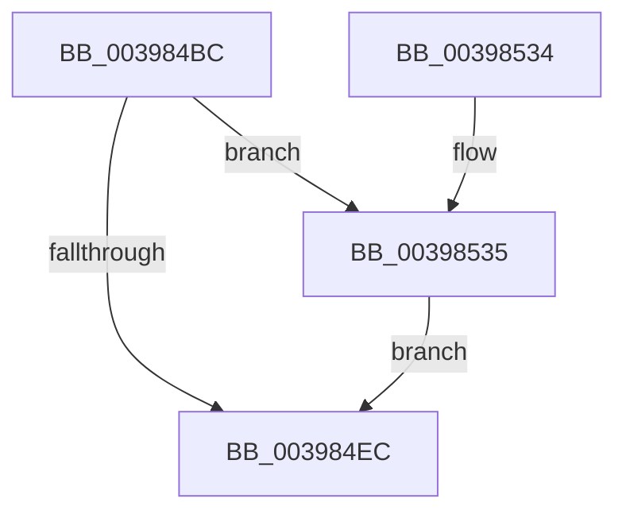

# KeAlertThreadByThreadIdEx

- RVA: `0x003984BC`–`0x0039853F` (길이 `131` bytes)
- VA: `0x00000001403984BC`
- 실행 섹션: `.text`
- PDB 이름 있음: `예`; PDB Function 태그: `아니요`
- unwind 정보 RVA: `0x00069570`
- 디코드: `35`개 명령, `131/131` bytes 표시
- 미해석 바이트: `0` (있으면 어셈블리에 `.byte`로 보존)

> 이 문서는 커널 이미지의 기계어와 PDB 기호를 분석해 생성했습니다. 4번과 5번은 함수 원형과 자료형을 바이너리 사용 방식에서 추정한 C 해석이며 원본 소스 복구 결과는 아닙니다.

## 1. Dependencies

- 직접 호출 지점: **3**; 고유 호출 대상: **3**
- 직접 호출자로 확인된 함수: **3**
- RIP 상대 이미지 참조: **1**

### Outgoing calls
- `0x003984FE` → [KiAlertSingleThreadByThreadId](KiAlertSingleThreadByThreadId_function_00397D8C.md) (function, `0x00397D8C`)
- `0x00398518` → [KiExitDispatcher](../25/KiExitDispatcher_function_00251CF0.md) (function, `0x00251CF0`)
- `0x00398538` → [KiRaiseIrqlProcessIrqlFlags](../4F/KiRaiseIrqlProcessIrqlFlags_function_004F56FC.md) (function, `0x004F56FC`)

### Direct callers
- [PsDispatchIumService](../4A/PsDispatchIumService_function_004A2F0C.md) at `0x004A31B4`
- [KeAlertThreadByThreadId](../4C/KeAlertThreadByThreadId_function_004C3900.md) at `0x004C3906`
- [sub_009A78D4](../../page/9A/Unknown_function_009A78D4.md) at `0x009A78FE`

### Static image references
- `0x003984E3` → RVA `0x00FC6D20` (`ALMOSTRO`; read)

## 2. Other-region calls and transfers

- 다른 실행 섹션으로 향하는 call: **0**
- 별도 외부 분기/꼬리 이동을 확인하지 못했습니다.

## 3. Assembly (complete function range)

```asm
003984BC  48 89 5C 24 08                  mov qword ptr [rsp + 8], rbx
003984C1  48 89 6C 24 10                  mov qword ptr [rsp + 0x10], rbp
003984C6  48 89 74 24 18                  mov qword ptr [rsp + 0x18], rsi
003984CB  57                              push rdi
003984CC  48 83 EC 30                     sub rsp, 0x30
003984D0  48 8B DA                        mov rbx, rdx
003984D3  48 8B E9                        mov rbp, rcx
003984D6  44 0F 20 C6                     mov rsi, cr8
003984DA  BA 02 00 00 00                  mov edx, 2
003984DF  44 0F 22 C2                     mov cr8, rdx
003984E3  83 3D 36 E8 C2 00 00            cmp dword ptr [rip + 0xc2e836], 0
003984EA  75 49                           jne 0x140398535
003984EC  65 48 8B 3C 25 20 00 00 00      mov rdi, qword ptr gs:[0x20]
003984F5  4C 8B C3                        mov r8, rbx
003984F8  48 8B CF                        mov rcx, rdi
003984FB  48 8B D5                        mov rdx, rbp
003984FE  E8 89 F8 FF FF                  call 0x140397d8c
00398503  41 B8 01 00 00 00               mov r8d, 1
00398509  40 88 74 24 20                  mov byte ptr [rsp + 0x20], sil
0039850E  45 8B C8                        mov r9d, r8d
00398511  33 D2                           xor edx, edx
00398513  48 8B CF                        mov rcx, rdi
00398516  8A D8                           mov bl, al
00398518  E8 D3 97 EB FF                  call 0x140251cf0
0039851D  48 8B 6C 24 48                  mov rbp, qword ptr [rsp + 0x48]
00398522  8A C3                           mov al, bl
00398524  48 8B 5C 24 40                  mov rbx, qword ptr [rsp + 0x40]
00398529  48 8B 74 24 50                  mov rsi, qword ptr [rsp + 0x50]
0039852E  48 83 C4 30                     add rsp, 0x30
00398532  5F                              pop rdi
00398533  C3                              ret
00398534  CC                              int3
00398535  40 8A CE                        mov cl, sil
00398538  E8 BF D1 15 00                  call 0x1404f56fc
0039853D  EB AD                           jmp 0x1403984ec
```

## 4. C-style interpretation (structured pseudocode)

```c
__int64 __fastcall KeAlertThreadByThreadIdEx(__int64 a1, __int64 a2)
{
    __int64 result;
    __int64 v_rsp;
    unsigned __int8 v_stack_m18;
    unsigned __int64 v_stack_p10;
    unsigned __int64 v_stack_p18;
    unsigned __int64 v_stack_p8;

    v_stack_p8 = v_rbx;
    v_stack_p10 = v_rbp;
    v_stack_p18 = v_rsi;
    v_rsp = (v_rsp) - (48);
    if ((*(unsigned int *)(v_rip + 12773430)) != 0) goto loc_00398535;
loc_003984EC:
    result = KiAlertSingleThreadByThreadId(*(unsigned __int64 *)(gs_base + (0 + 32)), a1, a2, a4);
    v_stack_m18 = (unsigned __int8)(v_cr8);
    a2 = 0;
    result = KiExitDispatcher(*(unsigned __int64 *)(gs_base + (0 + 32)), a2, 1, 1);
    v_rsp = (v_rsp) + (48);
    return (unsigned __int8)((unsigned __int8)(result));
loc_00398535:
    result = KiRaiseIrqlProcessIrqlFlags((unsigned __int8)(v_stack_p18), a2, 1, 1);
    goto loc_003984EC;
}
```

## 5. (Beta) C Style

```c
int64_t KeAlertThreadByThreadIdEx(int64_t Arg1, int64_t Arg2)
{
    int64_t result;
    int64_t local_rsp;
    uint8_t v_stack_m18;
    uint64_t v_stack_p10;
    uint64_t v_stack_p18;
    uint64_t v_stack_p8;

    v_stack_p8 = local_rbx;
    v_stack_p10 = local_rbp;
    v_stack_p18 = local_rsi;
    local_rsp = (local_rsp) - (48);
    if ((*(uint32_t *)(v_rip + 0xC2E836)) != 0) goto loc_00398535;
loc_003984EC:
    result = KiAlertSingleThreadByThreadId(*(uint64_t *)(gs_base + (0 + 0x20)), Arg1, Arg2, a4);
    v_stack_m18 = (uint8_t)(v_cr8);
    Arg2 = 0;
    result = KiExitDispatcher(*(uint64_t *)(gs_base + (0 + 0x20)), Arg2, 1, 1);
    local_rsp = (local_rsp) + (48);
    return (uint8_t)((uint8_t)(result));
loc_00398535:
    result = KiRaiseIrqlProcessIrqlFlags((uint8_t)(v_stack_p18), Arg2, 1, 1);
    goto loc_003984EC;
}
```

## 6. Execution-region graph

[열기: 2D/3D 그래프와 함수 탐색 컨트롤 패널](../../../control-panel.html?section=text&rva=0x003984BC&view=graph)

- 2D 그래프는 위에서 아래로 흐르고, 3D 그래프는 빈 공간을 드래그해 회전합니다. Shift+드래그는 이동, 휠은 확대·축소, 함수 노드 선택은 대상 보고서 이동입니다.

### Static fallback


