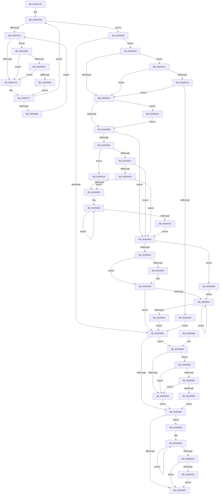

# KeApplyWobBamQos

- RVA: `0x003937AC`–`0x00393A46` (길이 `666` bytes)
- VA: `0x00000001403937AC`
- 실행 섹션: `.text`
- PDB 이름 있음: `예`; PDB Function 태그: `아니요`
- unwind 정보 RVA: `0x00080E98`
- 디코드: `173`개 명령, `666/666` bytes 표시
- 미해석 바이트: `0` (있으면 어셈블리에 `.byte`로 보존)

> 이 문서는 커널 이미지의 기계어와 PDB 기호를 분석해 생성했습니다. 4번과 5번은 함수 원형과 자료형을 바이너리 사용 방식에서 추정한 C 해석이며 원본 소스 복구 결과는 아닙니다.

## 1. Dependencies

- 직접 호출 지점: **7**; 고유 호출 대상: **7**
- 직접 호출자로 확인된 함수: **2**
- RIP 상대 이미지 참조: **3**

### Outgoing calls
- `0x00393877` → [_security_check_cookie](../6A/_security_check_cookie_function_006AC640.md) (function, `0x006AC640`)
- `0x003938AA` → [KeCheckAndApplyBamQos](KeCheckAndApplyBamQos_function_00391910.md) (function, `0x00391910`)
- `0x003938CC` → [KiCheckVpBackingLongSpinWaitHypercall](../30/KiCheckVpBackingLongSpinWaitHypercall_function_0030F490.md) (function, `0x0030F490`)
- `0x003938DB` → [HvlNotifyLongSpinWait](../30/HvlNotifyLongSpinWait_function_0030F460.md) (function, `0x0030F460`)
- `0x00393903` → [KiRemoveSystemWorkPriorityKick](../26/KiRemoveSystemWorkPriorityKick_function_002631D0.md) (function, `0x002631D0`)
- `0x0039399D` → [KiAcquireMultiplePrcbLocks](KiAcquireMultiplePrcbLocks_function_00393160.md) (function, `0x00393160`)
- `0x00393A02` → [KiUpdateThreadQosGroupingSummaries](../25/KiUpdateThreadQosGroupingSummaries_function_00257AEC.md) (function, `0x00257AEC`)

### Direct callers
- [PspUpdateContainerImpersonation](PspUpdateContainerImpersonation_function_003931EC.md) at `0x00393272`
- [sub_00393D34](Unknown_function_00393D34.md) at `0x00393D9A`

### Static image references
- `0x003937C5` → RVA `0x00E0A740` (`.data`; read)
- `0x003937E9` → RVA `0x00FC52AC` (`ALMOSTRO`; reference)
- `0x003938BE` → RVA `0x00FC6AB8` (`ALMOSTRO`; read)

## 2. Other-region calls and transfers

- 다른 실행 섹션으로 향하는 call: **0**
- 별도 외부 분기/꼬리 이동을 확인하지 못했습니다.

## 3. Assembly (complete function range)

```asm
003937AC  48 89 5C 24 18                  mov qword ptr [rsp + 0x18], rbx
003937B1  48 89 74 24 20                  mov qword ptr [rsp + 0x20], rsi
003937B6  55                              push rbp
003937B7  57                              push rdi
003937B8  41 54                           push r12
003937BA  41 56                           push r14
003937BC  41 57                           push r15
003937BE  48 8B EC                        mov rbp, rsp
003937C1  48 83 EC 60                     sub rsp, 0x60
003937C5  48 8B 05 74 6F A7 00            mov rax, qword ptr [rip + 0xa76f74]
003937CC  48 33 C4                        xor rax, rsp
003937CF  48 89 45 F0                     mov qword ptr [rbp - 0x10], rax
003937D3  4D 8B F0                        mov r14, r8
003937D6  48 8B F2                        mov rsi, rdx
003937D9  4C 8B F9                        mov r15, rcx
003937DC  33 DB                           xor ebx, ebx
003937DE  F0 48 0F BA 6E 40 00            lock bts qword ptr [rsi + 0x40], 0
003937E5  73 1B                           jae 0x140393802
003937E7  FF C3                           inc ebx
003937E9  85 1D BD 1A C3 00               test dword ptr [rip + 0xc31abd], ebx
003937EF  0F 84 C9 00 00 00               je 0x1403938be
003937F5  F3 90                           pause
003937F7  48 8B 46 40                     mov rax, qword ptr [rsi + 0x40]
003937FB  48 85 C0                        test rax, rax
003937FE  74 DE                           je 0x1403937de
00393800  EB E5                           jmp 0x1403937e7
00393802  45 0F B6 B6 04 02 00 00         movzx r14d, byte ptr [r14 + 0x204]
0039380A  0F B6 8E 04 02 00 00            movzx ecx, byte ptr [rsi + 0x204]
00393811  C7 45 E0 04 03 02 FF            mov dword ptr [rbp - 0x20], 0xff020304
00393818  66 C7 45 E4 05 00               mov word ptr [rbp - 0x1c], 5
0039381E  C6 45 E6 01                     mov byte ptr [rbp - 0x1a], 1
00393822  44 3B F1                        cmp r14d, ecx
00393825  0F 85 39 01 00 00               jne 0x140393964
0039382B  48 C7 46 40 00 00 00 00         mov qword ptr [rsi + 0x40], 0
00393833  FA                              cli
00393834  0F B6 8E 04 02 00 00            movzx ecx, byte ptr [rsi + 0x204]
0039383B  41 8B 87 EC 00 00 00            mov eax, dword ptr [r15 + 0xec]
00393842  0F B6 D0                        movzx edx, al
00393845  C7 45 E8 04 03 02 FF            mov dword ptr [rbp - 0x18], 0xff020304
0039384C  66 C7 45 EC 05 00               mov word ptr [rbp - 0x14], 5
00393852  C6 45 EE 01                     mov byte ptr [rbp - 0x12], 1
00393856  3B CA                           cmp ecx, edx
00393858  75 3C                           jne 0x140393896
0039385A  65 48 8B 0C 25 20 00 00 00      mov rcx, qword ptr gs:[0x20]
00393863  4C 8B 81 B8 8E 00 00            mov r8, qword ptr [rcx + 0x8eb8]
0039386A  4D 85 C0                        test r8, r8
0039386D  75 76                           jne 0x1403938e5
0039386F  FB                              sti
00393870  48 8B 4D F0                     mov rcx, qword ptr [rbp - 0x10]
00393874  48 33 CC                        xor rcx, rsp
00393877  E8 C4 8D 31 00                  call 0x1406ac640
0039387C  4C 8D 5C 24 60                  lea r11, [rsp + 0x60]
00393881  49 8B 5B 40                     mov rbx, qword ptr [r11 + 0x40]
00393885  49 8B 73 48                     mov rsi, qword ptr [r11 + 0x48]
00393889  49 8B E3                        mov rsp, r11
0039388C  41 5F                           pop r15
0039388E  41 5E                           pop r14
00393890  41 5C                           pop r12
00393892  5F                              pop rdi
00393893  5D                              pop rbp
00393894  C3                              ret
00393895  CC                              int3
00393896  44 8A 44 0D E8                  mov r8b, byte ptr [rbp + rcx - 0x18]
0039389B  8A 54 15 E8                     mov dl, byte ptr [rbp + rdx - 0x18]
0039389F  44 3A C2                        cmp r8b, dl
003938A2  76 0D                           jbe 0x1403938b1
003938A4  48 8B D6                        mov rdx, rsi
003938A7  49 8B CF                        mov rcx, r15
003938AA  E8 61 E0 FF FF                  call 0x140391910
003938AF  EB A9                           jmp 0x14039385a
003938B1  41 80 F8 FF                     cmp r8b, 0xff
003938B5  74 ED                           je 0x1403938a4
003938B7  80 FA FF                        cmp dl, 0xff
003938BA  74 E8                           je 0x1403938a4
003938BC  EB 9C                           jmp 0x14039385a
003938BE  8B 05 F4 31 C3 00               mov eax, dword ptr [rip + 0xc331f4]
003938C4  A8 40                           test al, 0x40
003938C6  0F 84 29 FF FF FF               je 0x1403937f5
003938CC  E8 BF BB F7 FF                  call 0x14030f490
003938D1  84 C0                           test al, al
003938D3  0F 84 1C FF FF FF               je 0x1403937f5
003938D9  8B CB                           mov ecx, ebx
003938DB  E8 80 BB F7 FF                  call 0x14030f460
003938E0  E9 12 FF FF FF                  jmp 0x1403937f7
003938E5  41 0F 0D 08                     prefetchw byte ptr [r8]
003938E9  41 8B 00                        mov eax, dword ptr [r8]
003938EC  8B D0                           mov edx, eax
003938EE  0F BA F2 15                     btr edx, 0x15
003938F2  F0 41 0F B1 10                  lock cmpxchg dword ptr [r8], edx
003938F7  75 F3                           jne 0x1403938ec
003938F9  0F BA E0 15                     bt eax, 0x15
003938FD  0F 83 6C FF FF FF               jae 0x14039386f
00393903  E8 C8 F8 EC FF                  call 0x1402631d0
00393908  E9 62 FF FF FF                  jmp 0x14039386f
0039390D  48 83 E7 FE                     and rdi, 0xfffffffffffffffe
00393911  45 33 C0                        xor r8d, r8d
00393914  33 D2                           xor edx, edx
00393916  48 89 7D C8                     mov qword ptr [rbp - 0x38], rdi
0039391A  83 E3 01                        and ebx, 1
0039391D  74 3A                           je 0x140393959
0039391F  83 FB 01                        cmp ebx, 1
00393922  75 15                           jne 0x140393939
00393924  48 8B 87 58 8E 00 00            mov rax, qword ptr [rdi + 0x8e58]
0039392B  4C 8B 87 58 8E 00 00            mov r8, qword ptr [rdi + 0x8e58]
00393932  49 83 C0 08                     add r8, 8
00393936  0F B6 10                        movzx edx, byte ptr [rax]
00393939  85 D2                           test edx, edx
0039393B  0F 84 EA FE FF FF               je 0x14039382b
00393941  8D 42 FF                        lea eax, [rdx - 1]
00393944  49 8B 0C C0                     mov rcx, qword ptr [r8 + rax*8]
00393948  8B D0                           mov edx, eax
0039394A  F0 48 83 61 30 00               lock and qword ptr [rcx + 0x30], 0
00393950  85 C0                           test eax, eax
00393952  75 ED                           jne 0x140393941
00393954  E9 D2 FE FF FF                  jmp 0x14039382b
00393959  4C 8D 45 C8                     lea r8, [rbp - 0x38]
0039395D  BA 01 00 00 00                  mov edx, 1
00393962  EB DD                           jmp 0x140393941
00393964  42 8A 54 35 E0                  mov dl, byte ptr [rbp + r14 - 0x20]
00393969  8A 4C 0D E0                     mov cl, byte ptr [rbp + rcx - 0x20]
0039396D  3A D1                           cmp dl, cl
0039396F  0F 86 AC 00 00 00               jbe 0x140393a21
00393975  0F 57 C0                        xorps xmm0, xmm0
00393978  0F 11 45 D0                     movups xmmword ptr [rbp - 0x30], xmm0
0039397C  49 8B FF                        mov rdi, r15
0039397F  4D 85 FF                        test r15, r15
00393982  0F 84 B0 00 00 00               je 0x140393a38
00393988  48 8B 87 58 8E 00 00            mov rax, qword ptr [rdi + 0x8e58]
0039398F  48 8B DF                        mov rbx, rdi
00393992  48 83 CB 01                     or rbx, 1
00393996  0F B6 10                        movzx edx, byte ptr [rax]
00393999  48 8D 48 08                     lea rcx, [rax + 8]
0039399D  E8 BE F7 FF FF                  call 0x140393160
003939A2  44 88 B6 04 02 00 00            mov byte ptr [rsi + 0x204], r14b
003939A9  48 83 7F 10 00                  cmp qword ptr [rdi + 0x10], 0
003939AE  0F 85 59 FF FF FF               jne 0x14039390d
003939B4  8B 4E 78                        mov ecx, dword ptr [rsi + 0x78]
003939B7  D1 E9                           shr ecx, 1
003939B9  48 89 7D C0                     mov qword ptr [rbp - 0x40], rdi
003939BD  83 E1 01                        and ecx, 1
003939C0  74 54                           je 0x140393a16
003939C2  83 F9 01                        cmp ecx, 1
003939C5  0F 85 42 FF FF FF               jne 0x14039390d
003939CB  48 8B 87 58 8E 00 00            mov rax, qword ptr [rdi + 0x8e58]
003939D2  0F B6 08                        movzx ecx, byte ptr [rax]
003939D5  4C 8D 70 08                     lea r14, [rax + 8]
003939D9  85 C9                           test ecx, ecx
003939DB  0F 84 2C FF FF FF               je 0x14039390d
003939E1  44 8B E1                        mov r12d, ecx
003939E4  4D 8B 0E                        mov r9, qword ptr [r14]
003939E7  4D 8B 41 38                     mov r8, qword ptr [r9 + 0x38]
003939EB  41 8A 48 40                     mov cl, byte ptr [r8 + 0x40]
003939EF  8A C1                           mov al, cl
003939F1  32 86 04 02 00 00               xor al, byte ptr [rsi + 0x204]
003939F7  24 07                           and al, 7
003939F9  32 C1                           xor al, cl
003939FB  49 8B C9                        mov rcx, r9
003939FE  41 88 40 40                     mov byte ptr [r8 + 0x40], al
00393A02  E8 E5 40 EC FF                  call 0x140257aec
00393A07  4D 8D 76 08                     lea r14, [r14 + 8]
00393A0B  49 83 EC 01                     sub r12, 1
00393A0F  75 D3                           jne 0x1403939e4
00393A11  E9 F7 FE FF FF                  jmp 0x14039390d
00393A16  4C 8D 75 C0                     lea r14, [rbp - 0x40]
00393A1A  B9 01 00 00 00                  mov ecx, 1
00393A1F  EB C0                           jmp 0x1403939e1
00393A21  80 FA FF                        cmp dl, 0xff
00393A24  0F 84 4B FF FF FF               je 0x140393975
00393A2A  80 F9 FF                        cmp cl, 0xff
00393A2D  0F 84 42 FF FF FF               je 0x140393975
00393A33  E9 F3 FD FF FF                  jmp 0x14039382b
00393A38  65 48 8B 3C 25 20 00 00 00      mov rdi, qword ptr gs:[0x20]
00393A41  E9 42 FF FF FF                  jmp 0x140393988
```

## 4. C-style interpretation (structured pseudocode)

```c
__int64 __fastcall KeApplyWobBamQos(__int64 a1, __int64 a2, __int64 a3)
{
    __int64 result;
    __int64 v_r12;
    __int64 v_rbx;
    __int64 v_rdi;
    __int64 v_rsp;
    unsigned __int64 v_stack_m28;
    unsigned __int64 v_stack_m38;
    unsigned __int8 v_stack_m3A;
    unsigned __int16 v_stack_m3C;
    unsigned int v_stack_m40;
    unsigned __int8 v_stack_m42;
    unsigned __int16 v_stack_m44;
    unsigned int v_stack_m48;
    unsigned __int64 v_stack_m58;
    unsigned __int64 v_stack_m60;
    unsigned __int64 v_stack_m68;
    unsigned __int64 v_stack_p18;
    unsigned __int64 v_stack_p20;

    v_stack_p18 = v_rbx;
    v_stack_p20 = v_rsi;
    v_rsp = (v_rsp) - (96);
    result = (*(unsigned __int64 *)(v_rip + 10973044)) ^ (v_rsp);
    v_stack_m38 = result;
    v_rbx = 0;
loc_003937DE:
    if (condition_is_above_or_equal) goto loc_00393802;
loc_003937E7:
    v_rbx = (unsigned int)((v_rbx) + 1);
    if (((*(unsigned int *)(v_rip + 12786365)) & ((unsigned int)(v_rbx))) == 0) goto loc_003938BE;
loc_003937F5:
loc_003937F7:
    if (*(unsigned __int64 *)(a2 + 64) == 0) goto loc_003937DE;
    goto loc_003937E7;
loc_00393802:
    v_stack_m48 = 0xFF020304ULL;
    v_stack_m44 = 5;
    v_stack_m42 = 1;
    if (((unsigned int)(*(unsigned __int8 *)(a3 + 516))) != ((unsigned int)(*(unsigned __int8 *)(a2 + 516)))) goto loc_00393964;
loc_0039382B:
    *(unsigned __int64 *)(a2 + 64) = 0;
    v_stack_m40 = 0xFF020304ULL;
    v_stack_m3C = 5;
    v_stack_m3A = 1;
    if (((unsigned int)(*(unsigned __int8 *)(a2 + 516))) != ((unsigned int)((unsigned __int8)((unsigned int)(*(unsigned int *)(a1 + 236)))))) goto loc_00393896;
loc_0039385A:
    if (*(unsigned __int64 *)(*(unsigned __int64 *)(gs_base + (0 + 32)) + 36536) != 0) goto loc_003938E5;
loc_0039386F:
    a1 = (v_stack_m38) ^ (v_rsp);
    result = _security_check_cookie(a1, (unsigned __int8)((unsigned int)(*(unsigned int *)(a1 + 236))), *(unsigned __int64 *)(*(unsigned __int64 *)(gs_base + (0 + 32)) + 36536), a4);
    return result;
loc_00393896:
    if (((unsigned __int8)(*(unsigned __int8 *)(v_rsp + a1 * 1 - 24))) <= ((unsigned __int8)(*(unsigned __int8 *)(v_rsp + (unsigned __int8)((unsigned int)(*(unsigned int *)(a1 + 236))) * 1 - 24)))) goto loc_003938B1;
loc_003938A4:
    result = KeCheckAndApplyBamQos(a1, *(unsigned __int64 *)(v_stack_m28 + 72), *(unsigned __int8 *)(v_rsp + a1 * 1 - 24), a4);
    goto loc_0039385A;
loc_003938B1:
    if (((unsigned __int8)(*(unsigned __int8 *)(v_rsp + a1 * 1 - 24))) == 255) goto loc_003938A4;
    if (((unsigned __int8)(*(unsigned __int64 *)(v_stack_m28 + 72))) == 255) goto loc_003938A4;
    goto loc_0039385A;
loc_003938BE:
    if ((((unsigned __int8)((unsigned int)(*(unsigned int *)(v_rip + 12792308)))) & (64)) == 0) goto loc_003937F5;
    result = KiCheckVpBackingLongSpinWaitHypercall(a1, *(unsigned __int64 *)(v_stack_m28 + 72), *(unsigned __int8 *)(v_rsp + a1 * 1 - 24), a4);
    if ((unsigned __int8)(result) == 0) goto loc_003937F5;
    result = HvlNotifyLongSpinWait((unsigned int)((unsigned int)(*(unsigned __int64 *)(v_stack_m28 + 64))), *(unsigned __int64 *)(v_stack_m28 + 72), *(unsigned __int8 *)(v_rsp + a1 * 1 - 24), a4);
    goto loc_003937F7;
loc_003938E5:
loc_003938EC:
    if ((unsigned __int8)(result) != 0) goto loc_003938EC;
    if (condition_is_above_or_equal) goto loc_0039386F;
    result = KiRemoveSystemWorkPriorityKick((unsigned int)((unsigned int)(*(unsigned __int64 *)(v_stack_m28 + 64))), (unsigned int)((unsigned int)((unsigned int)(*(unsigned int *)(*(unsigned __int8 *)(v_rsp + a1 * 1 - 24))))), *(unsigned __int8 *)(v_rsp + a1 * 1 - 24), a4);
    goto loc_0039386F;
loc_0039390D:
    v_rdi = (v_rdi) & (-2);
    a3 = 0;
    a2 = 0;
    v_stack_m60 = v_rdi;
    v_rbx = (unsigned int)((*(unsigned __int64 *)(v_stack_m28 + 64)) & (1));
    if (condition_is_equal) goto loc_00393959;
    if (((unsigned int)(v_rbx)) == 1) {
        result = *(unsigned __int64 *)(v_rdi + 36440);
        a3 = *(unsigned __int64 *)(v_rdi + 36440);
        a3 = (a3) + (8);
        a2 = *(unsigned __int8 *)(result);
    }
    if ((unsigned int)(a2) == 0) goto loc_0039382B;
loc_00393941:
    if ((unsigned int)(a2 - 1) != 0) goto loc_00393941;
    goto loc_0039382B;
loc_00393959:
    goto loc_00393941;
loc_00393964:
    if (((unsigned __int8)(*(unsigned __int8 *)(v_rsp + *(unsigned __int8 *)(a3 + 516) * 1 - 32))) <= ((unsigned __int8)(*(unsigned __int8 *)(v_rsp + *(unsigned __int64 *)(a3 + a2 - 1 * 8) * 1 - 32)))) goto loc_00393A21;
loc_00393975:
    v_stack_m58 = v_xmm0;
    if (a1 == 0) goto loc_00393A38;
loc_00393988:
    v_rbx = (a1) | (1);
    result = KiAcquireMultiplePrcbLocks(*(unsigned __int64 *)(a1 + 36440) + 8, *(unsigned __int8 *)(*(unsigned __int64 *)(a1 + 36440)), v_stack_m60, a4);
    *(unsigned __int8 *)(*(unsigned __int64 *)(v_stack_m28 + 72) + 516) = (unsigned __int8)(*(unsigned __int8 *)(a3 + 516));
    if ((*(unsigned __int64 *)(a1 + 16)) != 0) goto loc_0039390D;
    a1 = (unsigned int)(((unsigned int)(*(unsigned int *)(*(unsigned __int64 *)(v_stack_m28 + 72) + 120))) >> (1));
    v_stack_m68 = a1;
    a1 = (unsigned int)((a1) & (1));
    if (condition_is_equal) goto loc_00393A16;
    if (((unsigned int)(a1)) != 1) goto loc_0039390D;
    if ((unsigned int)(*(unsigned __int8 *)(*(unsigned __int64 *)(a1 + 36440))) == 0) goto loc_0039390D;
loc_003939E1:
loc_003939E4:
    result = (unsigned __int8)(((unsigned __int8)(*(unsigned __int8 *)(*(unsigned __int64 *)(*(unsigned __int64 *)(*(unsigned __int64 *)(a1 + 36440) + 8) + 56) + 64))) ^ (*(unsigned __int8 *)(*(unsigned __int64 *)(v_stack_m28 + 72) + 516)));
    result = (unsigned __int8)((result) & (7));
    result = (unsigned __int8)((result) ^ ((unsigned __int8)(*(unsigned __int8 *)(*(unsigned __int64 *)(*(unsigned __int64 *)(*(unsigned __int64 *)(a1 + 36440) + 8) + 56) + 64))));
    *(unsigned __int8 *)(*(unsigned __int64 *)(*(unsigned __int64 *)(*(unsigned __int64 *)(a1 + 36440) + 8) + 56) + 64) = (unsigned __int8)(result);
    result = KiUpdateThreadQosGroupingSummaries(*(unsigned __int64 *)(*(unsigned __int64 *)(a1 + 36440) + 8), *(unsigned __int8 *)(*(unsigned __int64 *)(a1 + 36440)), *(unsigned __int64 *)(*(unsigned __int64 *)(*(unsigned __int64 *)(a1 + 36440) + 8) + 56), *(unsigned __int64 *)(*(unsigned __int64 *)(a1 + 36440) + 8));
    v_r12 = ((unsigned int)((unsigned int)(*(unsigned __int8 *)(*(unsigned __int64 *)(a1 + 36440))))) - (1);
    if (condition_is_not_equal) goto loc_003939E4;
    goto loc_0039390D;
loc_00393A16:
    goto loc_003939E1;
loc_00393A21:
    if (((unsigned __int8)(*(unsigned __int8 *)(*(unsigned __int64 *)(a1 + 36440)))) == 255) goto loc_00393975;
    if (1 == 255) goto loc_00393975;
    goto loc_0039382B;
loc_00393A38:
    goto loc_00393988;
}
```

## 5. (Beta) C Style

```c
int64_t KeApplyWobBamQos(int64_t Arg1, void *Arg2, void *Arg3)
{
    uint8_t *arg2 = (uint8_t *)Arg2;
    uint8_t *arg3 = (uint8_t *)Arg3;

    int64_t result;
    int64_t local_r12;
    int64_t local_rbx;
    int64_t local_rdi;
    int64_t local_rsp;
    uint64_t v_stack_m28;
    uint64_t v_stack_m38;
    uint8_t v_stack_m3A;
    uint16_t v_stack_m3C;
    uint32_t v_stack_m40;
    uint8_t v_stack_m42;
    uint16_t v_stack_m44;
    uint32_t v_stack_m48;
    uint64_t v_stack_m58;
    uint64_t v_stack_m60;
    uint64_t v_stack_m68;
    uint64_t v_stack_p18;
    uint64_t v_stack_p20;

    v_stack_p18 = local_rbx;
    v_stack_p20 = local_rsi;
    local_rsp = (local_rsp) - (96);
    result = (*(uint64_t *)(v_rip + 0xA76F74)) ^ (local_rsp);
    v_stack_m38 = result;
    local_rbx = 0;
loc_003937DE:
    if (condition_is_above_or_equal) goto loc_00393802;
loc_003937E7:
    local_rbx = (uint32_t)((local_rbx) + 1);
    if (((*(uint32_t *)(v_rip + 0xC31ABD)) & ((uint32_t)(local_rbx))) == 0) goto loc_003938BE;
loc_003937F5:
loc_003937F7:
    if (*(uint64_t *)(arg2 + 0x40) == 0) goto loc_003937DE;
    goto loc_003937E7;
loc_00393802:
    v_stack_m48 = 0xFF020304ULL;
    v_stack_m44 = 5;
    v_stack_m42 = 1;
    if (((uint32_t)(*(uint8_t *)(arg3 + 0x204))) != ((uint32_t)(*(uint8_t *)(arg2 + 0x204)))) goto loc_00393964;
loc_0039382B:
    *(uint64_t *)(arg2 + 0x40) = 0;
    v_stack_m40 = 0xFF020304ULL;
    v_stack_m3C = 5;
    v_stack_m3A = 1;
    if (((uint32_t)(*(uint8_t *)(arg2 + 0x204))) != ((uint32_t)((uint8_t)((uint32_t)(*(uint32_t *)(Arg1 + 0xEC)))))) goto loc_00393896;
loc_0039385A:
    if (*(uint64_t *)(*(uint64_t *)(gs_base + (0 + 0x20)) + 0x8EB8) != 0) goto loc_003938E5;
loc_0039386F:
    Arg1 = (v_stack_m38) ^ (local_rsp);
    result = _security_check_cookie(Arg1, (uint8_t)((uint32_t)(*(uint32_t *)(Arg1 + 0xEC))), *(uint64_t *)(*(uint64_t *)(gs_base + (0 + 0x20)) + 0x8EB8), a4);
    return result;
loc_00393896:
    if (((uint8_t)(*(uint8_t *)(local_rsp + Arg1 * 1 - 0x18))) <= ((uint8_t)(*(uint8_t *)(local_rsp + (uint8_t)((uint32_t)(*(uint32_t *)(Arg1 + 0xEC))) * 1 - 0x18)))) goto loc_003938B1;
loc_003938A4:
    result = KeCheckAndApplyBamQos(Arg1, *(uint64_t *)(v_stack_m28 + 0x48), *(uint8_t *)(local_rsp + Arg1 * 1 - 0x18), a4);
    goto loc_0039385A;
loc_003938B1:
    if (((uint8_t)(*(uint8_t *)(local_rsp + Arg1 * 1 - 0x18))) == 255) goto loc_003938A4;
    if (((uint8_t)(*(uint64_t *)(v_stack_m28 + 0x48))) == 255) goto loc_003938A4;
    goto loc_0039385A;
loc_003938BE:
    if ((((uint8_t)((uint32_t)(*(uint32_t *)(v_rip + 0xC331F4)))) & (64)) == 0) goto loc_003937F5;
    result = KiCheckVpBackingLongSpinWaitHypercall(Arg1, *(uint64_t *)(v_stack_m28 + 0x48), *(uint8_t *)(local_rsp + Arg1 * 1 - 0x18), a4);
    if ((uint8_t)(result) == 0) goto loc_003937F5;
    result = HvlNotifyLongSpinWait((uint32_t)((uint32_t)(*(uint64_t *)(v_stack_m28 + 0x40))), *(uint64_t *)(v_stack_m28 + 0x48), *(uint8_t *)(local_rsp + Arg1 * 1 - 0x18), a4);
    goto loc_003937F7;
loc_003938E5:
loc_003938EC:
    if ((uint8_t)(result) != 0) goto loc_003938EC;
    if (condition_is_above_or_equal) goto loc_0039386F;
    result = KiRemoveSystemWorkPriorityKick((uint32_t)((uint32_t)(*(uint64_t *)(v_stack_m28 + 0x40))), (uint32_t)((uint32_t)((uint32_t)(*(uint32_t *)(*(uint8_t *)(local_rsp + Arg1 * 1 - 0x18))))), *(uint8_t *)(local_rsp + Arg1 * 1 - 0x18), a4);
    goto loc_0039386F;
loc_0039390D:
    local_rdi = (local_rdi) & (-2);
    Arg3 = 0;
    Arg2 = 0;
    v_stack_m60 = local_rdi;
    local_rbx = (uint32_t)((*(uint64_t *)(v_stack_m28 + 0x40)) & (1));
    if (condition_is_equal) goto loc_00393959;
    if (((uint32_t)(local_rbx)) == 1) {
        result = *(uint64_t *)(local_rdi + 0x8E58);
        Arg3 = *(uint64_t *)(local_rdi + 0x8E58);
        Arg3 = (Arg3) + (8);
        Arg2 = *(uint8_t *)(result);
    }
    if ((uint32_t)(Arg2) == 0) goto loc_0039382B;
loc_00393941:
    if ((uint32_t)(Arg2 - 1) != 0) goto loc_00393941;
    goto loc_0039382B;
loc_00393959:
    goto loc_00393941;
loc_00393964:
    if (((uint8_t)(*(uint8_t *)(local_rsp + *(uint8_t *)(arg3 + 0x204) * 1 - 0x20))) <= ((uint8_t)(*(uint8_t *)(local_rsp + *(uint64_t *)(arg3 + arg2 - 0x1 * 8) * 1 - 0x20)))) goto loc_00393A21;
loc_00393975:
    v_stack_m58 = v_xmm0;
    if (Arg1 == 0) goto loc_00393A38;
loc_00393988:
    local_rbx = (Arg1) | (1);
    result = KiAcquireMultiplePrcbLocks(*(uint64_t *)(Arg1 + 0x8E58) + 8, *(uint8_t *)(*(uint64_t *)(Arg1 + 0x8E58)), v_stack_m60, a4);
    *(uint8_t *)(*(uint64_t *)(v_stack_m28 + 0x48) + 0x204) = (uint8_t)(*(uint8_t *)(arg3 + 0x204));
    if ((*(uint64_t *)(Arg1 + 0x10)) != 0) goto loc_0039390D;
    Arg1 = (uint32_t)(((uint32_t)(*(uint32_t *)(*(uint64_t *)(v_stack_m28 + 0x48) + 0x78))) >> (1));
    v_stack_m68 = Arg1;
    Arg1 = (uint32_t)((Arg1) & (1));
    if (condition_is_equal) goto loc_00393A16;
    if (((uint32_t)(Arg1)) != 1) goto loc_0039390D;
    if ((uint32_t)(*(uint8_t *)(*(uint64_t *)(Arg1 + 0x8E58))) == 0) goto loc_0039390D;
loc_003939E1:
loc_003939E4:
    result = (uint8_t)(((uint8_t)(*(uint8_t *)(*(uint64_t *)(*(uint64_t *)(*(uint64_t *)(Arg1 + 0x8E58) + 0x8) + 0x38) + 0x40))) ^ (*(uint8_t *)(*(uint64_t *)(v_stack_m28 + 0x48) + 0x204)));
    result = (uint8_t)((result) & (7));
    result = (uint8_t)((result) ^ ((uint8_t)(*(uint8_t *)(*(uint64_t *)(*(uint64_t *)(*(uint64_t *)(Arg1 + 0x8E58) + 0x8) + 0x38) + 0x40))));
    *(uint8_t *)(*(uint64_t *)(*(uint64_t *)(*(uint64_t *)(Arg1 + 0x8E58) + 0x8) + 0x38) + 0x40) = (uint8_t)(result);
    result = KiUpdateThreadQosGroupingSummaries(*(uint64_t *)(*(uint64_t *)(Arg1 + 0x8E58) + 0x8), *(uint8_t *)(*(uint64_t *)(Arg1 + 0x8E58)), *(uint64_t *)(*(uint64_t *)(*(uint64_t *)(Arg1 + 0x8E58) + 0x8) + 0x38), *(uint64_t *)(*(uint64_t *)(Arg1 + 0x8E58) + 0x8));
    local_r12 = ((uint32_t)((uint32_t)(*(uint8_t *)(*(uint64_t *)(Arg1 + 0x8E58))))) - (1);
    if (condition_is_not_equal) goto loc_003939E4;
    goto loc_0039390D;
loc_00393A16:
    goto loc_003939E1;
loc_00393A21:
    if (((uint8_t)(*(uint8_t *)(*(uint64_t *)(Arg1 + 0x8E58)))) == 255) goto loc_00393975;
    if (1 == 255) goto loc_00393975;
    goto loc_0039382B;
loc_00393A38:
    goto loc_00393988;
}
```

### 관측된 메모리 오프셋

구조체 형식이 확인되지 않은 접근은 인자 기준의 오프셋으로만 기록했습니다.

| 기준 인자 | 오프셋 표현 | 폭 (bit) | 접근 |
|---|---:|---:|---|
| `Arg2` | `+ 0x40` | `64` | `R` |
| `Arg2` | `+ 0x40` | `64` | `R/W` |
| `Arg2` | `+ 0x40` | `64` | `W` |
| `Arg2` | `+ 0x78` | `32` | `R` |
| `Arg2` | `+ 0x204` | `8` | `R` |
| `Arg2` | `+ 0x204` | `8` | `W` |
| `Arg3` | `+ 0x204` | `8` | `R` |

## 6. Execution-region graph

[열기: 2D/3D 그래프와 함수 탐색 컨트롤 패널](../../../control-panel.html?section=text&rva=0x003937AC&view=graph)

- 2D 그래프는 위에서 아래로 흐르고, 3D 그래프는 빈 공간을 드래그해 회전합니다. Shift+드래그는 이동, 휠은 확대·축소, 함수 노드 선택은 대상 보고서 이동입니다.

### Static fallback


