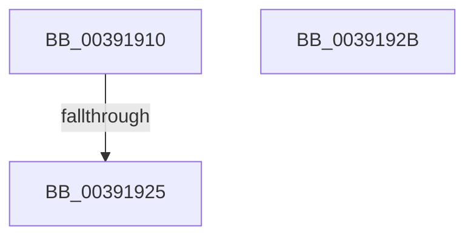

# KeCheckAndApplyBamQos

- RVA: `0x00391910`–`0x0039192C` (길이 `28` bytes)
- VA: `0x0000000140391910`
- 실행 섹션: `.text`
- PDB 이름 있음: `예`; PDB Function 태그: `예`
- unwind 정보 RVA: `0x00080AC8`
- 디코드: `10`개 명령, `28/28` bytes 표시
- 미해석 바이트: `0` (있으면 어셈블리에 `.byte`로 보존)

> 이 문서는 커널 이미지의 기계어와 PDB 기호를 분석해 생성했습니다. 4번과 5번은 함수 원형과 자료형을 바이너리 사용 방식에서 추정한 C 해석이며 원본 소스 복구 결과는 아닙니다.

## 1. Dependencies

- 직접 호출 지점: **0**; 고유 호출 대상: **0**
- 직접 호출자로 확인된 함수: **5**
- RIP 상대 이미지 참조: **1**

### Outgoing calls
- 직접 디코드된 call 명령이 없습니다.

### Direct callers
- [sub_0021BFFA](../21/Unknown_function_0021BFFA.md) at `0x0021C000`
- [KeSetThreadSchedulerAssist](../30/KeSetThreadSchedulerAssist_function_003038F8.md) at `0x00303A89`
- [KeApplyWobBamQos](KeApplyWobBamQos_function_003937AC.md) at `0x003938AA`
- [KeUpdateThreadTag](../47/KeUpdateThreadTag_function_00475770.md) at `0x00475D19`
- [SwapContext](../6B/SwapContext_function_006B9820.md) at `0x006B98B5`

### Static image references
- `0x00391916` → RVA `0x00FC6C6C` (`ALMOSTRO`; read)

## 2. Other-region calls and transfers

- 다른 실행 섹션으로 향하는 call: **0**
- call이 아닌 외부 분기/꼬리 이동: **1**
  - `0x00391923` → [sub_0039192C](Unknown_function_0039192C.md) (`tail-transfer`)

## 3. Assembly (complete function range)

```asm
00391910  40 53                           push rbx
00391912  48 83 EC 50                     sub rsp, 0x50
00391916  83 3D 4F 53 C3 00 00            cmp dword ptr [rip + 0xc3534f], 0
0039191D  4C 8B C2                        mov r8, rdx
00391920  48 8B D9                        mov rbx, rcx
00391923  75 07                           jne 0x14039192c
00391925  48 83 C4 50                     add rsp, 0x50
00391929  5B                              pop rbx
0039192A  C3                              ret
0039192B  CC                              int3
```

## 4. C-style interpretation (structured pseudocode)

```c
void __fastcall KeCheckAndApplyBamQos(__int64 a1, __int64 a2)
{
    __int64 v_rsp;

    v_rsp = (v_rsp) - (80);
    v_rsp = (v_rsp) + (80);
    return;
}
```

## 5. (Beta) C Style

```c
void KeCheckAndApplyBamQos(int64_t Arg1, int64_t Arg2)
{
    int64_t local_rsp;

    local_rsp = (local_rsp) - (80);
    local_rsp = (local_rsp) + (80);
    return;
}
```

## 6. Execution-region graph

[열기: 2D/3D 그래프와 함수 탐색 컨트롤 패널](../../../control-panel.html?section=text&rva=0x00391910&view=graph)

- 2D 그래프는 위에서 아래로 흐르고, 3D 그래프는 빈 공간을 드래그해 회전합니다. Shift+드래그는 이동, 휠은 확대·축소, 함수 노드 선택은 대상 보고서 이동입니다.

### Static fallback


