# KeDisableTimer2

- RVA: `0x0039FD58`–`0x003A0140` (길이 `1,000` bytes)
- VA: `0x000000014039FD58`
- 실행 섹션: `.text`
- PDB 이름 있음: `예`; PDB Function 태그: `아니요`
- unwind 정보 RVA: `0x00081D80`
- 디코드: `234`개 명령, `1,000/1,000` bytes 표시
- 미해석 바이트: `0` (있으면 어셈블리에 `.byte`로 보존)

> 이 문서는 커널 이미지의 기계어와 PDB 기호를 분석해 생성했습니다. 4번과 5번은 함수 원형과 자료형을 바이너리 사용 방식에서 추정한 C 해석이며 원본 소스 복구 결과는 아닙니다.

## 1. Dependencies

- 직접 호출 지점: **16**; 고유 호출 대상: **14**
- 직접 호출자로 확인된 함수: **7**
- RIP 상대 이미지 참조: **8**

### Outgoing calls
- `0x0039FDA3` → [memset](../6C/memset_function_006C6C40.md) (function, `0x006C6C40`)
- `0x0039FE7B` → [KiAcquireTimer2LockUnlessDisabled](../3A/KiAcquireTimer2LockUnlessDisabled_function_003A10D8.md) (function, `0x003A10D8`)
- `0x0039FEA6` → [KiAcquireTimer2CollectionLockIfInserted](../3A/KiAcquireTimer2CollectionLockIfInserted_function_003A1150.md) (function, `0x003A1150`)
- `0x0039FED1` → [EtwGetKernelTraceTimestamp](EtwGetKernelTraceTimestamp_function_0039FC50.md) (function, `0x0039FC50`)
- `0x0039FEE0` → [KiUpdateTimer2Flags](../3A/KiUpdateTimer2Flags_function_003A2100.md) (function, `0x003A2100`)
- `0x0039FEF8` → [KiLowerIrqlProcessIrqlFlags](../4F/KiLowerIrqlProcessIrqlFlags_function_004F5698.md) (function, `0x004F5698`)
- `0x0039FF2A` → [_security_check_cookie](../6A/_security_check_cookie_function_006AC640.md) (function, `0x006AC640`)
- `0x0039FF67` → [memset](../6C/memset_function_006C6C40.md) (function, `0x006C6C40`)
- `0x0039FF76` → [KeAddProcessorAffinityEx](../25/KeAddProcessorAffinityEx_function_0025B6F0.md) (function, `0x0025B6F0`)
- `0x0039FF8F` → [KeGenericProcessorCallback](KeGenericProcessorCallback_function_00398C2C.md) (function, `0x00398C2C`)
- `0x0039FF9E` → [KiRaiseIrqlProcessIrqlFlags](../4F/KiRaiseIrqlProcessIrqlFlags_function_004F56FC.md) (function, `0x004F56FC`)
- `0x0039FFB8` → [KiLowerIrqlProcessIrqlFlags](../4F/KiLowerIrqlProcessIrqlFlags_function_004F5698.md) (function, `0x004F5698`)
- `0x0039FFDC` → [KiRemoveTimer2](../3A/KiRemoveTimer2_function_003A1D60.md) (function, `0x003A1D60`)
- `0x0039FFE8` → [KxReleaseSpinLock](../20/KxReleaseSpinLock_function_00206670.md) (function, `0x00206670`)
- `0x003A00A7` → [EtwTraceTimedEvent](../3A/EtwTraceTimedEvent_function_003A3430.md) (function, `0x003A3430`)
- `0x003A0103` → [KiTraceCancelTimer2](../3A/KiTraceCancelTimer2_function_003A378C.md) (function, `0x003A378C`)

### Direct callers
- [ExpShutdownWorkerFactory](../2A/ExpShutdownWorkerFactory_function_002A4F70.md) at `0x002A5073`
- [ExDeleteTimer](ExDeleteTimer_function_0039F2E0.md) at `0x0039F329`
- [MiStoreEvictThread](../3A/MiStoreEvictThread_function_003A42D0.md) at `0x003A44C2`
- [PopPowerButtonWorkCallback](../5D/PopPowerButtonWorkCallback_function_005D9A70.md) at `0x005D9B62`
- [SMKM_STORE_MGR&lt;SM_TRAITS&gt;::SmCleanup](../60/SMKM_STORE_MGR_SM_TRAITS_SmCleanup_function_0060C214.md) at `0x0060C27B`
- [PopThermalZoneRemove](../../page/75/PopThermalZoneRemove_function_0075FAD0.md) at `0x0075FBCE`
- [ExpDeleteTimer2](../../page/A5/ExpDeleteTimer2_function_00A571D0.md) at `0x00A571DD`

### Static image references
- `0x0039FD77` → RVA `0x00E0A740` (`.data`; read)
- `0x0039FDB3` → RVA `0x00FC6B08` (`ALMOSTRO`; read)
- `0x0039FE2F` → RVA `0x00FC7250` (`ALMOSTRO`; read)
- `0x0039FE3D` → RVA `0x00FC6F78` (`ALMOSTRO`; read)
- `0x0039FE6B` → RVA `0x00FC6D20` (`ALMOSTRO`; read)
- `0x0039FF6C` → RVA `0x00F21FB0` (`.data`; read)
- `0x0039FF81` → RVA `0x0049E550` (`EmpCheckErrataList`; read)
- `0x0039FFE1` → RVA `0x00FCF600` (`CACHEALI`; read)

## 2. Other-region calls and transfers

- 다른 실행 섹션으로 향하는 call: **0**
- 별도 외부 분기/꼬리 이동을 확인하지 못했습니다.

## 3. Assembly (complete function range)

```asm
0039FD58  48 89 5C 24 10                  mov qword ptr [rsp + 0x10], rbx
0039FD5D  55                              push rbp
0039FD5E  56                              push rsi
0039FD5F  57                              push rdi
0039FD60  41 54                           push r12
0039FD62  41 55                           push r13
0039FD64  41 56                           push r14
0039FD66  41 57                           push r15
0039FD68  48 8D AC 24 60 FF FF FF         lea rbp, [rsp - 0xa0]
0039FD70  48 81 EC A0 01 00 00            sub rsp, 0x1a0
0039FD77  48 8B 05 C2 A9 A6 00            mov rax, qword ptr [rip + 0xa6a9c2]
0039FD7E  48 33 C4                        xor rax, rsp
0039FD81  48 89 85 90 00 00 00            mov qword ptr [rbp + 0x90], rax
0039FD88  44 88 44 24 31                  mov byte ptr [rsp + 0x31], r8b
0039FD8D  48 8B D9                        mov rbx, rcx
0039FD90  88 54 24 32                     mov byte ptr [rsp + 0x32], dl
0039FD94  48 8D 4D 80                     lea rcx, [rbp - 0x80]
0039FD98  33 D2                           xor edx, edx
0039FD9A  41 B8 08 01 00 00               mov r8d, 0x108
0039FDA0  4D 8B E1                        mov r12, r9
0039FDA3  E8 98 6E 32 00                  call 0x1406c6c40
0039FDA8  45 33 C0                        xor r8d, r8d
0039FDAB  C7 44 24 38 20 00 00 00         mov dword ptr [rsp + 0x38], 0x20
0039FDB3  F7 05 4B 6D C2 00 00 00 02 00   test dword ptr [rip + 0xc26d4b], 0x20000
0039FDBD  0F 57 C0                        xorps xmm0, xmm0
0039FDC0  4C 89 44 24 48                  mov qword ptr [rsp + 0x48], r8
0039FDC5  41 8B F8                        mov edi, r8d
0039FDC8  4C 89 44 24 50                  mov qword ptr [rsp + 0x50], r8
0039FDCD  41 8B F0                        mov esi, r8d
0039FDD0  41 8D 48 01                     lea ecx, [r8 + 1]
0039FDD4  4C 89 44 24 58                  mov qword ptr [rsp + 0x58], r8
0039FDD9  0F 11 44 24 60                  movups xmmword ptr [rsp + 0x60], xmm0
0039FDDE  44 88 44 24 30                  mov byte ptr [rsp + 0x30], r8b
0039FDE3  45 8B F0                        mov r14d, r8d
0039FDE6  0F 11 44 24 70                  movups xmmword ptr [rsp + 0x70], xmm0
0039FDEB  44 88 44 24 33                  mov byte ptr [rsp + 0x33], r8b
0039FDF0  B0 08                           mov al, 8
0039FDF2  0F 84 04 02 00 00               je 0x14039fffc
0039FDF8  48 8B 7B 60                     mov rdi, qword ptr [rbx + 0x60]
0039FDFC  44 8A E9                        mov r13b, cl
0039FDFF  4C 89 44 24 48                  mov qword ptr [rsp + 0x48], r8
0039FE04  4C 89 44 24 50                  mov qword ptr [rsp + 0x50], r8
0039FE09  4C 89 44 24 58                  mov qword ptr [rsp + 0x58], r8
0039FE0E  49 B9 77 72 DD F3 C7 C6 35 7E   movabs r9, 0x7e35c6c7f3dd7277
0039FE18  4D 85 E4                        test r12, r12
0039FE1B  74 41                           je 0x14039fe5e
0039FE1D  49 8B 34 24                     mov rsi, qword ptr [r12]
0039FE21  4D 8B 74 24 08                  mov r14, qword ptr [r12 + 8]
0039FE26  45 84 ED                        test r13b, r13b
0039FE29  0F 85 82 02 00 00               jne 0x1403a00b1
0039FE2F  48 33 35 1A 74 C2 00            xor rsi, qword ptr [rip + 0xc2741a]
0039FE36  4C 33 35 13 74 C2 00            xor r14, qword ptr [rip + 0xc27413]
0039FE3D  48 8B 15 34 71 C2 00            mov rdx, qword ptr [rip + 0xc27134]
0039FE44  48 0F CE                        bswap rsi
0039FE47  48 33 F3                        xor rsi, rbx
0039FE4A  8B CA                           mov ecx, edx
0039FE4C  49 0F CE                        bswap r14
0039FE4F  48 D3 CE                        ror rsi, cl
0039FE52  4C 33 F3                        xor r14, rbx
0039FE55  48 33 F2                        xor rsi, rdx
0039FE58  49 D3 CE                        ror r14, cl
0039FE5B  4C 33 F2                        xor r14, rdx
0039FE5E  45 0F 20 C7                     mov r15, cr8
0039FE62  B8 02 00 00 00                  mov eax, 2
0039FE67  44 0F 22 C0                     mov cr8, rax
0039FE6B  44 39 05 AE 6E C2 00            cmp dword ptr [rip + 0xc26eae], r8d
0039FE72  0F 85 21 01 00 00               jne 0x14039ff99
0039FE78  48 8B CB                        mov rcx, rbx
0039FE7B  E8 58 12 00 00                  call 0x1403a10d8
0039FE80  88 44 24 34                     mov byte ptr [rsp + 0x34], al
0039FE84  84 C0                           test al, al
0039FE86  0F 85 1C 01 00 00               jne 0x14039ffa8
0039FE8C  4D 85 E4                        test r12, r12
0039FE8F  74 08                           je 0x14039fe99
0039FE91  48 89 73 70                     mov qword ptr [rbx + 0x70], rsi
0039FE95  4C 89 73 78                     mov qword ptr [rbx + 0x78], r14
0039FE99  44 8A 64 24 32                  mov r12b, byte ptr [rsp + 0x32]
0039FE9E  45 84 E4                        test r12b, r12b
0039FEA1  74 1A                           je 0x14039febd
0039FEA3  48 8B CB                        mov rcx, rbx
0039FEA6  E8 A5 12 00 00                  call 0x1403a1150
0039FEAB  84 C0                           test al, al
0039FEAD  0F 85 26 01 00 00               jne 0x14039ffd9
0039FEB3  F6 43 01 0A                     test byte ptr [rbx + 1], 0xa
0039FEB7  0F 85 33 02 00 00               jne 0x1403a00f0
0039FEBD  BE 06 00 00 00                  mov esi, 6
0039FEC2  45 84 ED                        test r13b, r13b
0039FEC5  74 0F                           je 0x14039fed6
0039FEC7  BA 00 00 02 40                  mov edx, 0x40020000
0039FECC  48 8D 4C 24 60                  lea rcx, [rsp + 0x60]
0039FED1  E8 7A FD FF FF                  call 0x14039fc50
0039FED6  8B 54 24 38                     mov edx, dword ptr [rsp + 0x38]
0039FEDA  44 8B C6                        mov r8d, esi
0039FEDD  48 8B CB                        mov rcx, rbx
0039FEE0  E8 1B 22 00 00                  call 0x1403a2100
0039FEE5  83 3D 34 6E C2 00 00            cmp dword ptr [rip + 0xc26e34], 0
0039FEEC  44 8A F0                        mov r14b, al
0039FEEF  74 0C                           je 0x14039fefd
0039FEF1  44 0F 20 C1                     mov rcx, cr8
0039FEF5  41 8A D7                        mov dl, r15b
0039FEF8  E8 9B 57 15 00                  call 0x1404f5698
0039FEFD  41 0F B6 C7                     movzx eax, r15b
0039FF01  44 0F 22 C0                     mov cr8, rax
0039FF05  44 8A 7C 24 31                  mov r15b, byte ptr [rsp + 0x31]
0039FF0A  45 84 FF                        test r15b, r15b
0039FF0D  75 3C                           jne 0x14039ff4b
0039FF0F  40 8A 74 24 30                  mov sil, byte ptr [rsp + 0x30]
0039FF14  45 84 ED                        test r13b, r13b
0039FF17  0F 85 E7 00 00 00               jne 0x1403a0004
0039FF1D  40 8A C6                        mov al, sil
0039FF20  48 8B 8D 90 00 00 00            mov rcx, qword ptr [rbp + 0x90]
0039FF27  48 33 CC                        xor rcx, rsp
0039FF2A  E8 11 C7 30 00                  call 0x1406ac640
0039FF2F  48 8B 9C 24 E8 01 00 00         mov rbx, qword ptr [rsp + 0x1e8]
0039FF37  48 81 C4 A0 01 00 00            add rsp, 0x1a0
0039FF3E  41 5F                           pop r15
0039FF40  41 5E                           pop r14
0039FF42  41 5D                           pop r13
0039FF44  41 5C                           pop r12
0039FF46  5F                              pop rdi
0039FF47  5E                              pop rsi
0039FF48  5D                              pop rbp
0039FF49  C3                              ret
0039FF4A  CC                              int3
0039FF4B  45 84 F6                        test r14b, r14b
0039FF4E  75 BF                           jne 0x14039ff0f
0039FF50  83 65 84 00                     and dword ptr [rbp - 0x7c], 0
0039FF54  48 8D 4D 88                     lea rcx, [rbp - 0x78]
0039FF58  33 D2                           xor edx, edx
0039FF5A  C7 45 80 01 00 20 00            mov dword ptr [rbp - 0x80], 0x200001
0039FF61  41 B8 00 01 00 00               mov r8d, 0x100
0039FF67  E8 D4 6C 32 00                  call 0x1406c6c40
0039FF6C  8B 15 3E 20 B8 00               mov edx, dword ptr [rip + 0xb8203e]
0039FF72  48 8D 4D 80                     lea rcx, [rbp - 0x80]
0039FF76  E8 75 B7 EB FF                  call 0x14025b6f0
0039FF7B  41 B9 02 00 00 00               mov r9d, 2
0039FF81  48 8D 15 C8 E5 0F 00            lea rdx, [rip + 0xfe5c8]
0039FF88  45 33 C0                        xor r8d, r8d
0039FF8B  48 8D 4D 80                     lea rcx, [rbp - 0x80]
0039FF8F  E8 98 8C FF FF                  call 0x140398c2c
0039FF94  E9 76 FF FF FF                  jmp 0x14039ff0f
0039FF99  8A D0                           mov dl, al
0039FF9B  41 8A CF                        mov cl, r15b
0039FF9E  E8 59 57 15 00                  call 0x1404f56fc
0039FFA3  E9 D0 FE FF FF                  jmp 0x14039fe78
0039FFA8  83 3D 71 6D C2 00 00            cmp dword ptr [rip + 0xc26d71], 0
0039FFAF  74 0C                           je 0x14039ffbd
0039FFB1  44 0F 20 C1                     mov rcx, cr8
0039FFB5  41 8A D7                        mov dl, r15b
0039FFB8  E8 DB 56 15 00                  call 0x1404f5698
0039FFBD  41 0F B6 C7                     movzx eax, r15b
0039FFC1  44 0F 22 C0                     mov cr8, rax
0039FFC5  44 8A 74 24 33                  mov r14b, byte ptr [rsp + 0x33]
0039FFCA  44 8A 7C 24 31                  mov r15b, byte ptr [rsp + 0x31]
0039FFCF  44 8A 64 24 32                  mov r12b, byte ptr [rsp + 0x32]
0039FFD4  E9 36 FF FF FF                  jmp 0x14039ff0f
0039FFD9  48 8B CB                        mov rcx, rbx
0039FFDC  E8 7F 1D 00 00                  call 0x1403a1d60
0039FFE1  48 8D 0D 18 F6 C2 00            lea rcx, [rip + 0xc2f618]
0039FFE8  E8 83 66 E6 FF                  call 0x140206670
0039FFED  C6 44 24 30 01                  mov byte ptr [rsp + 0x30], 1
0039FFF2  BE 04 00 00 00                  mov esi, 4
0039FFF7  E9 C6 FE FF FF                  jmp 0x14039fec2
0039FFFC  45 8A E8                        mov r13b, r8b
0039FFFF  E9 0A FE FF FF                  jmp 0x14039fe0e
003A0004  80 7C 24 34 00                  cmp byte ptr [rsp + 0x34], 0
003A0009  0F 85 0E FF FF FF               jne 0x14039ff1d
003A000F  48 8B 0D 62 6F C2 00            mov rcx, qword ptr [rip + 0xc26f62]
003A0016  48 33 F9                        xor rdi, rcx
003A0019  48 D3 C7                        rol rdi, cl
003A001C  48 33 FB                        xor rdi, rbx
003A001F  48 0F CF                        bswap rdi
003A0022  48 33 3D 27 72 C2 00            xor rdi, qword ptr [rip + 0xc27227]
003A0029  40 84 F6                        test sil, sil
003A002C  0F 85 CB 00 00 00               jne 0x1403a00fd
003A0032  48 33 1D 17 72 C2 00            xor rbx, qword ptr [rip + 0xc27217]
003A0039  48 8B 05 38 6F C2 00            mov rax, qword ptr [rip + 0xc26f38]
003A0040  48 0F CB                        bswap rbx
003A0043  48 33 DF                        xor rbx, rdi
003A0046  8B C8                           mov ecx, eax
003A0048  48 D3 CB                        ror rbx, cl
003A004B  48 33 D8                        xor rbx, rax
003A004E  48 B8 77 72 DD F3 C7 C6 35 7E   movabs rax, 0x7e35c6c7f3dd7277
003A0058  48 0F AF D8                     imul rbx, rax
003A005C  8A 44 24 58                     mov al, byte ptr [rsp + 0x58]
003A0060  48 89 5C 24 40                  mov qword ptr [rsp + 0x40], rbx
003A0065  45 84 E4                        test r12b, r12b
003A0068  0F 85 9F 00 00 00               jne 0x1403a010d
003A006E  45 84 FF                        test r15b, r15b
003A0071  0F 85 A1 00 00 00               jne 0x1403a0118
003A0077  4C 8D 44 24 40                  lea r8, [rsp + 0x40]
003A007C  B9 6B 0F 00 00                  mov ecx, 0xf6b
003A0081  41 B9 20 00 00 00               mov r9d, 0x20
003A0087  BA 00 00 02 40                  mov edx, 0x40020000
003A008C  45 84 F6                        test r14b, r14b
003A008F  0F 84 8E 00 00 00               je 0x1403a0123
003A0095  48 8D 44 24 60                  lea rax, [rsp + 0x60]
003A009A  48 89 44 24 28                  mov qword ptr [rsp + 0x28], rax
003A009F  C7 44 24 20 02 0E 50 00         mov dword ptr [rsp + 0x20], 0x500e02
003A00A7  E8 84 33 00 00                  call 0x1403a3430
003A00AC  E9 6C FE FF FF                  jmp 0x14039ff1d
003A00B1  48 85 F6                        test rsi, rsi
003A00B4  0F 84 75 FD FF FF               je 0x14039fe2f
003A00BA  49 8B D6                        mov rdx, r14
003A00BD  88 44 24 58                     mov byte ptr [rsp + 0x58], al
003A00C1  48 33 15 88 71 C2 00            xor rdx, qword ptr [rip + 0xc27188]
003A00C8  48 8B 05 A9 6E C2 00            mov rax, qword ptr [rip + 0xc26ea9]
003A00CF  48 0F CA                        bswap rdx
003A00D2  48 33 D3                        xor rdx, rbx
003A00D5  48 89 74 24 48                  mov qword ptr [rsp + 0x48], rsi
003A00DA  8B C8                           mov ecx, eax
003A00DC  48 D3 CA                        ror rdx, cl
003A00DF  48 33 D0                        xor rdx, rax
003A00E2  49 0F AF D1                     imul rdx, r9
003A00E6  48 89 54 24 50                  mov qword ptr [rsp + 0x50], rdx
003A00EB  E9 3F FD FF FF                  jmp 0x14039fe2f
003A00F0  C7 44 24 38 24 00 00 00         mov dword ptr [rsp + 0x38], 0x24
003A00F8  E9 F0 FE FF FF                  jmp 0x14039ffed
003A00FD  48 8B D7                        mov rdx, rdi
003A0100  48 8B CB                        mov rcx, rbx
003A0103  E8 84 36 00 00                  call 0x1403a378c
003A0108  E9 25 FF FF FF                  jmp 0x1403a0032
003A010D  0C 01                           or al, 1
003A010F  88 44 24 58                     mov byte ptr [rsp + 0x58], al
003A0113  E9 56 FF FF FF                  jmp 0x1403a006e
003A0118  0C 02                           or al, 2
003A011A  88 44 24 58                     mov byte ptr [rsp + 0x58], al
003A011E  E9 54 FF FF FF                  jmp 0x1403a0077
003A0123  0C 04                           or al, 4
003A0125  88 44 24 58                     mov byte ptr [rsp + 0x58], al
003A0129  48 8D 44 24 60                  lea rax, [rsp + 0x60]
003A012E  48 89 44 24 28                  mov qword ptr [rsp + 0x28], rax
003A0133  C7 44 24 20 02 06 00 00         mov dword ptr [rsp + 0x20], 0x602
003A013B  E9 67 FF FF FF                  jmp 0x1403a00a7
```

## 4. C-style interpretation (structured pseudocode)

```c
__int64 __fastcall KeDisableTimer2(__int64 a1, int a2, unsigned __int8 a3, __int64 a4)
{
    __int64 result;
    __int64 v_r14;
    __int64 v_rbx;
    __int64 v_rdi;
    __int64 v_rsi;
    __int64 v_rsp;
    unsigned __int64 v_stack_m150;
    unsigned int v_stack_m154;
    unsigned __int64 v_stack_m158;
    unsigned __int64 v_stack_m168;
    unsigned __int64 v_stack_m178;
    unsigned __int64 v_stack_m180;
    unsigned __int64 v_stack_m188;
    unsigned __int64 v_stack_m190;
    unsigned int v_stack_m1A0;
    unsigned __int8 v_stack_m1A4;
    unsigned __int8 v_stack_m1A5;
    unsigned __int8 v_stack_m1A6;
    unsigned __int8 v_stack_m1A7;
    unsigned __int8 v_stack_m1A8;
    unsigned __int64 v_stack_m48;
    unsigned __int64 v_stack_mD8;
    unsigned __int64 v_stack_p10;
    unsigned int v_stack_p20;
    unsigned __int64 v_stack_p28;
    unsigned __int8 v_stack_p30;
    unsigned __int8 v_stack_p31;
    unsigned __int8 v_stack_p32;
    unsigned __int8 v_stack_p33;
    unsigned __int8 v_stack_p34;
    unsigned int v_stack_p38;
    unsigned __int64 v_stack_p40;
    unsigned __int64 v_stack_p48;
    unsigned __int64 v_stack_p50;
    unsigned __int8 v_stack_p58;
    unsigned __int64 v_stack_p60;

    v_stack_p10 = v_rbx;
    v_rsp = (v_rsp) - (416);
    result = (*(unsigned __int64 *)(v_rip + 10922434)) ^ (v_rsp);
    v_stack_m48 = result;
    v_stack_m1A7 = a3;
    v_stack_m1A6 = (unsigned __int8)(a2);
    a2 = 0;
    result = memset(v_stack_m158, a2, 264, a4);
    a3 = 0;
    v_stack_m1A0 = 32;
    v_stack_m190 = 0;
    v_stack_m188 = 0;
    v_stack_m180 = 0;
    v_stack_m178 = v_xmm0;
    v_stack_m1A8 = 0;
    v_stack_m168 = v_xmm0;
    v_stack_m1A5 = 0;
    if (((*(unsigned int *)(v_rip + 12741963)) & (0x20000ULL)) == 0) goto loc_0039FFFC;
    v_stack_m190 = 0;
    v_stack_m188 = 0;
    v_stack_m180 = 0;
loc_0039FE0E:
    if (a4 == 0) goto loc_0039FE5E;
    if ((unsigned __int8)((unsigned __int8)(a3 + 1)) != 0) goto loc_003A00B1;
loc_0039FE2F:
    v_rsi = (*(unsigned __int64 *)(a4)) ^ (*(unsigned __int64 *)(v_rip + 12743706));
    v_r14 = (*(unsigned __int64 *)(a4 + 8)) ^ (*(unsigned __int64 *)(v_rip + 12743699));
    v_rsi = (v_rsi) ^ (a1);
    v_r14 = (v_r14) ^ (a1);
    v_rsi = (v_rsi) ^ (*(unsigned __int64 *)(v_rip + 12742964));
    v_r14 = (v_r14) ^ (*(unsigned __int64 *)(v_rip + 12742964));
loc_0039FE5E:
    if ((*(unsigned int *)(v_rip + 12742318)) != 0) goto loc_0039FF99;
loc_0039FE78:
    result = KiAcquireTimer2LockUnlessDisabled(a1, *(unsigned __int64 *)(v_rip + 12742964), a3, a4);
    v_stack_m1A4 = (unsigned __int8)(result);
    if ((unsigned __int8)(result) != 0) goto loc_0039FFA8;
    if (a4 != 0) {
        *(unsigned __int64 *)(a1 + 112) = v_rsi;
        *(unsigned __int64 *)(a1 + 120) = v_r14;
    }
    if ((unsigned __int8)(v_stack_m1A6) == 0) goto loc_0039FEBD;
    result = KiAcquireTimer2CollectionLockIfInserted(a1, *(unsigned __int64 *)(v_rip + 12742964), a3, a4);
    if ((unsigned __int8)(result) != 0) goto loc_0039FFD9;
    if (((*(unsigned __int8 *)(a1 + 1)) & (10)) != 0) goto loc_003A00F0;
loc_0039FEBD:
loc_0039FEC2:
    if ((unsigned __int8)((unsigned __int8)(a3 + 1)) != 0) {
        a2 = 0x40020000ULL;
        a1 = v_stack_m178;
        result = EtwGetKernelTraceTimestamp(a1, a2, a3, a4);
    }
    result = KiUpdateTimer2Flags(a1, (unsigned int)(v_stack_m1A0), 6, a4);
    if ((*(unsigned int *)(v_rip + 12742196)) != 0) {
        a1 = 2;
        a2 = (unsigned __int8)(v_cr8);
        result = KiLowerIrqlProcessIrqlFlags(a1, a2, 6, a4);
    }
    if ((unsigned __int8)(v_stack_m1A7) != 0) goto loc_0039FF4B;
loc_0039FF0F:
    if ((unsigned __int8)((unsigned __int8)(a3 + 1)) != 0) goto loc_003A0004;
loc_0039FF1D:
    a1 = (v_stack_m48) ^ (v_rsp);
    result = _security_check_cookie(a1, a2, 6, a4);
    v_rsp = (v_rsp) + (416);
    return result;
loc_0039FF4B:
    if ((unsigned __int8)((unsigned __int8)(result)) != 0) goto loc_0039FF0F;
    a2 = 0;
    v_stack_m158 = 0x200001ULL;
    result = memset(v_stack_m150, a2, 256, a4);
    result = KeAddProcessorAffinityEx(v_stack_m158, (unsigned int)(*(unsigned int *)(v_rip + 12066878)), 256, a4);
    a3 = 0;
    result = KeGenericProcessorCallback(v_stack_m158, v_rip + 1041864, a3, 2);
    goto loc_0039FF0F;
loc_0039FF99:
    result = KiRaiseIrqlProcessIrqlFlags((unsigned __int8)(v_stack_m1A7), (unsigned __int8)(result), a3, 2);
    goto loc_0039FE78;
loc_0039FFA8:
    if ((*(unsigned int *)(v_rip + 12742001)) != 0) {
        a1 = (unsigned __int8)(v_cr8);
        a2 = (unsigned __int8)(v_stack_m1A7);
        result = KiLowerIrqlProcessIrqlFlags(a1, a2, a3, 2);
    }
    goto loc_0039FF0F;
loc_0039FFD9:
    result = KiRemoveTimer2(v_stack_p10, a2, a3, 2);
    result = KxReleaseSpinLock(v_rip + 12776984, a2, a3, 2);
loc_0039FFED:
    v_stack_p30 = 1;
    goto loc_0039FEC2;
loc_0039FFFC:
    goto loc_0039FE0E;
loc_003A0004:
    if (v_stack_p34 != 0) goto loc_0039FF1D;
    v_rdi = (*(unsigned __int64 *)(a1 + 96)) ^ (*(unsigned __int64 *)(v_rip + 12742498));
    v_rdi = (v_rdi) ^ (v_stack_p10);
    v_rdi = (v_rdi) ^ (*(unsigned __int64 *)(v_rip + 12743207));
    if (4 != 0) goto loc_003A00FD;
loc_003A0032:
    v_rbx = (v_stack_p10) ^ (*(unsigned __int64 *)(v_rip + 12743191));
    v_rbx = (v_rbx) ^ (v_rdi);
    v_rbx = (v_rbx) ^ (*(unsigned __int64 *)(v_rip + 12742456));
    v_rbx = (v_rbx) * (*(unsigned __int64 *)(v_rip + 12742456));
    v_stack_p40 = v_rbx;
    if ((unsigned __int8)(v_stack_p32) != 0) goto loc_003A010D;
loc_003A006E:
    if ((unsigned __int8)(v_stack_p31) != 0) goto loc_003A0118;
loc_003A0077:
    if ((unsigned __int8)(v_stack_p33) == 0) goto loc_003A0123;
    v_stack_p28 = v_stack_p60;
    v_stack_p20 = 0x500E02ULL;
loc_003A00A7:
    result = EtwTraceTimedEvent((unsigned int)(0xF6BULL), (unsigned int)(0x40020000ULL), v_stack_p40, 32);
    goto loc_0039FF1D;
loc_003A00B1:
    if (4 == 0) goto loc_0039FE2F;
    v_stack_p58 = (unsigned __int8)(result);
    a2 = (v_stack_p33) ^ (*(unsigned __int64 *)(v_rip + 12743048));
    a2 = (a2) ^ (v_rbx);
    v_stack_p48 = 4;
    a2 = (a2) ^ (*(unsigned __int64 *)(v_rip + 12742313));
    a2 = (a2) * (32);
    v_stack_p50 = a2;
    goto loc_0039FE2F;
loc_003A00F0:
    v_stack_p38 = 36;
    goto loc_0039FFED;
loc_003A00FD:
    result = KiTraceCancelTimer2(v_rbx, v_rdi, v_stack_p40, 32);
    goto loc_003A0032;
loc_003A010D:
    result = (unsigned __int8)((result) | (1));
    v_stack_p58 = (unsigned __int8)(result);
    goto loc_003A006E;
loc_003A0118:
    result = (unsigned __int8)((result) | (2));
    v_stack_p58 = (unsigned __int8)(result);
    goto loc_003A0077;
loc_003A0123:
    result = (unsigned __int8)((result) | (4));
    v_stack_p58 = (unsigned __int8)(result);
    v_stack_p28 = v_stack_p60;
    v_stack_p20 = 0x602ULL;
    goto loc_003A00A7;
}
```

## 5. (Beta) C Style

```c
int64_t KeDisableTimer2(void *Arg1, int32_t Arg2, uint8_t Arg3, int64_t Arg4)
{
    uint8_t *arg1 = (uint8_t *)Arg1;

    int64_t result;
    int64_t local_r14;
    int64_t local_rbx;
    int64_t local_rdi;
    int64_t local_rsi;
    int64_t local_rsp;
    uint64_t v_stack_m150;
    uint32_t v_stack_m154;
    uint64_t v_stack_m158;
    uint64_t v_stack_m168;
    uint64_t v_stack_m178;
    uint64_t v_stack_m180;
    uint64_t v_stack_m188;
    uint64_t v_stack_m190;
    uint32_t v_stack_m1A0;
    uint8_t v_stack_m1A4;
    uint8_t v_stack_m1A5;
    uint8_t v_stack_m1A6;
    uint8_t v_stack_m1A7;
    uint8_t v_stack_m1A8;
    uint64_t v_stack_m48;
    uint64_t v_stack_mD8;
    uint64_t v_stack_p10;
    uint32_t v_stack_p20;
    uint64_t v_stack_p28;
    uint8_t v_stack_p30;
    uint8_t v_stack_p31;
    uint8_t v_stack_p32;
    uint8_t v_stack_p33;
    uint8_t v_stack_p34;
    uint32_t v_stack_p38;
    uint64_t v_stack_p40;
    uint64_t v_stack_p48;
    uint64_t v_stack_p50;
    uint8_t v_stack_p58;
    uint64_t v_stack_p60;

    v_stack_p10 = local_rbx;
    local_rsp = (local_rsp) - (416);
    result = (*(uint64_t *)(v_rip + 0xA6A9C2)) ^ (local_rsp);
    v_stack_m48 = result;
    v_stack_m1A7 = Arg3;
    v_stack_m1A6 = (uint8_t)(Arg2);
    Arg2 = 0;
    result = memset(v_stack_m158, Arg2, 264, Arg4);
    Arg3 = 0;
    v_stack_m1A0 = 32;
    v_stack_m190 = 0;
    v_stack_m188 = 0;
    v_stack_m180 = 0;
    v_stack_m178 = v_xmm0;
    v_stack_m1A8 = 0;
    v_stack_m168 = v_xmm0;
    v_stack_m1A5 = 0;
    if (((*(uint32_t *)(v_rip + 0xC26D4B)) & (0x20000ULL)) == 0) goto loc_0039FFFC;
    v_stack_m190 = 0;
    v_stack_m188 = 0;
    v_stack_m180 = 0;
loc_0039FE0E:
    if (Arg4 == 0) goto loc_0039FE5E;
    if ((uint8_t)((uint8_t)(Arg3 + 1)) != 0) goto loc_003A00B1;
loc_0039FE2F:
    local_rsi = (*(uint64_t *)(Arg4)) ^ (*(uint64_t *)(v_rip + 0xC2741A));
    local_r14 = (*(uint64_t *)(Arg4 + 0x8)) ^ (*(uint64_t *)(v_rip + 0xC27413));
    local_rsi = (local_rsi) ^ (Arg1);
    local_r14 = (local_r14) ^ (Arg1);
    local_rsi = (local_rsi) ^ (*(uint64_t *)(v_rip + 0xC27134));
    local_r14 = (local_r14) ^ (*(uint64_t *)(v_rip + 0xC27134));
loc_0039FE5E:
    if ((*(uint32_t *)(v_rip + 0xC26EAE)) != 0) goto loc_0039FF99;
loc_0039FE78:
    result = KiAcquireTimer2LockUnlessDisabled(Arg1, *(uint64_t *)(v_rip + 0xC27134), Arg3, Arg4);
    v_stack_m1A4 = (uint8_t)(result);
    if ((uint8_t)(result) != 0) goto loc_0039FFA8;
    if (Arg4 != 0) {
        *(uint64_t *)(arg1 + 0x70) = local_rsi;
        *(uint64_t *)(arg1 + 0x78) = local_r14;
    }
    if ((uint8_t)(v_stack_m1A6) == 0) goto loc_0039FEBD;
    result = KiAcquireTimer2CollectionLockIfInserted(Arg1, *(uint64_t *)(v_rip + 0xC27134), Arg3, Arg4);
    if ((uint8_t)(result) != 0) goto loc_0039FFD9;
    if (((*(uint8_t *)(arg1 + 0x1)) & (10)) != 0) goto loc_003A00F0;
loc_0039FEBD:
loc_0039FEC2:
    if ((uint8_t)((uint8_t)(Arg3 + 1)) != 0) {
        Arg2 = 0x40020000ULL;
        Arg1 = v_stack_m178;
        result = EtwGetKernelTraceTimestamp(Arg1, Arg2, Arg3, Arg4);
    }
    result = KiUpdateTimer2Flags(Arg1, (uint32_t)(v_stack_m1A0), 6, Arg4);
    if ((*(uint32_t *)(v_rip + 0xC26E34)) != 0) {
        Arg1 = 2;
        Arg2 = (uint8_t)(v_cr8);
        result = KiLowerIrqlProcessIrqlFlags(Arg1, Arg2, 6, Arg4);
    }
    if ((uint8_t)(v_stack_m1A7) != 0) goto loc_0039FF4B;
loc_0039FF0F:
    if ((uint8_t)((uint8_t)(Arg3 + 1)) != 0) goto loc_003A0004;
loc_0039FF1D:
    Arg1 = (v_stack_m48) ^ (local_rsp);
    result = _security_check_cookie(Arg1, Arg2, 6, Arg4);
    local_rsp = (local_rsp) + (416);
    return result;
loc_0039FF4B:
    if ((uint8_t)((uint8_t)(result)) != 0) goto loc_0039FF0F;
    Arg2 = 0;
    v_stack_m158 = 0x200001ULL;
    result = memset(v_stack_m150, Arg2, 256, Arg4);
    result = KeAddProcessorAffinityEx(v_stack_m158, (uint32_t)(*(uint32_t *)(v_rip + 0xB8203E)), 256, Arg4);
    Arg3 = 0;
    result = KeGenericProcessorCallback(v_stack_m158, v_rip + 1041864, Arg3, 2);
    goto loc_0039FF0F;
loc_0039FF99:
    result = KiRaiseIrqlProcessIrqlFlags((uint8_t)(v_stack_m1A7), (uint8_t)(result), Arg3, 2);
    goto loc_0039FE78;
loc_0039FFA8:
    if ((*(uint32_t *)(v_rip + 0xC26D71)) != 0) {
        Arg1 = (uint8_t)(v_cr8);
        Arg2 = (uint8_t)(v_stack_m1A7);
        result = KiLowerIrqlProcessIrqlFlags(Arg1, Arg2, Arg3, 2);
    }
    goto loc_0039FF0F;
loc_0039FFD9:
    result = KiRemoveTimer2(v_stack_p10, Arg2, Arg3, 2);
    result = KxReleaseSpinLock(v_rip + 12776984, Arg2, Arg3, 2);
loc_0039FFED:
    v_stack_p30 = 1;
    goto loc_0039FEC2;
loc_0039FFFC:
    goto loc_0039FE0E;
loc_003A0004:
    if (v_stack_p34 != 0) goto loc_0039FF1D;
    local_rdi = (*(uint64_t *)(arg1 + 0x60)) ^ (*(uint64_t *)(v_rip + 0xC26F62));
    local_rdi = (local_rdi) ^ (v_stack_p10);
    local_rdi = (local_rdi) ^ (*(uint64_t *)(v_rip + 0xC27227));
    if (4 != 0) goto loc_003A00FD;
loc_003A0032:
    local_rbx = (v_stack_p10) ^ (*(uint64_t *)(v_rip + 0xC27217));
    local_rbx = (local_rbx) ^ (local_rdi);
    local_rbx = (local_rbx) ^ (*(uint64_t *)(v_rip + 0xC26F38));
    local_rbx = (local_rbx) * (*(uint64_t *)(v_rip + 0xC26F38));
    v_stack_p40 = local_rbx;
    if ((uint8_t)(v_stack_p32) != 0) goto loc_003A010D;
loc_003A006E:
    if ((uint8_t)(v_stack_p31) != 0) goto loc_003A0118;
loc_003A0077:
    if ((uint8_t)(v_stack_p33) == 0) goto loc_003A0123;
    v_stack_p28 = v_stack_p60;
    v_stack_p20 = 0x500E02ULL;
loc_003A00A7:
    result = EtwTraceTimedEvent((uint32_t)(0xF6BULL), (uint32_t)(0x40020000ULL), v_stack_p40, 32);
    goto loc_0039FF1D;
loc_003A00B1:
    if (4 == 0) goto loc_0039FE2F;
    v_stack_p58 = (uint8_t)(result);
    Arg2 = (v_stack_p33) ^ (*(uint64_t *)(v_rip + 0xC27188));
    Arg2 = (Arg2) ^ (local_rbx);
    v_stack_p48 = 4;
    Arg2 = (Arg2) ^ (*(uint64_t *)(v_rip + 0xC26EA9));
    Arg2 = (Arg2) * (32);
    v_stack_p50 = Arg2;
    goto loc_0039FE2F;
loc_003A00F0:
    v_stack_p38 = 36;
    goto loc_0039FFED;
loc_003A00FD:
    result = KiTraceCancelTimer2(local_rbx, local_rdi, v_stack_p40, 32);
    goto loc_003A0032;
loc_003A010D:
    result = (uint8_t)((result) | (1));
    v_stack_p58 = (uint8_t)(result);
    goto loc_003A006E;
loc_003A0118:
    result = (uint8_t)((result) | (2));
    v_stack_p58 = (uint8_t)(result);
    goto loc_003A0077;
loc_003A0123:
    result = (uint8_t)((result) | (4));
    v_stack_p58 = (uint8_t)(result);
    v_stack_p28 = v_stack_p60;
    v_stack_p20 = 0x602ULL;
    goto loc_003A00A7;
}
```

### 관측된 메모리 오프셋

구조체 형식이 확인되지 않은 접근은 인자 기준의 오프셋으로만 기록했습니다.

| 기준 인자 | 오프셋 표현 | 폭 (bit) | 접근 |
|---|---:|---:|---|
| `Arg1` | `+ 0x1` | `8` | `R` |
| `Arg1` | `+ 0x60` | `64` | `R` |
| `Arg1` | `+ 0x70` | `64` | `W` |
| `Arg1` | `+ 0x78` | `64` | `W` |

## 6. Execution-region graph

[열기: 2D/3D 그래프와 함수 탐색 컨트롤 패널](../../../control-panel.html?section=text&rva=0x0039FD58&view=graph)

- 2D 그래프는 위에서 아래로 흐르고, 3D 그래프는 빈 공간을 드래그해 회전합니다. Shift+드래그는 이동, 휠은 확대·축소, 함수 노드 선택은 대상 보고서 이동입니다.

### Static fallback

```mermaid
flowchart TD
  bb_0039FD58[BB_0039FD58]
  bb_0039FDF8[BB_0039FDF8]
  bb_0039FE0E[BB_0039FE0E]
  bb_0039FE1D[BB_0039FE1D]
  bb_0039FE2F[BB_0039FE2F]
  bb_0039FE5E[BB_0039FE5E]
  bb_0039FE78[BB_0039FE78]
  bb_0039FE8C[BB_0039FE8C]
  bb_0039FE91[BB_0039FE91]
  bb_0039FE99[BB_0039FE99]
  bb_0039FEA3[BB_0039FEA3]
  bb_0039FEB3[BB_0039FEB3]
  bb_0039FEBD[BB_0039FEBD]
  bb_0039FEC2[BB_0039FEC2]
  bb_0039FEC7[BB_0039FEC7]
  bb_0039FED6[BB_0039FED6]
  bb_0039FEF1[BB_0039FEF1]
  bb_0039FEFD[BB_0039FEFD]
  bb_0039FF0F[BB_0039FF0F]
  bb_0039FF1D[BB_0039FF1D]
  bb_0039FF4A[BB_0039FF4A]
  bb_0039FF4B[BB_0039FF4B]
  bb_0039FF50[BB_0039FF50]
  bb_0039FF99[BB_0039FF99]
  bb_0039FFA8[BB_0039FFA8]
  bb_0039FFB1[BB_0039FFB1]
  bb_0039FFBD[BB_0039FFBD]
  bb_0039FFD9[BB_0039FFD9]
  bb_0039FFED[BB_0039FFED]
  bb_0039FFFC[BB_0039FFFC]
  bb_003A0004[BB_003A0004]
  bb_003A000F[BB_003A000F]
  bb_003A0032[BB_003A0032]
  bb_003A006E[BB_003A006E]
  bb_003A0077[BB_003A0077]
  bb_003A0095[BB_003A0095]
  bb_003A00A7[BB_003A00A7]
  bb_003A00B1[BB_003A00B1]
  bb_003A00BA[BB_003A00BA]
  bb_003A00F0[BB_003A00F0]
  bb_003A00FD[BB_003A00FD]
  bb_003A010D[BB_003A010D]
  bb_003A0118[BB_003A0118]
  bb_003A0123[BB_003A0123]
  bb_0039FD58 -->|branch| bb_0039FFFC
  bb_0039FD58 -->|fallthrough| bb_0039FDF8
  bb_0039FDF8 -->|flow| bb_0039FE0E
  bb_0039FE0E -->|branch| bb_0039FE5E
  bb_0039FE0E -->|fallthrough| bb_0039FE1D
  bb_0039FE1D -->|branch| bb_003A00B1
  bb_0039FE1D -->|fallthrough| bb_0039FE2F
  bb_0039FE2F -->|flow| bb_0039FE5E
  bb_0039FE5E -->|branch| bb_0039FF99
  bb_0039FE5E -->|fallthrough| bb_0039FE78
  bb_0039FE78 -->|branch| bb_0039FFA8
  bb_0039FE78 -->|fallthrough| bb_0039FE8C
  bb_0039FE8C -->|branch| bb_0039FE99
  bb_0039FE8C -->|fallthrough| bb_0039FE91
  bb_0039FE91 -->|flow| bb_0039FE99
  bb_0039FE99 -->|branch| bb_0039FEBD
  bb_0039FE99 -->|fallthrough| bb_0039FEA3
  bb_0039FEA3 -->|branch| bb_0039FFD9
  bb_0039FEA3 -->|fallthrough| bb_0039FEB3
  bb_0039FEB3 -->|branch| bb_003A00F0
  bb_0039FEB3 -->|fallthrough| bb_0039FEBD
  bb_0039FEBD -->|flow| bb_0039FEC2
  bb_0039FEC2 -->|branch| bb_0039FED6
  bb_0039FEC2 -->|fallthrough| bb_0039FEC7
  bb_0039FEC7 -->|flow| bb_0039FED6
  bb_0039FED6 -->|branch| bb_0039FEFD
  bb_0039FED6 -->|fallthrough| bb_0039FEF1
  bb_0039FEF1 -->|flow| bb_0039FEFD
  bb_0039FEFD -->|branch| bb_0039FF4B
  bb_0039FEFD -->|fallthrough| bb_0039FF0F
  bb_0039FF0F -->|branch| bb_003A0004
  bb_0039FF0F -->|fallthrough| bb_0039FF1D
  bb_0039FF4A -->|flow| bb_0039FF4B
  bb_0039FF4B -->|branch| bb_0039FF0F
  bb_0039FF4B -->|fallthrough| bb_0039FF50
  bb_0039FF50 -->|branch| bb_0039FF0F
  bb_0039FF99 -->|branch| bb_0039FE78
  bb_0039FFA8 -->|branch| bb_0039FFBD
  bb_0039FFA8 -->|fallthrough| bb_0039FFB1
  bb_0039FFB1 -->|flow| bb_0039FFBD
  bb_0039FFBD -->|branch| bb_0039FF0F
  bb_0039FFD9 -->|flow| bb_0039FFED
  bb_0039FFED -->|branch| bb_0039FEC2
  bb_0039FFFC -->|branch| bb_0039FE0E
  bb_003A0004 -->|branch| bb_0039FF1D
  bb_003A0004 -->|fallthrough| bb_003A000F
  bb_003A000F -->|branch| bb_003A00FD
  bb_003A000F -->|fallthrough| bb_003A0032
  bb_003A0032 -->|branch| bb_003A010D
  bb_003A0032 -->|fallthrough| bb_003A006E
  bb_003A006E -->|branch| bb_003A0118
  bb_003A006E -->|fallthrough| bb_003A0077
  bb_003A0077 -->|branch| bb_003A0123
  bb_003A0077 -->|fallthrough| bb_003A0095
  bb_003A0095 -->|flow| bb_003A00A7
  bb_003A00A7 -->|branch| bb_0039FF1D
  bb_003A00B1 -->|branch| bb_0039FE2F
  bb_003A00B1 -->|fallthrough| bb_003A00BA
  bb_003A00BA -->|branch| bb_0039FE2F
  bb_003A00F0 -->|branch| bb_0039FFED
  bb_003A00FD -->|branch| bb_003A0032
  bb_003A010D -->|branch| bb_003A006E
  bb_003A0118 -->|branch| bb_003A0077
  bb_003A0123 -->|branch| bb_003A00A7
```


